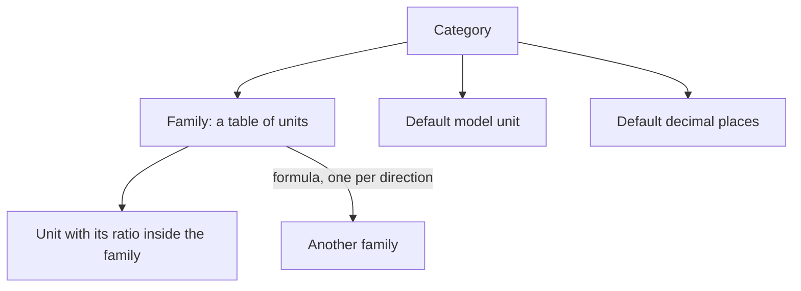
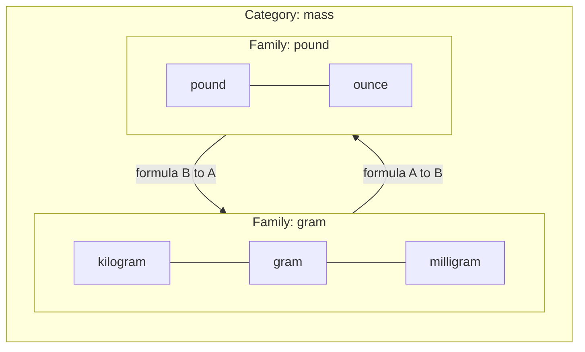
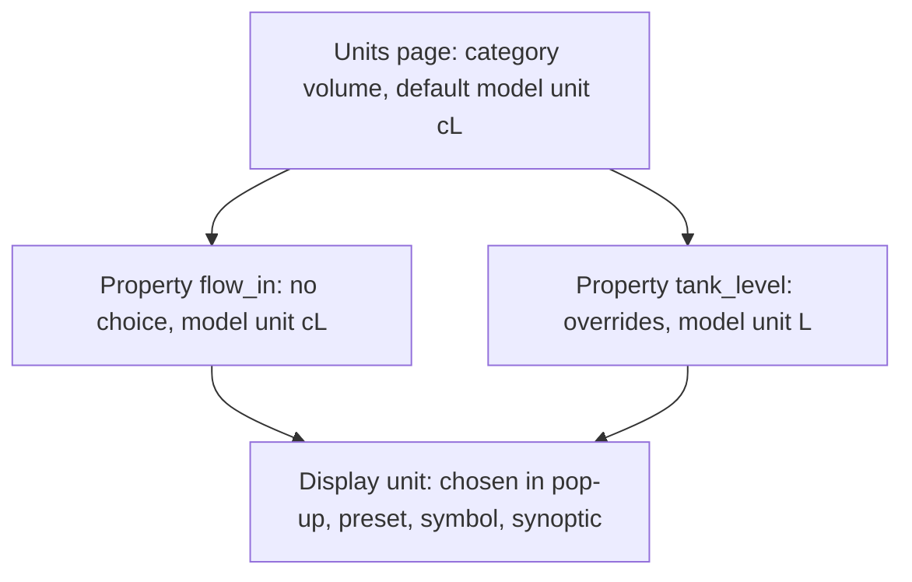
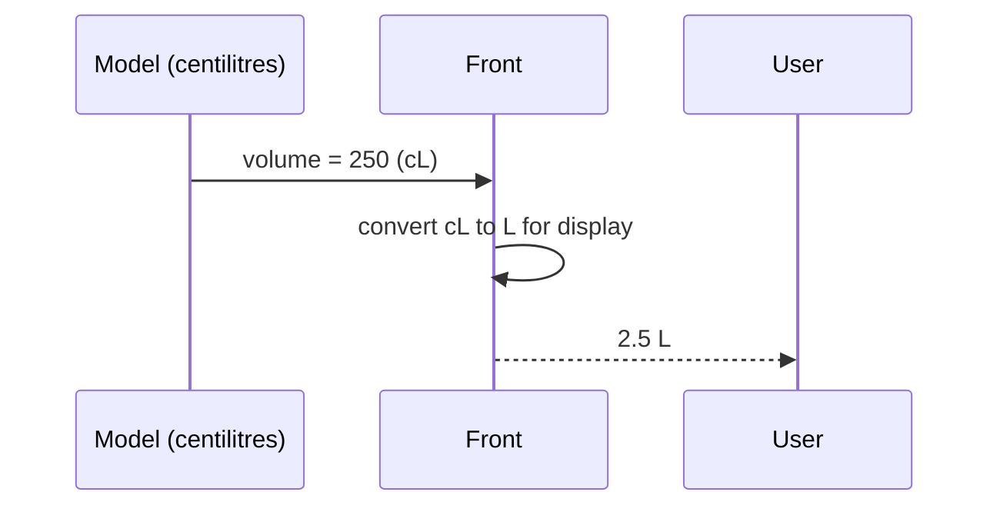
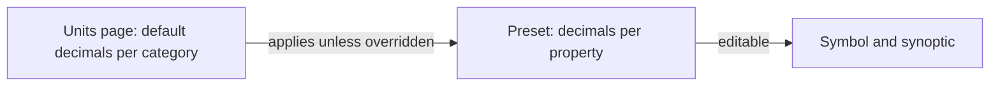

# Units

> [Home](../README.md) › [Metadata](README.md) › Units · Previous: [Properties](04-properties.md) · Next: [Enums](06-enums.md)

Status: draft, rules stated by the Product Owner on 2026-11-10. Nothing here is validated.

A Units page lists unit categories (mass, volume, flow, pressure...), created by the user.

## Rules

- A category holds one or more unit families.
- A family is a table of units, like the school ladder: kilogram, hectogram, decagram, gram, decigram, centigram, milligram. Each unit has its ratio to the others in the family.
- A category can hold several families. Example: category "mass" has the family "gram" (the metric ladder) and the family "pound" (pound, ounce...).
- Between two families, the user writes the mathematical formula to go from one to the other, one formula for each direction. Formulas are not limited to a factor, so cases like temperature are covered.

## Model unit and display unit

- The Units page gives each category a default model unit. Example: category "volume", default model unit centilitre.
- A property takes a category, not a unit: a property is "volume", not "m³/h". By default it uses the model unit of its category.
- A property can override it: in its definition, the user picks another unit of the same category as the model unit of that property. The model then handles this property in that unit.
- So the model unit is not one for all models: the category gives the default, the property can change it.
- A display unit is any unit of the same category, in any family. It is chosen in a pop-up, then in a preset, and can be edited in a symbol or a synoptic.
- The value is converted for display only. The model value stays the same.

## Conversions only inside a category

A conversion only exists between two units of the same category: kilograms to pounds, never kilograms to volts. A documentary research is planned to say which mathematical function is needed to make every conversion between units of the same physical family (it is one of the questions of the documentary research, see [Open questions](13-open-questions.md), "To do later").

## Decimal places

- Decimal places are the number of decimals shown for a value. They are a display matter only.
- The Units page gives a default number of decimals per category. It is the global setting: one choice, applied everywhere, which suits a company that wants the same display for all.
- The preset can override it for each property, next to its display unit (see [Presets](09-presets.md)). It keeps a minimum of flexibility.
- The symbol and the synoptic can edit it from the preset, like the display unit.

## Where it is used

| Thing | Created and changed in | Used in | In a symbol | In a synoptic |
| --- | --- | --- | --- | --- |
| Category, families, formulas, default model unit, default decimals | Units page | Property (category, model unit), pop-up and preset (display unit, decimals) | No | No |
| Display unit, decimal places | Pop-up, then preset in Metadata | Pop-up entry | Edit | Edit |
