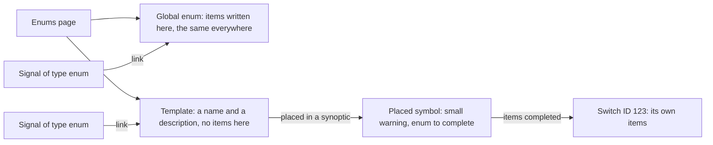
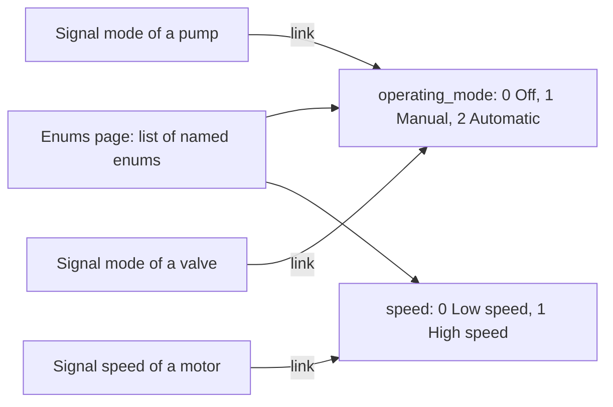
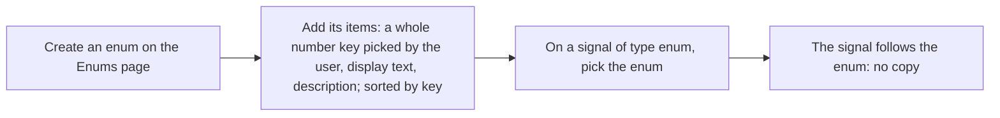

# Enums

> [Home](../README.md) › [Metadata](README.md) › Enums · Previous: [Units](05-units.md) · Next: [Commands](07-commands.md)

Status: validated by the Product Owner on 2026-11-11; changed by him on 2026-11-16 (keys always whole numbers; the + that creates an enum is an icon on the line of the title; delete with a button and a warning; at the end of the day, an optional description for each item, shown on the Enums page only); reviewed by him on 2026-11-17 (the display text before the description, no change of order of the items); changed by him later on 2026-11-17 (two kinds of enum: global and template, see [Global enums and templates](#global-enums-and-templates)); completed by him at the end of 2026-11-17 (the items of a template are completed on each placed symbol in the synoptic, with a warning until they are; a template has a description); changed by him again at the end of 2026-11-17 (the user picks the number of each key, gaps allowed; the items are sorted by key; the name "template" kept). Open points are listed in [Open questions](#open-questions).

An Enums page lists the enums of the application, like the Units page lists the quantities. A signal of the type enum does not hold its own list of values: it points to an enum of this page.

## Global enums and templates

Decided by the Product Owner on 2026-11-17. The Enums page holds **two kinds of enum**:

| Kind | What it is | Its items | Example |
| --- | --- | --- | --- |
| **Global** | An enum that is true everywhere: the same items for every symbol and every synoptic that uses it. | Written on the Enums page, as below. | `alarm_level`: "normalement, tu as la même alarm level partout". |
| **Template** | An enum that is not defined in advance: only its name and its description are made on the Enums page. Its items belong to **one placed symbol** and can change from one symbol to the next. | Not written on the Enums page: no keys, no display texts, no descriptions yet ("des displays qui ne sont pas encore faits, des descriptions qui ne sont pas encore faites"). | The positions of a switch: switch `ID 123` has its own list, another switch another one ("un commutateur, il a plusieurs sélections, mais ça change à chaque fois"). |

- Why (Product Owner): some enums are shared, others depend on the very object ("le pump mode, ça dépend des pompes potentiellement"). A template lets people work with an enum signal before its items exist ("comme ça, au moins, on se permet de travailler quand même avec les choses").
- **The user chooses the kind** when making an enum on the Enums page ("dans la page enum, il faut pouvoir créer des enums globaux et des templates").
- **A signal of the type enum points to a global enum or to a template**, picked in the same list ("pouvoir choisir dans la liste « enum unique » ou un truc du genre"). The Product Owner first said "enum unique", then "template". **The names "Global" and "Template" are kept** (Product Owner, end of 2026-11-17, on the wireframe: "ton truc template, là, je l'aime bien [...] Comment t'as géré ça : global ou template ? Ouais, c'est bien comme ça"), although the research found "template" taken in OPC UA and AutomationML in another sense.
- **A template has a name and a description** (Product Owner, end of 2026-11-17: "un peu comme les enums normaux, il faudrait, en plus du nom, pouvoir mettre une description qui explique un peu plus ce que c'est, en généralité, de l'enum"). The description says what the enum is about as a whole (for example "the positions of a switch"), since a template has no items to explain it. Plain text, never sent to the model, like the description of an item.
- **The items of a template are completed on each placed symbol, in the synoptic** (Product Owner, end of 2026-11-17: "quand on crée le synoptique, les symboles qu'on place contiennent des templates d'enum"). Switch `ID 123` gets its own keys, display texts and descriptions there. The synoptic, part 3, is not written yet: the screen where they are typed is described with it.
- **A placed symbol whose template is not completed shows a small warning**, an information that its enum must be completed (Product Owner: "c'est une sorte de petit warning ou d'information qui dit : « Oui, vous devez compléter son enum à lui »"). It does not stop the user from placing the symbol or working on: it only reminds that the enum is still empty (assistant's reading of "petit warning ou d'information" and of "on se permet de travailler quand même"). Where it is shown, and whether it is a warning or an information, is for part 3.
- **The screen must make the difference explicit**: a global enum is the same everywhere, a template changes with each symbol. How it is shown is not settled: the Product Owner asked the assistant to note it, not to explain it on the page itself ("il ne faut pas l'expliquer, mais toi, il faut que tu te le notes : il faudra trouver un moyen d'expliquer ça explicitement"). For the design system.
- A Symbol Lib can add its own columns to a template as to a global enum (see [Enums of a Symbol Lib](../symbols/11-enums-of-a-symbol-lib.md)).

## Rules

- An enum is a named list of items. **Each item is a pair: a key and a display text** (Product Owner, 2026-11-11, replacing the "value alone" rule written earlier the same day):
  - the **key** is what the model receives: **always a whole number** (Product Owner, 2026-11-16, replacing "a number or a string, chosen for the whole enum": "les enums, c'est tout le temps des entiers"); keys are unique in the enum;
  - **the user picks the number of each key**, with gaps if they want: an enum can have the keys 0, 2, 4 (Product Owner, end of 2026-11-17: "il faut pouvoir mettre le chiffre qu'on veut. Il faut laisser le choix de rajouter une ligne et de choisir son numéro [...] un enum où c'est 0, 2, 4"). The same for a global enum and for the items of a template ("que ce soit un template ou un enum");
  - the **description** explains what the item means, for the people who make the types and the symbols (Product Owner, 2026-11-16, end of the day: "il faut pouvoir décrire quand même ce que vaut l'enum [...] une description, c'est peut-être pas mal pour avoir des explications sur les enums"); plain text; it never goes to the model; **optional, and shown only on the Enums page**: the faceplate never shows it (Product Owner, 2026-11-16);
  - the **display text** is what people read: the faceplate, a text of a symbol and the test values show it, never the key.
- The items are shown in a table whose columns come in this order: **Key, Display text, Description**, then the delete button, with no header (Product Owner, 2026-11-17, reviewing the wireframes: "Faudrait peut-être inverser la description et le display name [...] le display name, il est assez court. La description, elle est plutôt grande, donc la description, elle irait après"). The short field first, the long one last. It replaces the order Key, Description, Display text of 2026-11-16 (decision 0032, accepted on 2026-11-17, which changes decision 0025 on this point).
- **The items are sorted by key automatically**, from the smallest key to the largest: a line added with the key 3 goes between 2 and 4 (Product Owner, end of 2026-11-17: "en fonction des chiffres qu'on met, il y ait un tri automatique pour que ça aille dans l'ordre quand même. Il ne faut pas déconner"). It replaces "a new item goes at the end" (assistant's reading of the same day).
- À trancher (Product Owner, end of 2026-11-17, said with a doubt): **handles to put the items in the order of their meaning**, without changing their keys ("tu mets des petites poignées pour bouger les numéros comme on veut. Comme ça, on peut le mettre dans l'ordre qu'on veut au niveau du sens"). Earlier the same day he had refused any handle ("On peut pas changer l'ordre, ça me chante pas"). The question matters because a key, once given, may not change: an item added later gets a free key, maybe not where its meaning puts it. Asked; until answered, no handle.
- À trancher (Product Owner, end of 2026-11-17, said with a doubt): **can a key change once it is given?** ("la clé, c'est la clé. Si elle était définie à un moment, elle ne peut pas forcément changer après. Donc, s'il y a des choses qui se rajoutent, c'est comme ça"). Changing a key is already breaking for the model (see below); what is open is whether the screen forbids it, or allows it and the [Versions](13-versions.md) page shows the break. Asked.
- No string keys (Product Owner, 2026-11-16). Why: every enum can be checked in one place, the Enums page, and the configuration files are generated from it; so the model never needs a readable key, and the display text is enough for people.
- When the user picks an item, the signal receives exactly its key.
- It is the pair (name, value) the research found in FMI, SSP and OPC UA.
- Enums are created and changed on the Enums page only, never inside a signal, a symbol or a synoptic. Exception since 2026-11-17: the items of a **template** are completed on each placed symbol, in the synoptic (see [Global enums and templates](#global-enums-and-templates)); the template itself, its name and its description, is made on the Enums page.
- Unlike the units, which are a read-only catalogue (see [Units](05-units.md#a-ready-made-catalogue-read-only)), enums are made by the user: each has its name, and the user builds its items (Product Owner, 2026-11-16: "Les enums, par contre, il faut pouvoir en créer").
- The button that creates an enum is a small **+ icon on the line of the title "Enums"**, on its right, above the list (Product Owner, 2026-11-16: "il faut qu'il soit au niveau des enums pour que ça fasse joli avec une icône", then, reviewing the wireframes: "ça doit être un petit +, une petite icône à côté du titre"). The same for the items: a small + on the right of the title "Items" (see the [layout rules](../screens/README.md#a-title-and-a-small--on-its-right)).
- A new enum goes into the list of the Enums page. The list can be filled in advance, before any signal uses it.
- An enum, or an item of an enum, is deleted with the delete button at the far right of its line, then a warning that asks to confirm; there is no right click in Metadata (Product Owner, 2026-11-16; see the [layout rules](../screens/README.md#delete-with-a-button-and-a-warning-in-metadata)).
- A signal of the type enum picks one enum of the list. It is a link to the existing enum, never a copy.
- Several signals can point to the same enum.
- Changing an enum changes it for every signal that points to it: that is the point of a link.
- The keys of an enum are part of the contract with the model (decided on 2026-11-11, from the research). Adding, removing or changing a key is breaking, like a rename: OPC UA's best-practices guide forbids it for a published enum. The model must follow. Changing a display text is not breaking: it never goes to the model.

The items of `operating_mode`:

| Key | Display text | Description |
| --- | --- | --- |
| 0 | Off | The pump is stopped and ignores the setpoint. |
| 1 | Manual | An operator drives the pump from its faceplate. |
| 2 | Automatic | The control loop drives the pump. |

| Enum | Items (key: display text) |
| --- | --- |
| `operating_mode` | 0: Off, 1: Manual, 2: Automatic |
| `speed` | 0: Low speed, 1: High speed |

## Steps

## Where it is used

| Thing | Created and changed in | Used in | In a symbol | In a synoptic |
| --- | --- | --- | --- | --- |
| Global enum, its items (key, display text, description) | Enums page | Signal: picks one as a link | Its columns added by the Symbol Lib, used by animations | No |
| Template (a name and a description, no items) | Enums page | Signal: picks one as a link | Its columns added by the Symbol Lib, used by animations | Its items, completed on each placed symbol; a small warning until they are |

The faceplate builder of a preset chooses how an enum is shown in the faceplate (radio on one line, radio on several lines, select), see [Presets](09-presets.md#mode-faceplate-the-faceplate-builder).

## Open questions

Raised at the end of 2026-11-17, with the keys picked by the user:

- Handles to put the items in the order of their meaning, besides the sort by key (see [Rules](#rules)).
- Can a key change once it is given, or is it fixed (see [Rules](#rules))?

Raised on 2026-11-17, when the templates were added:

- Does a global enum also get a description of the enum as a whole, like a template, besides the descriptions of its items?
- The warning of a placed symbol whose template is not completed: where it shows, whether it is a warning or an information, and whether a synoptic can be saved or used with it: for part 3.
- How the screen makes the difference between a global enum and a template explicit: for the design system.
- Can an enum change kind (global to template, or back) once signals point to it, and what breaks then?
- The keys of a template are part of the contract with the model for that placed symbol only: how are they written in the configuration files? To settle with [Storage](../storage/README.md).
