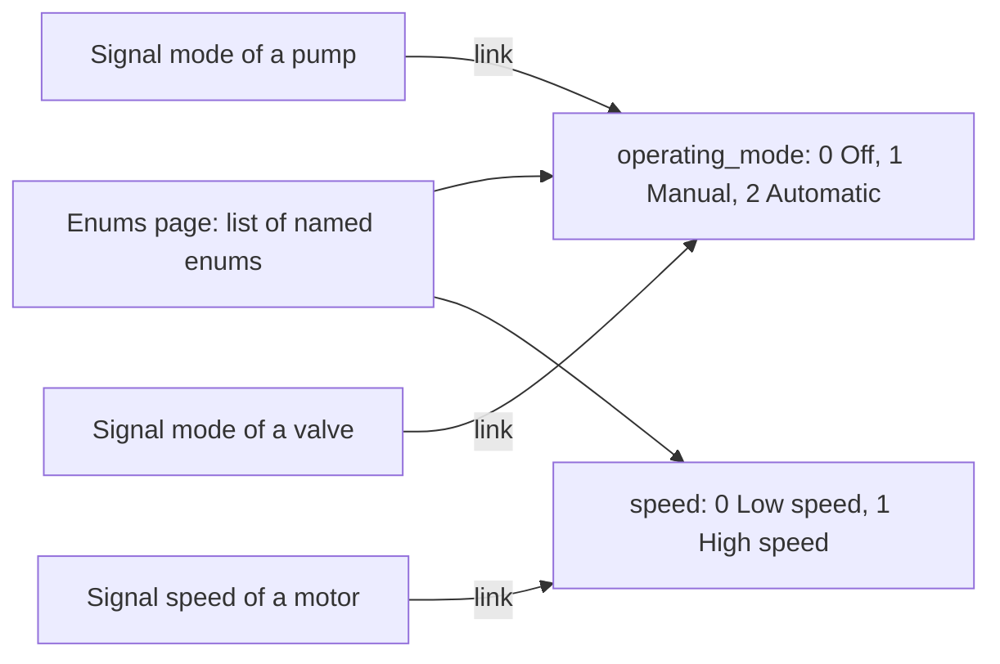
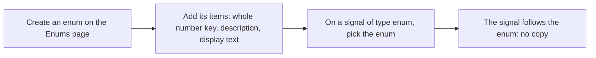

# Enums

> [Home](../README.md) › [Metadata](README.md) › Enums · Previous: [Units](05-units.md) · Next: [Commands](07-commands.md)

Status: validated by the Product Owner on 2026-11-11; changed by him on 2026-11-16 (keys always whole numbers; the + that creates an enum is an icon on the line of the title; delete with a button and a warning; at the end of the day, an optional description for each item, shown on the Enums page only). No question is open on this page.

An Enums page lists the enums of the application, like the Units page lists the quantities. A signal of the type enum does not hold its own list of values: it points to an enum of this page.

## Rules

- An enum is a named list of items. **Each item is a pair: a key and a display text** (Product Owner, 2026-11-11, replacing the "value alone" rule written earlier the same day):
  - the **key** is what the model receives: **always a whole number** (0, 1, 2...; Product Owner, 2026-11-16, replacing "a number or a string, chosen for the whole enum": "les enums, c'est tout le temps des entiers"); keys are unique in the enum;
  - the **description** explains what the item means, for the people who make the types and the symbols (Product Owner, 2026-11-16, end of the day: "il faut pouvoir décrire quand même ce que vaut l'enum [...] une description, c'est peut-être pas mal pour avoir des explications sur les enums"); plain text; it never goes to the model; **optional, and shown only on the Enums page**: the faceplate never shows it (Product Owner, 2026-11-16);
  - the **display text** is what people read: the faceplate, a text of a symbol and the test values show it, never the key.
- The items are shown in a table whose columns come in this order: **Key, Description, Display text** (Product Owner, 2026-11-16: "il faudrait la key, après une description, et après le display text"; decision 0025, accepted on 2026-11-16, which completes decision 0009), then the delete button, with no header.
- No string keys (Product Owner, 2026-11-16). Why: every enum can be checked in one place, the Enums page, and the configuration files are generated from it; so the model never needs a readable key, and the display text is enough for people.
- When the user picks an item, the signal receives exactly its key.
- It is the pair (name, value) the research found in FMI, SSP and OPC UA.
- Enums are created and changed on the Enums page only, never inside a signal, a symbol or a synoptic.
- Unlike the units, which are a read-only catalogue (see [Units](05-units.md#a-ready-made-catalogue-read-only)), enums are made by the user: each has its name, and the user builds its items (Product Owner, 2026-11-16: "Les enums, par contre, il faut pouvoir en créer").
- The button that creates an enum is a small **+ icon on the line of the title "Enums"**, on its right, above the list (Product Owner, 2026-11-16: "il faut qu'il soit au niveau des enums pour que ça fasse joli avec une icône", then, reviewing the wireframes: "ça doit être un petit +, une petite icône à côté du titre"). The same for the items: a small + on the right of the title "Items" (see the [layout rules](../screens/README.md#a-title-and-a-small--on-its-right)).
- A new enum goes into the list of the Enums page. The list can be filled in advance, before any signal uses it.
- An enum, or an item of an enum, is deleted with the delete button at the far right of its line, then a warning that asks to confirm; there is no right click in Metadata (Product Owner, 2026-11-16; see the [layout rules](../screens/README.md#delete-with-a-button-and-a-warning-in-metadata)).
- A signal of the type enum picks one enum of the list. It is a link to the existing enum, never a copy.
- Several signals can point to the same enum.
- Changing an enum changes it for every signal that points to it: that is the point of a link.
- The keys of an enum are part of the contract with the model (decided on 2026-11-11, from the research). Adding, removing or changing a key is breaking, like a rename: OPC UA's best-practices guide forbids it for a published enum. The model must follow. Changing a display text is not breaking: it never goes to the model.

The items of `operating_mode`:

| Key | Description | Display text |
| --- | --- | --- |
| 0 | The pump is stopped and ignores the setpoint. | Off |
| 1 | An operator drives the pump from its faceplate. | Manual |
| 2 | The control loop drives the pump. | Automatic |

| Enum | Items (key: display text) |
| --- | --- |
| `operating_mode` | 0: Off, 1: Manual, 2: Automatic |
| `speed` | 0: Low speed, 1: High speed |

## Steps

## Where it is used

| Thing | Created and changed in | Used in | In a symbol | In a synoptic |
| --- | --- | --- | --- | --- |
| Enum, its items (key, description, display text) | Enums page | Signal: picks one as a link | No | No |

The faceplate builder of a preset chooses how an enum is shown in the faceplate (radio on one line, radio on several lines, select), see [Presets](09-presets.md#mode-faceplate-the-faceplate-builder).
