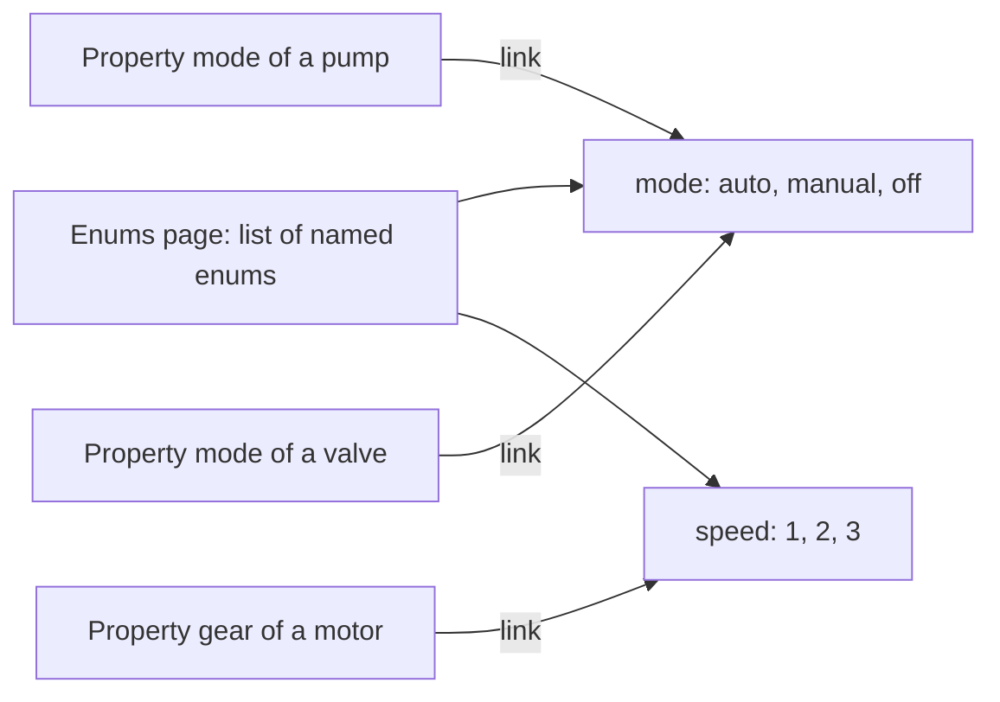
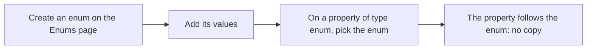

# Enums

> [Home](../README.md) › [Metadata](README.md) › Enums · Previous: [Units](05-units.md) · Next: [Commands](07-commands.md)

Status: draft, rules stated by the Product Owner on 2026-11-10. Nothing here is validated.

An Enums page lists the enums of the application, like the Units page lists the unit categories. A property of the type enum does not hold its own list of values: it points to an enum of this page.

## Rules

- An enum is a named list of values: a list of numbers or a list of strings.
- Enums are created and changed on the Enums page only, never inside a property, a symbol or a synoptic.
- A new enum goes into the list of the Enums page. The list can be filled in advance, before any property uses it.
- A property of the type enum picks one enum of the list. It is a link to the existing enum, never a copy.
- Several properties can point to the same enum.
- Changing an enum changes it for every property that points to it: that is the point of a link.

## Steps

## Where it is used

| Thing | Created and changed in | Used in | In a symbol | In a synoptic |
| --- | --- | --- | --- | --- |
| Enum, its values | Enums page | Property: picks one as a link | No | No |

The pop-up chooses how an enum is shown (radio on one line, radio on several lines, select...), see [Pop-ups](08-popups.md).
