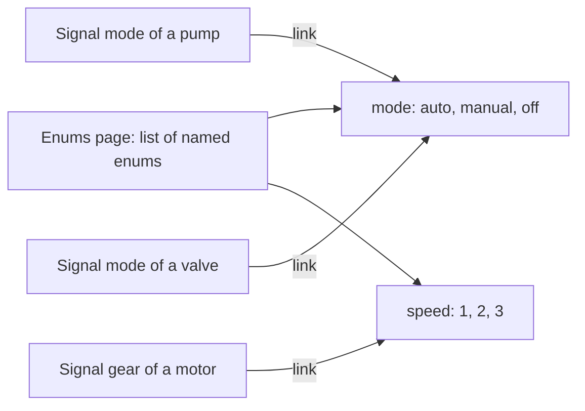
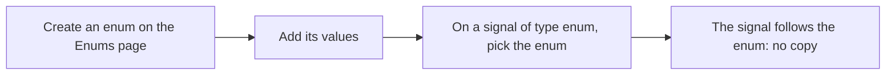

# Enums

> [Home](../README.md) › [Metadata](README.md) › Enums · Previous: [Units](05-units.md) · Next: [Commands](07-commands.md)

Status: validated by the Product Owner on 2026-11-11. Open points are listed in [Open questions](12-open-questions.md).

An Enums page lists the enums of the application, like the Units page lists the quantities. A signal of the type enum does not hold its own list of values: it points to an enum of this page.

## Rules

- An enum is a named list of values: a list of numbers or a list of strings. An item is a value alone, with no separate readable name (decided by the Product Owner on 2026-11-11): when the user picks an item, the signal receives exactly that value, and the value is what the faceplate shows. Values are unique in the enum. The research found that FMI, SSP and OPC UA use a pair (name, value); the project chooses not to.
- Enums are created and changed on the Enums page only, never inside a signal, a symbol or a synoptic.
- A new enum goes into the list of the Enums page. The list can be filled in advance, before any signal uses it.
- A signal of the type enum picks one enum of the list. It is a link to the existing enum, never a copy.
- Several signals can point to the same enum.
- Changing an enum changes it for every signal that points to it: that is the point of a link.
- The values of an enum are part of the contract with the model (decided on 2026-11-11, from the research). Adding, removing or changing a value is breaking, like a rename: OPC UA's best-practices guide forbids it for a published enum. The model must follow.

## Steps

## Where it is used

| Thing | Created and changed in | Used in | In a symbol | In a synoptic |
| --- | --- | --- | --- | --- |
| Enum, its values | Enums page | Signal: picks one as a link | No | No |

The faceplate chooses how an enum is shown (radio on one line, radio on several lines, select...), see [Faceplates](08-faceplates.md).
