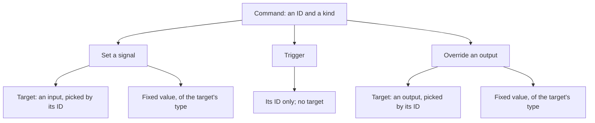
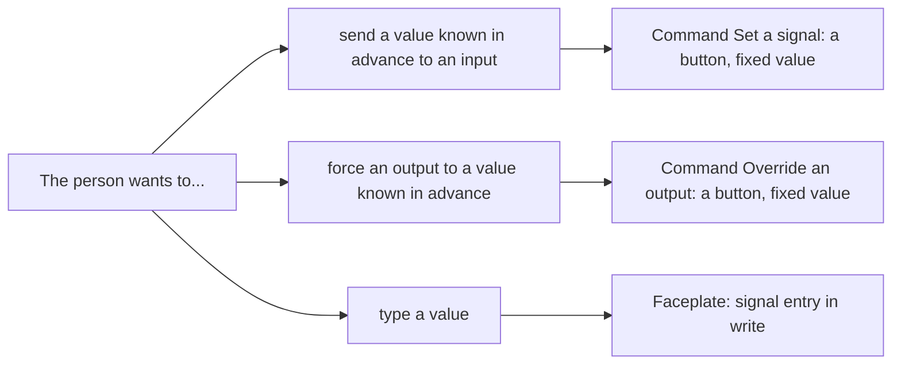
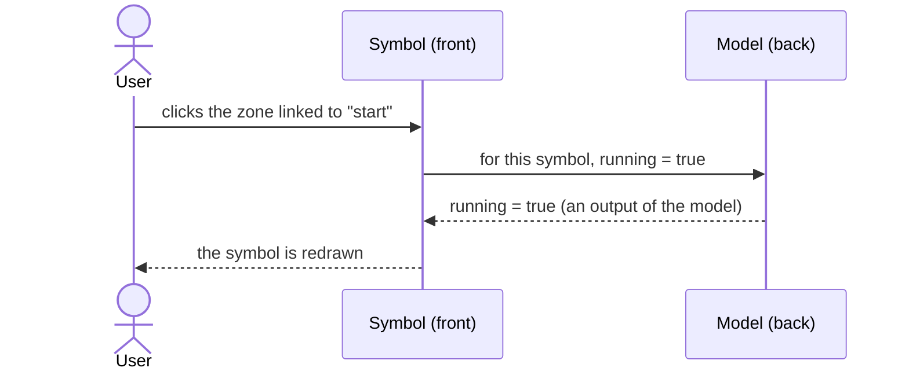

# Commands

> [Home](../README.md) › [Metadata](README.md) › Commands · Previous: [Enums](06-enums.md) · Next: [Presets](09-presets.md)

Status: validated by the Product Owner on 2026-11-11; changed by him on 2026-11-16 (a command always sends a fixed value; commands shown in a table, always editable; three kinds: set a signal, trigger, override an output; an ID instead of a name; decision 0019, accepted on 2026-11-16, which completes decision 0014; a handle on each line to choose the order). Reviewing the wireframes later that day, he confirmed the three kinds and the ID, asked for an example with every option, and replaced the delete by right click by a delete button with a warning; the inherited commands come first, like the inherited signals. Open points are listed in [Open questions](12-open-questions.md).

A command is how the front acts with one click. Three kinds, kept apart because they do not say the same thing (Product Owner, 2026-11-16: "envoyer à une entrée, à un output, ou faire un trigger").

| Kind | Meaning | What the user edits |
| --- | --- | --- |
| Set a signal | "This input must take this value". | Its ID, the signal targeted (an input of the model, picked by its ID in the list of signals), and the value sent, fixed in Metadata. |
| Trigger | "This happened, deal with it". | Its ID only, defined by the user. It targets nothing: the model decides what to do. |
| Override an output | "I want this output to show this value instead of the model's". | Its ID, the signal targeted (an output of the model, picked by its ID in the list of signals), and the value, fixed in Metadata. |

A command has an **ID** and a kind (Product Owner, 2026-11-16: the column is called ID, as for the signals, never "name").

## Rules

- Commands are created and changed in Metadata only.
- The table of commands is always editable, with no Edit or Save step, as the signals (Product Owner, 2026-11-16). The changes are checked on the [Versions](13-versions.md) page before a version is made.
- A command also has an internal identifier, set by the software, that never changes, like a type's (see [Types](01-types.md)). It exists on the application side only and never goes to the model. Symbols link to a command through it, so changing a command's ID does not break them (see [Libraries and symbols](../symbols/01-libraries-and-symbols.md)).
- In a symbol, direct commands: the user links a command from Metadata to a click on a part of the symbol.
- On the front, a command is a button: the user clicks it, and that is all.
- **"Set a signal" targets an input of the model only** (Product Owner, 2026-11-16): sending a value to an output "n'a pas trop de sens", since the model computes it. Its target list shows the inputs only.
- **"Override an output" targets an output only**, picked in the list of signals by its ID, the same way (Product Owner, 2026-11-16). It is "une mécanique complètement différente" from sending a value to an input: it does not ask the model to compute anything, it says the value of an output is to be overridden.
- A preset does not choose commands: all the commands of a type stay available. The symbol says which it uses. The faceplate builder of a preset only places the commands that have a button in the faceplate, and gives that button its text (see [Presets](09-presets.md#mode-faceplate-the-faceplate-builder)). Commands are not in the table of values of a preset: they have no value to set there.

## The value is always fixed

Decided by the Product Owner on 2026-11-16. It replaces the "typed value" of 2026-11-11 (a command whose value the person types).

- A command is a click, nothing more. Its value is set once in Metadata and stays fixed: the person who clicks never types it.
- So there is no choice between "fixed" and "typed" any more.
- The value follows the type of the target signal, for "Set a signal" and for "Override an output":

| Type of the target signal | Fixed value written in Metadata |
| --- | --- |
| Integer, real | A number, typed. |
| Boolean | True or false. |
| Text | A text, typed. |
| Enum | An item of the enum, picked by its display text; the model receives its key. |

- To let a person **type a value**, a command is not used: a signal of the preset is set to **write**, which puts an input in the faceplate (see [Presets](09-presets.md#typing-a-value)). The person types the value there; it is checked, converted and sent to the model.

Example: the command `start`, when the user clicks a zone of the symbol, sets the signal `running` to `true`.

## The table of commands

The commands of a type are shown in **one table**, like the signals (Product Owner, 2026-11-16): one line per command, the kind in the first column.

| Column | Values |
| --- | --- |
| Handle | A small grip at the very left of the line, with no value: it is held and dragged to move the line. |
| Kind | Set a signal, Trigger, or Override an output. First column of values. |
| ID | The command's identifier (Product Owner, 2026-11-16: "comme dans les signaux, il vaut mieux mettre l'ID"). |
| Target signal | For "Set a signal": an input, picked by its ID. For "Override an output": an output, picked by its ID. Empty for a trigger. |
| Value | For "Set a signal" and "Override an output": the fixed value, of the target signal's type. Empty for a trigger. |

| Delete | A delete button (an icon), in the last column, on the far right; a click opens a warning before anything is deleted (Product Owner, 2026-11-16). Not on the inherited lines. |

- A trigger leaves the target and the value empty.
- The button that adds a command sits above the table (see the [layout rules](../screens/README.md#add-buttons-above-the-list)).
- A command is deleted with the delete button of its line, then a warning that asks to confirm; there is no right click in Metadata (Product Owner, 2026-11-16; see the [layout rules](../screens/README.md#delete-with-a-button-and-a-warning-in-metadata)).
- **The inherited commands come first, read only**, from the first parent at the top of the tree down to the type's own commands, as for the signals (Product Owner, 2026-11-16, said for the signals; the commands are inherited the same way; see [The table of signals](04-signals.md#the-table-of-signals)).
- **The user chooses the order of the type's own commands** with the handle at the left of each line, the same way as for the signals (Product Owner, 2026-11-16: "pouvoir trier l'ordre dans les tableaux"). The order is kept, a new command goes at the end, and a change of order is a patch on the [Versions](13-versions.md) page. See [The order of the lines](04-signals.md#the-order-of-the-lines). The faceplate places its command buttons in the order of its builder (see [Presets](09-presets.md#mode-faceplate-the-faceplate-builder)).

### Example

The commands of `centrifugal_pump`, with every kind and every type of value (Product Owner, 2026-11-16: "complète le tableau des commandes avec le + d'options"). The signals are those of the [example of Signals](04-signals.md#example).

| From | Kind | ID | Target signal | Value |
| --- | --- | --- | --- | --- |
| `equipment`, read only | Override an output | `clear_message` | `fault_message` (text output) | "" (empty text) |
| `pump`, read only | Set a signal | `start` | `running` (boolean input) | true |
| `pump`, read only | Set a signal | `stop` | `running` (boolean input) | false |
| `pump`, read only | Override an output | `force_flow_zero` | `flow` (real output) | 0 |
| own | Set a signal | `auto_mode` | `mode` (enum input) | Automatic (key 2) |
| own | Set a signal | `nominal_speed` | `speed_setpoint` (integer input) | 1450 |
| own | Trigger | `reset_fault` |  |  |
| own | Trigger | `request_maintenance` |  |  |

## Where it is used

| Thing | Created and changed in | Used in | In a symbol | In a synoptic |
| --- | --- | --- | --- | --- |
| Command (set a signal, trigger, override an output) | Metadata | Button of the faceplate (ticked in the preset), click on a part of a symbol | Link a command to a click | No |

## A text that becomes an input does not use a command

A text of a symbol that becomes an input when clicked writes an **input signal** of the type directly, with the same checks as a write entry of the faceplate (bounds, conversion from the display unit, enum item). No command is used (Product Owner, 2026-11-16, accepting the assistant's proposal). See [Animation mode](../symbols/08-animation-mode/README.md#a-text-that-becomes-an-input).

## Open questions

- Override an output: who applies the override (the model, the server, the front), what the model and the other screens see while it holds, and how it ends (a second click, a command that lifts it, a time limit)? If the answer is the server, it must be checked against decision 0001 (proposed): the server only communicates with files.
