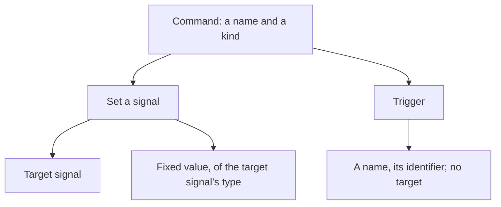
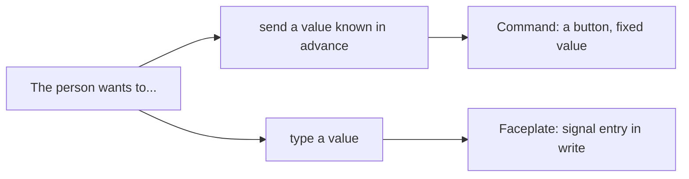
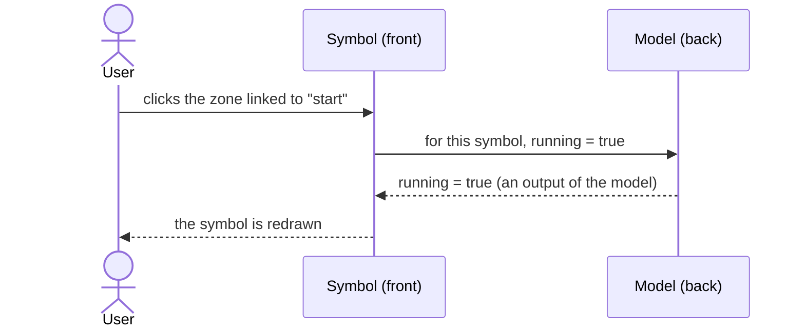

# Commands

> [Home](../README.md) › [Metadata](README.md) › Commands · Previous: [Enums](06-enums.md) · Next: [Faceplates](08-faceplates.md)

Status: validated by the Product Owner on 2026-11-11; changed by him on 2026-11-16 (a command always sends a fixed value; commands shown in a table). Open points are listed in [Open questions](12-open-questions.md).

A command is how the front acts on the model with one click. Two kinds, kept apart because they do not say the same thing.

| Kind | Meaning | What the user edits |
| --- | --- | --- |
| Set a signal | "This signal must take this value". | The signal targeted, and the value sent, fixed in Metadata. |
| Trigger | "This happened, deal with it". | Its name only, which is its identifier. It targets nothing: the model decides what to do. |

A command has a name and a kind (Product Owner, 2026-11-11).

## Rules

- Commands are created and changed in Metadata only.
- A command also has an internal identifier, set by the software, that never changes, like a type's (see [Types](01-types.md)). It exists on the application side only and never goes to the model. Symbols link to a command through it, so renaming a command does not break them (see [Libraries and symbols](../symbols/01-libraries-and-symbols.md)).
- In a symbol, direct commands: the user links a command from Metadata to a click on a part of the symbol.
- On the front, a command is a button: the user clicks it, and that is all.
- A preset does not choose commands: all the commands of a type stay available. The symbol says which it uses.

## The value is always fixed

Decided by the Product Owner on 2026-11-16. It replaces the "typed value" of 2026-11-11 (a command whose value the person types).

- A command is a click, nothing more. Its value is set once in Metadata and stays fixed: the person who clicks never types it.
- So there is no choice between "fixed" and "typed" any more.
- The value follows the type of the target signal:

| Type of the target signal | Fixed value written in Metadata |
| --- | --- |
| Integer, real | A number, typed. |
| Boolean | True or false. |
| Text | A text, typed. |
| Enum | An item of the enum, picked by its display text; the model receives its key. |

- To let a person **type a value**, a command is not used: a signal entry of the faceplate is set to **write** (see [Faceplates](08-faceplates.md)). The person types the value there; it is checked, converted and sent to the model.

Example: the command `start`, when the user clicks a zone of the symbol, sets the signal `running` to `true`.

## The table of commands

The commands of a type are shown in **one table**, like the signals (Product Owner, 2026-11-16): one line per command, the kind in the first column.

| Column | Values |
| --- | --- |
| Kind | Set a signal, or Trigger. |
| Name | The command's identifier. |
| Target signal | For "Set a signal" only. |
| Value | For "Set a signal" only: the fixed value, of the target signal's type. |

- A trigger leaves the target and the value empty.
- The button that adds a command sits above the table; a command is deleted by a right click on its line (see [Signals](04-signals.md#the-table-of-signals) and the [layout rules](../screens/README.md#add-buttons-above-the-list)).

## Where it is used

| Thing | Created and changed in | Used in | In a symbol | In a synoptic |
| --- | --- | --- | --- | --- |
| Command (set a signal, trigger) | Metadata | Faceplate entry, click on a part of a symbol | Link a command to a click | No |

## Open questions

- A text of a symbol that becomes an input when clicked was tied to a typed-value command, which no longer exists. What does it write now? See [Animation mode](../symbols/08-animation-mode/README.md#a-text-that-becomes-an-input).
- Can a command target a signal of any direction, or only an input?
