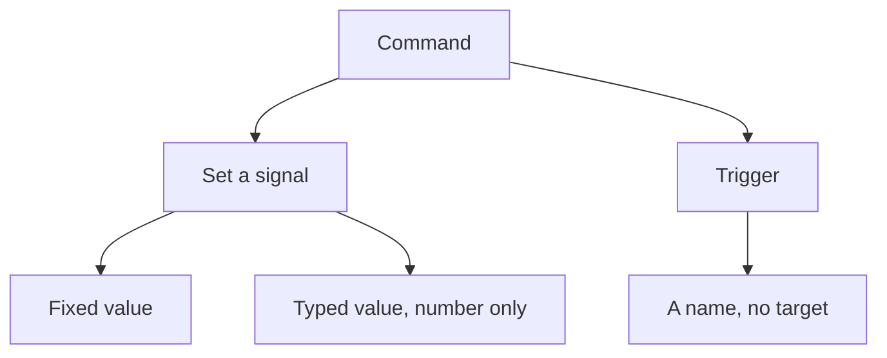
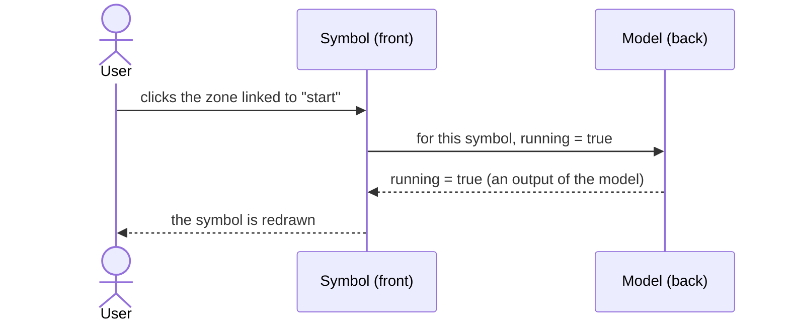
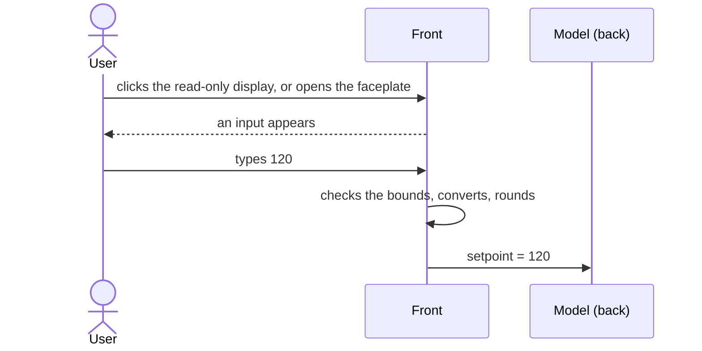

# Commands

> [Home](../README.md) › [Metadata](README.md) › Commands · Previous: [Enums](06-enums.md) · Next: [Faceplates](08-faceplates.md)

Status: validated by the Product Owner on 2026-11-11. Open points are listed in [Open questions](12-open-questions.md).

A command is how the front acts on the model. Two kinds, kept apart because they do not say the same thing.

| Kind | Meaning | What the user edits |
| --- | --- | --- |
| Set a signal | "This signal must take this value". | The signal targeted, and how the value is given: fixed (set in Metadata) or typed (see below). |
| Trigger | "This happened, deal with it". | Its name only. It targets nothing: the model decides what to do. |

## Rules

- Commands are created and changed in Metadata only.
- In a symbol, direct commands: the user links a command from Metadata to a click on a part of the symbol.
- On the web front, a command is a button, except a typed-value command, which has two ways to take its value (see below).
- A preset does not choose commands: all the commands of a type stay available. The symbol says which it uses.

## Set a signal, fixed value

Example: the command `start`, when the user clicks a zone of the symbol, sets the signal `running` to `true`. The user edits the value sent.

## Set a signal, typed value

On a number signal, the person types the value to send, instead of a fixed one. Two ways to give it, both allowed (decided by the Product Owner on 2026-11-11), on the web and on the desktop:

| Way | What the user sees | Where it lives |
| --- | --- | --- |
| Display that becomes an input | A read-only display of the value. A click on it turns it into an input, placed right there with an SVG foreignObject (a form element inside the SVG of the symbol). | On the symbol. |
| Faceplate | The input sits in the faceplate, which opens as a panel. | In the faceplate (see [Faceplates](08-faceplates.md)). |

A typed-value command can use either way or both. It is not necessarily tied to a click on a part of the symbol. The typed value follows the same checks as any typed value: bounds, conversion back to the model unit and rounding (see [Faceplates](08-faceplates.md) and [Units](05-units.md)).

## Where it is used

| Thing | Created and changed in | Used in | In a symbol | In a synoptic |
| --- | --- | --- | --- | --- |
| Command (set a signal, trigger) | Metadata | Faceplate entry, click on a part of a symbol | Link a command to a click | No |
