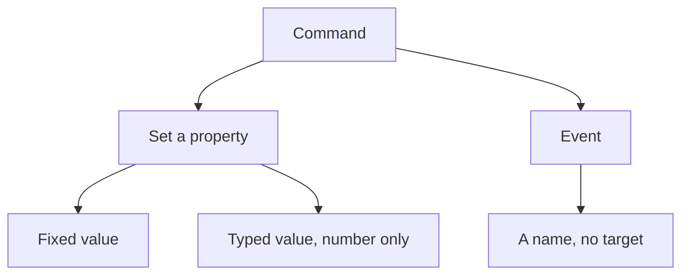
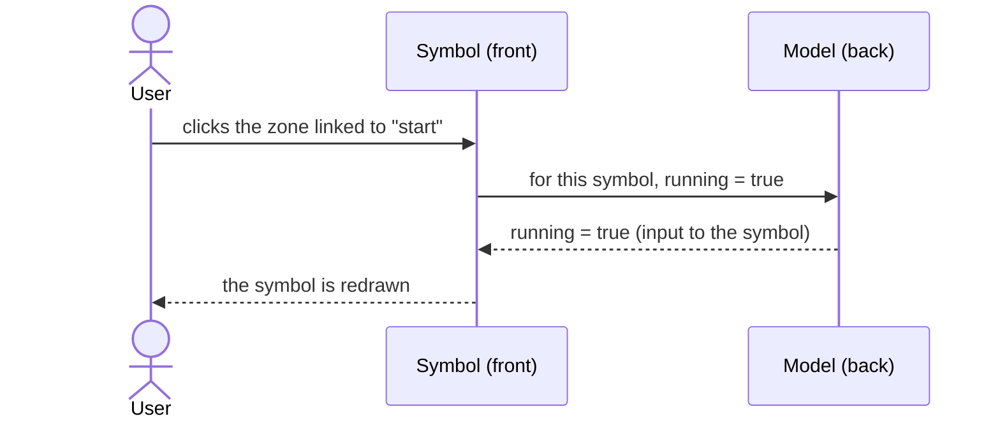
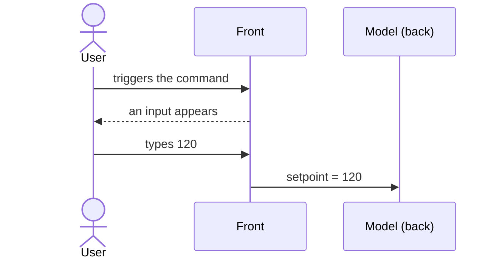

# Commands

> [Home](../README.md) › [Metadata](README.md) › Commands · Previous: [Enums](06-enums.md) · Next: [Pop-ups](08-popups.md)

Status: draft, rules stated by the Product Owner on 2026-11-10. Nothing here is validated.

A command is how the front acts on the model. Two kinds, kept apart because they do not say the same thing.

| Kind | Meaning | What the user edits |
| --- | --- | --- |
| Set a property | "This property must take this value". | The property targeted, and how the value is given: fixed (set in Metadata) or typed (see below). |
| Event | "This happened, deal with it". | Its name only. It targets nothing: the model decides what to do. |

## Rules

- Commands are created and changed in Metadata only.
- In a symbol, direct commands: the user links a command from Metadata to a click on a part of the symbol.
- On the web front, a command is a button and nothing else (to check against the typed-value command below).
- A preset does not choose commands: all the commands of a type stay available. The symbol says which it uses.

## Set a property, fixed value

Example: the command `start`, when the user clicks a zone of the symbol, sets the property `running` to `true`. The user edits the value sent.

## Set a property, typed value

On a number property, an input appears and the person types the value to send, instead of a fixed one. Such a command is not necessarily tied to a click on the symbol: it can also live in a pop-up.

## Where it is used

| Thing | Created and changed in | Used in | In a symbol | In a synoptic |
| --- | --- | --- | --- | --- |
| Command (set a property, event) | Metadata | Pop-up entry, click on a part of a symbol | Link a command to a click | No |

## Open questions

- On the web, what does a typed-value command do? Proposal: a button that opens a small input. It is also listed in [Open questions](13-open-questions.md).
