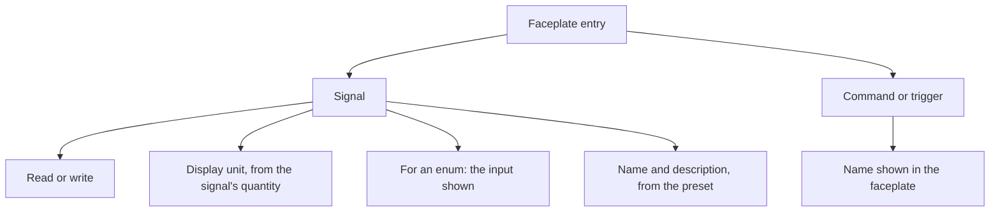
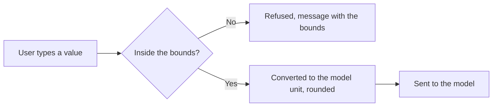
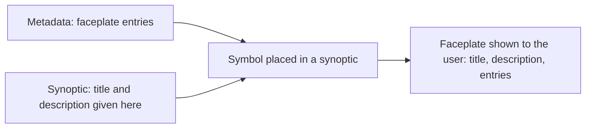

# Faceplates

> [Home](../README.md) › [Metadata](README.md) › Faceplates · Previous: [Commands](07-commands.md) · Next: [Presets](09-presets.md)

Status: validated by the Product Owner on 2026-11-11. Open points are listed in [Open questions](12-open-questions.md).

A faceplate is a panel built in Metadata. It is the front side of a type: what the user sees and can act on. "Faceplate" is the standard word of supervision software for this object.

## Rules

### An entry

For each signal entry, the user:

- picks the signal to show;
- sets read or write;
- picks the display unit, among the units of the signal's quantity;
- for an enum, picks the input shown, in read and in write: radio on one line, radio on several lines, select, and so on.

For each command or trigger entry, the user adds it and gives it the name shown in the faceplate.

### Name and description of a signal: set in the preset

- The faceplate does not show the signal's name, which is an identifier for the model and reads badly. It shows a name and a description written for people.
- They are set in the preset, for each signal (see [Presets](09-presets.md)), and can be edited in a symbol and in a synoptic, like the display unit.
- Both are plain text, no Markdown. Line breaks are kept in the description.
- Until a name is written, the faceplate shows the signal's name.
- They only change what the faceplate shows. They never go to the model.

### Typing a value

- When the user types a value in a write entry, the faceplate checks it against the bounds of the signal. The bounds are written in the model unit and are shown in the display unit.
- A value outside the bounds is refused, with a message that says the bounds. Nothing is sent to the model.
- An integer signal accepts whole numbers only. An enum signal accepts only the values of its enum.
- A value that passes is converted back to the model unit and rounded to 12 significant digits before it goes to the model (see [Units](05-units.md)).

### Ticking entries

- The faceplate is saved in a preset, with the entries shown by default (see [Presets](09-presets.md)).
- In a symbol and in a synoptic, the full list of entries is always there and the user can tick or untick each one.
- This changes the display only, never the model's inputs and outputs.
- In a synoptic, only the faceplate can be edited. A command that is not wanted means a new symbol, because the symbol shows something extra.

### Title and description of the faceplate: given in the synoptic, not in Metadata

- A faceplate can show a title and, possibly, a description.
- They are not defined in Metadata: they are not part of a type, a faceplate or a preset.
- They are given in the synoptic, on each symbol the user places. The same symbol placed twice can have two different titles.
- They only change what the faceplate shows. They never go to the model.
- A synoptic can therefore edit more than the ticking of entries: it also sets the title and the description of the faceplate of each placed symbol.
- The description is plain text only: no Markdown, no formatting, no links. Line breaks are kept. This keeps the faceplate light.

## Example

| Entry | Kind | Mode | Display unit | Input |
| --- | --- | --- | --- | --- |
| `flow` | signal | read | m³/h | none |
| `mode` | signal, enum | write | none | select |
| `start` | command | button | none | none |
| `stopped` | trigger | button | none | none |

## Where it is used

| Thing | Created and changed in | Used in | In a symbol | In a synoptic |
| --- | --- | --- | --- | --- |
| Faceplate and its entries | Metadata | Preset (saved with entries shown by default) | Tick or untick entries | Tick or untick entries |
| Name and description of a signal | Preset, in Metadata | The faceplate of the symbol or synoptic | Edit | Edit |
| Faceplate title and description | Synoptic, on each placed symbol | The faceplate of that symbol | No | Write them |
