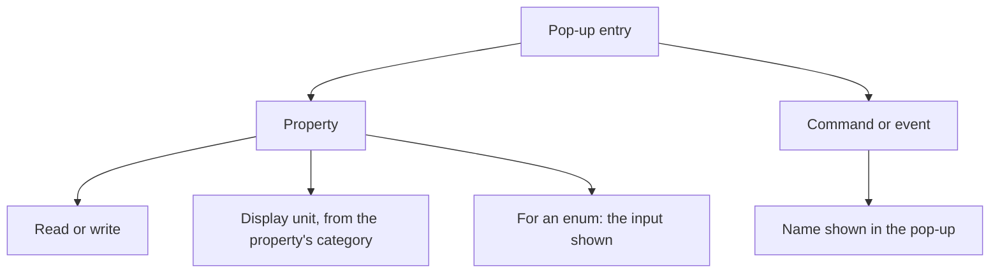
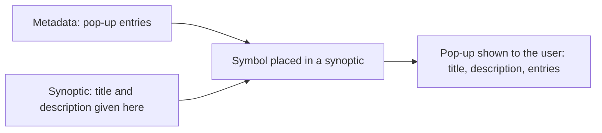

# Pop-ups

> [Home](../README.md) › [Metadata](README.md) › Pop-ups · Previous: [Commands](07-commands.md) · Next: [Presets](09-presets.md)

Status: draft, rules stated by the Product Owner on 2026-11-10. Nothing here is validated.

A pop-up is a panel built in Metadata. It is the front side of a type: what the user sees and can act on.

## Rules

### An entry

For each property entry, the user:

- picks the property to show;
- sets read or write;
- picks the display unit, among the units of the property's category;
- for an enum, picks the input shown, in read and in write: radio on one line, radio on several lines, select, and so on.

For each command or event entry, the user adds it and gives it the name shown in the pop-up.

### Ticking entries

- The pop-up is saved in a preset, with the entries shown by default (see [Presets](09-presets.md)).
- In a symbol and in a synoptic, the full list of entries is always there and the user can tick or untick each one.
- This changes the display only, never the model's inputs and outputs.
- In a synoptic, only the pop-up can be edited. A command that is not wanted means a new symbol, because the symbol shows something extra.

### Title and description: given in the synoptic, not in Metadata

- A pop-up can show a title and, possibly, a description.
- They are not defined in Metadata: they are not part of a type, a pop-up or a preset.
- They are given in the synoptic, on each symbol the user places. The same symbol placed twice can have two different titles.
- They only change what the pop-up shows. They never go to the model.
- A synoptic can therefore edit more than the ticking of entries: it also sets the title and the description of the pop-up of each placed symbol.
- The description is plain text only: no Markdown, no formatting, no links. Line breaks are kept. This keeps the pop-up light.

## Example

| Entry | Kind | Mode | Display unit | Input |
| --- | --- | --- | --- | --- |
| `flow` | property | read | m³/h | none |
| `mode` | property, enum | write | none | select |
| `start` | command | button | none | none |
| `stopped` | event | button | none | none |

## Where it is used

| Thing | Created and changed in | Used in | In a symbol | In a synoptic |
| --- | --- | --- | --- | --- |
| Pop-up and its entries | Metadata | Preset (saved with entries shown by default) | Tick or untick entries | Tick or untick entries |
| Pop-up title and description | Synoptic, on each placed symbol | The pop-up of that symbol | No | Write them |
