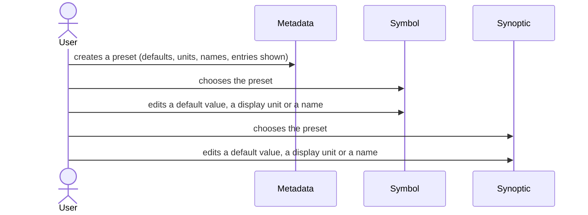
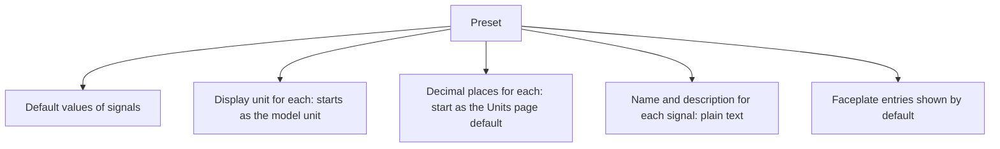

# Presets

> [Home](../README.md) › [Metadata](README.md) › Presets · Previous: [Faceplates](08-faceplates.md) · Next: [Libraries](10-libraries.md)

Status: validated by the Product Owner on 2026-11-11. Open points are listed in [Open questions](12-open-questions.md).

A preset is made under a type (example: pneumatic positive displacement pump). It saves a faceplate with its defaults, so that a symbol or a synoptic starts well configured. It stays simple: defaults, nothing more.

## Rules

- A type needs at least one preset to be chosen in a symbol or a synoptic. No preset is created automatically. If no preset fits, the user creates one in Metadata.
- Unticked faceplate entries are only unticked at the start, to save time. In a symbol or a synoptic the full list is still there and the user can tick them by hand.
- A preset does not choose commands: all the commands of the type stay available. The symbol says which it uses.
- Default values, display units, decimal places, and the name and description of each signal are first set in the preset, in Metadata.
- The name and the description of a signal are what the faceplate shows instead of the signal's name, which is an identifier for the model. Both are plain text. If no name is written, the faceplate shows the signal's name.
- Default display unit: the unit the model uses for the signal (its model unit). If the model works in litres, the preset starts with litres. The user changes it in the preset only when another unit is wanted.
- Decimal places: they start from the number set for the quantity on the Units page (see [Units](05-units.md)). The preset overrides it only if needed.
- Decimal places never go to the model: they are display only. The display unit does not change the model value either, and nor do the name and the description.
- In a symbol or a synoptic, the user chooses a preset, then can edit its default values, display units, decimal places, names and descriptions there. Example: to see a green pump, the user sets the default colour in the symbol.

## What a preset holds

## Where it is used

| Thing | Created and changed in | Used in | In a symbol | In a synoptic |
| --- | --- | --- | --- | --- |
| Preset | Metadata, under a type | Symbol and synoptic start from it | Choose one | Choose one |
| Default value, display unit, decimal places, name and description, entries shown | Preset, in Metadata | Faceplate of the symbol or synoptic | Edit | Edit |
