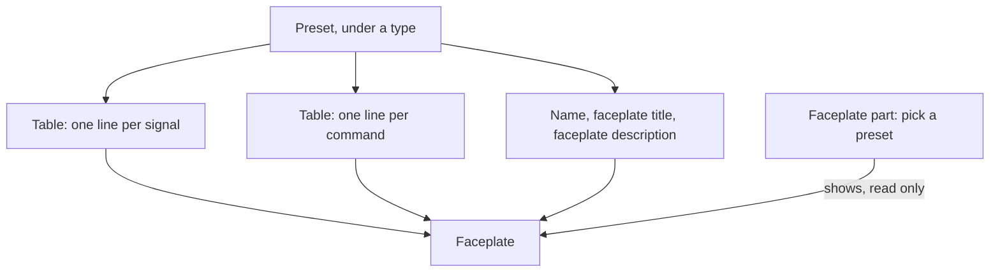
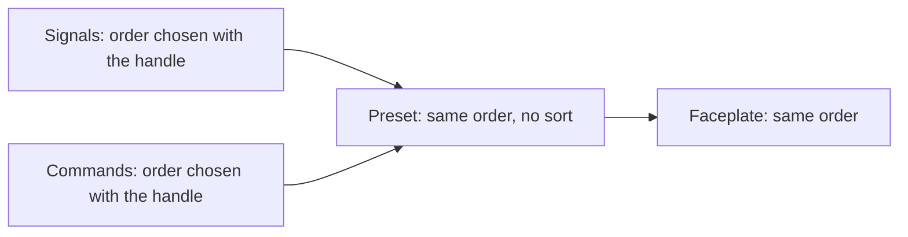
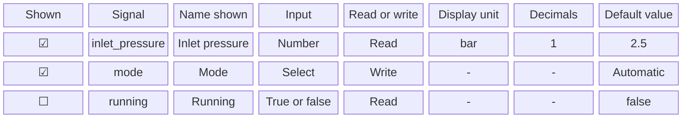
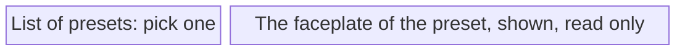
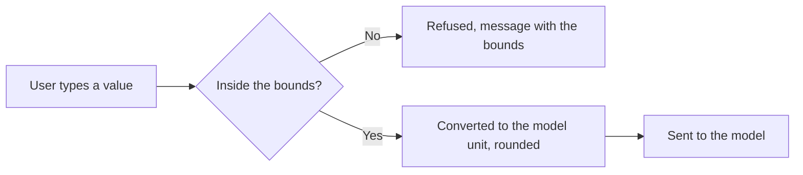
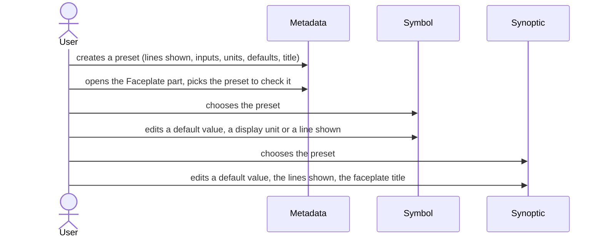

# Presets and their faceplate

> [Home](../README.md) › [Metadata](README.md) › Presets · Previous: [Commands](07-commands.md) · Next: [Versions](13-versions.md)

Status: validated by the Product Owner on 2026-11-11; changed by him on 2026-11-16: the faceplate and the presets are **merged** into this one part, a preset is one table, always editable, and the faceplate is seen with a button; the name people see for each signal is written here (decision 0018, accepted on 2026-11-16, which changes decision 0015); the lines follow the order of Signals and Commands, with no sort. Later that day, the button that showed the faceplate became a **Faceplate part** of its own, after Presets, which only shows the faceplate of a chosen preset. Open points are listed in [Open questions](12-open-questions.md).

A preset is made under a type (example: pneumatic positive displacement pump). It holds the defaults of a symbol and **builds its faceplate**, so that a symbol or a synoptic starts well configured. A faceplate is the panel that shows the signals and the commands of a placed symbol: what the user sees and can act on. "Faceplate" is the standard word of supervision software for this panel.

## Rules

### One part: the preset builds the faceplate

Decided by the Product Owner on 2026-11-16: "Faceplate et preset, il faut fusionner ça, parce que les presets ne servent qu'à la faceplate."

- Everything the faceplate shows is set in the preset: which signals and commands are shown, how, and under which title. The Faceplate part of a type sets nothing: it only shows the result (see [The Faceplate part](#the-faceplate-part-a-view-only)).
- The display unit and the decimal places of the preset also serve the texts of a symbol that show a value (see [Animation mode](../symbols/08-animation-mode/README.md)): a preset is not only the faceplate, but the faceplate is wholly in the preset.
- A preset is an override: what it does not change comes from the signal and from the Units page (model unit, default decimals).
- It stays simple: defaults, nothing more.
- The preset is always editable, with no Edit or Save step (Product Owner, 2026-11-16). Its changes are checked on the [Versions](13-versions.md) page before a version is made.

### A type needs a preset

- A type needs at least one preset to be chosen in a symbol or a synoptic. No preset is created automatically. If no preset fits, the user creates one in Metadata.
- A preset has a name, which tells two presets of a type apart (Product Owner, 2026-11-16). Its field stays above the table for now: the Product Owner finds the place "pas mal" and will look at it again later (2026-11-16).

### The table of a preset

A preset is shown as **one table** with every signal of the type, own and inherited, one per line, and a column per setting (Product Owner, 2026-11-16: "un tableau comme ça, c'est pas mal"). There is no "add an entry": the whole list is always there, and a checkbox says what the faceplate shows by default.

| Column | Values | Rule |
| --- | --- | --- |
| Shown | Checkbox | Ticked: the signal is in the faceplate at the start. Unticked: it stays available, a symbol or a synoptic can tick it. |
| Signal | The signal's ID, read only | Which signal the line is about (see [Signals](04-signals.md)). |
| Name shown | Text field | The name people see for this signal in the faceplate (Product Owner, 2026-11-16: "le display name qu'il faut afficher dans le preset, exactement"). Plain text, never sent to the model; changing it breaks nothing. Empty: the ID is shown. |
| Input | Select for an enum; fixed for the other types | How the value is shown, in read and in write (Product Owner, 2026-11-16). For an enum: radio on one line, radio on several lines, select. For the other types there is nothing to choose: a number field for an integer or a real, true or false for a boolean, a text field for a text (assistant's reading of "il n'y a rien de compliqué", to confirm). |
| Read or write | Radio | Read: the faceplate shows the value. Write: a person can type a value for the model. |
| Display unit | Select | Only with a quantity. Among the units of the signal's quantity; starts as the signal's model unit. |
| Decimals | Number field | Integers and reals only. Starts as the default of the quantity on the Units page (see [Units](05-units.md)). Display only. |
| Default value | Field of the signal's type | The value the symbol starts with. A boolean: true or false. An integer or a real: a number, typed. A text: a text, typed. An enum: an item, picked by its display text (Product Owner, 2026-11-16: "si c'est un nombre, on peut écrire une valeur par défaut, et puis basta"). |

The commands of the type follow in their own table, one per line:

| Column | Values | Rule |
| --- | --- | --- |
| Shown | Checkbox | Ticked: the command's button is in the faceplate. |
| Command | The command's ID, read only | From the table of commands (see [Commands](07-commands.md)). |
| Name on the button | Text field | What the button of the faceplate says. Plain text. |

- No description per signal or per command (Product Owner, 2026-11-16: "La description pour chaque signal ou commande, non").
- An enum is always shown by the display texts of its items, never by their keys (see [Enums](06-enums.md)).
- Ticking a command in the preset only says whether its button is in the faceplate. All the commands of the type stay available to the symbol, which links them to clicks on its parts (see [Commands](07-commands.md)).
- Unticked lines are only unticked at the start, to save time. In a symbol or a synoptic the full list is still there and the user can tick them by hand. This changes the display only, never the model's inputs and outputs.

### The order of the lines

Decided by the Product Owner on 2026-11-16: "dans Preset, l'ordre, ce serait l'ordre qu'il y a dans Signal et Commandes. [...] il n'y aurait pas de tri".

- The lines of the table of signals come in the order chosen with the handle in the table of [Signals](04-signals.md#the-order-of-the-lines). The lines of the table of commands come in the order chosen in the table of [Commands](07-commands.md).
- A preset has no handle and no sort: its order cannot be changed here. To change it, the user moves the line in Signals or in Commands, and every preset of the type follows.
- The faceplate is built from the table, so it shows the signals and the commands in this same order.
- Where the inherited lines go depends on the question still open in [Signals](04-signals.md#open-questions); the preset follows the answer.

### Title and description of the faceplate

- A preset can give the faceplate a title and a description (Product Owner, 2026-11-16: "quelle description on met à la pop-up, quel titre potentiel"). Both are optional.
- Like every value of a preset, they can still be changed on each symbol placed in a synoptic: the same symbol placed twice can have two different titles (rule of 2026-11-11, kept).
- The description is plain text only: no Markdown, no formatting, no links. Line breaks are kept. This keeps the faceplate light.
- They only change what the faceplate shows. They never go to the model.

### The Faceplate part: a view only

Decided by the Product Owner on 2026-11-16, replacing the button "Show the faceplate" of the same day: the faceplate becomes a part of the type, "une catégorie comme preset", the last one, after Presets.

- The Faceplate part looks like the Presets part: the list of the type's presets on the left, where the user picks one. On the right, in place of the two tables, the faceplate of that preset is shown, as it would look, built from the preset (title, description, lines shown, commands shown, in the order of the lines).
- Nothing is set there: "sans configuration possible, juste du visuel". Every setting stays in the preset. Nothing can be typed or clicked in the faceplate shown.
- It lets the user see the result without placing a symbol.
- (The Product Owner first spoke of a preview on the left of the preset, then of a button in the preset, then settled on this part.)

### Typing a value

- A signal set to **write** is the only way for a person to type a value for the model: a command always sends a fixed value (see [Commands](07-commands.md#the-value-is-always-fixed)).
- Only an **input** of the model can be set to write; for an output, write is greyed. It follows the Product Owner's rule for commands (2026-11-16): sending a value to an output makes no sense, the model computes it; overriding an output is another mechanism, a command of its own with a fixed value (see [Commands](07-commands.md)).
- When the user types a value, the faceplate checks it against the bounds of the signal. The bounds are written in the model unit and are shown in the display unit.
- A value outside the bounds is refused, with a message that says the bounds. Nothing is sent to the model.
- An integer signal accepts whole numbers only. An enum signal accepts only the items of its enum: the user picks a display text, the model receives its key.
- A value that passes is converted back to the model unit and rounded to 12 significant digits before it goes to the model (see [Units](05-units.md)).

### In a symbol and in a synoptic

- The user chooses a preset, then can edit there its default values, display units, decimal places, the lines shown, and the title and description of the faceplate. Example: to see a green pump, the user sets the default colour in the symbol.
- In a synoptic, only the faceplate can be edited. A command that is not wanted means a new symbol, because the symbol shows something extra.
- Decimal places, display units, titles and descriptions never go to the model: they are display only.

## Example

Preset `default` of `centrifugal_pump`, faceplate title "Feed pump".

| Shown | Signal | Name shown | Input | Read or write | Display unit | Decimals | Default value |
| --- | --- | --- | --- | --- | --- | --- | --- |
| ☑ | `inlet_pressure` | Inlet pressure | number field | read | bar | 1 | 2.5 |
| ☑ | `speed` | Speed | number field | read | rpm | 0 | 0 |
| ☐ | `running` | Running | true or false | read |  |  | false |
| ☑ | `mode` | Mode | select | write |  |  | Automatic |

| Shown | Command | Name on the button |
| --- | --- | --- |
| ☑ | `start` | Start |
| ☑ | `stopped` | Stopped |

## Where it is used

| Thing | Created and changed in | Used in | In a symbol | In a synoptic |
| --- | --- | --- | --- | --- |
| Preset and its name | Metadata, under a type | Symbol and synoptic start from it | Choose one | Choose one |
| Lines shown, name shown, input, read or write, display unit, decimals, default value | Preset, in Metadata | Faceplate of the symbol or synoptic; texts of a symbol that show a value | Edit | Edit |
| Command shown, name on the button | Preset, in Metadata | Faceplate of the symbol or synoptic | Edit | Edit |
| Faceplate title and description | Preset, in Metadata | Faceplate of the symbol or synoptic | Edit | Edit, on each placed symbol |

## Open questions

- Where the name of a preset is edited: above the table for now, to look at again later (Product Owner, 2026-11-16).
- The input of a signal that is not an enum: fixed by its type (number field, true or false, text field), as written above? Assistant's reading, to confirm.
- Which preset the Faceplate part shows when it opens: the first of the list (assistant's proposal), or the one selected last in Presets? To confirm.
