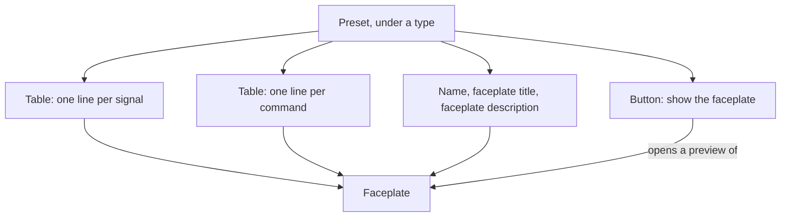
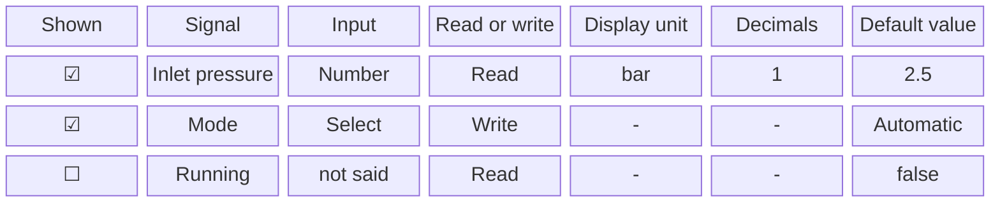
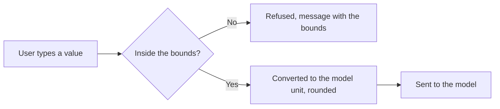
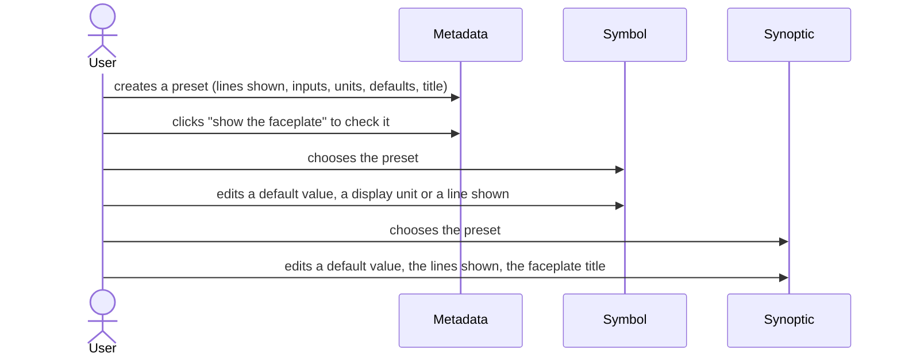

# Presets and their faceplate

> [Home](../README.md) › [Metadata](README.md) › Presets · Previous: [Commands](07-commands.md) · Next: [Who changes what](11-who-changes-what.md)

Status: validated by the Product Owner on 2026-11-11; changed by him on 2026-11-16: the faceplate and the presets are **merged** into this one part, a preset is one table, and the faceplate is seen with a button. Open points are listed in [Open questions](12-open-questions.md).

A preset is made under a type (example: pneumatic positive displacement pump). It holds the defaults of a symbol and **builds its faceplate**, so that a symbol or a synoptic starts well configured. A faceplate is the panel that shows the signals and the commands of a placed symbol: what the user sees and can act on. "Faceplate" is the standard word of supervision software for this panel.

## Rules

### One part: the preset builds the faceplate

Decided by the Product Owner on 2026-11-16: "Faceplate et preset, il faut fusionner ça, parce que les presets ne servent qu'à la faceplate."

- A type has no separate Faceplate part any more. Everything the faceplate shows is set in the preset: which signals and commands are shown, how, and under which title.
- The display unit and the decimal places of the preset also serve the texts of a symbol that show a value (see [Animation mode](../symbols/08-animation-mode/README.md)): a preset is not only the faceplate, but the faceplate is wholly in the preset.
- A preset is an override: what it does not change comes from the signal and from the Units page (model unit, default decimals).
- It stays simple: defaults, nothing more.

### A type needs a preset

- A type needs at least one preset to be chosen in a symbol or a synoptic. No preset is created automatically. If no preset fits, the user creates one in Metadata.
- A preset has a name, which tells two presets of a type apart (Product Owner, 2026-11-16). Where the name is edited on the screen is open: the field above the table "is not nice there".

### The table of a preset

A preset is shown as **one table** with every signal of the type, own and inherited, one per line, and a column per setting (Product Owner, 2026-11-16: "un tableau comme ça, c'est pas mal"). There is no "add an entry": the whole list is always there, and a checkbox says what the faceplate shows by default.

| Column | Values | Rule |
| --- | --- | --- |
| Shown | Checkbox | Ticked: the signal is in the faceplate at the start. Unticked: it stays available, a symbol or a synoptic can tick it. |
| Signal | The signal's display name, read only | The name comes from the signal (see [Signals](04-signals.md)); the preset does not rename it. |
| Input | Select, depending on the type of the signal | Second column (Product Owner, 2026-11-16). How the value is shown, in read and in write. For an enum: radio on one line, radio on several lines, select. For the other types: open. |
| Read or write | Radio | Read: the faceplate shows the value. Write: a person can type a value for the model. |
| Display unit | Select | Only with a quantity. Among the units of the signal's quantity; starts as the signal's model unit. |
| Decimals | Number field | Integers and reals only. Starts as the default of the quantity on the Units page (see [Units](05-units.md)). Display only. |
| Default value | Field of the signal's type | The value the symbol starts with. |

The commands of the type follow in their own table, one per line:

| Column | Values | Rule |
| --- | --- | --- |
| Shown | Checkbox | Ticked: the command's button is in the faceplate. |
| Command | The command's name, read only | From the table of commands (see [Commands](07-commands.md)). |
| Name on the button | Text field | What the button of the faceplate says. Plain text. |

- No description per signal or per command (Product Owner, 2026-11-16: "La description pour chaque signal ou commande, non").
- An enum is always shown by the display texts of its items, never by their keys (see [Enums](06-enums.md)).
- Ticking a command in the preset only says whether its button is in the faceplate. All the commands of the type stay available to the symbol, which links them to clicks on its parts (see [Commands](07-commands.md)).
- Unticked lines are only unticked at the start, to save time. In a symbol or a synoptic the full list is still there and the user can tick them by hand. This changes the display only, never the model's inputs and outputs.

### Title and description of the faceplate

- A preset can give the faceplate a title and a description (Product Owner, 2026-11-16: "quelle description on met à la pop-up, quel titre potentiel"). Both are optional.
- Like every value of a preset, they can still be changed on each symbol placed in a synoptic: the same symbol placed twice can have two different titles (rule of 2026-11-11, kept).
- The description is plain text only: no Markdown, no formatting, no links. Line breaks are kept. This keeps the faceplate light.
- They only change what the faceplate shows. They never go to the model.

### Show the faceplate

- A button of the preset shows the faceplate as it would look, built from the table (Product Owner, 2026-11-16: "un bouton affiche la pop-up, et puis ça l'affiche"). It lets the user see the result without placing a symbol.
- The faceplate is not shown all the time beside the table: the button opens it. (The Product Owner first spoke of a preview on the left, then settled on the button.)

### Typing a value

- A signal set to **write** is the only way for a person to type a value for the model: a command always sends a fixed value (see [Commands](07-commands.md#the-value-is-always-fixed)).
- When the user types a value, the faceplate checks it against the bounds of the signal. The bounds are written in the model unit and are shown in the display unit.
- A value outside the bounds is refused, with a message that says the bounds. Nothing is sent to the model.
- An integer signal accepts whole numbers only. An enum signal accepts only the items of its enum: the user picks a display text, the model receives its key.
- A value that passes is converted back to the model unit and rounded to 12 significant digits before it goes to the model (see [Units](05-units.md)).

### In a symbol and in a synoptic

- The user chooses a preset, then can edit there its default values, display units, decimal places, the lines shown, and the title and description of the faceplate. Example: to see a green pump, the user sets the default colour in the symbol.
- In a synoptic, only the faceplate can be edited. A command that is not wanted means a new symbol, because the symbol shows something extra.
- Decimal places, display units, titles and descriptions never go to the model: they are display only.

## Example

Preset `default` of `centrifugal_pump`, faceplate title "Feed pump".

| Shown | Signal | Input | Read or write | Display unit | Decimals | Default value |
| --- | --- | --- | --- | --- | --- | --- |
| ☑ | Inlet pressure | not said (number) | read | bar | 1 | 2.5 |
| ☑ | Speed | not said (number) | read | rpm | 0 | 0 |
| ☐ | Running | not said (boolean) | read |  |  | false |
| ☑ | Mode | select | write |  |  | Automatic |

| Shown | Command | Name on the button |
| --- | --- | --- |
| ☑ | `start` | Start |
| ☑ | `stopped` | Stopped |

## Where it is used

| Thing | Created and changed in | Used in | In a symbol | In a synoptic |
| --- | --- | --- | --- | --- |
| Preset and its name | Metadata, under a type | Symbol and synoptic start from it | Choose one | Choose one |
| Lines shown, input, read or write, display unit, decimals, default value | Preset, in Metadata | Faceplate of the symbol or synoptic; texts of a symbol that show a value | Edit | Edit |
| Command shown, name on the button | Preset, in Metadata | Faceplate of the symbol or synoptic | Edit | Edit |
| Faceplate title and description | Preset, in Metadata | Faceplate of the symbol or synoptic | Edit | Edit, on each placed symbol |

## Open questions

- A name shown per signal in the preset: the Product Owner said "Name shown, oui" while reading the table, and also that the faceplate always shows the display name of the signal. Written here as the signal's display name only, no renaming in the preset: to confirm.
- Where the name of a preset is edited: the field above the table "is not nice there" (Product Owner, 2026-11-16).
- The inputs of a signal that is not an enum (number, boolean, text): which choices?
- Can a signal set to write be an output of the model?
- Order of the lines: the order of the signals, or chosen in the preset?
