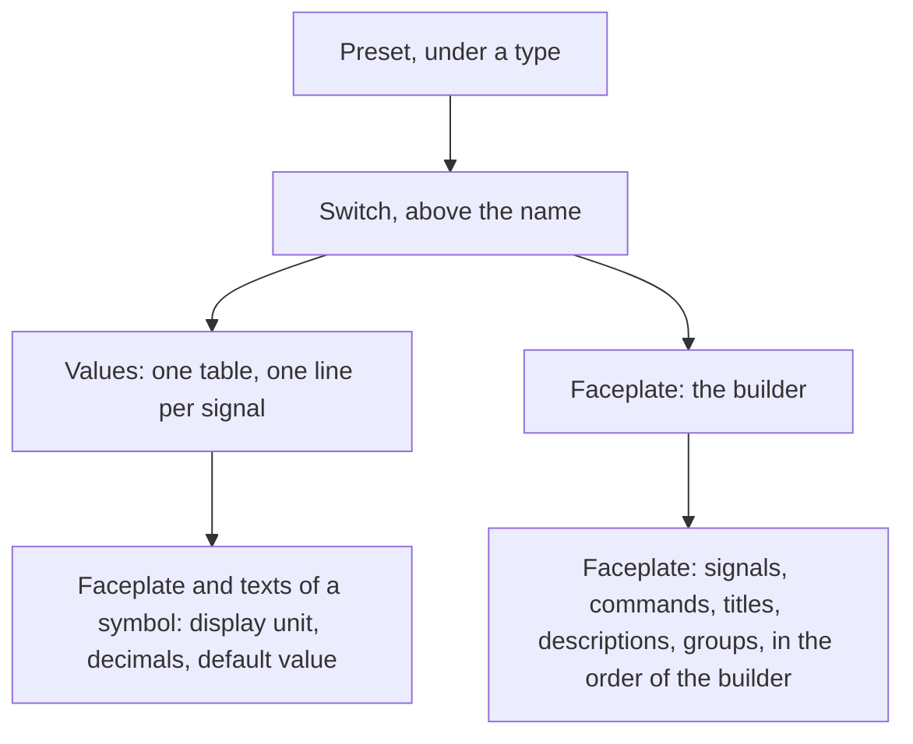
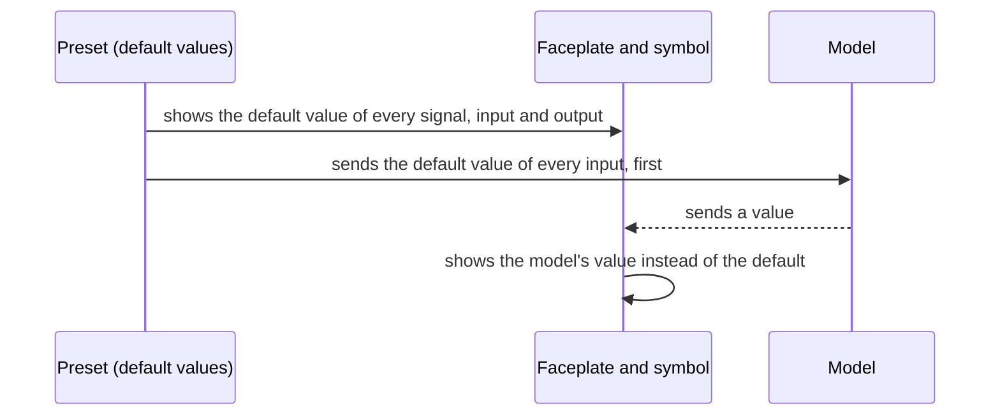
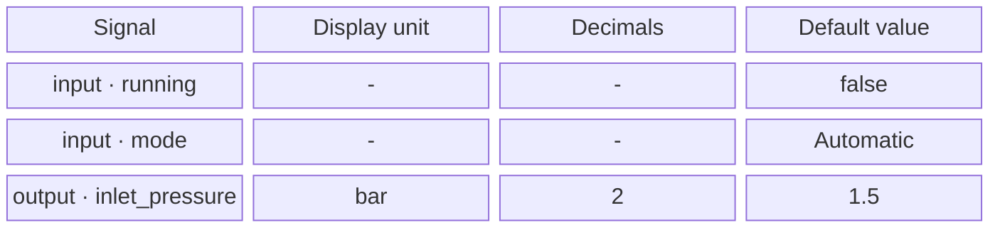
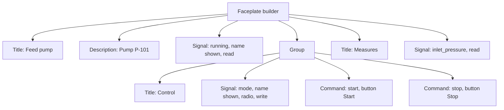
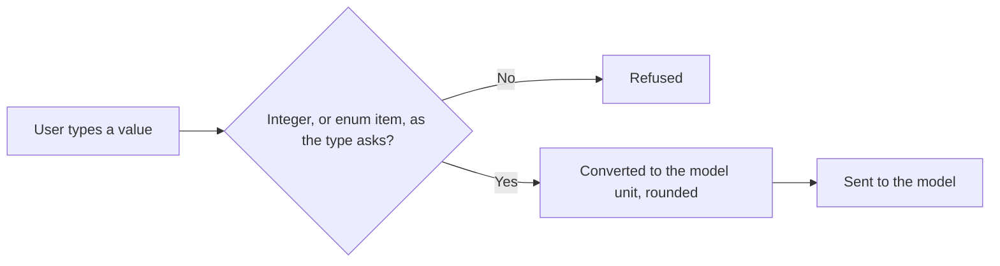
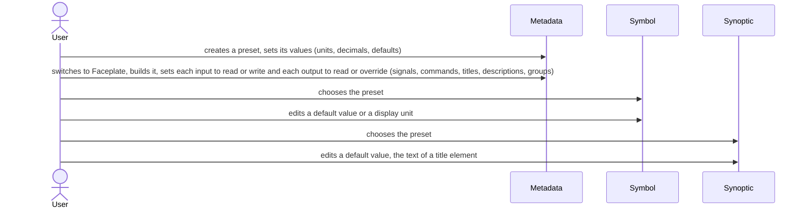

# Presets and their faceplate

> [Home](../README.md) › [Metadata](README.md) › Presets · Previous: [Commands](07-commands.md) · Next: [Versions](13-versions.md)

Status: validated by the Product Owner on 2026-11-11; changed by him on 2026-11-16: the faceplate and the presets are **merged** into this one part, always editable; the name people see for each signal is written here (decision 0018, accepted on 2026-11-16, which changes decision 0015). Later that day, a Faceplate part of its own only showed the faceplate of a chosen preset (decision 0021). Last, while reviewing the wireframes, he split the preset into **two modes**, chosen by a switch above its name: the **values** (display unit, decimals, default value of each signal) and the **faceplate builder** (a list of elements, with groups, titles and descriptions, that builds the faceplate), with no "shown" box (decision 0022, accepted on 2026-11-16, which changes a point of decisions 0015 and 0018). At the end of the day he **removed the Faceplate part** (decision 0023, accepted on 2026-11-16, which replaces decision 0021): the faceplate is only the second mode of the preset; he confirmed the labels "Values" and "Faceplate", and made "Presets" the title of the list, with a small + on its right, so that the switch moves up. Later still, he made the builder fully generic: no title nor description by default, neither for the faceplate nor for a group; a title or a description is an element the user adds; a group shows the same small + icons at its top, a group included. On 2026-11-17, reviewing the wireframes again, he kept the display unit, the decimals and the default value; asked for an icon telling an input from an output in the table of values; said what the default value is for; replaced "read or write" by "read or override"; and confirmed that neither the faceplate nor a group has a title or a description of its own. At the end of 2026-11-17 he corrected it: **read or write for an input, read or override for an output**; and he settled the handles of the builder, the input chosen in the builder, and the bounds of a number field, typed or taken from a signal. Open points are listed in [Open questions](12-open-questions.md).

A preset is made under a type (example: pneumatic positive displacement pump). It holds the defaults of a symbol and **builds its faceplate**, so that a symbol or a synoptic starts well configured. A faceplate is the panel that shows the signals and the commands of a placed symbol: what the user sees and can act on. "Faceplate" is the standard word of supervision software for this panel.

## Rules

### One part: the preset builds the faceplate

Decided by the Product Owner on 2026-11-16: "Faceplate et preset, il faut fusionner ça, parce que les presets ne servent qu'à la faceplate."

- Everything the faceplate shows is set in the preset: which signals and commands are shown, how, in which groups, and under which titles.
- The display unit and the decimal places of the preset also serve the texts of a symbol that show a value (see [Animation mode](../symbols/08-animation-mode/README.md)): a preset is not only the faceplate, but the faceplate is wholly in the preset.
- A preset is an override: what it does not change comes from the signal and from the units (the model unit of the quantity, the default decimals).
- The preset is always editable, with no Edit or Save step (Product Owner, 2026-11-16). Its changes are checked on the [Versions](13-versions.md) page before a version is made.

### A type needs a preset

- A type needs at least one preset to be chosen in a symbol or a synoptic. No preset is created automatically. If no preset fits, the user creates one in Metadata.
- The list of presets is on the left. Its title is **"Presets"**, with a small **+ on its right** that creates a preset (Product Owner, 2026-11-16: "Preset, ça ne doit pas être le titre de toute la page. Tu dois juste mettre Preset comme titre de la liste et avoir un petit + à droite"; see the [layout rules](../screens/README.md#a-title-and-a-small--on-its-right)). The page has no big title above.
- The selected preset is on the right: the switch of the two modes **at the top**, where the page title was ("ça te permettra de remonter le truc Values / Faceplate"), then its name, then the mode chosen.
- A preset has a name, which tells two presets of a type apart (Product Owner, 2026-11-16). Its field sits under the switch of the two modes, and stays the same in both.

### Two modes, chosen by a switch

Decided by the Product Owner on 2026-11-16, while reviewing the wireframes: "un menu qui soit juste un switch au-dessus de name of the preset. Ce switch serait entre ma définition des display units, des décimales et des default values, et un truc en mode création de pop-up."

- A **switch** sits above the name of the preset. It changes what the right side shows:
  - **Values**: the display unit, the decimals and the default value of each signal;
  - **Faceplate**: the faceplate builder, where the faceplate is put together element by element.
- The labels are **"Values"** and **"Faceplate"** (proposed by the assistant, confirmed by the Product Owner on 2026-11-16: "que ce soit juste un truc Values et Faceplate").
- **The faceplate has no part of its own**: it is made and seen only in this second mode of the preset (Product Owner, 2026-11-16, end of the day). Decision 0023 replaces decision 0021, which had made it a part.
- The title and the description of the faceplate are no longer two fields next to the name (Product Owner: "Faceplate title et faceplate description, ça, on le dégagerait"). They are not fields of the builder either: a title or a description is an element the user adds, like any other (see [Only elements in elements](#only-elements-in-elements)).

### Mode Values: one table of the signals

A table with **every signal of the type**, own and inherited, one per line (Product Owner, 2026-11-16: "un premier tableau des signaux où on voit l'ID du signal, le display unit, son nombre de décimales, les default values").

| Column | Values | Rule |
| --- | --- | --- |
| Signal | An icon of its direction, then the signal's ID, read only | Which signal the line is about (see [Signals](04-signals.md)). The icon says whether it is an input or an output of the model (Product Owner, 2026-11-17: "il faudrait qu'on puisse savoir si c'est un input ou un output [...] ça donne juste une icône"), so that the default value is read right. |
| Display unit | Select | Only with a quantity. Among the units of the signal's quantity; starts as the model unit of the quantity. Kept (Product Owner, 2026-11-17: "Display unit pareil"). |
| Decimals | Number field | Integers and reals only. Starts as the default of the quantity on the Units page (see [Units](05-units.md)). Display only. Kept (Product Owner, 2026-11-17: "les décimales ici servent"). |
| Default value | Field of the signal's type | See [The default value](#the-default-value) below. A boolean: true or false. An integer or a real: a number, typed. A text: a text, typed. An enum: an item, picked by its display text (Product Owner, 2026-11-16: "si c'est un nombre, on peut écrire une valeur par défaut, et puis basta"). |

#### The default value

Said by the Product Owner on 2026-11-17, who asked that it be written as it is: "c'est vraiment le premier truc qu'on envoie au modèle, et c'est le truc qu'on voit avant que le modèle nous envoie quelque chose."

- **For an input**, the default value is **the first value sent to the model**.
- **For an input and for an output**, it is **the value shown before the model sends anything**: once the model sends a value, that value is shown instead.
- This is why the table shows the direction of each signal: the same field means more for an input than for an output.
- Written in decision 0030 (accepted on 2026-11-17).
- The default value is in the units of the display unit of the line, like any value the user types (assistant's reading, to confirm); before it goes to the model, it is converted back to the model unit, as in [Typing a value](#typing-a-value).

- **No command in this table** (Product Owner: "Dans les commandes, tu ne les verrais même pas dans preset"): a command has no value to set here. Commands are only placed in the builder.
- No "Shown", no "Name shown", no "Input", no "Read or write", no "Read or override" here: they belong to the builder, since they only say how the faceplate shows a signal.
- There is no "add an entry": the whole list is always there.
- The lines come in the order of the table of [Signals](04-signals.md#the-order-of-the-lines): inherited signals first, then the type's own; no handle and no sort here.

### Mode Faceplate: the faceplate builder

Decided by the Product Owner on 2026-11-16: "il ne faut pas juste bêtement avoir la liste des signaux. Il faudrait pouvoir vraiment mettre des sous-groupes."

- The builder is a **list of elements**, read from top to bottom like the faceplate it builds.
- The list of elements has the title **"Elements"**, with, on its right, **one small icon with a + per kind** of element below; a click adds one element at a time. It applies the rule the Product Owner set for the links (2026-11-16: no menu, "clac-clac"), confirmed by him for the builder the same day (see the [layout rules](../screens/README.md#a-title-and-a-small--on-its-right)). An element is one of:

| Element | What it holds | Rule |
| --- | --- | --- |
| Signal | The signal, picked by its ID; the **name shown**; **read or write** for an input, **read or override** for an output; the **input**. | Name shown: plain text, the name people see in the faceplate, never sent to the model; empty, the ID is shown (decision 0018); it exists only in the builder (decision 0022). Read or write, read or override: see [Typing a value](#typing-a-value). Input: chosen in the builder (Product Owner, end of 2026-11-17: "on le choisit : on met input number, par exemple"); for an enum, radio on one line, radio on several lines or select, its items in the order chosen with the handles on the Enums page (Product Owner, end of 2026-11-17: "Oui, l'ordre des poignées"); for a number, a number field, with its [bounds](#bounds-of-a-number-field). |
| Command | The command, picked by its ID; the **name on the button**. | Plain text. The faceplate shows a button that sends the command. |
| Title | A text. | A heading inside the faceplate or inside a group. |
| Description | A text, plain: no Markdown, no links; line breaks kept. | A paragraph inside the faceplate or inside a group. |
| Group | Only its own elements: signals, commands, titles, descriptions, groups. No title, no description of its own (confirmed by the Product Owner on 2026-11-17: "ça, faut les enlever, le title et la description"). | Gathers the elements put in it. At its top, the same five small icons with a + as the title "Elements": Signal, Command, Title, Description, Group (decided 2026-11-16; confirmed 2026-11-17, see [Only elements in elements](#only-elements-in-elements)). |

#### Only elements in elements

Decided by the Product Owner on 2026-11-16: "il ne faut pas donner un titre et une description par défaut à la pop-up. Il faut vraiment glisser en premier un titre et une description si on veut un titre et une description. [...] Comme ça, ce ne sont vraiment que des éléments dans des éléments."

- **No title and no description by default**, neither for the faceplate nor for a group. A faceplate or a group that needs a heading or a text gets a title element or a description element, usually put first. This replaces the earlier rule of a title and a description always at the top of the faceplate and of each group.
- **A group holds the same elements as the faceplate**, a group included: a group can hold a group ("+, signal, commande, titre, description, groupe en haut"). No limit of depth was given.
- **The add icons of a group are at its top**, not at its bottom ("C'est mieux de plutôt les mettre en haut du groupe"): the same five small icons with a +, in the same order as on the right of "Elements". A click adds the element inside the group.
- **Confirmed on 2026-11-17**, after a doubt the same day (a group with no add icons, its elements dragged in): the five + icons stay at the top of each group (Product Owner: "les boutons « + » là, directement dans le groupe [...] c'est OK, donc tu peux garder ça. Comme ça, ça fera gagner du temps et sera moins chiant").
- The builder is thus one generic rule at every level: a list of elements, and a row of small + icons above it.
- Written in decision 0034 (accepted on 2026-11-17), which changes decision 0022 on these points.

- **What is in the builder is what the faceplate shows.** There is no "Shown" checkbox any more ("on montrerait ce qu'on veut"): a signal or a command that is not added is not in the faceplate.
- The name shown and the name on the button exist **only in the builder**: they serve the faceplate alone (Product Owner: "le display name, qui ne sert que pour la pop-up").
- The **order of the faceplate is the order of the builder**: it no longer follows the order of the table of Signals. An element is moved with a **handle** at its left, as in the tables of Metadata and as on the wireframes (Product Owner, end of 2026-11-17: "il y a déjà les poignées là").
- Deleting an element: a delete button at its right, with a warning, as everywhere in Metadata (see the [layout rules](../screens/README.md#delete-with-a-button-and-a-warning-in-metadata)).
- All the commands of the type stay available to the symbol, which links them to clicks on its parts, whether or not the builder holds them (see [Commands](07-commands.md)).
- An enum is always shown by the display texts of its items, never by their keys (see [Enums](06-enums.md)).

### No Faceplate part

- Earlier on 2026-11-16, a Faceplate part, last of the parts of a type, only showed the faceplate of a chosen preset (decision 0021).
- At the end of the day, the Product Owner **removed it** from the parts of the type ("Tu ne m'as pas enlevé la page Faceplate [...] de la liste de part of the type"): the faceplate is the mode Faceplate of the preset, nothing else (decision 0023). Since 2026-11-17, the parts of a type are General, Documentation, Signals, Commands, Flags, Presets (decision 0028; see [Types](01-types.md)).

### Typing a value

- A signal element offers **read or write for an input**, and **read or override for an output** (Product Owner, end of 2026-11-17: "c'est read write pour un input et read override pour un output"). It corrects the single "read or override" written earlier on 2026-11-17 for both directions.
- A signal set to **write** or to **override** in the builder is the only way for a person to type a value: a command always sends a fixed value (see [Commands](07-commands.md#the-value-is-always-fixed)).
- **An input and an output can both be typed in, in the same way** (Product Owner, 2026-11-17: "c'est des outputs, faut pouvoir les mettre en write aussi, exactement de la même façon"); only the word changes: write for an input, override for an output. It replaces the rule of 2026-11-16, which greyed write for an output (decision 0030, accepted on 2026-11-17, which changes decisions 0014 and 0022 on this point).
- What happens to the typed value is **left to what is behind** the faceplate (Product Owner: "c'est à ce qui passe derrière de se débrouiller, parce que ça peut devenir une valeur, ça peut devenir un override"): for an input it becomes the value the model receives; for an output, an override of that output. How an override of an output is applied, and how it ends, is the open question already asked for the command "Override an output" (see [Commands](07-commands.md#open-questions)).

#### Bounds of a number field

Said by the Product Owner at the end of 2026-11-17. A signal has no bounds of its own: a bound is a plain signal (decision 0026; see [Signals](04-signals.md#rules)).

- A **number field** of the builder can have a **minimum** and a **maximum**.
- Each is **typed by hand, or taken from a signal of the type**, picked in the field itself: a small icon inside the field chooses the signal, as Figma's "Apply variable" in its fields ("dans l'input même de sélection du min/max, on puisse mettre un truc à la main ou alors choisir une variable").
- A typed value outside them is refused, as the faceplate did before bounds became signals (assistant's reading).
- An integer signal accepts whole numbers only. An enum signal accepts only the items of its enum: the user picks a display text, the model receives its key.
- A value that passes is converted back to the model unit and rounded to 12 significant digits before it goes to the model (see [Units](05-units.md)).

### In a symbol and in a synoptic

- The user chooses a preset, then can edit there its default values, display units, decimal places, and the title and description of the faceplate. Since the faceplate has no title nor description of its own any more, this now means the texts of its title and description elements (assistant's reading, to confirm with the open question below). Example: to see a green pump, the user sets the default colour in the symbol.
- In a synoptic, only the faceplate can be edited. A command that is not wanted means a new symbol, because the symbol shows something extra.
- Decimal places, display units, titles and descriptions never go to the model: they are display only.
- Open: before the builder, a symbol or a synoptic could tick a line left unticked in the preset. Now that the faceplate is a built list, what can a symbol or a synoptic change in it (add or remove an element, change a group)?

## Example

Preset `default` of `centrifugal_pump`, with the signals and commands of the examples of [Signals](04-signals.md#example) and [Commands](07-commands.md#example).

Mode Values (inherited signals first, as in Signals):

| Signal (icon, ID) | Display unit | Decimals | Default value |
| --- | --- | --- | --- |
| output · `fault_message` |  |  | "" (empty text) |
| input · `running` |  |  | false |
| output · `flow` | m³/h | 1 | 0 |
| input · `mode` |  |  | Automatic |
| input · `speed_setpoint` | rpm | 0 | 1450 |
| input · `speed_setpoint_max` | rpm | 0 | 3000 |
| output · `inlet_pressure` | bar | 2 | 1.5 |
| output · `pressure_rise` | bar | 2 | 0 |
| output · `bearing_temperature` | °C | 1 | 20 |

Read: when the synoptic starts, the model first receives `running` false, `mode` Automatic, `speed_setpoint` 1450 and `speed_setpoint_max` 3000; until it sends anything, the faceplate shows every value of this table, `flow` 0 m³/h and `bearing_temperature` 20 °C included.

Mode Faceplate:

| Element | Content |
| --- | --- |
| Title | Feed pump |
| Description | Pump P-101, feeds tank T-3. |
| Signal | `running`, name shown "Running", true or false, read |
| Signal | `flow`, name shown "Flow", number field, read |
| Group | (no title nor description of its own) |
| › Title | Control |
| › Description | Local commands |
| › Signal | `mode`, name shown "Mode", radio on one line, write |
| › Signal | `speed_setpoint`, name shown "Speed setpoint", number field, write, minimum 0 typed, maximum the signal `speed_setpoint_max` |
| › Command | `start`, button "Start" |
| › Command | `stop`, button "Stop" |
| Title | Measures |
| Signal | `inlet_pressure`, name shown "Inlet pressure", number field, read |
| Signal | `pressure_rise`, name shown "Pressure rise", number field, read |
| Signal | `bearing_temperature`, name shown "Bearing temperature", number field, read |
| Description | Alarm above 90 °C. |
| Command | `reset_fault`, button "Reset fault" |

## Where it is used

| Thing | Created and changed in | Used in | In a symbol | In a synoptic |
| --- | --- | --- | --- | --- |
| Preset and its name | Metadata, under a type | Symbol and synoptic start from it | Choose one | Choose one |
| Display unit, decimals, default value | Preset, mode Values, in Metadata | Faceplate of the symbol or synoptic; texts of a symbol that show a value | Edit | Edit |
| Elements of the faceplate: signals (name shown, input and its bounds, read or write, read or override), commands (name on the button), titles, descriptions, groups | Preset, mode Faceplate, in Metadata | Faceplate of the symbol or synoptic | Open | Open |
| Texts of the title and description elements | Preset, mode Faceplate, in Metadata | Faceplate of the symbol or synoptic | Edit (assistant's reading) | Edit, on each placed symbol (assistant's reading) |

## Open questions

Noted, not to be asked again in the chat (Product Owner, end of 2026-11-17).

- The default value is typed in the display unit of the line, then converted to the model unit (assistant's reading)?
- Can a signal or a command be added twice to the builder?
- What a symbol or a synoptic can change in the faceplate built by the preset.
