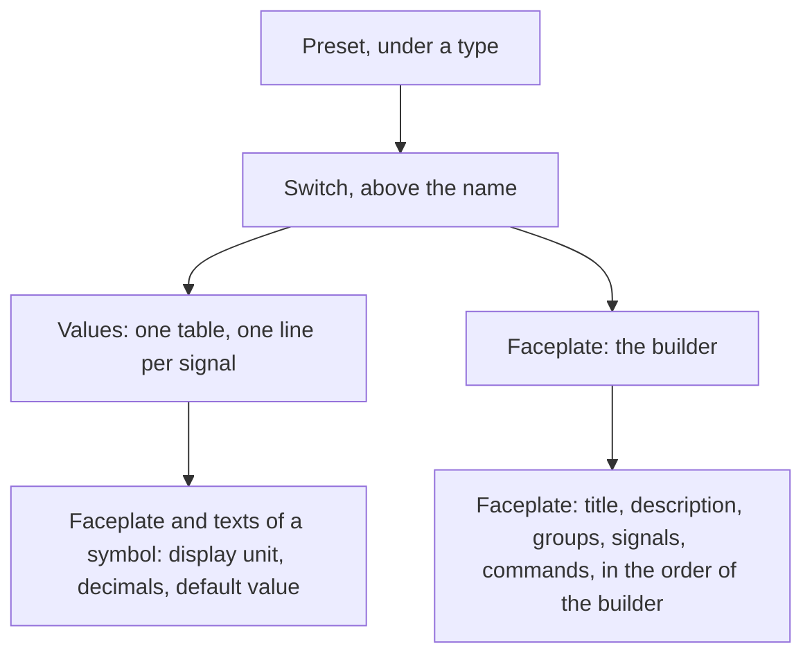
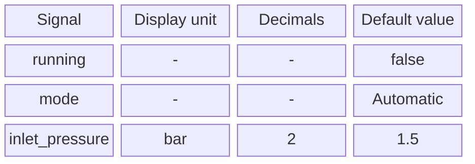
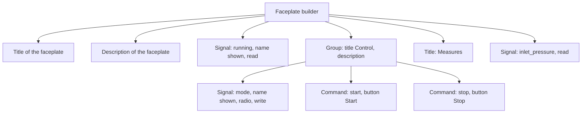
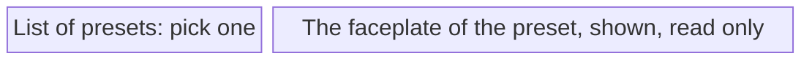
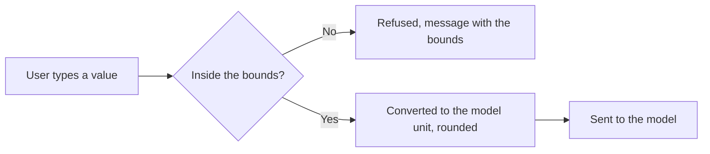
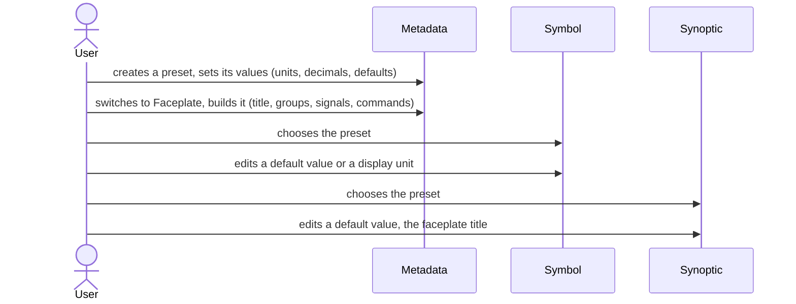

# Presets and their faceplate

> [Home](../README.md) › [Metadata](README.md) › Presets · Previous: [Commands](07-commands.md) · Next: [Versions](13-versions.md)

Status: validated by the Product Owner on 2026-11-11; changed by him on 2026-11-16: the faceplate and the presets are **merged** into this one part, always editable; the name people see for each signal is written here (decision 0018, accepted on 2026-11-16, which changes decision 0015). Later that day, a Faceplate part of its own only showed the faceplate of a chosen preset (decision 0021). Last, while reviewing the wireframes, he split the preset into **two modes**, chosen by a switch above its name: the **values** (display unit, decimals, default value of each signal) and the **faceplate builder** (a list of elements, with groups, titles and descriptions, that builds the faceplate), with no "shown" box (decision 0022, accepted on 2026-11-16, which changes a point of decisions 0015 and 0018). Open points are listed in [Open questions](12-open-questions.md).

A preset is made under a type (example: pneumatic positive displacement pump). It holds the defaults of a symbol and **builds its faceplate**, so that a symbol or a synoptic starts well configured. A faceplate is the panel that shows the signals and the commands of a placed symbol: what the user sees and can act on. "Faceplate" is the standard word of supervision software for this panel.

## Rules

### One part: the preset builds the faceplate

Decided by the Product Owner on 2026-11-16: "Faceplate et preset, il faut fusionner ça, parce que les presets ne servent qu'à la faceplate."

- Everything the faceplate shows is set in the preset: which signals and commands are shown, how, in which groups, and under which titles.
- The display unit and the decimal places of the preset also serve the texts of a symbol that show a value (see [Animation mode](../symbols/08-animation-mode/README.md)): a preset is not only the faceplate, but the faceplate is wholly in the preset.
- A preset is an override: what it does not change comes from the signal and from the Units page (model unit, default decimals).
- The preset is always editable, with no Edit or Save step (Product Owner, 2026-11-16). Its changes are checked on the [Versions](13-versions.md) page before a version is made.

### A type needs a preset

- A type needs at least one preset to be chosen in a symbol or a synoptic. No preset is created automatically. If no preset fits, the user creates one in Metadata.
- The list of presets is on the left, with the + that creates one above it. The selected preset is on the right.
- A preset has a name, which tells two presets of a type apart (Product Owner, 2026-11-16). Its field sits under the switch of the two modes, and stays the same in both.

### Two modes, chosen by a switch

Decided by the Product Owner on 2026-11-16, while reviewing the wireframes: "un menu qui soit juste un switch au-dessus de name of the preset. Ce switch serait entre ma définition des display units, des décimales et des default values, et un truc en mode création de pop-up."

- A **switch** sits above the name of the preset. It changes what the right side shows:
  - **Values**: the display unit, the decimals and the default value of each signal;
  - **Faceplate**: the faceplate builder, where the faceplate is put together element by element.
- The labels "Values" and "Faceplate" are the assistant's: to confirm. The Product Owner spoke of the builder as the "preset faceplate".
- The title and the description of the faceplate are no longer two fields next to the name: they move into the builder (Product Owner: "Faceplate title et faceplate description, ça, on le dégagerait").

### Mode Values: one table of the signals

A table with **every signal of the type**, own and inherited, one per line (Product Owner, 2026-11-16: "un premier tableau des signaux où on voit l'ID du signal, le display unit, son nombre de décimales, les default values").

| Column | Values | Rule |
| --- | --- | --- |
| Signal | The signal's ID, read only | Which signal the line is about (see [Signals](04-signals.md)). |
| Display unit | Select | Only with a quantity. Among the units of the signal's quantity; starts as the signal's model unit. |
| Decimals | Number field | Integers and reals only. Starts as the default of the quantity on the Units page (see [Units](05-units.md)). Display only. |
| Default value | Field of the signal's type | The value the symbol starts with. A boolean: true or false. An integer or a real: a number, typed. A text: a text, typed. An enum: an item, picked by its display text (Product Owner, 2026-11-16: "si c'est un nombre, on peut écrire une valeur par défaut, et puis basta"). |

- **No command in this table** (Product Owner: "Dans les commandes, tu ne les verrais même pas dans preset"): a command has no value to set here. Commands are only placed in the builder.
- No "Shown", no "Name shown", no "Input", no "Read or write" here: they belong to the builder, since they only say how the faceplate shows a signal.
- There is no "add an entry": the whole list is always there.
- The lines come in the order of the table of [Signals](04-signals.md#the-order-of-the-lines): inherited signals first, then the type's own; no handle and no sort here.

### Mode Faceplate: the faceplate builder

Decided by the Product Owner on 2026-11-16: "il ne faut pas juste bêtement avoir la liste des signaux. Il faudrait pouvoir vraiment mettre des sous-groupes."

- The builder is a **list of elements**, read from top to bottom like the faceplate it builds.
- The faceplate always has a **title** and a **description** for the whole faceplate, at the top of the builder ("Tu as toujours un titre de pop-up, une description pour la pop-up entière. Ça, ça ne change pas"). Both are optional to fill. The description is plain text: no Markdown, no links; line breaks are kept.
- **+ buttons** add an element, one at a time. An element is one of:

| Element | What it holds | Rule |
| --- | --- | --- |
| Signal | The signal, picked by its ID; the **name shown**; the **input**; **read or write**. | Name shown: plain text, the name people see in the faceplate, never sent to the model; empty, the ID is shown (decision 0018); it exists only in the builder (decision 0022). Input: for an enum, radio on one line, radio on several lines or select; for the other types, fixed by the type (number field, true or false, text field: assistant's reading, to confirm). Read or write: write lets a person type a value (see [Typing a value](#typing-a-value)); greyed for an output. |
| Command | The command, picked by its ID; the **name on the button**. | Plain text. The faceplate shows a button that sends the command. |
| Title | A text. | A heading inside the faceplate. |
| Description | A text, plain, line breaks kept. | A paragraph inside the faceplate. |
| Group | Its own title and description, then its own elements: signals, commands, titles, descriptions. | Groups the elements under one heading (Product Owner: "je fais un groupe à l'intérieur: il y a une description, il y a un titre. Là, maintenant, je rajoute une propriété, une commande"). |

- **What is in the builder is what the faceplate shows.** There is no "Shown" checkbox any more ("on montrerait ce qu'on veut"): a signal or a command that is not added is not in the faceplate.
- The name shown and the name on the button exist **only in the builder**: they serve the faceplate alone (Product Owner: "le display name, qui ne sert que pour la pop-up").
- The **order of the faceplate is the order of the builder**: it no longer follows the order of the table of Signals. Assistant's reading of a list built element by element; to confirm.
- Moving an element inside the builder: a handle at its left, as in the tables of Metadata. Assistant's proposal, to confirm.
- Deleting an element: a delete button at its right, with a warning, as everywhere in Metadata (see the [layout rules](../screens/README.md#delete-with-a-button-and-a-warning-in-metadata)).
- All the commands of the type stay available to the symbol, which links them to clicks on its parts, whether or not the builder holds them (see [Commands](07-commands.md)).
- An enum is always shown by the display texts of its items, never by their keys (see [Enums](06-enums.md)).

### The Faceplate part

Decided by the Product Owner on 2026-11-16 (decision 0021): the Faceplate part, last of the parts, only shows the faceplate of a chosen preset, "sans configuration possible, juste du visuel": the list of presets on the left, the faceplate shown on the right, read only.

À trancher: when the builder came, the Product Owner said "Faceplate, on peut le dégager", which may mean that this part is removed, now that the faceplate is built in the preset. Asked to the Product Owner; until then the part is kept.

### Typing a value

- A signal set to **write** in the builder is the only way for a person to type a value for the model: a command always sends a fixed value (see [Commands](07-commands.md#the-value-is-always-fixed)).
- Only an **input** of the model can be set to write; for an output, write is greyed. It follows the Product Owner's rule for commands (2026-11-16): sending a value to an output makes no sense, the model computes it; overriding an output is another mechanism, a command of its own with a fixed value (see [Commands](07-commands.md)).
- When the user types a value, the faceplate checks it against the bounds of the signal. The bounds are written in the model unit and are shown in the display unit.
- A value outside the bounds is refused, with a message that says the bounds. Nothing is sent to the model.
- An integer signal accepts whole numbers only. An enum signal accepts only the items of its enum: the user picks a display text, the model receives its key.
- A value that passes is converted back to the model unit and rounded to 12 significant digits before it goes to the model (see [Units](05-units.md)).

### In a symbol and in a synoptic

- The user chooses a preset, then can edit there its default values, display units, decimal places, and the title and description of the faceplate. Example: to see a green pump, the user sets the default colour in the symbol.
- In a synoptic, only the faceplate can be edited. A command that is not wanted means a new symbol, because the symbol shows something extra.
- Decimal places, display units, titles and descriptions never go to the model: they are display only.
- Open: before the builder, a symbol or a synoptic could tick a line left unticked in the preset. Now that the faceplate is a built list, what can a symbol or a synoptic change in it (add or remove an element, change a group)?

## Example

Preset `default` of `centrifugal_pump`, with the signals and commands of the examples of [Signals](04-signals.md#example) and [Commands](07-commands.md#example).

Mode Values (inherited signals first, as in Signals):

| Signal | Display unit | Decimals | Default value |
| --- | --- | --- | --- |
| `fault_message` |  |  | "" (empty text) |
| `running` |  |  | false |
| `flow` | m³/h | 1 | 0 |
| `mode` |  |  | Automatic |
| `speed_setpoint` | rpm | 0 | 1450 |
| `inlet_pressure` | bar | 2 | 1.5 |
| `pressure_rise` | bar | 2 | 0 |
| `bearing_temperature` | °C | 1 | 20 |

Mode Faceplate:

| Element | Content |
| --- | --- |
| Title of the faceplate | Feed pump |
| Description of the faceplate | Pump P-101, feeds tank T-3. |
| Signal | `running`, name shown "Running", true or false, read |
| Signal | `flow`, name shown "Flow", number field, read |
| Group | Title "Control", description "Local commands" |
| › Signal | `mode`, name shown "Mode", radio on one line, write |
| › Signal | `speed_setpoint`, name shown "Speed setpoint", number field, write |
| › Command | `start`, button "Start" |
| › Command | `stop`, button "Stop" |
| Title | Measures |
| Signal | `inlet_pressure`, name shown "Inlet pressure", number field, read |
| Signal | `pressure_rise`, name shown "Pressure rise", number field, read |
| Signal | `bearing_temperature`, name shown "Bearing temperature", number field, read |
| Description | Alarm above 90 °C. |
| Command | `reset_fault`, button "Reset fault" |

## Where it is used

| Thing | Created and changed in | Used in | In a symbol | In a synoptic |
| --- | --- | --- | --- | --- |
| Preset and its name | Metadata, under a type | Symbol and synoptic start from it | Choose one | Choose one |
| Display unit, decimals, default value | Preset, mode Values, in Metadata | Faceplate of the symbol or synoptic; texts of a symbol that show a value | Edit | Edit |
| Elements of the faceplate: signals (name shown, input, read or write), commands (name on the button), titles, descriptions, groups | Preset, mode Faceplate, in Metadata | Faceplate of the symbol or synoptic | Open | Open |
| Faceplate title and description | Preset, mode Faceplate, in Metadata | Faceplate of the symbol or synoptic | Edit | Edit, on each placed symbol |

## Open questions

- The labels of the two modes of the switch: "Values" and "Faceplate" (assistant's proposal)?
- The Faceplate part: removed now that the faceplate is built in the preset ("Faceplate, on peut le dégager"), or kept as a view only?
- Groups: only one level, or a group inside a group?
- The order of the faceplate: the order of the builder, moved with a handle (assistant's reading and proposal)?
- Can a signal or a command be added twice to the builder?
- What a symbol or a synoptic can change in the faceplate built by the preset.
- The input of a signal that is not an enum: fixed by its type (number field, true or false, text field)? Assistant's reading, to confirm.
- Which preset the Faceplate part shows when it opens, if the part is kept.
