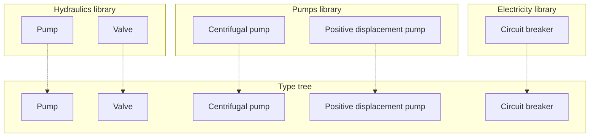
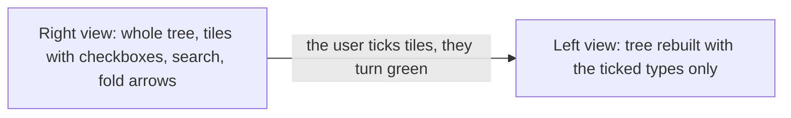
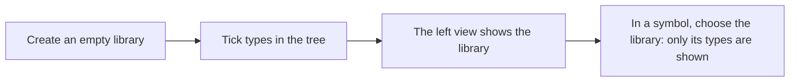

# Libraries

> [Home](../README.md) › [Metadata](README.md) › Libraries · Previous: [Presets](09-presets.md) · Next: [Who changes what](11-who-changes-what.md)

Status: draft, rules stated by the Product Owner on 2026-11-10. Nothing here is validated.

A library is a flat list that points to types. It only sorts them, so that people find their way. Everyone can have all the types, and a library sorts them by project or by trade.

## Rules

- A library is created empty. The user then ticks the types they want in it.
- Any type can go in, at any level, alone. Example: a library can hold "Positive displacement pump" and "Centrifugal pump" without "Pump". What is ticked is what limits the choice in the library.
- A type can be in several libraries. Each library only points to it, through the type's internal identifier (see [Types](01-types.md)).
- No library inside a library.
- In a symbol, the user must first choose a library. Only the types of that library are then shown. All the types are never shown at once in a symbol.
- A library is not used in a synoptic.

## Choosing the types of a library

The screen has two views side by side.

- Right view: the whole type tree, where the user ticks. Each type is a fairly big tile with a checkbox. Clicking a tile ticks it and it turns green. Small arrows fold or unfold the branches, and a search field filters the tree. The user ticks, ticks, ticks: everything green is selected, and that is all.
- Left view: the same tree rebuilt with only the ticked types, which is what the library holds.
- Each tile shows the type's icon, its model identifier (its name) and its description (see [Documentation](03-documentation.md)).

## Steps

## A ticked type whose parent is not ticked

- The parent is still shown in the tree, so that the path stays readable.
- On the symbol side, the parent cannot be selected: it is shown but greyed, only the ticked types can be chosen.

## Why the library has no version

Libraries and types are generated as files, which the open source version reads from and writes to a folder (see [Storage](../storage/files-and-conflicts.md)). A version of a library is not a notion of these specs for now: the application only has access to a folder, so no versioning option was started. How a file is saved and how conflicts between people are avoided is not about metadata: it is described in [Storage](../storage/files-and-conflicts.md).

## Where it is used

| Thing | Created and changed in | Used in | In a symbol | In a synoptic |
| --- | --- | --- | --- | --- |
| Library (ticked types) | Metadata | Left view of the symbol's type choice | Choose a library, then one of its types | No |
