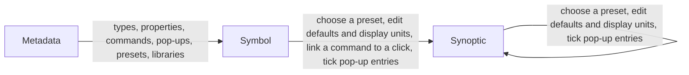

# Who changes what, and where

> [Home](../README.md) › [Metadata](README.md) › Who changes what · Previous: [Libraries](10-libraries.md) · Next: [Naming](12-naming.md)

Status: draft, rules stated by the Product Owner on 2026-11-10. Nothing here is validated.

Rule of the Product Owner: no duplicate ways to change the same thing. Each thing has one place where it is created and changed.

| Thing | Created and changed in | In a symbol | In a synoptic |
| --- | --- | --- | --- |
| Library | Metadata | Choose a library, then one of its types | No |
| Type (name, parent, icon) | Metadata, General | Choose its type (only here) | No |
| Type documentation | Metadata | No | No |
| Property | Metadata | No | No |
| Unit category, families, formulas, default model unit, default decimals | Units page | No | No |
| Model unit of a property (override of the category's default) | Property, in Metadata | No | No |
| Enum and its values | Enums page | No | No |
| Command | Metadata | Link a command to a click | No |
| Pop-up | Metadata | Tick or untick entries | Tick or untick entries |
| Pop-up title and description | Synoptic only | No | Write them, on each placed symbol |
| Preset | Metadata | Choose one | Choose one |
| Default value, display unit, decimal places | Preset, in Metadata | Edit | Edit |

## Details

- Types: [Types](01-types.md), [Icons](02-icons.md), [Documentation](03-documentation.md).
- Model side: [Properties](04-properties.md), [Units](05-units.md), [Enums](06-enums.md).
- Front side: [Commands](07-commands.md), [Pop-ups](08-popups.md), [Presets](09-presets.md).
- Use: [Libraries](10-libraries.md).

Each page also has its own "Where it is used" table, the detail of the table above. When one changes, the other must change too.
