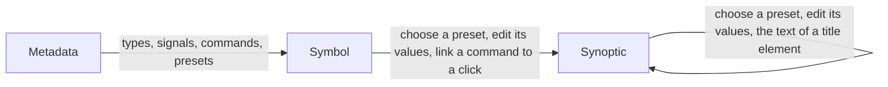

# Who changes what, and where

> [Home](../README.md) › [Metadata](README.md) › Who changes what · Previous: [Versions](13-versions.md) · Next: [Open questions](12-open-questions.md)

Status: validated by the Product Owner on 2026-11-11; the faceplate merged into the presets on 2026-11-16, the name shown of a signal moved to the preset and versions added the same day; the preset split into two modes, Values and Faceplate (the builder), later that day; at the end of the day the model unit left the signal and the Faceplate part was removed. Open points are listed in [Open questions](12-open-questions.md).

Rule of the Product Owner: no duplicate ways to change the same thing. Each thing has one place where it is created and changed.

| Thing | Created and changed in | In a symbol | In a synoptic |
| --- | --- | --- | --- |
| Type (name, parent, icon) | Metadata, General (the parent: set at creation, never changed) | Choose its type among all the types (only here) | No |
| Type documentation | Metadata | No | No |
| Signal, its direction and ID | Metadata | No | No |
| Quantity, families, reference family, conversions, default model unit, default decimals | Nowhere in the application: catalogue files of the software, completed by contributors; read only on the Units page | No | No |
| Quantity of a signal, and whether its value is the quantity or a difference | Signal, in Metadata | No | No |
| Model unit of a quantity, the same for every signal (no longer chosen per signal, 2026-11-16) | Outside Metadata: the catalogue for good, or a configuration file of the project (open) | No | No |
| Enum and its items (key, description, display text) | Enums page | No | No |
| Command | Metadata | Link a command to a click | No |
| Preset and its name | Metadata | Choose one | Choose one |
| Display unit, decimals, default value of each signal | Preset, mode Values, in Metadata | Edit | Edit |
| Elements of the faceplate: signals (name shown, input, read or write), commands (text of their button), titles, descriptions, groups | Preset, mode Faceplate (the builder), in Metadata | Open | Open |
| Texts of the title and description elements of the faceplate (no title nor description by default, 2026-11-16) | Preset, mode Faceplate, in Metadata | Edit (assistant's reading) | Edit, on each placed symbol (assistant's reading) |
| Version of Metadata, its number and change log | Versions page of Metadata | No | No |

## Details

- Types: [Types](01-types.md), [Icons](02-icons.md), [Documentation](03-documentation.md).
- Model side: [Signals](04-signals.md), [Units](05-units.md), [Enums](06-enums.md).
- Front side: [Commands](07-commands.md), [Presets](09-presets.md).
- Versions: [Versions](13-versions.md).

Each page also has its own "Where it is used" table, the detail of the table above. When one changes, the other must change too.
