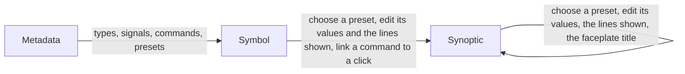

# Who changes what, and where

> [Home](../README.md) › [Metadata](README.md) › Who changes what · Previous: [Presets](09-presets.md) · Next: [Open questions](12-open-questions.md)

Status: validated by the Product Owner on 2026-11-11; the faceplate merged into the presets on 2026-11-16. Open points are listed in [Open questions](12-open-questions.md).

Rule of the Product Owner: no duplicate ways to change the same thing. Each thing has one place where it is created and changed.

| Thing | Created and changed in | In a symbol | In a synoptic |
| --- | --- | --- | --- |
| Type (name, parent, icon) | Metadata, General (the parent: set at creation, never changed) | Choose its type among all the types (only here) | No |
| Type documentation | Metadata | No | No |
| Signal, its ID and display name | Metadata | No | No |
| Quantity, families, reference family, conversions, default model unit, default decimals | Units page | No | No |
| Model unit of a signal (override of the quantity's default) | Signal, in Metadata | No | No |
| Enum and its values | Enums page | No | No |
| Command | Metadata | Link a command to a click | No |
| Preset and its name | Metadata | Choose one | Choose one |
| Lines of the faceplate shown, input, read or write, display unit, decimals, default value | Preset, in Metadata | Edit | Edit |
| Commands shown in the faceplate, text of their button | Preset, in Metadata | Edit | Edit |
| Faceplate title and description | Preset, in Metadata | Edit | Edit, on each placed symbol |

## Details

- Types: [Types](01-types.md), [Icons](02-icons.md), [Documentation](03-documentation.md).
- Model side: [Signals](04-signals.md), [Units](05-units.md), [Enums](06-enums.md).
- Front side: [Commands](07-commands.md), [Presets](09-presets.md).

Each page also has its own "Where it is used" table, the detail of the table above. When one changes, the other must change too.
