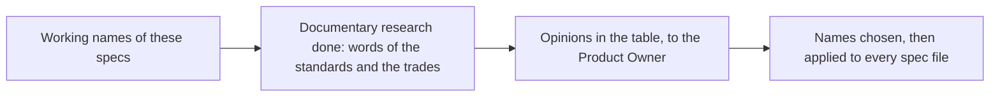

# Naming

> [Home](../README.md) › [Metadata](README.md) › Naming · Previous: [Who changes what](11-who-changes-what.md) · Next: [Open questions](13-open-questions.md)

Status: draft. Names used in these specs are working names. Nothing is chosen.

The Product Owner finds some names misleading (in Figma, "Action" and "Command" in particular) and asks for better ones. The documentary research (2026-11-10) looked at the words used by the standards and by the trades (SCADA, simulation, front-end design systems). Its opinions are in the last column; the Product Owner decides.

| Today | Problem | Proposals | Product Owner's lean | Research opinion (medium confidence unless said) |
| --- | --- | --- | --- | --- |
| Property | In front-end vocabulary it means a visual attribute, but here it is a model signal (an input or an output of the model). | Signal, Variable, Property | Signal: his company already says signal for these, and the specs already speak of signals. | Signal: the word of SSP, Simulink and the IEC. "Property" means metadata in OPC UA. (Caveat: "signal" is also a reactivity mechanism in some front-end frameworks, not checked.) |
| Command (set a property) | Close to "action". | Control, Command | Open. | Keep Command: the word of PackML and OPC UA. "Control" is a screen element at Apple. |
| Event (was "Action") | Close to "command". | Trigger, Event | Open. | Avoid Event: in OPC UA and FMI it goes from the system to the outside, the opposite of here. Trigger conflicts with no source read; or one Command with two variants, with or without a target. Low confidence. |
| Pop-up | Describes a form, not the content. | Panel, Inspector | Not discussed. | Faceplate: the supervision word (Siemens). Keep Inspector for the editor's own panel. |
| Preset | Not sure it is the right word. | Template, Configuration, Profile | Profile looks good. | Keep Preset: Profile means conformity in OPC UA, Template means the type in AutomationML. Profile stays usable if never used near OPC UA. |
| Unit category | Not in the list. | Quantity | Not discussed. | Quantity ("grandeur") says better what the property picks. |

## Rules until the choice is made

- The working names stay in the specs (property, command, event, pop-up, preset), so that every file says the same thing.
- When the names are chosen, they are changed in every file at once, and in the Figma design system, and this file is removed.
- A name is a contract with the model for types and properties (see [Types](01-types.md)): the names of the concepts themselves are changed once, here, never one file at a time.
