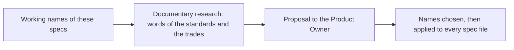

# Naming

> [Home](../README.md) › [Metadata](README.md) › Naming · Previous: [Who changes what](11-who-changes-what.md) · Next: [Open questions](13-open-questions.md)

Status: draft. Names used in these specs are working names. Nothing is chosen.

The Product Owner finds some names misleading (in Figma, "Action" and "Command" in particular) and asks for better ones. The choice is not made by guessing: the vocabulary is part of the documentary research (see [Open questions](13-open-questions.md), "To do later"), which looks at the words used by the standards and by the trades (SCADA, simulation, front-end design systems) before the Product Owner decides.

| Today | Problem | Proposals | Product Owner's lean |
| --- | --- | --- | --- |
| Property | In front-end vocabulary it means a visual attribute, but here it is a model signal (an input or an output of the model). | Signal, Variable, Property | Signal: his company already says signal for these, and the specs already speak of signals. |
| Command (set a property) | Close to "action". | Control, Command | Open. |
| Event (was "Action") | Close to "command". | Trigger, Event | Open. |
| Pop-up | Describes a form, not the content. | Panel, Inspector | Not discussed. |
| Preset | Not sure it is the right word. | Template, Configuration, Profile | Profile looks good. |

## Rules until the choice is made

- The working names stay in the specs (property, command, event, pop-up, preset), so that every file says the same thing.
- When the names are chosen, they are changed in every file at once, and in the Figma design system, and this file is removed.
- A name is a contract with the model for types and properties (see [Types](01-types.md)): the names of the concepts themselves are changed once, here, never one file at a time.
