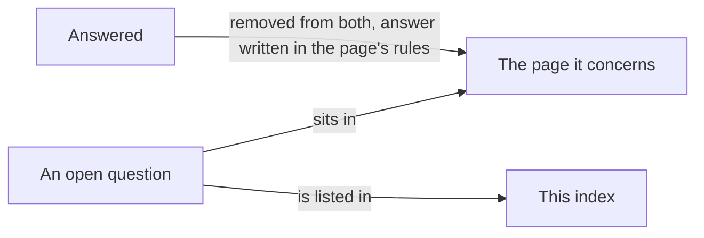

# Metadata: open questions

> [Home](../README.md) › [Metadata](README.md) › Open questions · Previous: [Who changes what](11-who-changes-what.md)

Status: validated by the Product Owner on 2026-11-11, with the questions below still open.

This file is the index of the open questions.

Rule: a question sits in the file it concerns, under "Open questions", and is listed here. A file with no open question has no such section. When a question is answered, it is removed from both places and the answer is written in the rules of the file.

| Question | Page | Written as |
| --- | --- | --- |
| Label of the name in General ("Name" or "ID"); parent fixed (decision 0013) or chosen in a list of the tree indented with dashes; parents kept in a filtered tree; place of the reset buttons | [Types](01-types.md) | Raised while reviewing the wireframes (2026-11-16); the tree, its + and its search icon validated the same day. |
| Palette, icon list and default icon and colour; place of the reset buttons when a list takes several lines | [Icons](02-icons.md) | To define with the design system. |
| Folder, generated files and conflicts between people | [Files and conflicts](../storage/files-and-conflicts.md) | Open, not about metadata. |
| The reference family of a quantity: kept, or replaced by a base unit per quantity, the families only grouping units for reading | [Units](05-units.md#quantities-families-and-conversions) | Asked on 2026-11-17, after the review of the Units page, where the Product Owner did not see what it was for. |
| Source and licence of the ready-made catalogue of units; where the model unit of each quantity is set (catalogue for good, a configuration file of the project, or an annex page) | [Units](05-units.md) | Licences of UCUM, QUDT, CLDR and NIST not checked, to settle before release. The model unit left the signal at the end of 2026-11-16: one per quantity, the same everywhere, set outside Metadata; the Product Owner leans towards the catalogue but will think it over. Once settled, it will be decision 0029. |
| Order of the builder; an element twice; what a symbol or a synoptic changes in the built faceplate; input of a signal that is not an enum | [Presets](09-presets.md) | Raised when the preset was split into Values and the faceplate builder (2026-11-16). The labels Values and Faceplate were confirmed and the Faceplate part removed at the end of the day. |
| Which mode of the description opens first; content of the formatting tool bar and no text colour; editing of a link in place, now that a click on it opens it | [Documentation](03-documentation.md) | Raised when the read-only mode came back, then while reviewing the wireframes (2026-11-16). The order of the links (a handle), the two add icons and the click that opens were decided at the end of the day. |
| Check of a typed value against bound signals | [Signals](04-signals.md) | Waits for the Product Owner's review of the faceplates (2026-11-17). The tie of a bound (none), its direction (usually an input), the header "Quantity / Difference", no decimals on the signal and no bubble on an enum name were settled on 2026-11-17. |
| Default decimals of the catalogue, now that decimals may be set once for the project, outside Metadata | [Units](05-units.md) | The decimals of the preset are kept (Product Owner, 2026-11-17, reviewing the presets: "les décimales ici servent"). The catalogue's default stays as it is until asked. |
| Override an output: who applies it, what is seen while it holds, how it ends | [Commands](07-commands.md), [Presets](09-presets.md#typing-a-value) | The kind is decided (2026-11-16); its mechanism is open. Since 2026-11-17, a signal element of the faceplate set to "override" also overrides an output; the Product Owner leaves it to what is behind the faceplate. |
| One version for all of Metadata or per type; level computed or chosen; undo and going back; what is written between two versions; what symbols see | [Versions](13-versions.md) | Raised when versions replaced Edit and Save (2026-11-16). |
| An ID unique in the type and its tree; the description kept out of the configuration files | [Flags](14-flags.md) | Settled by the Product Owner on 2026-11-17: the description optional, an internal identifier, no warning on delete, no rule on how an ID is written, the order by handle, the inheritance. |
| Handles to order the items by meaning, besides the sort by key; whether a key can change once given; a description for a global enum as a whole; the warning of an uncompleted template (part 3); how the screen shows global against template; changing the kind of an enum; the keys of a template in the configuration files | [Enums](06-enums.md#open-questions) | Raised on 2026-11-17, when the Product Owner split the enums into global enums and templates. |
| Every control the specs need but never describe (create, delete, order...) | [Screens of Metadata](../screens/metadata.md) | Listed as gaps, screen by screen. |

## Documentary research: done

The documentary research of 2026-11-10 covered data models, unit conversions and vocabulary. Its report is `research/t2-recherche-documentaire-unique-modeles-de-donnees/rapport.md` (a source, never committed). What it settles is written in [Types](01-types.md), [Signals](04-signals.md), [Units](05-units.md), [Enums](06-enums.md) and the faceplate rules now in [Presets](09-presets.md), and was validated by the Product Owner on 2026-11-11. The names of the concepts (signal, trigger, faceplate, quantity) come from it and are applied everywhere in these specs. The Figma design system, a separate project, applies the same names when it is redone from these specs.

Not read by the research, to read if the subject matters: the exact linear conversion of OPC UA Part 8, the mirror-object rules of AutomationML (IEC 62714), ISA-101 for "faceplate", and the licences of UCUM, QUDT and CLDR if the application ships a ready-made unit catalogue.
