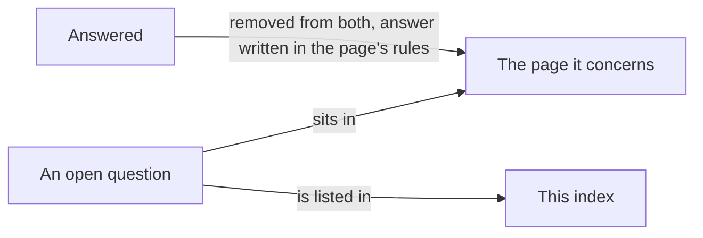

# Metadata: open questions

> [Home](../README.md) › [Metadata](README.md) › Open questions · Previous: [Who changes what](11-who-changes-what.md)

Status: validated by the Product Owner on 2026-11-11, with the questions below still open.

This file is the index of the open questions.

Rule: a question sits in the file it concerns, under "Open questions", and is listed here. A file with no open question has no such section. When a question is answered, it is removed from both places and the answer is written in the rules of the file.

| Question | Page | Written as |
| --- | --- | --- |
| Palette, icon list and default icon and colour | [Icons](02-icons.md) | To define with the design system. |
| Folder, generated files and conflicts between people | [Files and conflicts](../storage/files-and-conflicts.md) | Open, not about metadata. |
| Source and licence of the ready-made catalogue of units | [Units](05-units.md) | Open: the licences of UCUM, QUDT, CLDR and NIST were not checked; to settle before release. |
| A name shown per signal in the preset, or the signal's display name only; where the name of a preset is edited; inputs of a signal that is not an enum; write on an output; order of the lines | [Presets](09-presets.md) | Raised when the faceplate was merged into the presets (2026-11-16). |
| Enum keys: whole numbers only, or any number | [Enums](06-enums.md) | Raised when string keys were removed (2026-11-16). |
| How the five parts of a type are shown (tabs, a column, icons, under the type in the tree) | [Types](01-types.md) | Four proposals drawn for the Product Owner (2026-11-16). |
| Where the description of a type is shown besides its documentation page | [Documentation](03-documentation.md) | Raised by the removal of the libraries of types (2026-11-16). |
| Full page of the description: does the type tree stay visible? | [Documentation](03-documentation.md) | Raised with the full page button (2026-11-16). |
| Table of signals: Edit and Save for the table or a line; hover on an enum; decimal places on the signal itself | [Signals](04-signals.md) | Raised when the signals became a table (2026-11-16); decimals noted at the Product Owner's request the same day. |
| What a text that becomes an input writes, now that commands have a fixed value only; directions a command can target | [Commands](07-commands.md) | Raised when typed values were removed from commands (2026-11-16). |
| Delete by right click in all of Metadata | [Layout rules](../screens/README.md#delete-by-right-click-in-metadata) | Preference of the Product Owner, said with a doubt (2026-11-16). |
| Every control the specs need but never describe (create, delete, order...) | [Screens of Metadata](../screens/metadata.md) | Listed as gaps, screen by screen. |

## Documentary research: done

The documentary research of 2026-11-10 covered data models, unit conversions and vocabulary. Its report is `research/t2-recherche-documentaire-unique-modeles-de-donnees/rapport.md` (a source, never committed). What it settles is written in [Types](01-types.md), [Signals](04-signals.md), [Units](05-units.md), [Enums](06-enums.md) and the faceplate rules now in [Presets](09-presets.md), and was validated by the Product Owner on 2026-11-11. The names of the concepts (signal, trigger, faceplate, quantity) come from it and are applied everywhere in these specs. The Figma design system, a separate project, applies the same names when it is redone from these specs.

Not read by the research, to read if the subject matters: the exact linear conversion of OPC UA Part 8, the mirror-object rules of AutomationML (IEC 62714), ISA-101 for "faceplate", and the licences of UCUM, QUDT and CLDR if the application ships a ready-made unit catalogue.
