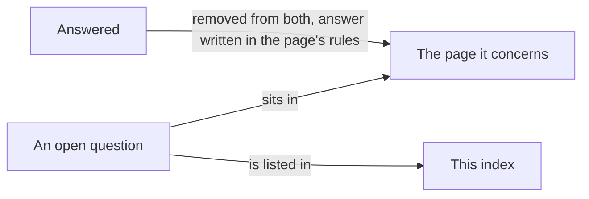

# Metadata: open questions

> [Home](../README.md) › [Metadata](README.md) › Open questions · Previous: [Who changes what](11-who-changes-what.md)

Status: validated by the Product Owner on 2026-11-11, with the questions below still open.

This file is the index of the open questions.

Rule: a question sits in the file it concerns, under "Open questions", and is listed here. A file with no open question has no such section. When a question is answered, it is removed from both places and the answer is written in the rules of the file.

| Question | Page | Written as |
| --- | --- | --- |
| Palette, icon list and default icon and colour | [Icons](02-icons.md) | To define with the design system. |
| Folder, generated files and conflicts between people | [Files and conflicts](../storage/files-and-conflicts.md) | Open, not about metadata. |
| Source and licence of the ready-made catalogue of units | [Units](05-units.md) | Open: the licences of UCUM, QUDT, CLDR and NIST were not checked; to settle before release. |
| Place of the name of a preset (later); input of a signal that is not an enum fixed by its type; order of the lines | [Presets](09-presets.md) | Raised when the faceplate was merged into the presets (2026-11-16); the name shown per signal settled the same day. |
| Which mode of the description opens first: read only or visual | [Documentation](03-documentation.md) | Raised when the read-only mode came back (2026-11-16). |
| Table of signals: a bubble listing the items of an enum; decimal places on the signal itself; where the inherited lines go when the order is chosen by hand | [Signals](04-signals.md) | Decimals: the Product Owner doubts it, not added (2026-11-16). Order by a handle on each line: decided the same day. |
| Override an output: who applies it, what is seen while it holds, how it ends | [Commands](07-commands.md) | The kind is decided (2026-11-16); its mechanism is open. |
| One version for all of Metadata or per type; level computed or chosen; undo and going back; what is written between two versions; what symbols see | [Versions](13-versions.md) | Raised when versions replaced Edit and Save (2026-11-16). |
| Every control the specs need but never describe (create, delete, order...) | [Screens of Metadata](../screens/metadata.md) | Listed as gaps, screen by screen. |

## Documentary research: done

The documentary research of 2026-11-10 covered data models, unit conversions and vocabulary. Its report is `research/t2-recherche-documentaire-unique-modeles-de-donnees/rapport.md` (a source, never committed). What it settles is written in [Types](01-types.md), [Signals](04-signals.md), [Units](05-units.md), [Enums](06-enums.md) and the faceplate rules now in [Presets](09-presets.md), and was validated by the Product Owner on 2026-11-11. The names of the concepts (signal, trigger, faceplate, quantity) come from it and are applied everywhere in these specs. The Figma design system, a separate project, applies the same names when it is redone from these specs.

Not read by the research, to read if the subject matters: the exact linear conversion of OPC UA Part 8, the mirror-object rules of AutomationML (IEC 62714), ISA-101 for "faceplate", and the licences of UCUM, QUDT and CLDR if the application ships a ready-made unit catalogue.
