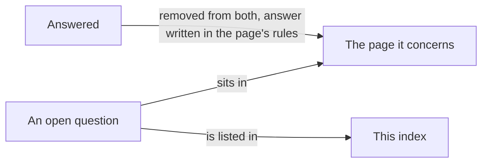

# Metadata: open questions

> [Home](../README.md) › [Metadata](README.md) › Open questions · Previous: [Naming](12-naming.md)

Status: draft. This file is the index of the open questions.

Rule: a question sits in the file it concerns, under "Open questions", and is listed here. A file with no open question has no such section. When a question is answered, it is removed from both places and the answer is written in the rules of the file. Naming questions live only in [Naming](12-naming.md).

| Question | Page | Written as |
| --- | --- | --- |
| On the web, what does a typed-value command do? | [Commands](07-commands.md) | Open; proposal: a button that opens a small input. |
| Palette, icon list and default icon and colour | [Icons](02-icons.md) | To define with the design system. |
| Folder, generated files and conflicts between people | [Files and conflicts](../storage/files-and-conflicts.md) | Open, not about metadata. |
| Apply the decided names to every file and to Figma, then remove the naming file | [Naming](12-naming.md) | Decided on 2026-11-11, to apply in one pass. |
| Does the application ship a catalogue of ready-made units, and under which licence? | [Units](05-units.md) | Open: the licences of UCUM, QUDT, CLDR and NIST were not checked. |

## Documentary research: done

The documentary research of 2026-11-10 covered data models, unit conversions and vocabulary. Its report is `research/t2-recherche-documentaire-unique-modeles-de-donnees/rapport.md` (a source, never committed). What it settles is written in [Types](01-types.md), [Properties](04-properties.md), [Units](05-units.md), [Enums](06-enums.md) and [Naming](12-naming.md), as proposals until the Product Owner confirms.

Not read by the research, to read if the subject matters: the exact linear conversion of OPC UA Part 8, the mirror-object rules of AutomationML (IEC 62714), ISA-101 for "faceplate", and the licences of UCUM, QUDT and CLDR if the application ships a ready-made unit catalogue.
