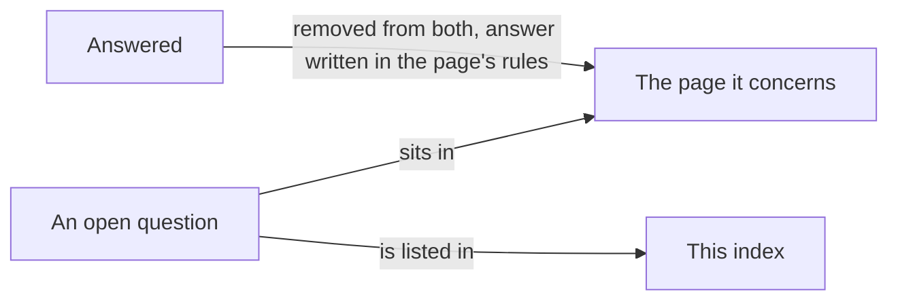

# Metadata: open questions

> [Home](../README.md) › [Metadata](README.md) › Open questions · Previous: [Naming](12-naming.md)

Status: draft. This file is the index of the open questions.

Rule: a question sits in the file it concerns, under "Open questions", and is listed here. A file with no open question has no such section. When a question is answered, it is removed from both places and the answer is written in the rules of the file. Naming questions live only in [Naming](12-naming.md).

| Question | Page | Written as |
| --- | --- | --- |
| Is the description of a pop-up plain text or Markdown? | [Pop-ups](08-popups.md) | Open; proposal: plain text. |
| On the web, what does a typed-value command do? | [Commands](07-commands.md) | Open; proposal: a button that opens a small input. |
| Palette, icon list and default icon and colour | [Icons](02-icons.md) | To define with the design system. |
| Folder, generated files and conflicts between people | [Files and conflicts](../storage/files-and-conflicts.md) | Open, not about metadata. |
| Final names | [Naming](12-naming.md) | Open. |

## To do later

One documentary research is a task of the specification list. It is launched when the conversation is finished, once these files are consistent. It covers three things:

- Data models: full reading of the standards (FMI, OPC UA, AutomationML) and the risks of shared nodes and inheritance for stability. See [Types](01-types.md), [Properties](04-properties.md), [Enums](06-enums.md).
- Unit conversions: which mathematical function is needed to convert any unit into any other unit of the same physical family (kilograms to pounds, never kilograms to volts), across the physics a model can use. See [Units](05-units.md).
- Vocabulary: which words the standards and the trades use for these concepts (signal, variable or property; command, control, event or trigger; preset, template, configuration or profile; pop-up, panel or inspector). See [Naming](12-naming.md).
