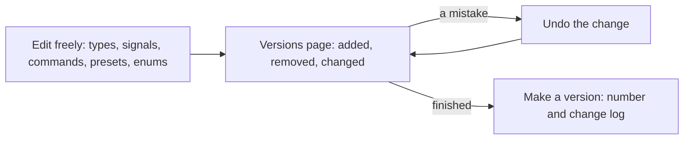
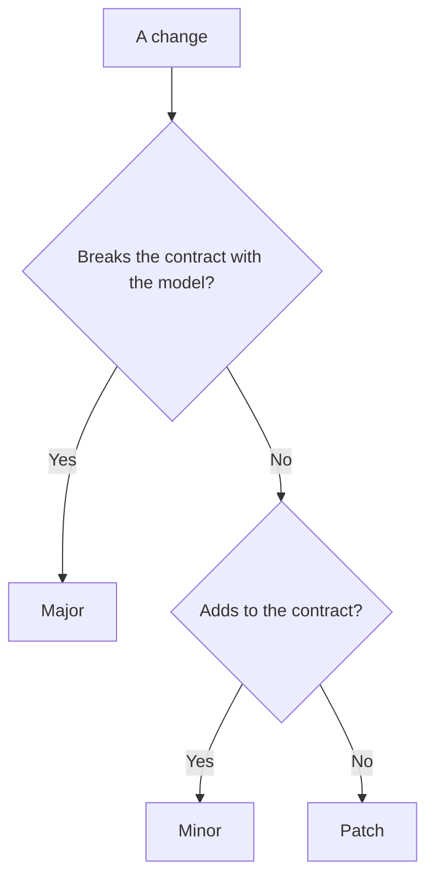

# Versions of Metadata

> [Home](../README.md) › [Metadata](README.md) › Versions · Previous: [Presets](09-presets.md) · Next: [Flags](14-flags.md)

Status: draft, written on 2026-11-16 from the Product Owner's words. The principle (always editable, versions instead of Edit and Save) is decision 0017, accepted on 2026-11-16, which changes decision 0009; the details below are not validated. Open points are listed in [Open questions](12-open-questions.md).

Metadata is always editable, and versions keep it from breaking: the user edits freely, then sees every difference, undoes what is wrong, and makes a version with a number that says how much changed (Product Owner, 2026-11-16: "comme ça, tu n'aurais jamais rien de cassé, et on arrête de mettre des edits validés partout").

## Rules

### Everything is editable all the time

- No Edit button, no Save button, no edit mode to enter and validate, anywhere in Metadata: General, documentation, signals, commands, presets, enums (Product Owner, 2026-11-16: "il faut que tout soit éditable tout le temps, rapidement, et puis basta … tout reste ultra simple").
- The units are not in this list: they are a read-only catalogue that the user never changes (Product Owner, 2026-11-16; see [Units](05-units.md#a-ready-made-catalogue-read-only)). A change of the units never shows on the Versions page.
- It replaces every Edit and Save step decided before (the name of a type, the whole signal, the tables).
- The read-only mode of the description stays: it is a way to read, not a lock (see [Documentation](03-documentation.md#the-description)).

### A Versions page

- The navigation bar of Metadata gets a fourth entry, **Versions**, after Types, Units and Enums (Product Owner, 2026-11-16: "tout à gauche, dans le menu avec Type, Unit, Enum, un truc en mode versionnage").
- The page shows what changed since the last version, thing by thing: what was **added**, what was **removed**, what was **changed**, with the value before and after (a diff).
- From these differences the application writes a **change log** by itself: the user does not write it.
- The user can **undo** a change before making a version ("revenir en arrière avec un revert").
- When the user has finished ("OK, là, j'ai fini"), they make a version. It gets a number in **semantic versioning**: major, minor, patch (for example `2.4.1`), so that the people who work with Metadata, model authors first, know how much changed.

### What makes a version major, minor or patch

Proposed by the assistant from the rules of these specs, to confirm. The number follows what the change does to the contract with the model (see [Types](01-types.md#renaming-is-breaking-on-purpose)).

| Level | When | Examples |
| --- | --- | --- |
| Major | A change that breaks the contract with the model. | A type, a signal or a command removed or renamed; the type, direction, enum or quantity (or its choice of quantity or difference) of a signal changed; an enum key changed or removed. |
| Minor | Something added to the contract, nothing broken. | A new type, signal, command, enum or enum item. |
| Patch | Nothing the model sees. | Documentation, icon and colour, order of the signals and of the commands, presets (display unit, decimals, default value; the elements of the faceplate builder: signals with their name shown, input and its bounds, read or write and read or override, commands with their button, titles, descriptions, groups), display texts of enum items. |

A bound is a signal of its own since 2026-11-17 (see [Signals](04-signals.md)): adding, removing or changing one follows the rules of any signal above.

## Where it is used

| Thing | Created and changed in | Used in | In a symbol | In a synoptic |
| --- | --- | --- | --- | --- |
| Version of Metadata, its number and change log | Versions page of Metadata | Model authors; anyone who works with Metadata | No | No |

## Open questions

- One version for all of Metadata, or one per type? Written here as one for all of it, since the page sits in the navigation bar next to Types, Units and Enums: assistant's reading, to confirm.
- The level of a version: computed by the application from the table above and only shown, or proposed and changeable by the user?
- Undo: one change at a time, all the changes since the last version, or both? Can the user go back to an older version, not only undo the changes not yet versioned?
- What is written to the files between two versions: every change at once (nothing lost if the application closes), or only when a version is made? See [Files and conflicts](../storage/files-and-conflicts.md).
- What the symbols and the synoptics see: always the latest version, or the version they were made with?
