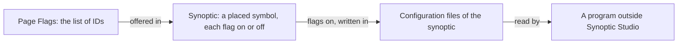

# Flags

> [Home](../README.md) › [Metadata](README.md) › Flags · Previous: [Versions](13-versions.md) · Next: [Who changes what](11-who-changes-what.md)

Status: draft, from the Product Owner's description of 2026-11-17. Not validated. The name "Flag" is the assistant's proposal, to confirm (the Product Owner: "je ne sais pas comment l'appeler [...] tu vas trouver le bon terme"). The place of the page is to confirm too. Open points are listed in [Open questions](#open-questions).

A flag is a key that a symbol placed in a synoptic has or does not have. Synoptic Studio does nothing with it: it only writes it in the configuration files it produces, so that something outside the application can customise that symbol. Flags let the user say explicitly that a given symbol has a given option.

## Rules

- **A new page holds the list of flags** (Product Owner, 2026-11-17: "il va falloir une nouvelle page"). The user adds flags there; they are offered later in the synoptic.
- **A flag is only an ID** (Product Owner: "c'est juste une liste de [...] clés ou tokens [...] qui sont juste des IDs"): no value, no type, no unit. No description either: assistant's reading of "juste des IDs", to confirm.
- **A flag means nothing to Synoptic Studio** (Product Owner: "une option qui n'a rien à voir avec le soft, avec mon soft à moi"). The application never reads it to draw, animate or check anything.
- **In the synoptic view, each placed symbol has each flag on or off** (Product Owner: "quand on est sur la vue synoptique, on peut sélectionner ou non les tokens"). Off by default: assistant's reading, to confirm.
- **The flags that are on go out in the configuration files** produced by the synoptic (Product Owner: "c'est juste pour pouvoir faire de la personnalisation externe via des clés, vu qu'en toute fin, ça sort des fichiers de config"). Their format there is settled with [Storage](../storage/README.md).
- **Every flag is offered on every placed symbol**: assistant's choice, the simplest, to confirm. The other way would be that each type lists the flags its symbols may have.
- The panel of the synoptic where the flags are ticked is described with part 3 (the synoptic), not written yet.

## The name

"Flag" is proposed because it says exactly what the thing is, a mark that is on or off, and because the other words are already taken in these specs or in the trade.

| Word | Taken by | Opinion |
| --- | --- | --- |
| Flag | Nothing in these specs; in software, a "feature flag" is a key switched on or off | Proposed |
| Tag | In supervision, a tag is a variable, a point of data: the meaning of a signal | Refused: confusing for the people of the trade |
| Token | The design tokens of the design system (colours, sizes) | Refused: confusing for the people who build the interface |
| Key | The key of an enum item, sent to the model (see [Enums](06-enums.md)) | Refused: already used in Metadata |
| Option | The options and settings of the application itself | Refused: the flag is not an option of the software |

## Example

Three flags, used by a company that reads the configuration files of its synoptics with its own program. The IDs are made up for the example.

| Flag | What the company's program does with it (outside Synoptic Studio) |
| --- | --- |
| `show_in_overview` | Shows the symbol on its overview screen. |
| `maintenance_watch` | Puts the equipment on the maintenance list. |
| `export_to_mes` | Sends the equipment's values to its production system. |

In the synoptic "Line 1", the pump P-101 has `show_in_overview` and `export_to_mes` on; the valve V-12 has none.

## Where it is used

| Thing | Created and changed in | Used in | In a symbol | In a synoptic |
| --- | --- | --- | --- | --- |
| Flag (ID) | Page Flags (place to confirm) | Configuration files of the synoptic | No | On or off, per placed symbol |

## Open questions

- The name: "Flag", or another word?
- The place of the page: in the navigation bar of Metadata, after Enums, or with the settings of the project (where the decimals may go, see [Signals](04-signals.md#rules))?
- Every flag on every placed symbol, or each type lists the flags allowed for its symbols?
- A description for each flag, to say what it is for, or the ID alone?
- Renaming or deleting a flag that symbols of a synoptic have on: a warning that says how many? Does a flag follow a rename through an internal identifier, as a signal does?
- The rules of an ID (characters allowed, unique), and the order of the list (a handle, as for the signals?).
- Are flags part of the [Versions](13-versions.md) of Metadata, if the page sits in Metadata?
