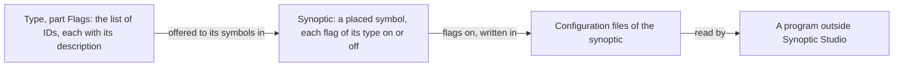

# Flags

> [Home](../README.md) › [Metadata](README.md) › Flags · Previous: [Versions](13-versions.md) · Next: [Who changes what](11-who-changes-what.md)

Status: draft, from the Product Owner's description of 2026-11-17, then his answers of the same day (the name, the place, an ID and a description per flag). Not validated. Open points are listed in [Open questions](#open-questions).

A flag is a key that a symbol placed in a synoptic has or does not have. Synoptic Studio does nothing with it: it only writes it in the configuration files it produces, so that something outside the application can customise that symbol. Flags let the user say explicitly that a given symbol has a given option.

## Rules

- **The name is "Flag"** (Product Owner, 2026-11-17: "flag, ça me va très bien"). Like every name of these specs, it may be challenged again later by a documentary research (Product Owner: "tous les noms, ils seront rechallengés après, je pense, avec une recherche").
- **Flags are a part of the type**, not a page of their own (Product Owner, 2026-11-17: "la page, elle fait partie des types [...] c'est des flags qui sont donnés en fonction du type"; decision 0028, accepted on 2026-11-17, which completes decision 0023). The parts of a type become General, Documentation, Signals, Commands, Flags, then Presets (see [Types](01-types.md#the-parts-of-a-type-a-list-fixed-under-the-tree)). The Product Owner listed the first five in this order; Presets, which he did not name, stays last, unchanged.
- **Each type lists its own flags.** A symbol placed in a synoptic is offered the flags of its type only.
- **A flag is an ID and a description** (Product Owner: "c'est juste une liste de [...] clés ou tokens [...] qui sont juste des IDs"; then, on 2026-11-17: "ce qu'il faut, c'est un [ID de] flag et une description. Comme ça, on se permet au moins de capter ce que c'est, en gros, et c'est tout"). No value, no type, no unit, nothing else.
  - **The ID** is the key written in the configuration files.
  - **The description** says in a few words what the flag is for, so that the user understands it. Plain text, as the description of an enum item (see [Enums](06-enums.md)). Optional, and never written in the configuration files: assistant's reading, as for the enum items, to confirm.
- **A flag means nothing to Synoptic Studio** (Product Owner: "une option qui n'a rien à voir avec le soft, avec mon soft à moi"). The application never reads it to draw, animate or check anything.
- **In the synoptic view, each placed symbol has each flag of its type on or off** (Product Owner: "quand on est sur la vue synoptique, on peut sélectionner ou non les tokens"). Off by default: assistant's reading.
- **The flags that are on go out in the configuration files** produced by the synoptic (Product Owner: "c'est juste pour pouvoir faire de la personnalisation externe via des clés, vu qu'en toute fin, ça sort des fichiers de config"). Their format there is settled with [Storage](../storage/README.md).
- **A sub-type inherits the flags of its parent**, as it inherits its signals and commands (see [Types](01-types.md)): assistant's reading, kept until the Product Owner says otherwise.
- Flags are part of Metadata, so they are part of its [Versions](13-versions.md).
- The panel of the synoptic where the flags are ticked is described with part 3 (the synoptic), not written yet.

## The name

"Flag" says exactly what the thing is, a mark that is on or off, and the other words are already taken in these specs or in the trade. Chosen by the Product Owner on 2026-11-17.

| Word | Taken by | Opinion |
| --- | --- | --- |
| Flag | Nothing in these specs; in software, a "feature flag" is a key switched on or off | Chosen |
| Tag | In supervision, a tag is a variable, a point of data: the meaning of a signal | Refused: confusing for the people of the trade |
| Token | The design tokens of the design system (colours, sizes) | Refused: confusing for the people who build the interface |
| Key | The key of an enum item, sent to the model (see [Enums](06-enums.md)) | Refused: already used in Metadata |
| Option | The options and settings of the application itself | Refused: the flag is not an option of the software |

## Example

Flags of the type `centrifugal_pump`, used by a company that reads the configuration files of its synoptics with its own program. The IDs are made up for the example.

| Flag (ID) | Description (written by the user, in the type) |
| --- | --- |
| `show_in_overview` | Shows the pump on the overview screen. |
| `maintenance_watch` | Puts the pump on the maintenance list. |
| `export_to_mes` | Sends the pump's values to the production system. |

What each flag really does is decided by the company's program, outside Synoptic Studio; the description only tells the user.

In the synoptic "Line 1", the pump P-101 has `show_in_overview` and `export_to_mes` on; the pump P-102 has none. A valve placed in the same synoptic is offered the flags of its own type, not these.

## Where it is used

| Thing | Created and changed in | Used in | In a symbol | In a synoptic |
| --- | --- | --- | --- | --- |
| Flag (ID) | Part Flags of a type | Configuration files of the synoptic | No | On or off, per placed symbol of that type |
| Description of a flag | Part Flags of a type | Shown to the user only | No | Shown next to the flag, to tick it knowingly: assistant's reading, described with part 3 |

## Open questions

Not asked: written here so that they are not lost, for when the Product Owner comes back to this page.

- The description: optional, and kept out of the configuration files? (Assistant's reading, as for the enum items.)
- Renaming or deleting a flag that symbols of a synoptic have on: what the warning says; does a flag follow a rename through an internal identifier, as a signal does?
- The rules of an ID (characters allowed, unique in the type and its tree), and the order of the list (a handle, as for the commands?).
- Inheritance: confirmed as above, or each type its own flags only?
