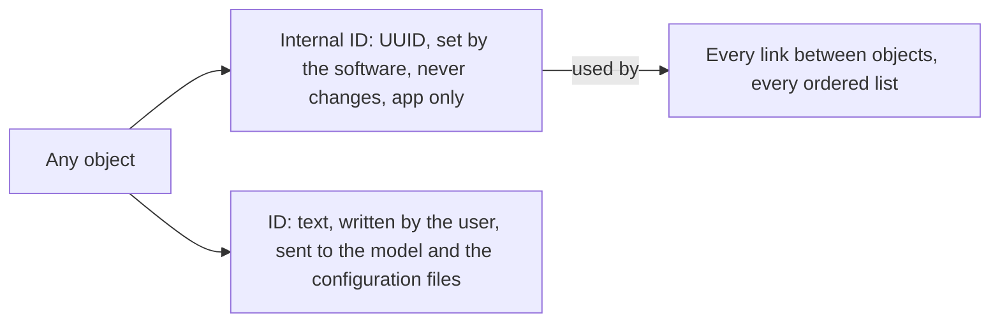
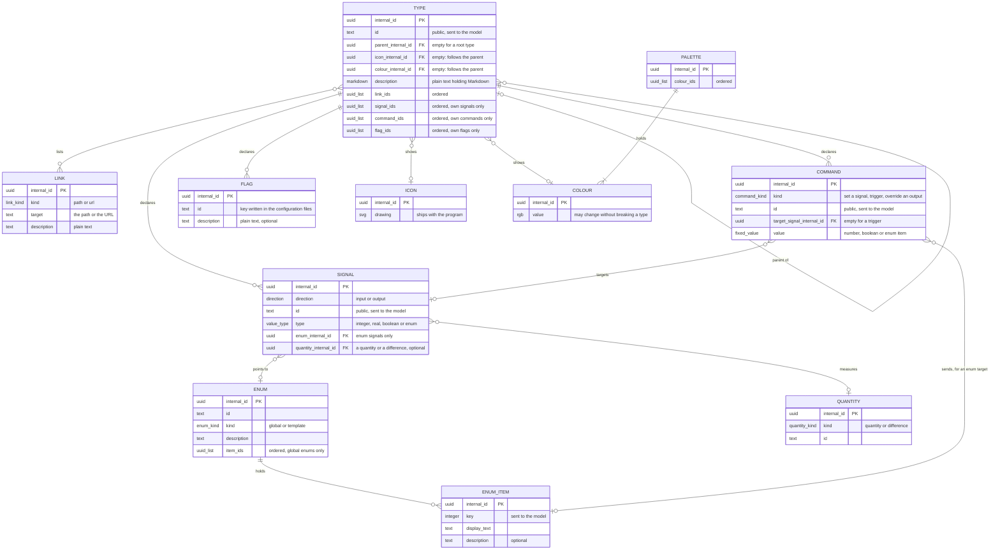
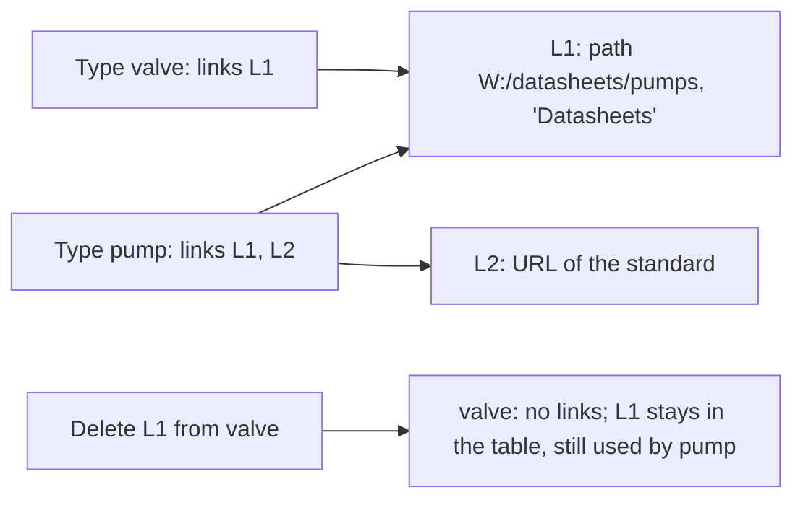

# Data model

> [Home](../README.md) › [Metadata](README.md) › Data model · Previous: [Flags](14-flags.md) · Next: [Who changes what](11-who-changes-what.md)

Status: draft, from the Product Owner's description of 2026-11-18 (the type, its links, signals, commands and flags, as tables linked by internal identifiers). Not validated. The presets are left out: the Product Owner is not ready to describe them yet ("je ne suis pas prêt à le faire"). Open points are listed in [Open questions](#open-questions).

This page is the logical representation of Metadata: the objects, their fields, and how they point to each other. It says what is stored, not how (files, database): the format of the files is settled with [Storage](../storage/README.md).

## Rules

- **Every object has two identifiers** (Product Owner, 2026-11-18):
  - an **internal ID**, a UUID set by the software, that never changes and never goes to the model. Every link between two objects goes through it;
  - an **ID**, the public identifier: a text, written by the user, sent everywhere (the model, the configuration files). It is what the pages already call the ID of a signal, of a command and of a flag, and the name of a type.
- **The words "internal ID" and "ID" are the Product Owner's leaning, not a decision** (Product Owner, 2026-11-18: "je pense que c'est mieux de juste l'appeler ID [...] peut-être, j'ai peut-être tort"). The other pair he named is "internal identifier" and "public identifier". A documentary research checks the words first (see [The names of the two identifiers](#the-names-of-the-two-identifiers)).
- **An object points to another by its internal ID, never by its ID or by a copy** (Product Owner, 2026-11-18): the parent of a type, its icon, its colour, the enum and the quantity of a signal, the target of a command. So renaming an ID breaks nothing in the application (see [Types](01-types.md)).
- **An ordered list is a list of internal IDs**: the place of an internal ID in the list is the place of the object on the screen (Product Owner, 2026-11-18: "en fonction de l'ordre de la liste, ça donne l'ordre"). It is how the handles of the tables keep their order: the objects themselves hold no position.
- A type holds **its own lines only**; the inherited ones are read from its parents, up the branch (see [Signals](04-signals.md#the-table-of-signals)).

## The schema

The diagram below shows every table and how they point to each other; each line reads from the table that holds the internal ID to the table it points to. `uuid_list` is an ordered list of internal IDs.

## The type

Said by the Product Owner on 2026-11-18.

| Field | Kind of value | Rule |
| --- | --- | --- |
| Internal ID | UUID | Set by the software, never changes. |
| ID | Text | The public identifier, sent to the model. Today called the name of the type (see [Types](01-types.md)). |
| Parent | Internal ID of a type | Empty for a root type. The screen shows the parent's ID and icon, read from it ("côté UI, montrer juste le parent"). Fixed at creation (decision 0013). |
| Icon | Internal ID of an icon | Empty: the type follows its parent's icon (see [Icons](02-icons.md#icon-and-colour-are-inherited)). |
| Colour | Internal ID of a colour | Empty: the type follows its parent's colour. A colour of a palette is pointed to by its internal ID, never by its colour code, so a palette that changes changes every type that uses it ("si jamais la palette change, c'est plus simple"). |
| Description | Text, holding Markdown | Plain text, not a binary object: the Markdown is read when it is shown (Product Owner: "ce n'est peut-être pas un blob, mais du texte [...] qui sera du Markdown, mais du texte brut"). |
| Links | Ordered list of internal IDs of links | See [The links](#the-links). |
| Signals | Ordered list of internal IDs of signals | Its own signals only. |
| Commands | Ordered list of internal IDs of commands | Its own commands only. |
| Flags | Ordered list of internal IDs of flags | Its own flags only. |
| Presets | Not described yet | Left out by the Product Owner on 2026-11-18. |

- Empty for "follows the parent" is how the reset of the icon and of the colour is kept: the reset empties the field. Assistant's reading, to confirm.

## The links

Said by the Product Owner on 2026-11-18.

- **One table of links, common to every type** ("une table commune pour tout le monde").
- A link has a **kind**, path or URL; a **target**, the path or the URL itself; and a **description** (see [Documentation](03-documentation.md#the-links)).
- **The type holds the ordered list of the internal IDs of its links**; the order of the list is the order on the screen.
- **The table holds only unique links**: two types that point to exactly the same link point to the same line, and no new line is made ("t'es pas obligé de créer une nouvelle ligne").
- **Deleting a link from a type removes its internal ID from the type's list only**; the line stays in the table of links ("ça ne le supprime pas de la table links").

- Assistant's reading, to confirm: since a line is shared, it never changes. Changing the target or the description of a link in a type points that type to the line that holds the new values, found or made; the other types keep the old line. Otherwise a change in one type would change another silently, against the rule of no virtual link (see [Types](01-types.md)).
- Which fields make two links "the same" is asked (see [Open questions](#open-questions)).

## The signals

Said by the Product Owner on 2026-11-18: a table of their own, pointed to by internal ID, as the links.

| Field | Kind of value | Rule |
| --- | --- | --- |
| Internal ID | UUID | Set by the software, never changes. |
| Direction | Enum: input or output | Seen from the model (see [Signals](04-signals.md#fields)). |
| ID | Text | The public identifier, sent to the model. |
| Type | Enum: integer, real, boolean or enum | No text (decision 0043). |
| Enum | Internal ID of an enum | For an enum signal only. |
| Quantity / Difference | Internal ID of a quantity or of a difference | Optional; integers and reals only. Each quantity and each difference of the catalogue has its own internal ID (see [Units](05-units.md#value-or-difference-chosen-in-the-signal)). |

- A signal belongs to one type, unlike a link: two types never share a signal line. Sharing one would change two types at once, a virtual link the rule of [Types](01-types.md) refuses. Assistant's reading, to confirm.

## The commands

Said by the Product Owner on 2026-11-18.

| Field | Kind of value | Rule |
| --- | --- | --- |
| Internal ID | UUID | Set by the software, never changes. |
| Kind | Enum: set a signal, trigger, override an output | See [Commands](07-commands.md). |
| ID | Text | The public identifier. |
| Target signal | Internal ID of a signal | An input for "set a signal", an output for "override an output", empty for a trigger. |
| Value | A number, a boolean, or an item of an enum | Fixed, of the type of the target signal; empty for a trigger. Never a text (decision 0043; Product Owner: "ça fait number, booléen ou enum"). |

- For an enum target, the value points to the item by its internal ID, so that a key changed later is followed. Assistant's proposal, which needs an internal ID on each enum item (asked, see [Open questions](#open-questions)).

## The flags

Said by the Product Owner on 2026-11-18, as [Flags](14-flags.md) already says.

| Field | Kind of value | Rule |
| --- | --- | --- |
| Internal ID | UUID | Set by the software, never changes. |
| ID | Text | The key written in the configuration files. No rule on how it is written. |
| Description | Text | Plain text, optional. |

## The tables pointed to

These tables are pointed to by the type and its parts. The Product Owner did not go through them on 2026-11-18; they are written from the pages already validated.

| Table | Made by | Fields | Page |
| --- | --- | --- | --- |
| Icon | The program: a list of SVG files shipped with it | Internal ID, the SVG drawing | [Icons](02-icons.md) |
| Palette, colour | The design system | A palette holds an ordered list of colours; a colour has an internal ID and its value | [Icons](02-icons.md) |
| Enum, enum item | The user, on the Enums page | An enum: internal ID, ID, kind (global or template), description, ordered list of its items. An item: key (a whole number), display text, description | [Enums](06-enums.md) |
| Quantity, difference | The catalogue of the software, read only | Internal ID, ID, kind (quantity or difference) | [Units](05-units.md) |

- "Palettes" in the plural is the Product Owner's word on 2026-11-18 ("comme ça, on peut faire des palettes et tout"); [Icons](02-icons.md) still says one fixed palette. How many palettes there are is left to the design system.
- The items of a template enum are completed on each placed symbol, in the synoptic (see [Enums](06-enums.md#global-enums-and-templates)): their table comes with part 3.

## The names of the two identifiers

- The Product Owner leans towards **"ID"** for the public identifier, and **"internal ID"** for the UUID (2026-11-18). He asked for a documentary research before settling it.
- What the first research already found (`research/t2-recherche-documentaire-unique-modeles-de-donnees/rapport.md`, section 3.1): the three standards separate a readable name from a technical identifier, but call them otherwise. FMI says `name` and `valueReference`; OPC UA says `BrowseName` and `NodeId`; AutomationML says `Name` and `ID`, where `ID` is the technical one. So "ID" for the public identifier is the opposite of AutomationML's use.
- The new research (task of the feature Specification) settles the words for Synoptic Studio.

## Where it is used

| Thing | Created and changed in | Used in | In a symbol | In a synoptic |
| --- | --- | --- | --- | --- |
| Internal ID of any object | The software, at creation | Every link between objects, every ordered list | Links to the type, its signals and commands | Links to the flags of a placed symbol |
| ID of any object | Metadata | The model, the configuration files | No | No |

## Open questions

- Which fields make two links the same line of the table: the kind, the target and the description, or the kind and the target only (the description then kept in the type's list)?
- Must each enum item have an internal ID, so that a command's value and a preset follow a key changed later?
- Must the ID of a type be unique in the whole tree?
- The words "ID" and "internal ID": to settle with the documentary research.
- The presets: their tables, when the Product Owner describes them.
