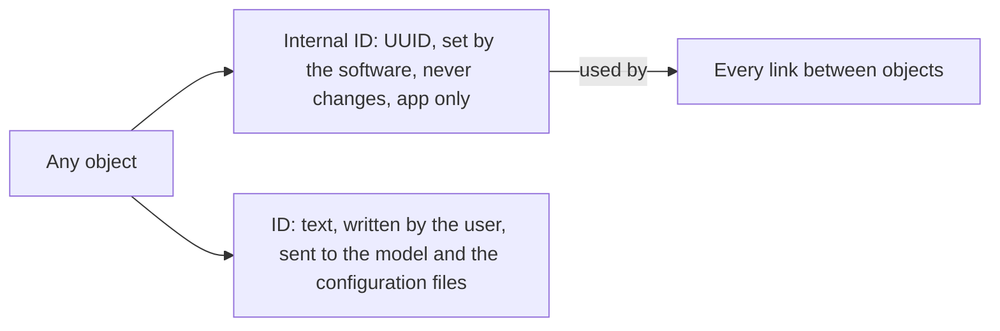
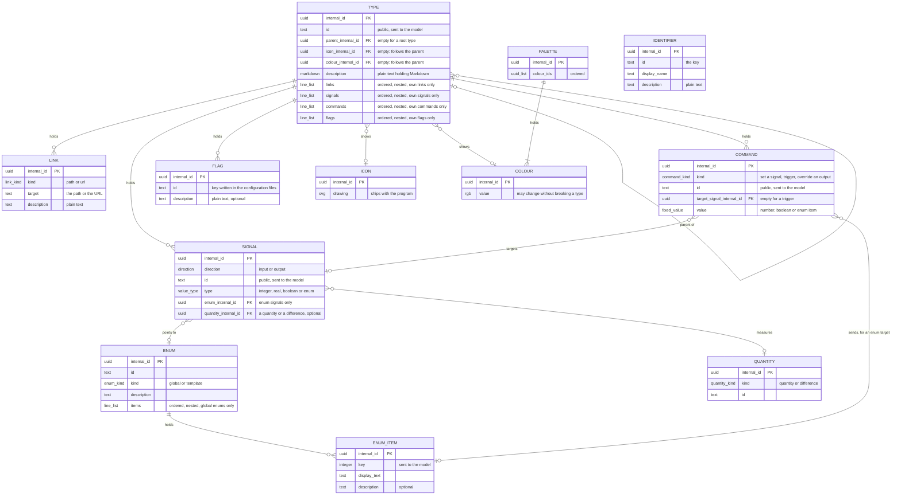
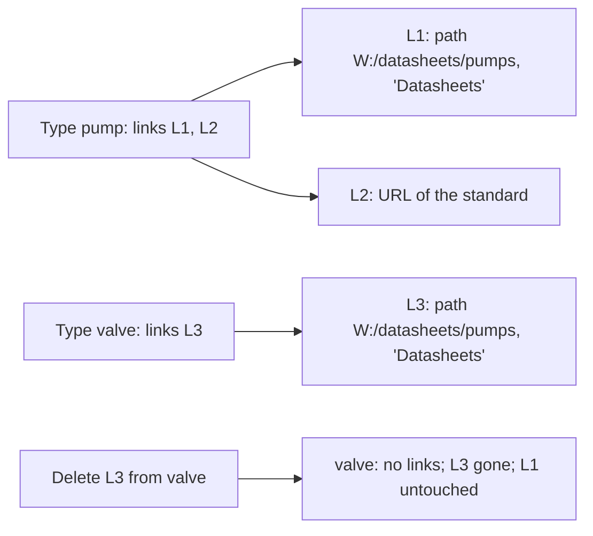

# Data model

> [Home](../README.md) › [Metadata](README.md) › Data model · Previous: [Flags](14-flags.md) · Next: [Identifiers](16-identifiers.md)

Status: draft, from the Product Owner's description of 2026-11-18 (the type, its links, signals, commands and flags, as tables linked by internal identifiers). Not validated. The presets are left out: the Product Owner is not ready to describe them yet ("je ne suis pas prêt à le faire"). Open points are listed in [Open questions](#open-questions).

This page is the logical representation of Metadata: the objects, their fields, and how they point to each other. The Product Owner leans towards saving it as JSON files, with no database: [As JSON](#as-json) shows what that means for the schema. The folder and the conflicts are settled with [Storage](../storage/README.md).

## Rules

- **Every object has two identifiers** (Product Owner, 2026-11-18):
  - an **internal ID**, a UUID set by the software, that never changes and never goes to the model. Every link between two objects goes through it;
  - an **ID**, the public identifier: a text, written by the user, sent everywhere (the model, the configuration files). It is what the pages already call the ID of a signal, of a command and of a flag, and the name of a type.
- **The words "internal ID" and "ID" are the Product Owner's leaning, not a decision** (Product Owner, 2026-11-18: "je pense que c'est mieux de juste l'appeler ID [...] peut-être, j'ai peut-être tort"). The other pair he named is "internal identifier" and "public identifier". A documentary research checks the words first (see [The names of the two identifiers](#the-names-of-the-two-identifiers)).
- **An object points to another by its internal ID, never by its ID or by a copy** (Product Owner, 2026-11-18): the parent of a type, its icon, its colour, the enum and the quantity of a signal, the target of a command. So renaming an ID breaks nothing in the application (see [Types](01-types.md)).
- **The order of a list is the order on the screen** (Product Owner, 2026-11-18: "en fonction de l'ordre de la liste, ça donne l'ordre"). It is how the handles of the tables keep their order: the objects themselves hold no position.
- **The links, signals, commands and flags of a type are nested in it, not kept in tables of their own** (Product Owner, 2026-11-18, answering the questionnaire: "Tout imbriqué dans le type"), if Metadata is saved as JSON (see [As JSON](#as-json)). Each line keeps its internal ID; the type holds them in ordered lists of lines, not lists of internal IDs. So a line belongs to one type and is never shared.
- A type holds **its own lines only**; the inherited ones are read from its parents, up the branch (see [Signals](04-signals.md#the-table-of-signals)).



## The schema

The diagram below shows every object and how they point to each other. A line marked "holds" is a nested list: the links, signals, commands and flags are written inside their type, the items inside their enum. Every other line reads from the object that holds the internal ID to the object it points to. `uuid_list` is an ordered list of internal IDs.



## The type

Said by the Product Owner on 2026-11-18.

| Field | Kind of value | Rule |
| --- | --- | --- |
| Internal ID | UUID | Set by the software, never changes. |
| ID | Text | The public identifier, sent to the model. Today called the name of the type (see [Types](01-types.md)). **Unique in the whole tree of types** (Product Owner, 2026-11-18, decision 0047, answering the questionnaire: "Oui, unique dans tout l'arbre"): the model knows a type by its ID, so two types with the same ID would be mixed up. |
| Parent | Internal ID of a type | Empty for a root type. The screen shows the parent's ID and icon, read from it ("côté UI, montrer juste le parent"). Fixed at creation (decision 0013). |
| Icon | Internal ID of an icon | Empty: the type follows its parent's icon (see [Icons](02-icons.md#icon-and-colour-are-inherited)). |
| Colour | Internal ID of a colour | Empty: the type follows its parent's colour. A colour of a palette is pointed to by its internal ID, never by its colour code, so a palette that changes changes every type that uses it ("si jamais la palette change, c'est plus simple"). |
| Description | Text, holding Markdown | Plain text, not a binary object: the Markdown is read when it is shown (Product Owner: "ce n'est peut-être pas un blob, mais du texte [...] qui sera du Markdown, mais du texte brut"). |
| Links | Ordered list of links, nested | See [The links](#the-links). |
| Signals | Ordered list of signals, nested | Its own signals only. |
| Commands | Ordered list of commands, nested | Its own commands only. |
| Flags | Ordered list of flags, nested | Its own flags only. |
| Presets | Not described yet | Left out by the Product Owner on 2026-11-18. |

- Empty for "follows the parent" is how the reset of the icon and of the colour is kept: the reset empties the field. Assistant's reading, to confirm.

## The links

Said by the Product Owner on 2026-11-18.

- **The links are nested in their type** (Product Owner, 2026-11-18, answering the questionnaire: "Tout imbriqué dans le type"). It replaces "one table of links, common to every type", said earlier the same day ("une table commune pour tout le monde").
- A link has an **internal ID**, a **kind**, path or URL; a **target**, the path or the URL itself; and a **description** (see [Documentation](03-documentation.md#the-links)).
- **The order of the type's list of links is the order on the screen.**
- **A link belongs to one type: links are never shared** (Product Owner, 2026-11-18, decision 0047: "on rajoute une ligne à chaque fois, et puis basta"). Two types that point to the same path have two links; the same path is written twice. Few links are expected, so the duplicates cost little ("ça se peut pas beaucoup non plus, parce qu'il y a pas énormément de données").
- **Adding a link adds it to the type's list.**
- **Changing a link changes it in its type only**: no other type changes.
- **Deleting a link removes it from the type's list**, and nothing is left elsewhere ("c'est supprimé [...] et puis basta").



## The signals

Said by the Product Owner on 2026-11-18: nested in their type, as the links, each with its internal ID.

| Field | Kind of value | Rule |
| --- | --- | --- |
| Internal ID | UUID | Set by the software, never changes. |
| Direction | Enum: input or output | Seen from the model (see [Signals](04-signals.md#fields)). |
| ID | Text | The public identifier, sent to the model. |
| Type | Enum: integer, real, boolean or enum | No text (decision 0043). |
| Enum | Internal ID of an enum | For an enum signal only. |
| Quantity / Difference | Internal ID of a quantity or of a difference | Optional; integers and reals only. Each quantity and each difference of the catalogue has its own internal ID (see [Units](05-units.md#value-or-difference-chosen-in-the-signal)). |

- **A signal belongs to one type, like a link**: two types never share a signal. Sharing one would change two types at once, a virtual link the rule of [Types](01-types.md) refuses. Confirmed by the Product Owner choosing lines nested in their type (2026-11-18). The same holds for commands and flags.

## The commands

Said by the Product Owner on 2026-11-18.

| Field | Kind of value | Rule |
| --- | --- | --- |
| Internal ID | UUID | Set by the software, never changes. |
| Kind | Enum: set a signal, trigger, override an output | See [Commands](07-commands.md). |
| ID | Text | The public identifier. |
| Target signal | Internal ID of a signal | An input for "set a signal", an output for "override an output", empty for a trigger. |
| Value | A number, a boolean, or an item of an enum | Fixed, of the type of the target signal; empty for a trigger. Never a text (decision 0043; Product Owner: "ça fait number, booléen ou enum"). |

- For an enum target, the value points to the item by its internal ID, so that a key changed later is followed: **each enum item has its own internal ID** (Product Owner, 2026-11-18, decision 0047, answering the questionnaire: "Oui, un internal ID par item").

## The flags

Said by the Product Owner on 2026-11-18, as [Flags](14-flags.md) already says.

| Field | Kind of value | Rule |
| --- | --- | --- |
| Internal ID | UUID | Set by the software, never changes. |
| ID | Text | The key written in the configuration files. No rule on how it is written. |
| Description | Text | Plain text, optional. |

## The tables pointed to

These tables are pointed to by the type and its parts. The Product Owner did not go through them on 2026-11-18; they are written from the pages already validated.

| Table | Made by | Fields | Page |
| --- | --- | --- | --- |
| Icon | The program: a list of SVG files shipped with it | Internal ID, the SVG drawing | [Icons](02-icons.md) |
| Palette, colour | The design system | A palette holds an ordered list of colours; a colour has an internal ID and its value | [Icons](02-icons.md) |
| Enum, enum item | The user, on the Enums page | An enum: internal ID, ID, kind (global or template), description, ordered list of its items. An item: internal ID, key (a whole number), display text, description | [Enums](06-enums.md) |
| Quantity, difference | The catalogue of the software, read only | Internal ID, ID, kind (quantity or difference) | [Units](05-units.md) |
| Identifier (working name, 2026-11-18) | The user, on the Identifiers page | Internal ID, ID, display name, description; no value, no default value. One ordered list, the order on the screen | [Identifiers](16-identifiers.md) |

- The identifiers are pointed to by the title and description elements of the faceplate builder (a field holds a fixed text, or the internal ID of an identifier or of a signal): their table comes with the presets, not described yet. Their text, filled on each placed symbol, comes with part 3.
- If JSON: one file for the whole ordered list of identifiers (proposal, `identifiers.json`), since the order of the list is the order on the screen.

- "Palettes" in the plural is the Product Owner's word on 2026-11-18 ("comme ça, on peut faire des palettes et tout"); [Icons](02-icons.md) still says one fixed palette. How many palettes there are is left to the design system.
- The items of a template enum are completed on each placed symbol, in the synoptic (see [Enums](06-enums.md#global-enums-and-templates)): their table comes with part 3.

## As JSON

Status: a leaning of the Product Owner, not a decision (2026-11-18: "On va peut-être tout faire en JSON pour pas faire compliqué"). Everything below marked "proposal" is the assistant's, to confirm.

### Each kind of value in JSON

Every field of the schema has a JSON equivalent; the links between objects stay by internal ID.

| In the schema | In JSON | Rule |
| --- | --- | --- |
| UUID (internal ID) | String | Lower case, 36 characters with the dashes. |
| Text, Markdown | String | The Markdown stays plain text in the string. |
| Integer (an enum key) | Number, without a fraction | Exact in JavaScript up to 9 007 199 254 740 991: a key beyond it is refused. |
| Real | Number | JSON has no "not a number" nor infinity: a bound left open is `null`, never infinity. |
| Boolean | `true` or `false` |  |
| A choice of the software (direction, kind) | A fixed string | `"input"`, `"output"`, `"path"`, `"url"`... in English, never translated. |
| Ordered list of internal IDs | Array of strings | The place in the array is the place on the screen. |
| Colour value | String `"#rrggbb"` |  |
| Empty field ("follows the parent", no parent) | `null` | Proposal: written `null`, never left out, so that a file read by hand shows every field. |

- **The value of a command** is a number, a boolean, or the internal ID of an enum item (a string). What it is comes from the type of the target signal, never from the JSON value itself.
- **What the software ships is never copied into the user's files**: an icon's drawing and the catalogue of quantities stay with the program; the files hold their internal IDs only.
- **Each file starts with the version of its format** (proposal: `"format": 1`), so that a later Synoptic Studio can still read an older file.

### A type nested in one object

**A type is one JSON object; its links, signals, commands and flags are arrays of objects inside it** (Product Owner, 2026-11-18, answering the questionnaire: "Tout imbriqué dans le type"). Separate tables, with lists of internal IDs in the type, were the other way; not chosen.

- The order of an array is the order on the screen, nothing more.
- Deleting a type deletes its lines with it: nothing is left behind.
- Each line keeps its internal ID: a command still points to its target signal, a symbol to a signal, by internal ID.
- Finding a line by its internal ID uses an index the software builds when it reads the files. Assistant's reading: there is little data, so it costs little.
- Enum items follow the same rule: nested in their enum. Assistant's reading, to confirm.

An example, with made-up identifiers:

```json
{
  "format": 1,
  "internalId": "6f1c2a90-0000-4000-8000-000000000001",
  "id": "centrifugal_pump",
  "parentInternalId": "6f1c2a90-0000-4000-8000-000000000000",
  "iconInternalId": null,
  "colourInternalId": null,
  "description": "A **centrifugal** pump.",
  "links": [
    {
      "internalId": "6f1c2a90-0000-4000-8000-000000000010",
      "kind": "path",
      "target": "W:/datasheets/pumps",
      "description": "Datasheets"
    }
  ],
  "signals": [
    {
      "internalId": "6f1c2a90-0000-4000-8000-000000000020",
      "direction": "input",
      "id": "speed_setpoint",
      "type": "real",
      "enumInternalId": null,
      "quantityInternalId": "6f1c2a90-0000-4000-8000-000000000900"
    }
  ],
  "commands": [
    {
      "internalId": "6f1c2a90-0000-4000-8000-000000000030",
      "kind": "trigger",
      "id": "start",
      "targetSignalInternalId": null,
      "value": null
    }
  ],
  "flags": []
}
```

### Files

- **One file per type** (Product Owner, 2026-11-18, answering the questionnaire: "Un fichier par type"). One file for all of Metadata was the other way; not chosen.
  - The check before saving works file by file (see [Files and conflicts](../storage/files-and-conflicts.md)): two people who change two different types never collide.
  - A change in Git shows one small file.
  - Checking that an ID is unique in the whole tree (decision 0047) needs every type read: they all are, when Metadata opens.
- **Proposal: the file is named by internal ID** (`types/<internal ID>.json`), never by ID: renaming an ID must break nothing.
- **Proposal: one file per global enum too**, for the same reasons (`enums/<internal ID>.json`).

## The names of the two identifiers

- The Product Owner leans towards **"ID"** for the public identifier, and **"internal ID"** for the UUID (2026-11-18). He asked for a documentary research before settling it.
- What the first research already found (`research/t2-recherche-documentaire-unique-modeles-de-donnees/rapport.md`, section 3.1): the three standards separate a readable name from a technical identifier, but call them otherwise. FMI says `name` and `valueReference`; OPC UA says `BrowseName` and `NodeId`; AutomationML says `Name` and `ID`, where `ID` is the technical one. So "ID" for the public identifier is the opposite of AutomationML's use.
- The new research (task of the feature Specification) settles the words for Synoptic Studio.

## Where it is used

| Thing | Created and changed in | Used in | In a symbol | In a synoptic |
| --- | --- | --- | --- | --- |
| Internal ID of any object | The software, at creation | Every link between objects, every ordered list | Links to the type, its signals and commands | Links to the flags of a placed symbol |
| ID of any object | Metadata | The model, the configuration files | No | No |

## Open questions

- The words "ID" and "internal ID": to settle with the documentary research.
- The presets: their tables, when the Product Owner describes them.
- JSON files instead of a database: a leaning of the Product Owner (2026-11-18, "peut-être"), not settled.
- If JSON: the file named by internal ID; one file per global enum; enum items nested in their enum; `null` for an empty field; the format version in each file. Settled: lines nested in their type, one file per type (2026-11-18).
