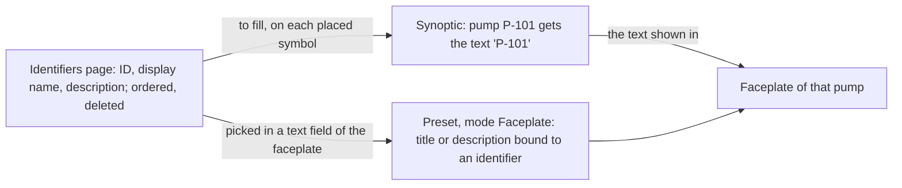
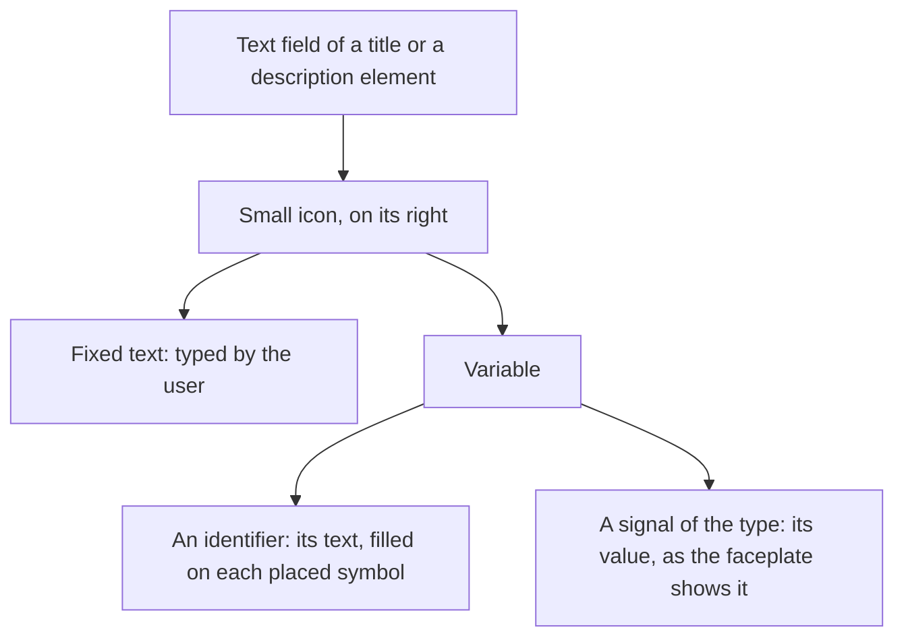

# Identifiers

> [Home](../README.md) › [Metadata](README.md) › Identifiers · Previous: [Data model](15-data-model.md) · Next: [Who changes what](11-who-changes-what.md)

Status: draft, from the Product Owner's description of 2026-11-18. Not validated. He asked not to be asked questions on it for now ("Ça ne sert à rien de me poser des questions"): what he did not say is written as the assistant's reading, and listed in [Open questions](#open-questions).

An identifier is a named key that each placed symbol fills with its own text in the synoptic: the tag of a pump, for example `P-101`. A faceplate can then show that text in a title or a description, so that one preset builds the faceplate of every pump, each with its own tag.

## Rules

### A page of its own, like Units, Enums and Versions

- **Identifiers are a page of Metadata, in the navigation bar, like Units, Enums and Versions** (Product Owner, 2026-11-18: "C'est une page de type unit enum version"). They are not part of a type ("Ça n'a rien à faire dans les types"): every type can use them.
- The name "Identifiers" is the Product Owner's word ("Il faut qu'on puisse rajouter des identifiants"), kept as a working name: he does not know what to call it yet ("Je ne sais pas forcément comment l'appeler"). See [The name](#the-name).
- In the navigation bar, the page comes after Enums and before Versions: assistant's reading, to confirm.

### What an identifier is

- **An identifier is only a key with a name** (Product Owner: "Il faut que ce soit juste des clés, qu'on leur donne un nom"). It has exactly three fields, nothing else ("C'est tout"):

| Field | What it is | Rule |
| --- | --- | --- |
| ID | The key | Written by the user. The public identifier, as for every object of Metadata (see [Data model](15-data-model.md#rules)). |
| Display name | The name people read | Shown where the user picks the identifier, and where its text is filled in the synoptic (assistant's reading). |
| Description | What the identifier is | Plain text, to explain it (Product Owner: "expliquer ce que c'est"). Optional, like the description of a flag: assistant's reading. |

- **No default value** (Product Owner: "Il n'y a pas de valeur par défaut, ça, on s'en fout").
- **In front of the key, the value is a text** (Product Owner: "qu'en face, ce soit une string"), filled on each placed symbol, in the synoptic. Metadata only makes the key: it never holds a value.
- **That text is meant to be unique in the synoptics** (Product Owner: "une string qui est censée être unique après dans les synoptiques"): two pumps do not share the tag `P-101`. Whether the application checks it, warns about it or leaves it to the user is open.
- **There can be several identifiers** (Product Owner: "Il faut pouvoir mettre plusieurs identifiants comme ça"): a tag, a location, a cabinet number...
- Like every object of Metadata, each identifier has an **internal ID**, a UUID set by the software (see [Data model](15-data-model.md#rules)): a faceplate points to the identifier through it, so a renamed ID breaks nothing. Assistant's reading of the general rule of 2026-11-18.

### The page: a table, ordered, with delete

- **The identifiers are shown in a table** (Product Owner: "faire un tableau").
- **The user chooses their order** (Product Owner: "Il faut pouvoir leur donner un ordre"), with a handle at the very left of each line, as everywhere in Metadata (see the [layout rules](../screens/README.md#handles-to-choose-the-order)).
- **An identifier can be deleted** (Product Owner: "et les supprimer"): the delete button at the far right of its line, then a warning, as everywhere in Metadata (see the [layout rules](../screens/README.md#delete-with-a-button-and-a-warning-in-metadata)).
- A new identifier is added with the small + on the right of the title "Identifiers" (the [layout rule](../screens/README.md#a-title-and-a-small--on-its-right) of every list of Metadata): assistant's reading.
- Columns, in this order: the handle with no header, ID, Display name, Description, then the delete button with no header. The short fields first and the long one last, as for the enum items (see [Enums](06-enums.md#rules)): assistant's reading.
- Identifiers are part of Metadata, so they are part of its [Versions](13-versions.md).

### In the faceplate: fixed text or a variable

Said by the Product Owner on 2026-11-18: it is the same principle as Figma's "Apply variable", already used for the bounds of a number field (see [Presets](09-presets.md#bounds-of-a-number-field)).

- **The text field of a title element and of a description element** of the faceplate builder has **a small icon on its right**, as in Figma (Product Owner: "quand on a un titre ou une description, pour les inputs texte, il faut qu'à leur droite, il y ait une petite icône, un peu comme sur Figma").
- **The icon chooses what fills the field** (Product Owner: "pour pouvoir sélectionner par quoi ça va être rempli"):
  - **a fixed text**, typed by the user (Product Owner: "soit nous qui tapons quelque chose de fixe"), as today;
  - **a variable** (Product Owner: "soit on dit que c'est un truc de variable"): **an identifier** of this page, **or a signal** (Product Owner: "qui pourrait être ces identifiants-là ou alors un signal. Peu importe").
- The icon tells the user that a variable can be chosen there (Product Owner: "Tu peux, à ta droite, sélectionner une variable").
- **The field holds one or the other, whole**: a fixed text, or one variable. Mixing both in one field (`Pump {tag}`) was not said: open. Assistant's reading, from the Figma principle the Product Owner names, where a variable replaces the whole value.
- **The faceplate is filled through the identifiers** (Product Owner: "La pop-up va pouvoir être remplie grâce à ces identifiants-là"): a title bound to the identifier `tag` shows `P-101` on the faceplate of the pump P-101, and `P-102` on the next one.
- **The identifiers used give the synoptic its list to fill** (Product Owner: "ça va permettre d'avoir une liste côté synoptique [...] d'identifiants à remplir"). How that list is shown is for part 3, the synoptic, not written yet.
- **A signal picked as a variable** is one of the signals of the type, own or inherited, as for the bounds of a number field: assistant's reading. It shows the signal's value as the faceplate shows it: in the display unit and with the decimals of the preset, an enum by the display text of its item (see [Presets](09-presets.md#mode-values-one-table-of-the-signals)). Assistant's reading.

## Example

The page Identifiers of a plant. The IDs and texts are made up for the example.

| ID | Display name | Description |
| --- | --- | --- |
| `tag` | Tag | The tag of the equipment, as on the plant drawings. |
| `location` | Location | The room or the zone where the equipment stands. |

The preset `default` of `centrifugal_pump` has a title element bound to the identifier `tag`, and a description element bound to `location`. In the synoptic "Line 1", the first pump is filled with `tag` = `P-101` and `location` = `Hall 2`; the second with `P-102` and `Hall 3`. Their faceplates show the title "P-101" and "P-102", each with its own location, from one preset.

## The name

The Product Owner does not know what to call this page yet. "Identifiers" is kept as a working name, from his words. Candidates, none checked against a source:

| Word | Against it |
| --- | --- |
| Identifiers | Each identifier has an "ID" and an "internal ID" (see [Data model](15-data-model.md#the-names-of-the-two-identifiers)): "the ID of an identifier" reads badly. |
| Variables | Figma's word for what fills a field; but in supervision, a variable is a point of data, the meaning of a signal. |
| Tags | Refused for the flags: in supervision software, a tag is a point of data (see [Flags](14-flags.md#the-name)). |
| Attributes, fields | Generic; nothing taken in these specs. |

Assistant's opinion: the word could be added to the documentary research on the names of the two identifiers (task of the feature Specification), since the words clash.

## Where it is used

| Thing | Created and changed in | Used in | In a symbol | In a synoptic |
| --- | --- | --- | --- | --- |
| Identifier (ID, display name, description), its order | Identifiers page of Metadata | Text fields of the title and description elements of the faceplate builder | No (assistant's reading) | Its text filled on each placed symbol; the panel is described with part 3 |
| Fixed text or variable of a title or description element | Preset, mode Faceplate, in Metadata | Faceplate of the symbol or synoptic | No (assistant's reading) | The faceplate shows the text of the identifier, or the value of the signal |

## Open questions

Not asked in the chat: the Product Owner asked not to be asked on this page for now (2026-11-18).

- The name of the page and of the concept (see [The name](#the-name)).
- Is the uniqueness of the text checked by the application, a warning, or left to the user? Unique in one synoptic or in all of them?
- Does each placed symbol get every identifier of the page to fill, or only those its faceplate uses?
- Does the text of an identifier go out in the configuration files of the synoptic, as the flags do?
- Must an ID be unique on the page?
- One variable alone in a field, or a fixed text and variables mixed (`Pump {tag}`)?
- Other text fields of the builder with the same icon: the name shown of a signal, the name on a command's button?
- The display name and the description: where each is shown; the description optional.
- Where the page sits in the navigation bar (after Enums, before Versions: assistant's reading).
