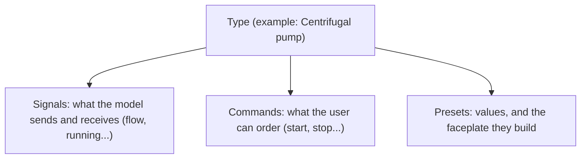
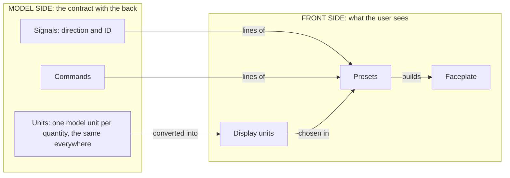
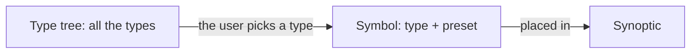

# metadata

> [Home](../README.md) › Metadata

The first part of Synoptic Studio: the data and documentation a symbol can be attached to. It is the model side (what an object is, what goes in and out of it), not the front side (how it looks).

Status: validated by the Product Owner on 2026-11-11, then changed by him the same day while reviewing the [screens](../screens/metadata.md): type tree on the left, order of the parts, three modes for the description, links that only open folders, a signal edited as a whole, enum items as a key and a display text, typed values of any type, differences shown with their quantity. On 2026-11-16, while reviewing the wireframes, he removed the libraries of types and set the layout rules of the [screens](../screens/README.md#layout-rules) (a navigation bar on the left, a list on the left and its panel on the right), made enum keys numbers only, and said how a type is created (a + on hover) and deleted (right click). Later that day he made the parent of a type fixed at creation, the description always editable (no view mode), the add buttons always above the lists, the signals and commands into tables, and the value of a command always fixed (a typed value goes through a write entry of the faceplate). Then he merged the faceplate into the presets (a preset is one table that builds the faceplate, seen with a button) and gave each signal an ID and a display name. Last, he chose a strip of icons for the parts of a type, confirmed delete by right click in all of Metadata, made enum keys whole numbers, kept the type tree in the full page of the description, and limited commands to the inputs of the model (a text that becomes an input writes an input signal directly). Last of all that day, he removed every Edit and Save step (everything is editable all the time) and added the [Versions](13-versions.md) of Metadata (differences, change log, undo, semantic version), kept the read-only mode of the description, put the direction first in the table of signals with a colour per direction, moved the name people see of a signal from the signal to the preset, and gave commands three kinds (set a signal, trigger, override an output) and an ID. Then he replaced the strip of icons by the names of the parts in whole words, fixed under the type tree in its column, put the choice of quantity or difference in the one column Quantity (a difference only where the conversion changes), and confirmed the default decimals fixed by the catalogue of units. Last, he moved that list above the tree, then back under it, and made the Faceplate a part again, after Presets, which only shows the faceplate of a chosen preset (it replaces the button that showed it). Reviewing the wireframes at the end of the day, he validated the type tree, put its search behind an icon, removed every right click of Metadata (a delete button with a warning instead, in General for a type, at the far right of a line elsewhere), put the inherited signals and commands first, marked a quantity and a difference by icons, put the formatting tool bar in both modes of the description, and split a preset into two modes: its values, and a faceplate builder with groups, titles and descriptions. Last, he removed the Faceplate part (the faceplate is the second mode of a preset), removed the model unit from the signal (one model unit per quantity, set outside Metadata), gave each enum item a description, let the links and the commands be reordered by a handle, and set three layout rules: a small + on the right of the title of each list, no header on the columns of buttons, and handles wherever the user chooses the order. The questions still open are listed in [Open questions](12-open-questions.md).

## The big picture

Metadata answers one question: what is this object, and how do we talk to it? It is read in three steps.

### Step 1: what a type is made of

The user builds a tree of types. Each type is made of three things.

### Step 2: the model side and the front side

Signals and commands are the contract with the model (the back). The presets, and the faceplate they build, are only about what the user sees (the front). Units are used by both to show values the way the user wants.

### Step 3: how it is used

A symbol picks a type, among all the types of the tree, and a preset. A synoptic uses symbols and can only change their faceplate: the defaults, the texts of its title and description elements (what else it can change in the built faceplate is open). There are no libraries of types (Product Owner, 2026-11-16).

## What it contains

| Page | What it holds |
| --- | --- |
| [Types](01-types.md) | The type tree, its two identifiers (name for the model, internal one for the app), inheritance, and the link between a type and a symbol. |
| [Icons](02-icons.md) | The icon and colour of a type, from a predefined SVG list. |
| [Documentation](03-documentation.md) | The documentation page of a type: Markdown description and links to files, folders and URLs. |
| [Signals](04-signals.md) | The model's inputs and outputs: direction, ID, type, quantity (a bound is a signal of its own); a table always editable, a colour per direction. |
| [Units](05-units.md) | Quantities, families, reference family, conversions, one model unit per quantity and the display unit, ready-made units. |
| [Enums](06-enums.md) | The Enums page: named lists of values, picked by a signal as a link, never copied. |
| [Commands](07-commands.md) | The three kinds of command: set a signal, trigger, override an output (always a fixed value); the table of commands, each with an ID. |
| [Presets](09-presets.md) | Two modes per preset, chosen by a switch: Values (display unit, decimals, default value of each signal) and the faceplate builder (signals with their name shown, input and its bounds, read or write for an input, read or override for an output, commands with their button, titles, descriptions, groups); what the default value is for; the check of typed values. |
| [Versions](13-versions.md) | Everything editable all the time; the Versions page: differences, change log, undo, semantic version. |
| [Flags](14-flags.md) | Draft (2026-11-17), a part of the type, after Commands: the type's list of keys, each an ID and a description, that each symbol of that type placed in a synoptic has on or off; the application does nothing with them but write them in the configuration files, for customisation outside it. |
| [Data model](15-data-model.md) | Draft (2026-11-18): the tables of Metadata and how they point to each other; every object has an internal ID (UUID) and an ID (public); ordered lists of internal IDs; one common table of links, each line owned by one type. The presets are left out for now. |
| [Who changes what](11-who-changes-what.md) | The table of where each thing is created and changed. |
| [Open questions](12-open-questions.md) | Every open question in one place. |

## Reading order

1. What a type is: [Types](01-types.md), [Icons](02-icons.md), [Documentation](03-documentation.md).
2. The model side: [Signals](04-signals.md), [Units](05-units.md), [Enums](06-enums.md).
3. The front side: [Commands](07-commands.md), [Presets](09-presets.md).
4. How it is kept safe: [Versions](13-versions.md).
5. Keys for customisation outside the application: [Flags](14-flags.md) (draft).
6. How it is stored, logically: [Data model](15-data-model.md) (draft).
7. How it is used: [Who changes what](11-who-changes-what.md).
8. What is left to decide: [Open questions](12-open-questions.md).

The page numbers jump: page 08 held the faceplates, merged into the presets on 2026-11-16, and page 10 the libraries of types, removed the same day. Versions, added the same day, took the next free number, 13, rather than reuse one; Flags, added on 2026-11-17, took 14; Data model, added on 2026-11-18, took 15.

## Page layout

Every concept page (types to presets, and versions) follows the same skeleton, in this order:

1. Title, then the navigation line (breadcrumb, previous, next).
2. `Status:` line, then a short paragraph saying what the page is about.
3. `## Rules`: the rules stated by the Product Owner, with their diagrams.
4. Detail sections specific to the page (fields, steps, examples of use).
5. `## Example`, when the page has one.
6. `## Where it is used`: the table of where the thing is created, changed and used.
7. `## Open questions`, last, only when the page has some; each is also listed in [Open questions](12-open-questions.md).

The index pages ([Who changes what](11-who-changes-what.md), [Open questions](12-open-questions.md)) keep their own shape, with the same header lines.

## See also

- [Storage](../storage/README.md): how the files that types generate are saved.
- [Screens of Metadata](../screens/metadata.md): every screen of this part, with its buttons, fields and lists, and what is missing.
