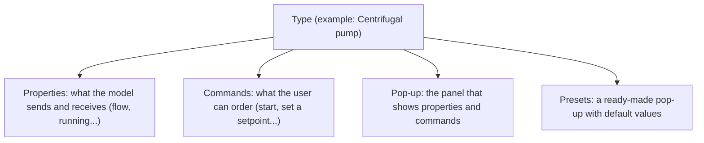
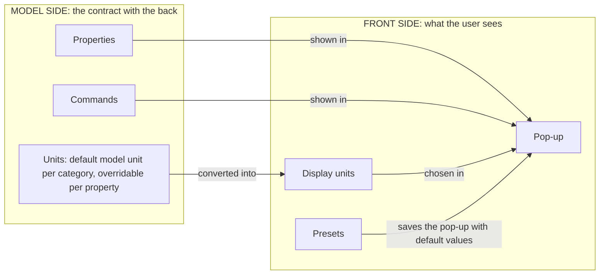
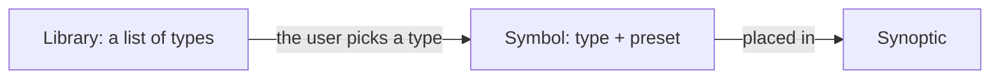

# metadata

> [Home](../README.md) › Metadata

The first part of Synoptic Studio: the data and documentation a symbol can be attached to. It is the model side (what an object is, what goes in and out of it), not the front side (how it looks).

Status: draft, written from the Product Owner's oral description and kept in line with their decisions up to 2026-11-11. Nothing here is validated.

## The big picture

Metadata answers one question: what is this object, and how do we talk to it? It is read in three steps.

### Step 1: what a type is made of

The user builds a tree of types. Each type is made of four things.

### Step 2: the model side and the front side

Properties and commands are the contract with the model (the back). The pop-up and the presets are only about what the user sees (the front). Units are used by both to show values the way the user wants.

### Step 3: how it is used

Libraries only sort the types. A symbol picks a type and a preset. A synoptic uses symbols and can only tick pop-up entries and write their title and description.

## What it contains

| Page | What it holds |
| --- | --- |
| [Types](01-types.md) | The type tree, its two identifiers (name for the model, internal one for the app), inheritance, and the link between a type and a symbol. |
| [Icons](02-icons.md) | The icon and colour of a type, from a predefined SVG list. |
| [Documentation](03-documentation.md) | The documentation page of a type: Markdown description and links to files, folders and URLs. |
| [Properties](04-properties.md) | The model's inputs and outputs: fields, type, bounds, direction. |
| [Units](05-units.md) | Unit categories, families, conversion formulas, model unit and display unit. |
| [Enums](06-enums.md) | The Enums page: named lists of values, picked by a property as a link, never copied. |
| [Commands](07-commands.md) | The two kinds of command: set a property (fixed or typed value) and event. |
| [Pop-ups](08-popups.md) | What a pop-up entry is: read or write, display unit, enum input, names; title and description given in the synoptic. |
| [Presets](09-presets.md) | Defaults: values, display units, decimal places, entries shown at the start. |
| [Libraries](10-libraries.md) | Flat lists that point to types, filled by ticking tiles in the tree. |
| [Who changes what](11-who-changes-what.md) | The table of where each thing is created and changed. |
| [Naming](12-naming.md) | Working names and proposals for better ones. |
| [Open questions](13-open-questions.md) | Every open question in one place. |

## Reading order

1. What a type is: [Types](01-types.md), [Icons](02-icons.md), [Documentation](03-documentation.md).
2. The model side: [Properties](04-properties.md), [Units](05-units.md), [Enums](06-enums.md).
3. The front side: [Commands](07-commands.md), [Pop-ups](08-popups.md), [Presets](09-presets.md).
4. How it is used: [Libraries](10-libraries.md), [Who changes what](11-who-changes-what.md).
5. What is left to decide: [Naming](12-naming.md), [Open questions](13-open-questions.md).

## Page layout

Every page follows the same order: navigation line, status, rules and diagrams, "Where it is used" table, then "Open questions" when there are some.

## See also

- [Storage](../storage/README.md): how the files that types and libraries generate are saved.
