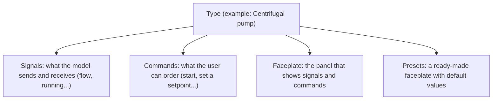
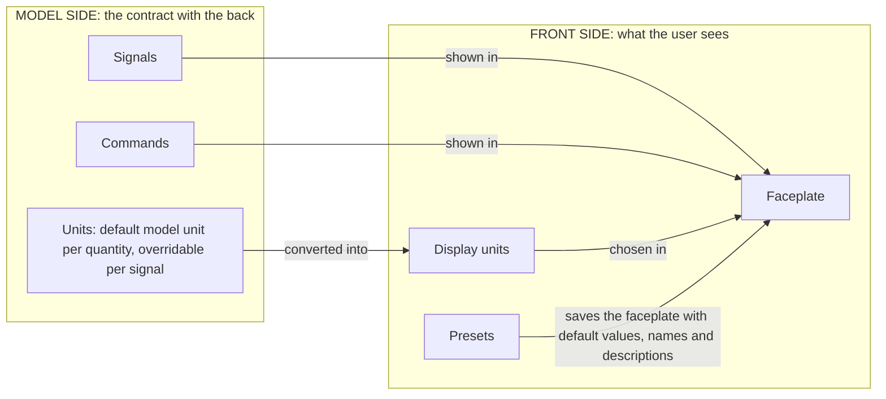
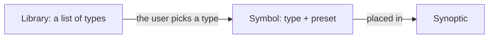

# metadata

> [Home](../README.md) › Metadata

The first part of Synoptic Studio: the data and documentation a symbol can be attached to. It is the model side (what an object is, what goes in and out of it), not the front side (how it looks).

Status: validated by the Product Owner on 2026-11-11. The few questions still open are listed in [Open questions](12-open-questions.md).

## The big picture

Metadata answers one question: what is this object, and how do we talk to it? It is read in three steps.

### Step 1: what a type is made of

The user builds a tree of types. Each type is made of four things.

### Step 2: the model side and the front side

Signals and commands are the contract with the model (the back). The faceplate and the presets are only about what the user sees (the front). Units are used by both to show values the way the user wants.

### Step 3: how it is used

Libraries only sort the types. A symbol picks a type and a preset. A synoptic uses symbols and can only tick faceplate entries and write their title and description.

## What it contains

| Page | What it holds |
| --- | --- |
| [Types](01-types.md) | The type tree, its two identifiers (name for the model, internal one for the app), inheritance, and the link between a type and a symbol. |
| [Icons](02-icons.md) | The icon and colour of a type, from a predefined SVG list. |
| [Documentation](03-documentation.md) | The documentation page of a type: Markdown description and links to files, folders and URLs. |
| [Signals](04-signals.md) | The model's inputs and outputs: fields, type, bounds, direction. |
| [Units](05-units.md) | Quantities, families, reference family, conversions, model unit and display unit, ready-made units. |
| [Enums](06-enums.md) | The Enums page: named lists of values, picked by a signal as a link, never copied. |
| [Commands](07-commands.md) | The two kinds of command: set a signal (fixed or typed value) and trigger. |
| [Faceplates](08-faceplates.md) | What a faceplate entry is: read or write, display unit, enum input, names; the check of typed values; title and description given in the synoptic. |
| [Presets](09-presets.md) | Defaults: values, display units, decimal places, names and descriptions of signals, entries shown at the start. |
| [Libraries](10-libraries.md) | Flat lists that point to types, filled by ticking tiles in the tree. |
| [Who changes what](11-who-changes-what.md) | The table of where each thing is created and changed. |
| [Open questions](12-open-questions.md) | Every open question in one place. |

## Reading order

1. What a type is: [Types](01-types.md), [Icons](02-icons.md), [Documentation](03-documentation.md).
2. The model side: [Signals](04-signals.md), [Units](05-units.md), [Enums](06-enums.md).
3. The front side: [Commands](07-commands.md), [Faceplates](08-faceplates.md), [Presets](09-presets.md).
4. How it is used: [Libraries](10-libraries.md), [Who changes what](11-who-changes-what.md).
5. What is left to decide: [Open questions](12-open-questions.md).

## Page layout

Every concept page (types to libraries) follows the same skeleton, in this order:

1. Title, then the navigation line (breadcrumb, previous, next).
2. `Status:` line, then a short paragraph saying what the page is about.
3. `## Rules`: the rules stated by the Product Owner, with their diagrams.
4. Detail sections specific to the page (fields, steps, examples of use).
5. `## Example`, when the page has one.
6. `## Where it is used`: the table of where the thing is created, changed and used.
7. `## Open questions`, last, only when the page has some; each is also listed in [Open questions](12-open-questions.md).

The index pages ([Who changes what](11-who-changes-what.md), [Open questions](12-open-questions.md)) keep their own shape, with the same header lines.

## See also

- [Storage](../storage/README.md): how the files that types and libraries generate are saved.
