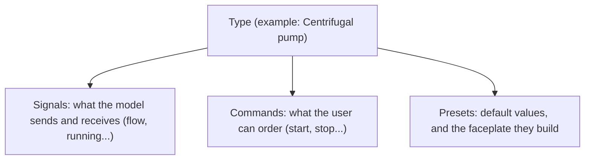
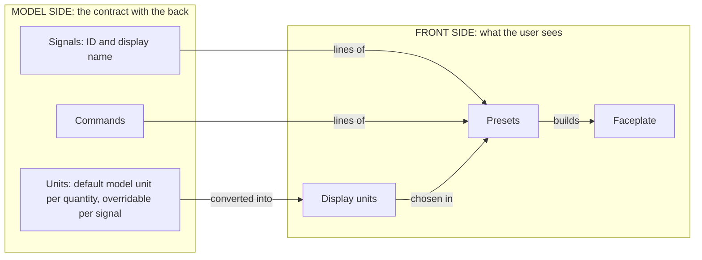
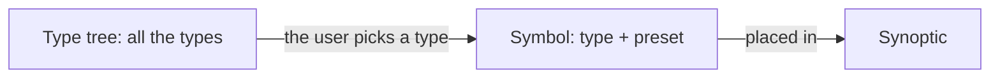

# metadata

> [Home](../README.md) › Metadata

The first part of Synoptic Studio: the data and documentation a symbol can be attached to. It is the model side (what an object is, what goes in and out of it), not the front side (how it looks).

Status: validated by the Product Owner on 2026-11-11, then changed by him the same day while reviewing the [screens](../screens/metadata.md): type tree on the left, order of the parts, three modes for the description, links that only open folders, a signal edited as a whole, enum items as a key and a display text, typed values of any type, differences shown with their quantity. On 2026-11-16, while reviewing the wireframes, he removed the libraries of types and set the layout rules of the [screens](../screens/README.md#layout-rules) (a navigation bar on the left, a list on the left and its panel on the right), made enum keys numbers only, and said how a type is created (a + on hover) and deleted (right click). Later that day he made the parent of a type fixed at creation, the description always editable (no view mode), the add buttons always above the lists, the signals and commands into tables, and the value of a command always fixed (a typed value goes through a write entry of the faceplate). Last, he merged the faceplate into the presets (a preset is one table that builds the faceplate, seen with a button) and gave each signal an ID and a display name. The questions still open are listed in [Open questions](12-open-questions.md).

## The big picture

Metadata answers one question: what is this object, and how do we talk to it? It is read in three steps.

### Step 1: what a type is made of

The user builds a tree of types. Each type is made of three things.

### Step 2: the model side and the front side

Signals and commands are the contract with the model (the back). The presets, and the faceplate they build, are only about what the user sees (the front). Units are used by both to show values the way the user wants.

### Step 3: how it is used

A symbol picks a type, among all the types of the tree, and a preset. A synoptic uses symbols and can only change their faceplate: the lines shown, the defaults, its title and description. There are no libraries of types (Product Owner, 2026-11-16).

## What it contains

| Page | What it holds |
| --- | --- |
| [Types](01-types.md) | The type tree, its two identifiers (name for the model, internal one for the app), inheritance, and the link between a type and a symbol. |
| [Icons](02-icons.md) | The icon and colour of a type, from a predefined SVG list. |
| [Documentation](03-documentation.md) | The documentation page of a type: Markdown description and links to files, folders and URLs. |
| [Signals](04-signals.md) | The model's inputs and outputs: ID, display name, type, bounds, direction. |
| [Units](05-units.md) | Quantities, families, reference family, conversions, model unit and display unit, ready-made units. |
| [Enums](06-enums.md) | The Enums page: named lists of values, picked by a signal as a link, never copied. |
| [Commands](07-commands.md) | The two kinds of command: set a signal (always a fixed value) and trigger; the table of commands. |
| [Presets](09-presets.md) | One table per preset that builds the faceplate: lines shown, input, read or write, display unit, decimals, default value; commands shown and their button; title and description of the faceplate; the button that shows it; the check of typed values. |
| [Who changes what](11-who-changes-what.md) | The table of where each thing is created and changed. |
| [Open questions](12-open-questions.md) | Every open question in one place. |

## Reading order

1. What a type is: [Types](01-types.md), [Icons](02-icons.md), [Documentation](03-documentation.md).
2. The model side: [Signals](04-signals.md), [Units](05-units.md), [Enums](06-enums.md).
3. The front side: [Commands](07-commands.md), [Presets](09-presets.md).
4. How it is used: [Who changes what](11-who-changes-what.md).
5. What is left to decide: [Open questions](12-open-questions.md).

The page numbers jump: page 08 held the faceplates, merged into the presets on 2026-11-16, and page 10 the libraries of types, removed the same day.

## Page layout

Every concept page (types to presets) follows the same skeleton, in this order:

1. Title, then the navigation line (breadcrumb, previous, next).
2. `Status:` line, then a short paragraph saying what the page is about.
3. `## Rules`: the rules stated by the Product Owner, with their diagrams.
4. Detail sections specific to the page (fields, steps, examples of use).
5. `## Example`, when the page has one.
6. `## Where it is used`: the table of where the thing is created, changed and used.
7. `## Open questions`, last, only when the page has some; each is also listed in [Open questions](12-open-questions.md).

The index pages ([Who changes what](11-who-changes-what.md), [Open questions](12-open-questions.md)) keep their own shape, with the same header lines.

## See also

- [Storage](../storage/README.md): how the files that types generate are saved.
- [Screens of Metadata](../screens/metadata.md): every screen of this part, with its buttons, fields and lists, and what is missing.
