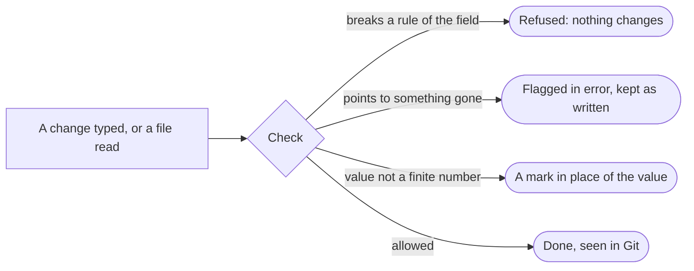

# Checks and errors

> [Home](../README.md) › [Metadata](README.md) › Checks and errors

| Version | Date | Status | Change |
| --- | --- | --- | --- |
| 1 | 2026-11-22 | Draft | Creation of the file |
| 2 | 2026-11-22 | Draft | An integer typed in another unit that gives no whole number: refused (decision 0085) |

What the software checks in Metadata, when, and what each check gives: a change refused, a thing flagged in error, a mark in place of a value, or nothing. The rules come from decisions 0038, 0042, 0043, 0047, 0051, 0071, 0076, 0078, 0079, 0080, 0081, 0082, 0083 and 0085, [Identity and renaming](identity-and-renaming.md), [Files](files.md), [Formulas](formulas.md), [Inheritance of types](inheritance.md), [Deleting and its consequences](deleting.md), the [entity files](entities/README.md) and the [Screens of Metadata](../screens/metadata.md).

## Where it is used

| Where | What it takes from here |
| --- | --- |
| [Files](files.md) | A file with errors is still read and written; a file name already taken is refused. |
| [Formulas](formulas.md) | The refused forms of a formula, a result that is not a finite number, the checks of the catalogue. |
| [Inheritance of types](inheritance.md) | An `id` already taken along the branch is refused; a type whose parent is missing is flagged in error. |
| [Deleting and its consequences](deleting.md) | A type that has sub-types is never deleted; what points to a deleted thing is flagged in error. |
| [Identity and renaming](identity-and-renaming.md) | A key or a name already taken in its list is refused when typed. |
| [Type](entities/30-type.md), [Signal](entities/16-signal.md), [Command](entities/18-command.md), [Flag](entities/19-flag.md), [Enum](entities/06-enum.md), [Enum item](entities/05-enum-item.md), [Designation](entities/11-designation.md), [Preset](entities/29-preset.md) | Their uniqueness, said in the `description` of their key. |
| [Range](entities/24-range.md), [Bound](entities/23-bound.md) | A typed value outside the range, a minimum greater than the maximum: refused. |
| [Command target](entities/17-command-target.md), [Value type](entities/15-value-type.md), [Preset value](entities/22-preset-value.md), [Text content](entities/27-text-content.md) | Flagged in error when what they point to is gone. |
| [MD-02.8](../screens/metadata.md#md-02--general), [MD-04.6](../screens/metadata.md#md-04--signals), [MD-05.3](../screens/metadata.md#md-05--commands), [MD-07.3, MD-07.14, MD-07.22](../screens/metadata.md#md-07--presets), [MD-08.10](../screens/metadata.md#md-08--units), [MD-09.3, MD-09.6, MD-09.7](../screens/metadata.md#md-09--enums), [MD-12.3](../screens/metadata.md#md-12--flags-a-part-of-the-type), [MD-13.4](../screens/metadata.md#md-13--designations) | Where a check shows on screen. |
| [Faults](../synoptics/08-faults.md) | What a change of Metadata breaks in a synoptic, listed there, never in Metadata. |

## What a check gives

| Outcome | What happens | Example |
| --- | --- | --- |
| **Refused** | The change does not happen: what was there stays. | `-x^2` in a formula; an `id` already taken along the branch. |
| **Flagged in error** | Kept as written and marked until the user fixes it; the rest of Metadata works. | A command whose target signal was deleted. |
| **A mark in place of a value** | A value that cannot be computed is never shown as a number. | `log10(0)`. |
| **Not checked** | Allowed, nothing is said; the change is seen in the differences of Git. | The key of an enum item changed. |

Metadata never warns at the moment of a change about what it breaks elsewhere: what is broken in a symbol or a synoptic shows there (see [Outside Metadata](#outside-metadata)).

## When the checks run

- **When the user types**, in a field of Metadata: a refused change leaves the value that was there.
- **When Metadata opens**: every file is read and checked against the JSON Schema of its `format_version` ([Files](files.md#each-file)); every type is read, so that the uniqueness of an `id` in the whole tree can be checked (decision 0047).
- **When a file is saved**: it is written again in the order of the keys of its schema ([Files](files.md#the-order-of-the-keys)).
- **When the catalogue is read, and by the tests of the shipped catalogue**: the [checks of the catalogue](formulas.md#checks-of-the-catalogue).
- **After a delete, or when a file is missing**: what points to the thing gone is flagged in error ([Deleting and its consequences](deleting.md#the-rules)).

## Refused

| Refused | Where | Source |
| --- | --- | --- |
| A `name` or an `id` whose file name is already taken, or empty | Every entity with a file of its own | [Files](files.md#the-name-of-a-file) |
| The `id` of a type already taken in the whole tree | MD-02 | Decision 0047 |
| A key or a name already taken in its list: the `id` of an enum or a designation, the key or the display name of an enum item in its enum, the name of a preset in its type, the `id` of a signal, a command or a flag in its type | MD-04.6, MD-05.3, MD-07.3, MD-09.3, MD-09.6, MD-09.7, MD-12.3, MD-13.4 | Decision 0083 |
| An `id` of a signal, a command or a flag already taken along the branch: added or renamed in a parent while a sub-type has it as its own line, or reused by a sub-type | MD-04.6, MD-05, MD-12 | Decisions 0080, 0081 |
| Deleting a type that has sub-types | MD-02.8 | Decision 0082 |
| A minimum typed greater than the maximum, in the faceplate builder | MD-07.22 | Decision 0079 |
| A value typed in a number field of the faceplate outside its range | Faceplate | [Range](entities/24-range.md) (assistant's reading) |
| A value typed (a start value, a value in the faceplate) whose conversion gives no finite number | MD-07.14, faceplate | Decisions 0051, 0076 |
| A decimal typed for an integer signal | MD-07.14, faceplate | Decisions 0003, 0043 |
| A number typed for an integer signal in another display unit that gives no whole number in the default unit (24.17 rps is 1450.2 rpm) | MD-07.14, faceplate | Decision 0085 |
| A key of an enum item beyond 9 007 199 254 740 991, the largest whole number exact in JavaScript | MD-09.6 | [Whole draft](draft.md) |
| A formula that does not follow the grammar, or one of its refused forms (`-x^2`, `**`, `log`, implied multiplication, a name other than `x`), each with a message that says how to write it | Quantity files | [Formulas](formulas.md#refused-forms), decision 0076 |

## Flagged in error

- **What is flagged in error is kept as written**: nothing is emptied, removed or picked in its place. It links again as soon as its cause is gone: the user picks another target, or the missing file comes back (decision 0082).
- **A file missing or unreadable is handled as a delete** ([Deleting and its consequences](deleting.md#the-rules), rule 7).

| Flagged in error | Because | Source |
| --- | --- | --- |
| A type | The file of its parent is missing or unreadable; the missing parent is named. | Decision 0079 |
| A signal | Its enum was deleted. | Decision 0082 |
| A preset value | The enum item of its start value was deleted. | Decision 0082 |
| A command | The signal it targets was deleted, or the enum item of its value. | Decision 0082 |
| A faceplate element | The designation of its title or paragraph was deleted. | Decision 0082 |

## A file with errors

- **A file is checked against the JSON Schema of its `format_version`**; the software lists where the errors are, and the file is still read and written ([Files](files.md#each-file)).
- **A file whose keys are out of order is still read**, and written again in the order of its schema when saved.
- **A file of the software's folder broken by hand** is read like any file with errors ([Files](files.md#the-two-configuration-folders)).
- **The same file name in both configuration folders is not an error**: the user's file is offered (decision 0071).

## A value that cannot be computed

- **A result that is not a finite number** (NaN, +Infinity, −Infinity) is never shown as a number: the screens and the synoptic show a mark in its place (decision 0076).
- **A value near the edge of a domain** may give a huge finite number: it is shown as it is; nothing brings it back to a bound ([Formulas](formulas.md#out-of-the-domain-of-a-formula)).

## Checks of the catalogue

- **Run on every quantity file when it is read, and by the tests of the shipped catalogue**, never by the user (MD-08.10): the grammar, the round trip within 1e-9, "multiplies then shifts" for a quantity that offers a difference, and the order of the units ([Formulas](formulas.md#checks-of-the-catalogue)).

## Not checked

| Allowed, with no warning | Source |
| --- | --- |
| Changing the `id` of a type, a signal, a command or a flag: breaking for the model, never for the software, whose links go through the `internal_id`. | [Inheritance of types](inheritance.md#when-a-parent-changes) |
| Changing the key of an enum item: breaking for the model. | Decision 0038 |
| Changing the kind of an enum, global or template, even while signals use it. | Decision 0042 |
| Deleting: the warning asks to confirm, never lists what the delete breaks. | [Deleting and its consequences](deleting.md#how-a-delete-is-done) |
| How an `id` is written: no rule. | [Whole draft](draft.md#flags), 2026-11-17 |
| The drawing of an icon: a stroke, against the rule, is shown as it is. | [Data model: notes](data-model-notes.md#settled-on-2026-11-22-icon-sets) |
| The value of a command target, by its own field: it is read by the value type of the signal it targets. | [Data model: notes](data-model-notes.md) |

## Outside Metadata

- **Symbols and synoptics are never changed by Metadata**: what a change breaks shows there, with a small red mark, and is listed in the symbol mode and the synoptic mode, with no automatic repair ([When Metadata changes](../symbols/01-libraries-and-symbols.md#when-metadata-changes), [Faults](../synoptics/08-faults.md)).
- **Some rules of Metadata only warn, in the synoptic, and never block**: a required designation left empty on a placed symbol ([Designation](entities/11-designation.md)), a template enum whose items are not completed ([whole draft](draft.md#global-enums-and-templates)).

## Open questions

- **How a refusal shows**: a message beside the field, a button disabled (the delete of a type that has sub-types), their wording: with the design system.
- **How a thing in error shows in Metadata**: a mark on the line, on the type in the tree, a list or a counter.
- **A duplicate found in a file changed by hand**: two keys that must be unique, read from the file; typing refuses them (decision 0083), reading a file does not say.
- **A formula or a check of the catalogue that fails when a quantity file is read**: the unit left out of the catalogue, or shown in error (gap of MD-08).
- **A file whose `format_version` the software does not know**, written by a later Synoptic Studio.
- **A number field whose two bounds, read from signals, give a minimum greater than the maximum** ([Range](entities/24-range.md)).
- **A format for the `id`s**, a regular expression per kind of `id` in the settings: a message only, or the `id` refused ([Files](files.md#open-questions)).
- **A quantity whose file is missing**: the signals and display formats that point to it flagged in error and kept as written, as for a parent: assistant's reading of rule 7 of [Deleting and its consequences](deleting.md#the-rules).
- **The look of the mark** in place of a value that is not a number ([Formulas](formulas.md#open-questions)).
