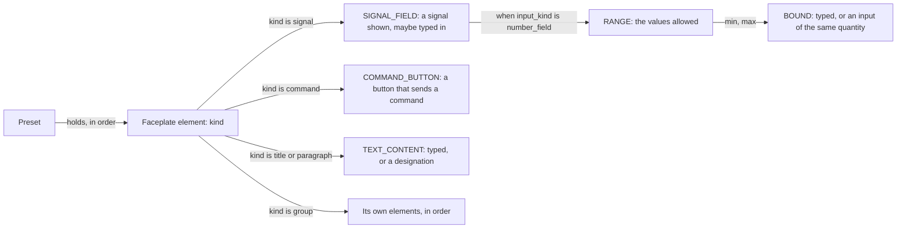

# Data model: notes

> [Home](../README.md) › [Metadata](README.md) › [Data model](data-model.md) › Notes

Status: everything written around the schema of the [Data model](data-model.md) from 2026-11-19 to 2026-11-21, moved here on 2026-11-21 at the Product Owner's request, so that the data model shows the schema and its JSON alone ("je veux que le schéma et l'objet JSON, sans commentaire tout autour [...] je veux pas que tu supprimes tout ce que t'as écrit"). The content is unchanged, apart from the links and the section [Checked on 2026-11-21 (schema against JSON)](#checked-on-2026-11-21-schema-against-json). The documentation of each object comes later, object by object, in the data model itself.

## Rules of the schema

- `internal_id`: the UUID set by the software, always a UUID; every FK holds one. It is the surrogate key and never leaves the software (its match in the standards: [Identity and renaming](identity-and-renaming.md#the-two-keys)).
  - Every UUID of Synoptic Studio is a **UUID version 7** (Product Owner, 2026-11-21: "le format qui a un timestamp [...] ça permettra d'avoir des trucs plus propres si jamais on met ça dans une base de données"). Version 7 starts with the time of its creation, in milliseconds since 1970 (UTC), so that UUIDs sort in the order they were made; RFC 9562 (May 2024, section 5.7) advises it over versions 1 and 6, the other two with a timestamp.
  - Written in lower case, 36 characters with the dashes; the 13th digit is always `7`.
  - The made-up UUIDs of the examples follow this shape (`01a1f800-0000-7000-8000-…`).
- `id`: the public identifier, written by the user, never a UUID, that leaves the application: sent to the model and written in the configuration files.
- `name`: a label people read, for a thing that has no `id`: nothing points to it and it never goes to the model. What the software ships (quantities, unit systems, units), the name of a preset (see [Read again on 2026-11-21](#read-again-on-2026-11-21-presets-and-faceplate)), the name of a palette, of an icon or of a color (decision 0057). Unlike FMI, Kubernetes or Google, where `name` identifies a thing, it is only a label here.
- `display_name`: a label people read, for a thing that has an `id` or a key: it is shown in place of that `id` or key, and never goes to the model (an enum item, a signal field, a command button). A designation has none: its `id` is shown (2026-11-21). Empty, the `id` or the key is shown.
- `key` of an enum item: the whole number sent to the model, never the item's name (TypeScript calls the names keys; here the key is the number).
- `description`: a text that explains, for people; plain text everywhere, Markdown only in `DOCUMENTATION`.
- A choice of the software (`kind`, `direction`, `access`...) is written in the JSON as an English word (`"input"`, `"real"`), never as a number, so that a file reads by itself (Product Owner, 2026-11-19). A value of several words is joined by underscores (`set_input_signal`, `number_field`), the same in the schema and in the JSON. The key of an enum item stays a whole number: it goes to the model (decisions 0012, 0016).
- The field that says which alternative a box is: `kind` when the alternative changes what the thing is (a link is a path or a URL, an element is a signal field or a button); `source` when the thing stays the same and only its value comes from elsewhere (a bound is always a number, typed or read from a signal; a text is always a text, typed or read from a designation), each value of `source` naming the field that then holds the value (`typed` → `typed_value` or `typed_text`, `signal` → `signal`, `designation` → `designation`); `direction`, `access` and `input_kind` where their own word says more. Never `type`, which already names `TYPE` and `VALUE_TYPE`.
- One idea, one word, across the whole JSON: a value that is a gap between two points is a `relative_quantity` everywhere in the files (`VALUE_TYPE.relative_quantity`, `QUANTITY.offers_relative_quantity`); the screens keep "difference" for people.
- A list of choices is named after its field; a field called `kind` or `source`, which several boxes have, takes its box as prefix (`command_kind`, `bound_source`). Every list is in [The choice lists](data-model.md#the-choice-lists).
- A value typed in the builder is prefixed `typed_` where it stands beside a value taken elsewhere (`typed_value`, `typed_text`). A value read by the value type of its signal (a number, a boolean or an enum item) has the type `signal_value`.
- A box without `internal_id` is a part of its owner (a nested object in the JSON), never pointed to.
- Fields that only exist together go in a part of their own (`RANGE`, `DISPLAY_FORMAT`), with one exception: the `quantity` of a number and its `relative_quantity` stay on `VALUE_TYPE`, in the words of FMI (decision 0059).
- `has`: one nested object; `holds`: an ordered list inside its owner. When an owner has two parts of the same box, the link says their role (`has, as min`).
- Every other link is a FK, labelled by the field that holds it, so that the reader knows which field points where. The field is named after the box it points to (`signal`, `quantity`, `unit`), or after its role when the box alone says too little (`parent`, `default_unit`).
- No field of the schema has a comment: a box shows each field's type, name and key only, as the schema of its entity file (Product Owner, 2026-11-22). A field that only exists in some cases says when in the JSON Schema of its entity. A FK link carries only its field's name; a link with no field of its own (a `has`) says the case on the link, always in the same words: `when kind is enum`, `when the signal is an enum`.
- A number typed in Metadata (a default value, the value of a command, a typed bound) is kept in the default unit of its signal's quantity, whatever unit the screen shows it in (decision 0051).
- Field order in each box: `internal_id`, then `kind` or `source` (so that the reader knows at once which fields follow, Product Owner, 2026-11-21) or the `direction` of a signal, then `id` or the name (what the thing is called, before what it points to, 2026-11-22), then the links (FK), then the other choices (`access`, `input_kind`), then the values, then the texts.
- Every name follows these rules (see [Names made even on 2026-11-21](#names-made-even-on-2026-11-21)) and the research T5 (see [Applied on 2026-11-22 (names, research T5)](#applied-on-2026-11-22-names-research-t5)).

## How the schema becomes JSON

Asked by the Product Owner on 2026-11-21 ("que tu me construises juste en dessous du schéma l'objet JSON [...] qui représente un peu tout ce qu'il pourrait avoir"). One made-up type that uses every box of a type at least once, without trying every combination; then a global enum and a quantity of the catalogue, which live in files of their own. The designations, the icons and the palettes are left out; the file of the designations is in [Designation](entities/11-designation.md) since 2026-11-21. The internal IDs are made up, and only their last digits differ, to read them easily.

How the boxes become JSON, one rule for each, with no exception (the names of the lists confirmed by the Product Owner on 2026-11-21, decision 0057):

- A field keeps its name in the schema (`internal_id`, `display_name`, `typed_value`).
- A part (`has`) is a nested object named after its box, in lower case (`value_type`, `display_format`, `command_target`, `signal_field`); two parts of the same box are named by their role (`min`, `max`).
- A list (`holds`) is an array named after the box it holds, in lower case and in the plural (`signals`, `enum_items`, `preset_values`, `faceplate_elements`, `units`): the same list has the same name everywhere, in a preset and in a group.
- The field order is the rule of the head of this file; the parts and the lists come after the fields of their box.
- A field or a part that does not exist in this case (its `when` is false) is left out; one that exists but is empty is `null` (no parent, no color, no display name).
- A choice of several words is joined by underscores: `"set_input_signal"`, `"number_field"`, `"radio_horizontal"`.
- A file adds one key that no box shows: `"format_version"`, the version of the file format, first key of the file. It belongs to the file, not to an object, so it is described in the rules of the files only ([Files](draft.md#files)), never in the schema (Product Owner, 2026-11-21, see [Settled on 2026-11-21 (format key)](#settled-on-2026-11-21-format-key)).

### What the type shows

What the example of a type shows, beyond the fields themselves:

- **Numbers are kept in the default unit** (decision 0051): the speeds are in rad/s, the default unit of the made-up quantity `…900` (angular velocity), while the preset shows them in rpm (`…902`). `157.0796` is 1500 rpm, `151.8436` is 1450 rpm.
- **A typed value is read by the signal it targets**: `switch_to_auto` sends the internal ID of the item `auto` because `mode` is an enum; `force_speed` sends a number because `speed` is a real.
- **The maximum of the setpoint is a signal**: `speed_max`, an input of the same quantity (decision 0056); the minimum is typed.
- **No `input_kind` and no `range` in read**, no `display_format` for the boolean and the enum, `boolean_texts` for the boolean only, no `command_target` for a trigger: their `when` is false.
- **The texts of a boolean are in the preset** (decision 0058): `running` shows "Running" or "Stopped" with the preset `Standard`; another preset of the same type may say "On" and "Off".
- **`display_name: null`**: the field of `speed` shows the signal's `id`.
- **A difference**: `bearing_temperature_rise` holds a gap of temperature, shown in °C (`…912`), kept in kelvins.
- The title shows the designation `…800` (`tag`, say `P-101`) of each placed symbol; the designations have their file of their own ([Designation](entities/11-designation.md)).

### What the quantity shows

A quantity is shipped with the software, never copied into the user's files: they hold the internal IDs only (draft, Data model).

- The kelvin has no `conversion`: it is the default unit.
- A difference is converted by the software from these two formulas (decision 0050): a rise of 1 °C is 1 K, a rise of 1 °F is 5/9 K.
- The syntax of the formulas goes to a documentary research (see [Noted on 2026-11-22](#noted-on-2026-11-22-syntax-of-the-formulas)).

## The faceplate, box by box

Written on 2026-11-21, at the Product Owner's request ("pour la partie faceplate, j'aimerais bien que tu refasses un retravail là-dessus [...] c'est un peu flou"). It says, field by field, what the boxes of the mode Faceplate of a preset hold. The rules are those of [Presets and their faceplate](draft.md#presets-and-their-faceplate) and of the dated sections below (decision 0055 for the text, the display name and the range; decision 0056 for the quantity of a bound).

A preset holds an ordered list of elements. Each element has a kind, and its kind gives it exactly one part, or, for a group, its own list of elements.

### `FACEPLATE_ELEMENT`: one line of the builder

| Field | What it holds | When |
| --- | --- | --- |
| `internal_id` | The UUID set by the software. | Always. |
| `kind` | Signal, command, title, paragraph or group (see [The choice lists](data-model.md#the-choice-lists)). | Always. |
| `faceplate_elements` | The elements inside a group, in order, with the same five kinds; the same name as the list of the preset. | When `kind` is group. |

### `SIGNAL_FIELD`: a signal shown in the faceplate

A labelled field that shows the value of one signal, and lets a person type it when its access allows.

| Field | What it holds | When |
| --- | --- | --- |
| `signal` | The signal shown: one of the type, own or inherited. | Always. |
| `access` | `read`: the field only shows the value, as text alone: in the display unit and with the decimals of the preset, an enum by the display name of its item, a boolean by the text of its state (the `BOOLEAN_TEXTS` of the preset). `write`, for an input: a person types the value the model receives. `override`, for an output: a person types a value that replaces the model's. | Always. Write is offered for an input only, override for an output only (decision 0040). |
| `input_kind` | How the value is typed: `number_field`, `radio_horizontal`, `radio_vertical`, `select` or `switch` (see [The choice lists](data-model.md#the-choice-lists)). | When `access` is write or override. The choices depend on the value type of the signal. |
| `display_name` | The label beside the field, for people; never sent to the model (decision 0055). | Always; empty, the signal's `id` is shown (decision 0018). |
| `range` | A `RANGE`: the values a person may type. | When `input_kind` is `number_field`. |

### `RANGE`: the values allowed in a number field

The minimum and the maximum only exist together, for a number field: they go in a part of their own, by the rule of the schema (see [Read again on 2026-11-19 (enums)](#read-again-on-2026-11-19-enums)).

| Field | What it holds | When |
| --- | --- | --- |
| `min` | A `BOUND`: the smallest value allowed. | Optional: empty, no minimum. |
| `max` | A `BOUND`: the largest value allowed. | Optional: empty, no maximum. |

A typed value outside the range is refused (assistant's reading, screen MD-07.22).

### `BOUND`: the minimum or the maximum of a range

A bound is its own box because it is one of two things, a number or a signal: three fields that say which, rather than six fields in `RANGE`.

| Field | What it holds | When |
| --- | --- | --- |
| `source` | `typed`: a number typed in the builder. `signal`: the value of an input signal of the type, read at each moment. | Always. |
| `typed_value` | The number. Shown and typed in the display unit of the preset (`g`, if the preset shows a mass in grams); kept in the default unit of the quantity of the signal shown, the unit of the Units page that every conversion is written against (`kg` for the mass), so that changing the display unit never changes the bound (decision 0051). | When `source` is typed. |
| `signal` | The signal whose value is the bound, picked with the small icon inside the field (decision 0041). An input only, never an output: an input is what the model receives, so the bound stays what the user set (decision 0055). An integer or a real of the same quantity as the signal shown, so that both compare in the same default unit; the list offers only these inputs (decision 0056). | When `source` is signal. |

### `COMMAND_BUTTON`: a button that sends a command

Found right by the Product Owner on 2026-11-21 ("button text, ça, c'est parfait, et la commande associée"); its text renamed `display_name` the same day, to read like the label of a signal field (decision 0057).

| Field | What it holds | When |
| --- | --- | --- |
| `command` | The command sent by a click, one of the type, own or inherited. | Always. |
| `display_name` | The text on the button, for people; never sent to the model. | Always; empty, the command's `id` is shown, as for a signal field. |

### `TEXT_CONTENT`: the text of a title or a paragraph

The text a title or a paragraph element shows, and where it comes from. The small icon on the right of its field chooses the source (Product Owner, 2026-11-18, decision 0048).

| Field | What it holds | When |
| --- | --- | --- |
| `source` | `typed`: a text typed in the builder. `designation`: the text filled for a designation on each placed symbol. | Always. |
| `typed_text` | The text. A paragraph keeps its line breaks; neither takes Markdown. | When `source` is typed. |
| `designation` | The designation whose text is shown: `tag` shows `P-101` on one pump and `P-102` on the next. | When `source` is designation. |

**Never a signal** (Product Owner, 2026-11-21: "ça doit venir que d'un identifiant et jamais d'un signal [...] un signal, on peut l'afficher avec la partie signal"): the value of a signal is shown by a signal element in read. Decision 0055 changes decisions 0048 and 0054 on this point.

## The choice lists

Moved on 2026-11-22 to [The choice lists](data-model.md#the-choice-lists) of the data model, with the census of every type of the schema.

## Checked on 2026-11-21 (schema against JSON)

Asked by the Product Owner on 2026-11-21 ("une longue recherche et une comparaison entre l'objet JSON et le schéma, pour voir si tout est cohérent, et [...] pour voir si tous les noms sont logiques"), before the entities are validated one by one. Every box, field, link and label of the schema was read against the three JSON examples and against the rules of the head of this file.

- **The JSON matches the schema.**
  - Every key of the examples is a field, a part or a list of the schema, under its name; `format` is the only exception (see [Open](#open)).
  - Every `when` is followed: no `input_kind` nor `range` in read, no `command_target` for a trigger, `display_format` for the numbers only, `boolean_texts` for the boolean only, `quantity` and `relative_quantity` for the reals only.
  - One preset value per signal of the type: six for six.
  - The order of the keys follows the rule in every object.
  - The numbers are right: 1500 rpm is 157.0796 rad/s, 1450 rpm is 151.8436 rad/s; the two formulas of the °F go there and back.
- **The names follow the rules**: `name`, `display_name`, `description`; `kind` and `source`; the FK fields; the lists named after their box; the choice lists named after their field. Nothing renamed.
- **Changed in the schema, to follow rules already written** (assistant; nothing new decided, the JSON examples do not change):
  - `ICON` and `COLOUR`: `name` before `drawing` and `value`, by the order of the fields (the name before the values), as `UNIT` and `QUANTITY` already do.
  - `ENUM_ITEM.display_name` and `IDENTIFIER.display_name` say what is shown when they are empty (the key, the `id`), by the rule of `display_name`, as `SIGNAL_FIELD` and `COMMAND_BUTTON` already did.
  - `COMMAND_TARGET.signal` says which signal each kind takes: an input for `set_input_signal`, an output for `override_output_signal`, as the list `command_kind` says.
  - `SIGNAL_FIELD.input_kind` says which choices go with which value type, as the list `input_kind` says.
  - `DISPLAY_FORMAT.unit` says it is a unit of the signal's quantity; `QUANTITY.default_unit` says it is one of its units.
- **Checked and unchanged**: `RANGE` is drawn without fields of its own, since it only holds its two bounds; `IDENTIFIER`, `ICON` and `PALETTE` have no owner in this schema, since they live in files of their own.

## Changed on 2026-11-19

Asked by the Product Owner on 2026-11-19, while reading the schema; the three points the assistant proposed were settled by the Product Owner the same day, in the questionnaire. Decision 0049 (accepted, 2026-11-19) records them: it changes decision 0003 (reference family, closed forms) and specifies decision 0020 (a difference).

- **The default unit** replaces `model_unit` (Product Owner: "c'est plutôt la unit par défaut"): the unit of the quantity that every conversion is written against, as the Units page already calls it. Its own conversion is empty: it is the unit itself.
- **No reference family any more**: every unit converts to the default unit and back, never to another family. It answers the question of 2026-11-17 the way the assistant proposed then; the families only group the units for reading.
- **A conversion is the real formula** (Product Owner: "que la conversion on puisse mettre le calcul réel"), not only a factor: two expressions in `x`, one from the default unit, one back to it, because a free formula cannot be turned round by the software. Confirmed by the Product Owner on 2026-11-19 ("Oui, formules libres"). It replaces the rule of 2026-11-11 (decision 0003) by which a conversion was one of four closed forms, a pair of free expressions being the last resort. The four forms of the research (proportional, affine, inverse, logarithmic) are now just formulas like any other. The catalogue is written by contributors, so its tests check that each pair goes there and back.
- **A quantity has a `name`, not an `id`** (Product Owner: "c'est pas vraiment ce que j'appellerai un ID, c'est plutôt un nom"): mass, volume, flow are shipped by the software, never typed by the user.
- **A difference is no longer a quantity of its own** (assistant's proposal, chosen by the Product Owner on 2026-11-19: "une lecture de la grandeur"; no table of its own): the signal says whether its value is the quantity or a difference of it (`measure`, as decision 0020 already says), and the units of a quantity whose conversion changes (`offers_difference`, temperature...) carry a second conversion, for a difference (computed by the software since the evening, see below). It removes the quantity that points to another quantity (`difference_of`, `kind`), which read badly. It is what FMI does with its flag `relativeQuantity` (research T2, section 3.8).
- **`integer` stays a value kind** beside `real`, `boolean` and `enum` (Product Owner, 2026-11-19: "Garder integer"), as decisions 0003 and 0043 already say: the model receives an exact whole number, and the input refuses decimals. FMI and SSP keep integers apart from reals (research T2, section 3.1).

## Read again on 2026-11-19 (afternoon)

The Product Owner read the quantity part again and found it right (`measure`: "ça, c'est vraiment bien"; families: metric or imperial "c'est juste ça"; units: name and symbol).

- **The units of a family are sorted by the software, never by hand** (Product Owner: "Oui, go faire ça. C'est plus simple comme ça"): smallest first, by the size of one step in the default unit, `to_default(1) − to_default(0)`; equal sizes by name. The catalogue writes them in any order. A quantity whose formulas give no finite step (an inverse such as l/100 km, a logarithm such as dB) keeps the order the catalogue writes.
- **The two expressions of a conversion are named by where `x` goes**: `to_default` takes `x` in this unit and gives the default unit; `from_default` takes `x` in the default unit and gives this unit. The labels of the schema said it the wrong way round.
- **What a difference is, said for the Product Owner** (the assistant's explanation, not a new rule): a value is a point on the scale ("it is 20 °C"), a difference is a gap between two points ("it rose by 20 °C"). Most conversions only multiply (litres to decalitres, kilograms to pounds): a value and a difference then convert the same way, so a quantity like volume needs nothing more. A conversion that also shifts the zero (°C to °F: `x × 9/5 + 32`) converts them differently: 20 °C is 68 °F, but a rise of 20 °C is a rise of 36 °F, because the `+ 32` cancels out in a gap. `offers_difference` marks these quantities, as decision 0020 says.
- **`default_decimals` is for the screen, never for the model**: the model always gets the full value; the decimals only round what is shown. Removed the same day (see below).

## Settled on 2026-11-19 (evening)

The Product Owner answered the two questions of the afternoon in the questionnaire. Decision 0050 (accepted, 2026-11-19) records them: it changes decisions 0049 (a second conversion for a difference) and 0020 (default decimals in the catalogue).

- **A difference is converted by the software, never written in the catalogue** (Product Owner: "si tout peut être calculé, « logiquement », ben go"; with no exception, else everything by hand): the difference of `x` in the default unit is `to_default(x) − to_default(0)`, and back `from_default(x) − from_default(0)`. A unit has one conversion only; the conversion "of a difference" is gone.
  - Why there is no exception: this computation is exact for every conversion that multiplies then shifts (°C, °F, K; gauge pressure is no shift of pressure, see [2026-11-22](#settled-on-2026-11-22-from-one-unit-system-to-another)), and these are the only quantities that offer a difference. A conversion that only multiplies needs no difference at all. A conversion that is not a straight line (an inverse such as l/100 km, a logarithm such as dB) has no difference that converts on its own, and such a quantity never offers one.
  - Hence one rule of the catalogue, checked by its tests: a quantity with `offers_difference` has only conversions that multiply then shift (`to_default(x) − to_default(0)` proportional to `x`).
- **No `default_decimals` on the quantity** (Product Owner: "les décimales à montrer, c'est vraiment selon les presets [...] il faut l'enlever de l'objet quantité"): the decimals shown are set in the presets only, which start from one default number of decimals, the same everywhere. The assistant agrees: the right number of decimals depends on the unit shown, not on the quantity (2 decimals show 10 g in kilograms, but 0.01 g in grams), so a default per quantity would be wrong as soon as a preset shows another unit.

## Read again on 2026-11-19 (enums)

The Product Owner read the enums and found them right (enum: kind, `id`, description, "faut pas plus"; item: key, display name, description, and its place in the list). The Product Owner then asked why `VALUE_TYPE` holds `measure` beside `enum`, when a signal does not always have a quantity. The question was right: `measure` only means something when there is a quantity, and the box did not say it. The fix is a rule for the whole schema, not only for this box (assistant's proposal, asked by the Product Owner: "corriger tous les endroits où il y aura des problèmes comme ça").

- **Fields that only exist together go in a part of their own.** The quantity and `measure` move to `MEASUREMENT`, which a value type has for an integer or a real only. The enum stays a single field of `VALUE_TYPE`: it has nothing else that goes with it, so it needs no part.
- **A part that only exists for some signals says so on its link.** `DISPLAY` (unit and decimals) is there for an integer or a real only, never for a boolean or an enum; its unit only when the signal has a quantity.
- **A choice between alternatives says which one it is**, as `VALUE_TYPE.kind` does, instead of leaving the reader to guess from the field that is filled. `BOUND` gets `source` (typed or signal), `TEXT_CONTENT` gets `source` (fixed, identifier or signal); each other field says when it is filled.
- **A typed value says what it holds**: a number, a boolean, or the internal ID of an enum item (decision 0047), in `COMMAND_TARGET` and `PRESET_VALUE`.
- The screen of an enum showed "Name": it is the `id`, as the Product Owner said ("ça devrait être ID"), in `screens/metadata.md`, MD-09.3.

## Read again on 2026-11-19 (signals, commands, flags)

The Product Owner read the signals, the commands and the flags and found them right; nothing changes in the schema.

- **Signals**: right ("j'ai l'impression que c'est bon, en tout cas pour moi").
- **Commands** ("C'est propre, je trouve"): a type holds its commands; a command has its `id` and its kind (set a signal, trigger or override); a command that sets a signal has a `COMMAND_TARGET`, the signal and the value sent; it is used by a command button of a faceplate element.
- **The typed value is not checked by its own field** (Product Owner: "en fonction de l'UID, on est censé savoir ce que c'est [...] tout est censé parser en fonction de la foreign key"): the field accepts a number, a boolean or the internal ID of an enum item, and it is read by the value type of the signal it targets. An integer signal reads a whole number, a boolean signal a boolean, an enum signal the internal ID of one of its items.
- **Flags**: an `id` and a description, "faut pas plus".
- Next: the presets, after a break.

## Read again on 2026-11-19 (presets)

The Product Owner read the preset, its values and their display. The preset (a name) and its values (a signal, a default value) are right ("ça fait sens"). He found the links to the enums and the signals unclear, and left the fix to the assistant ("je te laisse faire"), with a pass over the whole schema to make it even.

- **The "default item" and "sends" links were not fields of their own**: they are the typed value itself (`default_value`, `value`) when the signal is an enum, as decision 0047 says. They are now labelled by that field: `default_value, when the signal is an enum`, `value, when the signal is an enum`. The item is always one of the signal's enum.
- **Every FK link is labelled by its field**, all over the schema (`signal`, `quantity`, `default_unit`, `icon`...), instead of a verb (`targets`, `value of`, `shown in`, `measures`). `has` and `holds` stay for nested parts.
- **Every condition is said the same way**, `when ...`, on the fields and on the links: it replaces `enum only`, `signal only`, `typed only`, `integer or real only`, `a group holds`.
- **The parts of a faceplate element say when they exist**: a signal field for a signal element, a command button for a command element, a text content for a title or a description, the children for a group.
- **A command target exists for "set a signal" and for "override"**: the section above said "a command that sets a signal" only; an override targets an output the same way (draft, Commands).
- **A preset holds one value per signal of the type**, own and inherited, so none for a type without signals: `o{` instead of `|{`.
- **A unit has a conversion except the default unit**: said on the link, as the section of the morning already said.

### Can a number have no quantity? Checked on 2026-11-19

Asked by the Product Owner, who thinks a real always has a quantity or a difference ("il faut que tu fasses une recherche"). A fact to find, checked in the standard and in a catalogue of units, not a documentary research of its own.

- **FMI allows a number without unit**: "Variables without unit must not have a `unit` attribute" ([FMI 3.0.1](https://fmi-standard.org/docs/3.0.1/), section 2.4.7.5, table 21, read on 2026-11-19). A display unit needs a unit: "If `displayUnit` is defined a `unit` must also be defined" (same document, section 2.4.4, table 15). AutomationML also makes the unit optional (research T2, `research/t2-recherche-documentaire-unique-modeles-de-donnees/rapport.md`, section 3.1, source S8).
- **Such numbers exist in models**: a ratio, an efficiency, a valve opening from 0 to 1, a count. Paraphrase, assistant's examples.
- **A catalogue of units gives them a quantity anyway**: QUDT puts the percent and the per mille under the quantity "DimensionlessRatio" (percent = 0.01), and a count under the quantity "Count", whose unit is "unitless" ([QUDT, percent](https://qudt.org/vocab/unit/PERCENT), [QUDT, count](https://qudt.org/vocab/quantitykind/Count), read on 2026-11-19 through a search summary, pages not opened one by one).
- **What it changes in `DISPLAY`**: the unit and the decimals do not always go together. A real with no quantity still needs decimals, but has no unit to show. An integer needs decimals only when it is shown in another unit than its default unit (1450 rpm is 24.17 rps).
- Asked in the questionnaire: either every integer and real has a quantity, or a number may have no quantity and the decimals leave `DISPLAY`. Settled the same day, see below.

## Settled on 2026-11-19 (night)

The Product Owner answered the two questions of the presets in the questionnaire, with the option the assistant advised each time. Decision 0051 (accepted, 2026-11-19) records them: it changes the rule of the draft by which the quantity of a signal is optional (`draft.md`, Signals; screen MD-04.9), and extends decision 0024 (the bounds of a signal written in the model unit of its quantity) to every number typed in Metadata.

- **Every integer and real signal has a quantity** (Product Owner: "Quantité obligatoire"). A number that measures nothing physical gets one from the catalogue, as QUDT does (see above): a **ratio** (units 1, %, ‰, ppm; default unit 1) for a rate, an efficiency or a valve opening from 0 to 1, and a **count** (unit 1) for a number of things. Working names, as the other quantities of the catalogue. In the schema:
  - `MEASUREMENT` is always there for an integer or a real, and its `quantity` is required (it already was on the link);
  - `DISPLAY` keeps its unit and its decimals together; its `unit` is required and no longer says "when the signal has a quantity";
  - the rule of the head of the file gives another example of a condition.
- **A number typed in Metadata is kept in the default unit of its quantity** (Product Owner: "Unité par défaut"): the default value of a preset, the value of a command, a typed bound of a signal field. Changing the display unit of a preset never changes a stored value: the screen converts it with `from_default` to show it, and what the user types in the display unit is turned back with `to_default` before it is kept. A difference is turned the way decision 0050 says.
  - The bound is the assistant's reading: the question named the default value and the value of a command; a typed bound is the same kind of number, so the same rule applies.
  - It answers the gap the research T2 found: the conversion back of the values typed (`research/t2-recherche-documentaire-unique-modeles-de-donnees/rapport.md`, short answer, point 4).

## Changed on 2026-11-20 (descriptions)

The Product Owner found that the signals and the commands had no description ("il manque un champ description [...] c'est essentiel parce qu'il faut pouvoir expliquer ce qu'on veut dire au modeleur"). Decision 0052 (accepted, 2026-11-20) records it: it replaces the rule of the draft "a signal has no description" (2026-11-16).

- **A signal and a command each get a `description`**: a text that says what the line means, for the person who writes the model.
- Checked against the rest of the schema, as he listed it: the type has its description in `DOCUMENTATION`; a flag, an enum, an enum item and an identifier already have one. Nothing else changes.
- Plain text, like the description of a flag or of an enum item, never Markdown: assistant's reading.

## Settled on 2026-11-20 (descriptions)

The Product Owner answered the two questions of the morning in the questionnaire, with the option the assistant advised each time. Decision 0052 records them.

- **The description is optional** (Product Owner: "Facultative"), as for the flags and the enum items: an empty description never blocks anything. `description` stays a plain `text` field, which may be empty.
- **It is written in the configuration files sent with the model** (Product Owner: "Dans les fichiers de configuration"), so that the model author reads it where they work. It is edited in Metadata only (Product Owner: "on ne peut la modifier que dans la metadata"). Changing it changes nothing the model reads.
- A way for model authors to read the synoptics without changing them, with a summary sheet when they click a symbol, is an idea of the Product Owner for later ("ça, on verra ça plus tard"): noted in the open questions of the synoptics, nothing written here.

## Settled on 2026-11-21 (no versions)

The Product Owner answered the question of the day before in the questionnaire, with the option the assistant advised ("Les retirer, Git suffit"). Decision 0053 (accepted, 2026-11-21) records it: it changes decision 0017.

- **The schema has no version of Metadata**: no version number, no change log, nothing "not yet versioned". The application keeps no versions; the types are clean JSON files, one per type, that the user versions with Git if they want.
- So the JSON files must stay readable and stable (one field per line, the same order of keys every time), for the differences of Git to be clear: assistant's reading, to settle with the format of the files.
- The `"format"` number at the top of each file stays: it is the version of the file format, not of Metadata.

## Read again on 2026-11-21 (presets and faceplate)

The Product Owner read the preset, its values and the faceplate again. The values are right ("default value", the link to the enum item, the decimals beside the unit: "ça fait sens, c'est cool"); the command button too. He found the rest of the faceplate unclear and asked for it to be reworked, and left two names to the assistant ("à toi de me le dire").

- **The preset keeps a `name`, not an `id`** (assistant's choice, left to it by the Product Owner, who leaned that way: "peut-être que non, c'est mieux là, parce que ça va pas être utilisé comme un ID"). Nothing points to it, every link goes through its `internal_id`, and it never goes to the model: it only tells two presets of a type apart for people. The head of the file now says what `id` and `name` each mean, so that the difference is a rule and not an exception. Screen MD-07.3 already says "Name of the preset".
- **`DISPLAY` becomes `DISPLAY_FORMAT`, not "display unit"** (assistant's choice, asked by the Product Owner: "Pourquoi pas display unit ?"). The part holds two things that go together, the display unit and the decimals, so "display unit" would name only half of it; "display" alone said too little. Its `unit` field is the display unit, said in the schema.
- **The faceplate is described box by box**, in [The faceplate, box by box](#the-faceplate-box-by-box): what each field holds and when, with a diagram of which part goes with which kind of element.
- **Every choice list is described**, in [The choice lists](data-model.md#the-choice-lists), with its values and their meaning (Product Owner: "Input kind : c'est un enum pour moi, mais du coup, tu décris pas l'enum").
- **Fields renamed so that they say what they hold** (Product Owner: "Je veux bien que tu repasses sur les noms des propriétés"):
  - `SIGNAL_FIELD.input` becomes `input_kind`, the Product Owner's own reading, so that it is never mistaken for an input of the model; its values are written in the schema;
  - `access` says in the schema which value goes with which direction: write for an input, override for an output;
  - `BOUND.value` becomes `typed_value` and `TEXT_CONTENT.text` becomes `typed_text`: each says it is the typed one, beside the signal or the identifier;
  - the source of a text says `typed` instead of `fixed`, the same word as for a bound; screen MD-07.19 and the draft keep "fixed text" for the user, which means the same.
- **Why a title or a description could point to a signal** (Product Owner: "Je comprends pas pourquoi y a un truc signal"): he asked for it on 2026-11-18 (decision 0048). Removed the same day, see [Read again on 2026-11-21 (faceplate fields)](#read-again-on-2026-11-21-faceplate-fields).

## Settled on 2026-11-21 (faceplate fields)

The Product Owner answered the two questions of the faceplate in the questionnaire, with the option the assistant advised each time.

- **A boolean signal is typed with a switch** (Product Owner: "Interrupteur (switch)"): `switch` is added to `input_kind`, for a boolean only. One click turns it on or off, and its state reads at a glance.
- **A signal field in read shows the text of the value alone** (Product Owner: "Le texte de la valeur seul"): in the display unit and with the decimals of the preset, an enum by the display name of its item, a boolean by the text of its state. No field is drawn, not even greyed.
- **A boolean signal has two texts of its own** (Product Owner, in a third question: "Deux mots choisis par signal"): `true_text` and `false_text` ("Open" and "Closed", "Running" and "Stopped"), in a part `BOOLEAN_TEXTS` that a value type has for a boolean only, as `MEASUREMENT` for a number. They were typed in the table of signals; moved to the preset the same day, see [Changed on 2026-11-21 (boolean texts)](#changed-on-2026-11-21-boolean-texts). Assistant's reading, to confirm: they never go to the model, which gets `true` or `false`; empty, the faceplate shows "true" and "false"; the switch shows the text of its state beside it.
- Decision 0054 (accepted, 2026-11-21) records the three answers.
- **So `input_kind` only exists in write or override**: it says how a value is typed, and nothing is typed in read. The builder may keep the last choice while the access changes, so that going back to write finds it: assistant's reading, a matter of the screen, not of the file.
- The bounds follow: `min` and `max` exist only for a number field, so never in read.

## Read again on 2026-11-21 (faceplate fields)

The Product Owner read the signal field, its bounds and the text content again. Decision 0055 (accepted, 2026-11-21) records the first three points: it changes decisions 0048 and 0054 (a text bound to a signal) and specifies decisions 0018 (the name) and 0041 (a bound taken from a signal).

- **A title or a description comes from a typed text or an identifier, never from a signal** (Product Owner: "le titre ou une description, je pense que ça doit venir que d'un identifiant et jamais d'un signal [...] Puisqu'un signal, on peut l'afficher avec la partie signal"). `signal` leaves `TEXT_CONTENT` and `text_source`. The value of a signal is shown by a signal element in read, which does the same with a label.
- **`name_shown` becomes `display_name`** (Product Owner: "est-ce que c'est pas display name qu'on appellerait ça [...] faudrait homogénéiser ça partout"): the name people read, the same word as the field of an identifier. The screens and the draft say "Display name" too.
- **A bound taken from a signal takes an input only, never an output, for now** (Product Owner: "qu'en entrée, jamais en sortie pour l'instant [...] Au moins, le signal, il reste fixe"): an input is a value the user sets and the model receives, so the range does not move with what the model computes. A bounded linear animation of a symbol keeps any signal, input or output: it is another rule (decision 0027).
  - The signal of a bound is an integer or a real of the same quantity as the signal shown: settled the same day, see below.
- **`min` and `max` go in a part `RANGE`** (left to the assistant: "je te laisse réfléchir [...] pouvoir mettre un min/max [...] une range de valeurs"). They only exist together, for a number field: the rule of the schema puts them in a part of their own. `BOUND` stays a box, because a bound is a number or a signal and says which. In the JSON: `"range": { "min": { "source": "typed", "typed_value": 0 }, "max": { "source": "signal", "signal": "…" } }`.
- **The default unit of a typed bound, explained** (Product Owner: "Et où, le default unit ?"): it is the default unit of the quantity of the signal shown, set on the Units page (kilogram for a mass). The user types the bound in the display unit of the preset; the file keeps it in the default unit (decision 0051). The labels of the schema now say it.

## Settled on 2026-11-21 (enum item and bounds)

The Product Owner answered the two questions left by decision 0055 in the questionnaire, with the option the assistant advised each time. Decision 0056 (accepted, 2026-11-21) records them: it specifies decisions 0032 (the column of an enum) and 0041 with 0055 (the signal of a bound).

- **`ENUM_ITEM.display_text` becomes `display_name`** (Product Owner: "Oui, display_name"): the same word as for an identifier and a signal field, "Display name" on screen. Its rule does not change: what people read, never sent to the model.
- **The signal of a bound has the same quantity as the signal shown** (Product Owner: "Même grandeur obligatoire"): an input, integer or real, of that quantity, so that a speed is bounded by a speed and both compare in the same default unit. The list of the bound offers only these inputs.

## Names made even on 2026-11-21

Asked by the Product Owner on 2026-11-21 ("voir tout, tout, tout [...] comment c'est nommé, et donc homogénéiser le tout"). Every box, field, link, choice list and value was read again against one set of rules, now written at the head of this file. What changed:

- **Two things had the same name**: `typed_value` was both the type of a value read by its signal (`COMMAND_TARGET.value`, `PRESET_VALUE.default_value`) and the field of a bound typed in the builder. The type becomes `signal_value`; the field keeps `typed_value`, beside `typed_text`.
- **The choice lists are named by one rule**: their field, with the box as prefix for `kind` and `source`. `value_kind` becomes `value_type_kind`, `element_kind` becomes `faceplate_element_kind`, `text_source` becomes `text_content_source`. The others already followed it.
- **A value of several words is joined by underscores**, the same in the schema and in the JSON: `set_signal` (was "set a signal"), `number_field`, `radio_one_line`, `radio_several_lines`. The screens and the draft keep their words for people ("Set a signal", "radio on one line").
- **The two bounds of a range are parts**, so their link says `has, as min` and `has, as max`, not `min` alone, which read like a FK.
- **The JSON keys follow the boxes with no exception**: `command_target` (was `target`, which `LINK.target` already uses), `enum_items` (was `items`), `preset_values` (was `values`), `faceplate_elements` in the preset and in a group (were `faceplate` and `elements`).
- **`name`, `display_name` and `description` are told apart** at the head of the file: `name` for a thing without `id`, `display_name` shown in place of an `id` or a key, `description` to explain.
- Checked and unchanged: the FK fields (`parent`, `icon`, `colour`, `enum`, `quantity`, `signal`, `command`, `identifier`, `unit`, `default_unit`), the field order in every box, `has` and `holds`, the conditions in `when`.
- Left open, because they changed words the Product Owner validated or wait for a research: `id` and `internal_id` (research T5), `button_text`, and the `description` of an icon or a colour. The last two were settled the same day, see below.

## Settled on 2026-11-21 (names)

The Product Owner answered the three questions of the names in the questionnaire, with the option the assistant advised each time. Decision 0057 (accepted, 2026-11-21) records them: it changes the field name of a command button found right the same day.

- **The lists of the JSON keep the name of their box, with no exception** (Product Owner: "Nom de la boîte, sans exception"): `enum_items`, `preset_values`, `faceplate_elements` in a preset and in a group, `command_target`. One rule, and `command_target` is never mistaken for `LINK.target`.
- **`COMMAND_BUTTON.button_text` becomes `display_name`** (Product Owner: "Renommer en display_name"): it is shown in place of the command's `id`, as the label of a signal field is shown in place of the signal's. Empty, the button shows the command's `id`.
- **The short text that names an icon or a colour becomes `name`** (Product Owner: "Renommer en name"): a label for a thing without `id`, shown on hover; `description` stays for a text that explains.

## Changed on 2026-11-21 (boolean texts)

Asked by the Product Owner on 2026-11-21 ("le boolean text, ça serait plutôt dans les presets. Ce serait pas dans le signal directement"). Decision 0058 (accepted, 2026-11-21) records it: it changes decision 0054 on where the two texts are set.

- **`BOOLEAN_TEXTS` leaves `VALUE_TYPE` and becomes a part of `PRESET_VALUE`**, for a boolean signal only, as `DISPLAY_FORMAT` is for an integer or a real: how a value is shown is set in the preset, beside the display unit and the decimals.
- So two presets of the same type may name the states differently ("Running" / "Stopped", "On" / "Off"); the signal itself only says that it is a boolean.
- They are typed in the table of values of the preset (mode Values), in a column for booleans only: assistant's reading, its header and place to confirm (screen MD-07.13b).
- They never go to the model, which gets `true` or `false`; nor in the configuration files sent with it, since they are a matter of display like the display unit: assistant's reading.

## Changed on 2026-11-21 (kind of a measurement)

The Product Owner found `"measurement": { "measure": "value" }` odd in the JSON, and asked whether the field should rather be a type, "soit c'est une valeur, soit c'est une différence"; he left the choice to the assistant ("je te laisse réfléchir").

- **`MEASUREMENT.measure` becomes `MEASUREMENT.kind`**, and its list `measure` becomes `measurement_kind` (assistant's choice). It says which of two alternatives the measurement is, which is what `kind` means everywhere in the schema; `measure` repeated the name of its box (`measurement.measure`) without saying more.
- **Not `type`**: the schema already has `TYPE` and `VALUE_TYPE`, and `measurement.type` beside `value_type` would read as a third kind of type. `kind` is the word the rules give for this.
- **Not `typed`**: in the schema, `typed` means typed by hand in the builder (`typed_value`, `typed_text`), which this is not.
- **The values stay `value` and `difference`**: a point on the scale or a gap between two points, as decision 0020 says. In the JSON: `"measurement": { "quantity": "…", "kind": "difference" }`.
- The earlier sections keep `measure`, as written when they were settled.
- Replaced the same day: the part `MEASUREMENT` is gone, see below.

## Settled on 2026-11-21 (quantity of a number)

The Product Owner asked whether `measurement` was really the best name, and to keep it if it was. It was not: in supervision and simulation a "measurement" is first a value read by a sensor, so an output, and an input setpoint with a `measurement` part read as "this input is a measurement" (assistant's analysis, not sourced). Of the three options of decision 0059, the Product Owner chose the one the assistant advised ("Faire comme FMI, sans partie"). Decision 0059 (accepted, 2026-11-21) records it.

- **The part `MEASUREMENT` is gone**: its two fields go on `VALUE_TYPE`, for an integer or a real only. In the JSON: `"value_type": { "kind": "real", "quantity": "…", "relative_quantity": true }`.
- **`quantity`**: the FK to the quantity, required for an integer or a real (decision 0051). The word of FMI, OPC UA and CLDR (research T2, sources S1, S3, S16).
- **`relative_quantity`**: a boolean, `true` when the value is a difference (a gap between two points), `false` when it is a value (a point on the scale). The word of FMI, `relativeQuantity`, whose offset is then ignored (research T2, section 3.8, source S1). It replaces the list `measurement_kind` and its values `value` and `difference`. It may only be `true` when the quantity has `offers_relative_quantity` (renamed the same day, see below).
- **The rule of the parts gets one written exception**, at the head of this file: these two fields only exist together, but stay on `VALUE_TYPE`, to keep the words of a standard and one level less in the JSON.
- The screens do not change: the column Quantity of the table of signals still offers a quantity or its difference, each with its icon (screen MD-04.9); only the file says it with `relative_quantity`.

## Read again on 2026-11-21 (kind or source)

The Product Owner asked why `TEXT_CONTENT` says `source` and not `kind` "comme partout", thought `source` might be better, left it to the assistant ("à toi d'y réfléchir"), and asked for a pass over the whole JSON on this kind of thing.

- **`source` stays, on `TEXT_CONTENT` and on `BOUND`** (assistant's choice). `kind` says what a thing is, and its other fields change with it: a faceplate element of kind signal has a `signal_field`, one of kind command a `command_button`. A bound is always a number and a text always a text, whatever is chosen: only where the value comes from changes. `source` says it in one word, and each of its values names the field that then holds the value (`typed` → `typed_value` / `typed_text`, `signal` → `signal`, `identifier` → `identifier`), which `kind` would not show. The head of this file now gives that reason.
- **Every field of choice of the JSON read again against this rule**, nothing else changes:
  - `kind` on `LINK`, `VALUE_TYPE`, `COMMAND`, `ENUM` and `FACEPLATE_ELEMENT`: each says what the thing is, and is always there;
  - `direction` on `SIGNAL` and `access` on `SIGNAL_FIELD`: their own word says more than `kind`;
  - `input_kind` stays, not `kind`: the Product Owner's word (2026-11-21), and it only exists in write or override, while a `kind` is always there.
- **`QUANTITY.offers_difference` becomes `offers_relative_quantity`** (assistant's choice, found in the pass): since decision 0059 the signal says `relative_quantity`, and the same idea had two words in the files. The screens keep "difference" for people.
- **The minimum and the maximum of a range**: the same question (Product Owner: "c'est pareil, c'est source, c'est typed ou signal"), the same answer. A bound is always a number; `source` says whether it is typed or read from an input signal.

## Settled on 2026-11-21 (order of the keys)

The Product Owner answered the question of the pass in the questionnaire, with the option the assistant advised ("Le mettre en premier").

- **`kind` or `source` comes right after `internal_id`**, before the links: the reader learns what the object is, then reads the fields that go with it. `{ "source": "identifier", "identifier": "…" }`, `{ "kind": "enum", "enum": "…" }`.
- Changed in the schema and the JSON example: `VALUE_TYPE`, `BOUND`, `TEXT_CONTENT`; the other boxes already had it in that place, or have no link before it.
- `direction`, `access` and `input_kind` keep their place after the links: `SIGNAL_FIELD` starts with the signal it shows (assistant's reading).

## Settled on 2026-11-21 (format key)

The Product Owner answered the question of the check of the schema against the JSON in the questionnaire, with the option the assistant advised ("Règles des fichiers seulement").

- **`"format"` is described in the rules of the files only** ([Files](draft.md#files)): it is the version of the file format, so it belongs to the file, not to an entity. The schema stays the schema of the entities; no box `FILE` is added.
- The JSON examples keep `"format": 1` at the top of the file of a type and of an enum; nothing else changes.
- Still open: whether the catalogue of quantities is one file with one `format` at its top, or one file per quantity (see [Open](#open)).

## Changed on 2026-11-21 (identifier)

Asked by the Product Owner on 2026-11-21 ("dans l'identifiant, on va dégager display name [...] on voit que l'ID [...] Pour une première version, ça va rien casser [...] faut laisser la description").

- **`IDENTIFIER.display_name` is removed**: an identifier has its `internal_id`, its `id` and its `description`. Its `id` is shown wherever it is picked or filled. The earlier sections keep the field, as written when they were settled.
- **The page Identifier (now [Designation](entities/11-designation.md)) draws the identifier alone**, without `TEXT_CONTENT` (assistant's choice, left to it by the Product Owner: "je te laisse décider"): a text content belongs to the faceplate of a preset, and points to the identifier; it stays drawn in the schema of the [Data model](data-model.md), with its link.
- Screen MD-13 loses its column Display name; the identifiers of the placed symbol panel are labelled by their `id`.
- **`IDENTIFIER.required` is added**, a boolean (Product Owner, later the same day: "j'ai complètement besoin de dire si c'est required ou non"). `true`: every placed symbol must have its text (a control ID); `false`: it may stay empty (a location, for context).
- Settled in the questionnaire the same day: a required text is asked on **every placed symbol**, whether or not its faceplate shows it ("Sur tous les symboles placés"); left empty, it **warns and never blocks** ("Avertir sans bloquer").
- **Field order `internal_id`, `id`, `required`, `description`** (assistant's choice, left to it by the Product Owner: "un ordre le plus logique possible [...] à toi de décider"): what the identifier is, what it asks for, then the text that explains it, last as in every box. It follows the rule of the head of this file.
- Usually three identifiers, four at most (Product Owner: "trois, quatre grands max"): an order of size, not a limit.
- **`required` is `false` for a new identifier** (Product Owner, later the same day: "Le booléen required, ce serait genre false").
- **The schema of an entity page shows only the structure** (Product Owner, same day): type, name, key, required or optional and the default value; what a field means is in the table below it. Written in [Entities](#writing-rules-of-the-entity-files-to-become-a-skill).

## Changed on 2026-11-21 (entity files and global rules)

Asked by the Product Owner on 2026-11-21 ("c'est des règles globales").

- **Required and default leave the schema for the table**: column `Required`, with `✓` when required.
- **The section The file of an entity keeps its JSON Schema only**: no text, no example. A tag **File** under the status says the entity has a file of its own.
- **The rules shared by every file move to [Files](files.md)**: the `format` key, how the schema becomes JSON, the order of the keys. New rule: a file whose key order is not respected is still read, and is written again in the order of the schema when saved.
- **No section Product Owner context** on an entity file or on Files (Product Owner, later the same day: "ça ne sert strictement à rien"): the history stays in these notes.
- **No Where it is used and no status sentence on an entity file** (Product Owner, same day): a table of versions (version, date, status, change) and a table of tags (`File`) open the file instead.

## Settled on 2026-11-21 (identifier answers)

- `internal_id` is the primary key, so it is unique; `id` is never empty (it is required).
- The configuration files of a synoptic are always made, even with an empty required text; the software checks each object and lists where the errors are.
- The file of an entity is named after its list (`identifiers.json`), a name reserved for it; where files are placed is left to the software architecture.
- A text is never an empty string: empty is `null`; the JSON Schema says it with `minLength: 1`.
- The names of every term of the data model go to one research (T5, rewritten).

## Applied on 2026-11-22 (names, research T5)

Asked by the Product Owner on 2026-11-22 ("applique ce que la recherche a trouvé [...] je te dirai si je suis d'accord ou pas"): the advice of the research T5 (`research/t5-recherche-documentaire-les-noms-de-tous/rapport.md`, sections 3.2, 3.3 and 6) is applied, to be reviewed by the Product Owner. Decision 0064 (proposed) records it. The earlier sections keep the old names, as written when they were settled.

- **`id` and `internal_id` stay** (report, 3.2): a readable key written by the user and a surrogate key set by the software, as Home Assistant, Google and Kubernetes do. The risk is the swap with standards where `ID` is the UUID (AutomationML); three rules answer it, written in [Files](files.md#the-two-keys-of-an-entity) and at the head of this file: `id` is never a UUID, `internal_id` always is and every FK holds one, `internal_id` never leaves the software; plus a table of matches for any export.
- **`IDENTIFIER` becomes `DESIGNATION`** (report, 3.3, confidence low): the word of IEC 81346, which covers the tag (`P-101`) and the location; "identifier" also named `id` and `internal_id` in French, and promised a uniqueness that a location has not. File `designations.json`, value `designation` of `text_content_source`, field `TEXT_CONTENT.designation`; the entity file is now [Designation](entities/11-designation.md).
- **Six names changed for a precise collision** (report, 6, decision 3):
  - `colour` → `color`, `COLOUR` → `COLOR`, `colours` → `colors`: the word of design tokens, CSS and SVG;
  - `LINK.target` → `address`: in HTML, `target` says where a link opens, not where it goes;
  - `radio_one_line` → `radio_horizontal`, `radio_several_lines` → `radio_vertical`: the orientation of a radio group in a design system;
  - `FAMILY` → `UNIT_SYSTEM`, `families` → `unit_systems`: a system of units, and "family" also names families of equipment;
  - the kind of faceplate element `description` → `paragraph`: `"kind": "description"` read like the description of the element;
  - the file key `format` → `format_version`: `format` is a keyword of JSON Schema.
- **Kept, with their meaning written**: `ENUM_ITEM.key` (the number sent to the model, at the head of this file), `override` (the same word in `command_kind` and `access`; in `command_kind`, replaced by `override_output_signal` later on 2026-11-22, see below), `default_value`, `name` (a label here, an identifier in FMI), `display_name`, `description` and every other name.
- The screens and the draft keep their words for people for now; the other parts (synoptics, symbols, screens) still say "identifier": to change once the Product Owner confirms `DESIGNATION`.

## Settled on 2026-11-22 (names, answers of the Product Owner)

The Product Owner reviewed what was applied above (questionnaire of 2026-11-22). Decision 0064 is accepted.

- **`DESIGNATION` is kept** ("Garder Designation"). The synoptics and the screens say "designation" too: the page Designations (MD-13), the designation texts of a placed symbol. The draft and the earlier decisions keep "identifier", as written when they were settled.
- **The six other names are kept** ("Tous OK"): `color`, `address`, `radio_horizontal` / `radio_vertical`, `UNIT_SYSTEM`, `paragraph`, `format_version`.
- **`PRESET_VALUE.default_value` becomes `start_value`** (answer: "Valeur au démarrage"): the value the model gets when it starts, the word of FMI (`start`). It is also the value shown before the model sends anything. The screens say "Start value"; the value a synoptic changes for a placed symbol is the start value too (`VALUE_CHANGE.start_value`).

## Settled on 2026-11-22 (palettes)

Said by the Product Owner on 2026-11-22 ("les couleurs sont dans des palettes [...] Je ne veux pas que ce soit stocké à part [...] une palette par fichier [...] Comme ça, on peut les ajouter ou les enlever"). Decision 0065 recorded it; decision 0066 replaces it, with the color's `name` made optional.

- **A color is kept only inside its palette**, never in a file or a list of its own.
- **One palette per file**, never every palette in one file: a palette is added or removed with its file.
- **Two entity files** (the Product Owner's proposal): [Color](entities/01-color.md), its box and its schema only; [Palette](entities/02-palette.md), its box, its schema and the schema of its file.
- **A palette's file is named after the palette**, never after its `internal_id` (answer to the questionnaire: "Faut que ça ait un sens pour un humain [...] Si on met un internal ID, c'est incompréhensible"). So a palette's `name` is unique, and renaming a palette renames its file. How a name becomes a file name is written in [Files](files.md#the-name-of-a-file): simplified (answer: "Simplifié"), in kebab-case, the Product Owner leaving the choice between kebab-case and snake_case to the assistant.
- **The `name` of a color is optional** (Product Owner, later the same day: "le nom des couleurs, pour moi, faut pas qu'ils soient obligatoires [...] Le RGBA, il va suffire"; decision 0066, which replaces 0065): a palette can be made of values only. As every empty field, a color without a name has `name` set to `null`.
- **The `name` of a color, when given, is not unique**: two colors of a palette may share it (answer to the questionnaire of 2026-11-22: "Non, deux couleurs peuvent avoir le même nom"). This replaces the earlier answer "Non, unique", given while the name was required.
- **Every file holds `format_version`, then one object named after what it holds** (answer: "Objet nommé"), the palette as the type and the global enum: the two examples of the [Data model](data-model.md) were rewritten so.
- **A color has an opacity** (answer: "Avec transparence"): its value is `#rrggbbaa`, always eight digits, `ff` being opaque; the box says `rgba`.
- `name` is required for a palette, never empty; a palette holds at least one color, as the link `|{` of the schema says.
- **No table of the fields on an entity file** (Product Owner, same day: "le tableau [...] c'est un doublon du schéma JSON [...] il sert à rien, strictement rien"): an entity file shows its schema, then its JSON Schema, which Arsenal draws as a tree; each field is described once, in its `description`. This replaces the table set on 2026-11-21; the three entity files were changed so.

## Settled on 2026-11-22 (color of a type, configuration folders)

Said by the Product Owner on 2026-11-22, answering the two open questions of the [Palette](entities/02-palette.md), then the questionnaire that followed (decisions 0070 and 0071).

- _Replaced the same day: the appearance keeps only the copied values, with no FK and no refresh (see [Settled on 2026-11-22 (appearance)](#settled-on-2026-11-22-appearance)). The two points below are kept as they were said._
- **A type keeps the color it picked, even when its palette is removed** (Product Owner: "j'ai pas envie que ça soit cassant [...] inscrire que la couleur vient d'une palette, mais qu'on mette aussi la couleur. Comme ça, si la palette est supprimée, la couleur, elle reste"). `APPEARANCE` holds both: `color`, the FK to the color picked in a palette, and `color_value`, a copy of its value (`#rrggbbaa`). The rule belongs to the type, not to the palette (Product Owner: "j'ai pas l'impression que ce soit dans la palette"), so the [Color](entities/01-color.md) file no longer says that a type points to it.
  - Removing a palette never empties the color of a type: the type does not follow its parent's color then. This answers the first open question of the palette.
  - Assistant's reading, to confirm: `color` is kept as written when its palette is removed, so that putting the palette's file back links the type again; both are `null` when the type has no color of its own.
  - **While its palette exists, a type follows the value of its color** (Product Owner, answering the questionnaire the same day; decision 0070): when the color changes in its palette, `color_value` is refreshed. The copy is only used once the palette is gone.
- **Two configuration folders** (Product Owner: "un dossier de configuration logiciel et un dossier de configuration de l'utilisateur"): the software's holds what it ships, the user's what the user adds. The user may change the software's files by hand ("s'il les casse, c'est de sa faute, et point barre"); their own files are theirs. Written in [Files](files.md#the-two-configuration-folders). It answers the second open question of the palette: the user adds their own palettes in their folder; which palettes ship stays with the design system.
  - **Which palettes ship, and their names, are chosen once the screens are drawn** (Product Owner, same day: "on verra ça une fois que l'UI sera faite"): there may be several (one for the theme of the software, one for the colors of the icons…). Nothing to write in Metadata until then; the open question of the palette is closed.
  - **The same file name in both folders: the user's file is offered** (Product Owner, answering the questionnaire the same day; decision 0071).
  - Which files go in the two folders beside the palettes: left for later ("on verra ça après"), open in [Files](files.md#open-questions).
- Also done: the box `COLOR` of the [Data model](data-model.md) loses "optional, shown on hover", as its entity file already did.

## Settled on 2026-11-22 (enums in one file)

Said by the Product Owner on 2026-11-22 ("les enums, non, c'est un truc d'entreprise, tu vas pas les partager [...] y a qu'un fichier, un peu comme les désignations"). Decision 0072 records it.

- **Every enum is kept in one file, `enums.json`**, like the designations: enums belong to one company and are not shared, while a palette may be exported and imported, hence one file per palette. An enum per file would also make very small files.
- **Two entity files** (the Product Owner's proposal): [Enum item](entities/05-enum-item.md), its box and its schema only, kept inside its enum; [Enum](entities/06-enum.md), its box, its schema and the schema of its file.
- The example of the [Data model](data-model.md) now shows the file `enums.json`, with a global enum and a template.
- **A template keeps its items** in `enum_items`, unused, so that going back to global finds them (draft, Enums: changing the kind loses nothing). Assistant's reading of that rule in the file.
- **The items of a template follow the schema of an enum item exactly** (Product Owner, 2026-11-22: "ça follow exactement la même chose, sauf que ce sera défini par les gens qui font les vues"): `internal_id`, `key`, `display_name`, `description` (which may be `null`), filled on each placed symbol. A template is for enums known only on the view, such as the positions of a switch. Written in the introduction of [Enum item](entities/05-enum-item.md).
- Extra properties hung on the items of an enum or a template (a color per position, for example) will be another object, linked to the enum, settled with the symbol editor: nothing is added to the item (Product Owner, same day: "faut pas intégrer ça dans l'item pour l'instant").

## Settled on 2026-11-22 (unique ids of enums and designations)

Said by the Product Owner on 2026-11-22, answering the questionnaire ("Unique, pour les enums et les désignations"), with a note on the items.

- **The `id` of an enum is unique among the enums**, and **the `id` of a designation unique among the designations**: both are written in configuration files and picked in lists. Written in the `description` of each `id`.
- **The name of an item is unique in its enum, not across enums** (Product Owner: "tu peux avoir deux enums avec une même désignation à l'intérieur, parce que c'est deux thèmes différents"): two enums may both hold an item named the same. The note says "désignation" for the name of an item (`display_name`): the assistant's reading, confirmed by the Product Owner later the same day (eighth questionnaire, decision 0084). Written in the `description` of `display_name` in [Enum item](entities/05-enum-item.md).

## Noted on 2026-11-22 (format of the ids, idea)

An idea of the Product Owner, said on 2026-11-22 as a note, not a decision ("ça me passe par la tête"). Nothing in the schema changes for now.

- **A settings page to choose the format of every `id`**: a regular expression per kind of `id`, kept in the settings configuration file ("dans le fichier de config des paramètres"). When an `id` typed in the software does not follow it, the software says so ("ça ne respecte pas le format attendu").
- **The user writes their own expressions in that file** and adds others there ("qu'on puisse faire sa propre regex en fichier de conf et rajouter des trucs en fichier de conf").
- The Product Owner first hesitated on where the expression is kept ("qui ne serait pas du tout dans les fichiers de config, ou je ne sais pas quoi"), then said the settings file: assistant's reading, to confirm.
- Open: whether the software ships a format or none, since the Product Owner wanted no rule on how an ID is written (2026-11-17, [whole draft](draft.md#flags)); a message only or the `id` refused; one expression per entity (type, signal, enum, designation…) or shared ones; which configuration folder holds the settings file ([Files](files.md#the-two-configuration-folders)).

## Settled on 2026-11-22 (icon sets)

Said by the Product Owner on 2026-11-22 ("c'est un peu comme les couleurs [...] des fichiers d'icônes différentes [...] ça, c'est des icônes carbone, ça, c'est des icônes Microsoft [...] ça permettra de surcharger les icônes du logiciel"). Decision 0073 records it: it replaces the rule of the draft by which the icons are one list shipped with the program, which the user cannot add to.

- **The icons are kept in icon sets, one set per file**, as the colors in their palettes: a set gathers icons of one style or one origin (Carbon's, Microsoft's…), and is added or removed with its file.
- **`ICON_SET`** (the name left to the assistant: "il va falloir que tu trouves un nom"): "icon set" is the usual word for such a set; "library" is kept for the symbols, and "pack" says less. Its `name` is unique, since it names the file (`carbon.icon-set.json`).
- **Two entity files** (the Product Owner's request): [Icon](entities/03-icon.md), its box and its schema only, kept inside its set; [Icon set](entities/04-icon-set.md), its box, its schema and the schema of its file.
- **The user's sets go in their configuration folder**; a user's set of the same file name replaces the software's (decision 0071): that is how the icons the software ships are overridden (Product Owner, answering the questionnaire the same day). Only whole sets are replaced: neither one icon of a set nor the icons of the software's own interface.
- **A type keeps the icon it picked, even when its icon set is removed** (Product Owner, answering the questionnaire the same day), as for its color: `APPEARANCE` holds `icon`, the FK to the icon picked in a set, and `icon_drawing`, a copy of its SVG, refreshed while the set exists. Both are `null` when the type has no icon of its own (assistant's reading, as for the color). _Replaced the same day: no FK and no refresh (see [Settled on 2026-11-22 (appearance)](#settled-on-2026-11-22-appearance))._
- **The `name` of an icon is optional, and two icons of a set may share it** (Product Owner, answering the questionnaire the same day), as for a color: the key is always written, `null` when empty.
- **The drawing of an icon is an ordinary SVG**, which may have a `viewBox` (Product Owner, same day: "c'est un SVG normal").
- **An icon is drawn with fills only, never strokes**, even its thin lines (Product Owner: "même si c'est des bords fins [...] faut que ce soit du fil, et puis basta"): the color of the type goes on the fills.
- **The software puts the color of the type on every fill of the drawing**, whatever color the drawing gives it: an icon is always of one color, and any icon set works as it is, with nothing to prepare (Product Owner, answering the questionnaire the same day). `currentColor` is not used.
- **An icon drawn with a stroke, against the rule, is shown as it is** (Product Owner, same questionnaire): the software does not check the drawings; its stroke may not take the color of the type.
- **An icon without a name shows no name**: nothing stands in its place, the user gives one if they want it; and the icons are not searched (Product Owner, same day: "s'il n'y a pas de nom, il n'y a pas de nom [...] faire des recherches sur les icônes, je vois pas trop l'intérêt"). A color without a name shows its RGBA value (same message).
- **An icon set says nothing of its origin nor of its licence** (Product Owner, same day: "je pense qu'on s'en fout [...] je suis pas là pour faire des trucs trop chiants"): no field for them.
- **The icon sets the software ships are drawn for it, following its own rules** (Product Owner, same day: "on va les faire selon des règles"): no licence of others to keep.
- **Which icon sets ship, and their names, are chosen in due time**, as for the palettes. The Product Owner gave, with a doubt, an example of a file name: `synoptic-studio.icon-set.json` ("un truc du genre. J'en ai aucune idée").

## Settled on 2026-11-22 (unique id of a flag)

Said by the Product Owner on 2026-11-22, answering the questionnaire ("Unique dans le type et ses parents").

- **The `id` of a flag is unique among the flags of its type and of the types it inherits from**: a placed symbol has the flags of its type and of its parents, so two flags with the same `id` would write the same key twice in the configuration files. Written in the `description` of `id` in [Flag](entities/19-flag.md). It answers the question left open in the [whole draft](draft.md#flags) on 2026-11-17; the format of an `id` stays free.

## Settled on 2026-11-22 (descriptions of the documentation)

Said by the Product Owner on 2026-11-22, answering the questionnaire ("Facultative", twice). Flag v1 stays `Draft` at their request.

- **The description of a link is optional**: without it, only the path or the URL is shown. Written in [the Link entity](entities/13-link.md) and in the [whole draft](draft.md#the-links).
- **The description of the documentation of a type is optional**: a new type has none. Written in [Documentation](entities/14-documentation.md) and in the [whole draft](draft.md#the-description).

## Settled on 2026-11-22 (one file per quantity)

Said by the Product Owner on 2026-11-22 ("on va avoir un fichier par quantité [...] ça, ça contient tout ça"), who left the rest to the assistant ("à toi de gérer").

- **Each quantity is one file, `<name>.quantity.json`**, which holds the whole quantity: its unit systems, their units and the conversion of each unit. It answers the open question of the format key and of [Files](files.md#open-questions).
- **Four entity files**: [Conversion](entities/07-conversion.md), [Unit](entities/08-unit.md) and [Unit system](entities/09-unit-system.md), kept inside the quantity's file; [Quantity](entities/10-quantity.md), with the schema of its file. The example of the [Data model](data-model.md) now shows the whole file.
- **The `name` of a quantity is unique**, since it names its file, by the rule of [Files](files.md#the-name-of-a-file). Assistant's reading of that rule.
- **`offers_relative_quantity` is `false` unless set** (assistant's reading): most quantities only multiply.
- Which configuration folder holds the quantity files stays open in [Files](files.md#open-questions).

## Settled on 2026-11-22 (names and symbols of units)

The Product Owner answered the three questions of the quantity files in the questionnaire, each with the advised choice.

- **The `name` of a unit system is unique among the unit systems of its quantity, and the `name` of a unit among the units of its quantity** ("Uniques dans leur grandeur"): two "metric" or two "kelvin" in one quantity would mean nothing. Written in [Unit system](entities/09-unit-system.md) and [Unit](entities/08-unit.md).
- **A unit's `symbol` may be `null`** ("Symbole facultatif"): nothing is written after the value, such as the unit 1 of a count (12, not 12 1). Written in [Unit](entities/08-unit.md).
- **A difference shows the same symbol as a value** ("Le même : « °C »"): a rise of 5 °C is written 5 °C, never Δ°C; the column Quantity of the table of signals already shows the icon of a difference. Written in [Unit](entities/08-unit.md).

## Noted on 2026-11-22 (syntax of the formulas)

- **The syntax of the formulas of a conversion goes to a documentary research** (Product Owner: "il va falloir faire une grosse recherche documentaire"), a task of the specification feature: the operators, functions and constants needed to convert from one unit to another of the same quantity, the grammar, and an evaluation without `eval`. It replaces "chosen with the architecture" of decision 0049.
- Its scope is one quantity at a time, never everything into everything (Product Owner: "pas convertir tout en tout"): converting a temperature into an energy would need other quantities and stays out. Widened the same day to the whole subject of conversions (next section).
- **Its result is written in a file of its own in Metadata, not in the entity files** (Product Owner: "ça n'ira pas dans les entités"); [Conversion](entities/07-conversion.md) will link to it. The question left the open questions of Conversion and of this page.

## Noted on 2026-11-22 (the whole subject of conversions)

Said by the Product Owner after the research above was written ("je veux bien que tu fasses une recherche sur tout le sujet [...] peut-être qu'il me manque un truc"). Nothing here is settled: the research says what is missing, then the Product Owner decides.

- **The research covers the whole subject of conversions, not only the syntax of the formulas**: what the product must be able to convert, then how the formulas are written.
- **Kept as the goal**: any unit of a quantity into any other of the same quantity (decigrams into hectograms or milligrams), including those that do not only multiply, such as degrees Celsius into Fahrenheit, whose formula is fixed (Product Owner: "c'est des trucs qui sont fixes").
- **Refused**: a conversion that means nothing, such as a mass into a molar mass (Product Owner: "ça fait aucun sens").
- **Doubts of the Product Owner, left to the research**:
  - a conversion between unit systems, such as metric and imperial ("potentiellement [...] on verra"), while today a unit system only groups the units of its quantity ([Unit system](entities/09-unit-system.md)). Settled on 2026-11-22: a unit system only groups (see [from one unit system to another](#settled-on-2026-11-22-from-one-unit-system-to-another));
  - a conversion from one quantity to another ("peut-être que c'est de quantité à quantité"), while today a conversion only exists inside its quantity (decision 0049). Settled on 2026-11-22: kept inside its quantity, contexts later (see [formulas](#settled-on-2026-11-22-formulas));
  - an idea, to look at after the research ("on verra ça après la recherche"): each unit system with a default unit of its own, and a conversion between the default units of the unit systems ("un truc de conversion [...] entre unités par défaut"). Refused on 2026-11-22, see [from one unit system to another](#settled-on-2026-11-22-from-one-unit-system-to-another).
  - the default unit of a quantity needs no mark of its own: it is the one whose `to_default` and `from_default` are both `x`. Should it then have no conversion at all ("est-ce qu'on n'y a pas de conversion ?")?
  - a default unit system per quantity, marked in the quantity file ("il faudrait peut-être un système par défaut").
  - unit systems in a file of their own, as a closed list shared by all quantities, like an enum ("est-ce que ce n'est pas une sorte d'énum, les systèmes ?"). The Product Owner leans the other way, without settling it: stay simple, keep the unit systems inside each quantity file, and take care there ("il faut rester simple, je pense").
- Until the research and a decision, the entity files keep the rules of decision 0049.

## Settled on 2026-11-22 (appearance)

Said by the Product Owner on 2026-11-22 ("il n'y a plus besoin de mettre les UID des icônes, des couleurs [...] T'es censé juste mettre la color value et l'icone drawing, et rien d'autre"). It replaces the FK and the refresh of decisions 0068 and 0070, and the same rule for the icons (icon sets section above).

- **`APPEARANCE` holds two values, no FK**: `icon_drawing` (an SVG) and `color_value` (`#rrggbbaa`). Picking an icon or a color copies its value into the type ("on vient juste appliquer un truc"); the icon set and the palette are no longer linked, so changing or removing them changes no type.
- **Each value is either set or `null`**; `null` means inherited: the type shows its parent's value, which may itself be inherited, and a type without a parent shows the software's default ("ça vient toujours choper le truc du parent [...] sinon le truc par défaut"). This is the inheritance of the [whole draft](draft.md#icon-and-colour-are-inherited), now written in the file; the reset of a child sets its value back to `null`.
- Written in [Appearance](entities/12-appearance.md); the box and the example of the [Data model](data-model.md) lose `icon` and `color` and their links to `ICON` and `COLOR`.

## Changed on 2026-11-22 (kinds of a command)

Asked by the Product Owner on 2026-11-22 ("j'aimerais bien que ce soit plus explicite [...] `set input signal`, et `override`, ce serait `override output signal`").

- **The list `command_kind` is `set_input_signal`, `trigger`, `override_output_signal`**: each name says which signal it acts on. It replaces `set_signal` and `override`; `trigger` stays.
- `SIGNAL_FIELD.access` keeps `read`, `write`, `override`: only the kinds of a command change, so `override` is no longer the same word in both lists (section of 2026-11-22, names, above).
- Written in [Command](entities/18-command.md), [Command target](entities/17-command-target.md), the [Data model](data-model.md) and [Files](files.md).

## Changed on 2026-11-22 (who receives a trigger)

Said by the Product Owner on 2026-11-22 ("le trigger, c'est pas du tout pour le modèle, parce que le modèle, il a que des inputs et des outputs [...] c'est pour dire un truc au-dessus du modèle, de lui envoyer tel ou tel truc en fonction du trigger").

- **A trigger never goes to the model**: it tells the layer above the model that an action happened, and that layer decides what to send to the model. It replaces "the model decides what to do" (decision 0019).
- Its description says what that layer is expected to do. The name and the nature of that layer are an open question of the [draft](draft.md#open-questions-4).
- Written in [Command](entities/18-command.md), the example of the [Data model](data-model.md), the list `command_kind` above, the [draft](draft.md#commands) and [MD-05.12](../screens/metadata.md#md-05--commands).

## Written on 2026-11-22 (preset values)

Asked by the Product Owner on 2026-11-22 ("je veux bien que tu fasses la partie preset value").

- **Three entity files**, as for a command and its target: [Display format](entities/20-display-format.md) and [Boolean texts](entities/21-boolean-texts.md), the two parts of a preset value, then [Preset value](entities/22-preset-value.md), numbered just before the preset that will hold it.
- Nothing new is decided: the files follow the box of the [Data model](data-model.md) and the rules already written (decisions 0030, 0050, 0051, 0058; `start_value` of 2026-11-22).
- **Assistant's readings, written in the JSON Schemas**: `decimals` is a whole number from 0; `DISPLAY_FORMAT.unit` starts as the default unit of the quantity; a signal has one preset value per preset, so `signal` is unique in its preset; the two boolean texts follow the rule of every text (`null` when empty).
- The open questions on the default number of decimals and on the boolean texts move to their entity files; one is new, the start value of a signal whose enum is a template.

## Settled on 2026-11-22 (preset values)

The Product Owner answered the three questions of the preset values in the questionnaire.

- **A signal whose enum is a template has a null start value in the preset**: its items exist only on each placed symbol, where the start value is picked. Written in [Preset value](entities/22-preset-value.md) (`start_value` may be `null`) and in the [draft](draft.md#the-default-value).
- **The two boolean texts are optional**: "true" and "false" are shown when they are `null`. Written in [Boolean texts](entities/21-boolean-texts.md) and in the table of the mode Values of the [draft](draft.md#mode-values-one-table-of-the-signals).
- **The default number of decimals is fixed by the software**, never set for a project; the preset, then the symbol and the synoptic, may change it. The value was left to the assistant after a short search ("mets la valeur qui te parle le mieux"): **2**. Written in [Display format](entities/20-display-format.md) (`default: 2`) and in the [draft](draft.md#decimal-places).
- **What the short search found** (2026-11-22, web search in this session, 6 queries, 7 pages tried, 6 read; stop: saturation, no source gave a common default). Confidence: low.
  - No source states a default shared by the supervision tools. OPC UA gives an optional `ValuePrecision` (digits after the decimal point) with no default ([OPC 10000-8, §5](https://reference.opcfoundation.org/specs/OPC-10000-8/5)).
  - Ignition's documentation gives no default for a tag's format string ([Tag properties, 8.1](https://www.docs.inductiveautomation.com/docs/8.1/platform/tags/tag-properties)).
  - Grafana rounds automatically when the decimals are left empty, its example showing 1.1234 as 1.12 ([Standard options](https://grafana.com/docs/grafana/latest/panels-visualizations/configure-standard-options/)).
  - The browser's `Intl.NumberFormat` shows at most 3 decimals by default, without trailing zeros ([MDN](https://developer.mozilla.org/en-US/docs/Web/JavaScript/Reference/Global_Objects/Intl/NumberFormat/NumberFormat)).
  - Not opened: FactoryTalk View's page on its decimals setting (403 refused), and a third-party blog that says Ignition's tables default to 3 decimals; neither is used.
  - Analysis: 2 is the value Grafana's example lands on and the one the Product Owner advised; 3 is the browser's maximum, not a fixed count. A fixed count of 2 keeps the faceplate's columns aligned; a preset that needs more changes it.

## Settled on 2026-11-22 (from one unit system to another)

Asked by the Product Owner after research T6 ("dans une quantité, on puisse passer de chaque valeur, de chaque unité, à une autre, de la façon la plus simple possible [...] il ne faut pas venir polluer l'objet JSON"; example: a metre into a mile). The quantity files take nothing of the research but two corrections. The Product Owner answered the three questions in the questionnaire the same day; decision 0075 records them.

- **One pivot, the default unit of the quantity** (Product Owner: "Un seul pivot"): any unit goes to any other of its quantity, whatever their unit systems, by `to_default` of the first then `from_default` of the second. A metre into a mile: `x` (the metre is the default unit), then `x / 1609.344`. Written as one sentence in [Conversion](entities/07-conversion.md); no field added.
  - The idea of a default unit in each unit system, converting to the quantity's, is refused: it added a field to every unit system, a second step to every conversion out of the system (one more rounding, research T2 3.10), and made a unit's formula depend on another unit (changing the yard would change the mile). It saved nothing to write, since the imperial units are defined in metres exactly (1 yd = 0.9144 m, 1 mi = 1609.344 m).
  - The sources read by research T6 keep one reference unit per quantity and no table from unit to unit (report, 3.1 and 3.2).
- **A unit system only groups, with no preferred unit** (Product Owner: "Non, pas maintenant"): a preset has no setting to show every signal "in imperial" at once (option P of research T6, refused for now). Each signal picks its display unit in the preset. [Unit system](entities/09-unit-system.md) already says so.
- **Gauge pressure is a quantity of its own, with no conversion to pressure** (Product Owner: "Deux grandeurs séparées, sans conversion entre elles"): QUDT, POSC Caesar and AVEVA know no fixed offset between them, since the atmosphere varies (research T6, 3.5; 2 bar g is 3.01325 bar a with the standard atmosphere, 2.95 bar a with 0.95 bar).
  - Both only multiply between their own units, so neither offers a difference; a gap between two pressures (a pressure drop) is a plain pressure. Only the temperatures multiply then shift.
  - The simulation model says which of the two it sends; a preset cannot show in bar a a value received in bar g.
  - Written in the [draft](draft.md#value-or-difference-chosen-in-the-signal) (its examples now use the temperature, and `pressure_rise` is a plain pressure), in [MD-04.9](../screens/metadata.md#md-04--signals) and in the notes of 2026-11-19 above.
- **The names of the two pressures** (Product Owner, questionnaire, same day): `pressure` (absolute pressure and any gap between two pressures) and `gauge_pressure`, as `Pressure` and `GaugePressure` in QUDT.
- **Correction taken from the research**: [Unit system](entities/09-unit-system.md): two steps equal in theory may differ at the 14th digit, so they compare within a relative tolerance of 1e-9 (research T6, 3.11; the tolerance is PEP 485's default).

## Written on 2026-11-22 (formulas)

Asked by the Product Owner in the questionnaire ("Le fichier de syntaxe des formules"), as noted in [syntax of the formulas](#noted-on-2026-11-22-syntax-of-the-formulas).

- **[Formulas](formulas.md)**, a file of its own in Metadata, cited by [Conversion](entities/07-conversion.md), not written in the entity files.
- Its rules are the advice of research T6 (3.6 to 3.13, decision 3), all **proposed**: the variable `x` only; `pi` and `e`; `+ - * / ^`; seven functions (`sqrt exp ln log10 log2 tan atan`); `^` from right to left; `-x^2`, implied multiplication, `**` and `log` refused; a parser of the project, no `eval`; formulas parsed once when the catalogue is read; round trip within 1e-9.
- Open there: the absolute tolerance near zero, scales defined by tables, the look of the mark shown for a result that is not a number.

## Settled on 2026-11-22 (formulas)

Answers of the Product Owner to the questionnaire of Travail, same day (decision 0076):

- **The formulas are read by a small parser of the project** ("Un petit analyseur propre au projet"), no `eval`, no library: a quantity file may come from a third party.
- **`-x^2` is refused**, with a message asking for parentheses ("Il le refuse et demande des parenthèses"); `10^-3` stays allowed.
- **Out of the domain of a formula, only the result is checked** ("Contrôle du résultat seulement"): no domain in the JSON; a result that is not a finite number shows a mark, and a typed value that gives one is refused. A value near the edge (`tan` near 90°) gives a huge number, shown as it is.
- **Every other rule of [Formulas](formulas.md) is validated** ("Je valide tout le reste"): the variable `x` only, `pi` and `e`, `+ - * / ^`, the seven functions, `^` from right to left, the round trip within 1e-9. The file stays `Draft`, version 1, until the Product Owner validates the documentation.
- **A conversion stays inside its quantity, with contexts later** ("La garder, avec des contextes plus tard"; decision 0077): no conversion between two quantities (Nm³/h to m³/h, ppm to mg/m³, mass to volume) in version 1. A context with named parameters, as in Pint, may come later; the names other than `x` stay reserved for it.

## Written on 2026-11-22 (faceplate, preset and type)

Asked by the Product Owner on 2026-11-22 ("faceplate élément et tous les trucs en dessous [...] et ensuite le type [...] il y aura un format de fichier à faire").

- **Eight entity files**, each part numbered just before the entity that has or holds it: [Bound](entities/23-bound.md), [Range](entities/24-range.md), [Signal field](entities/25-signal-field.md), [Command button](entities/26-command-button.md), [Text content](entities/27-text-content.md), [Faceplate element](entities/28-faceplate-element.md), [Preset](entities/29-preset.md), then [Type](entities/30-type.md), with the schema of its file. Every box of the [Data model](data-model.md) now has its entity file.
- Nothing new is decided: the files follow the boxes of the data model, [The faceplate, box by box](#the-faceplate-box-by-box) and the decisions already written (0013, 0034, 0040, 0047, 0048, 0051, 0054 to 0058).
- **The file of a type is `<id>.type.json`** (assistant's reading of [Files](files.md#the-name-of-a-file): a file's name means something to a person, never an `internal_id`): `centrifugal-pump.type.json`. It replaces the proposal of the draft (`types/<internal ID>.json`). Renaming a type renames its file; the links of the software go through the `internal_id`, so nothing breaks. [Files](files.md) now says the rule for a thing that has an `id`.
- **Assistant's readings, written in the JSON Schemas**: a range always holds `min` and `max`, `null` when there is no bound; a typed text is `null` while nothing is typed; a type's lists hold its own signals, commands and flags, never those it inherits; a group holds `faceplate_elements` even when empty.
- **Open questions moved to their entity files**: a signal or a command added twice to the builder ([Faceplate element](entities/28-faceplate-element.md)); the uniqueness of a preset's `name` ([Preset](entities/29-preset.md)). New ones: a minimum greater than the maximum ([Range](entities/24-range.md)); the preset values when a signal is added or removed ([Preset](entities/29-preset.md)); a type whose parent's file is missing ([Type](entities/30-type.md)).

## Settled on 2026-11-22 (faceplate, preset and type)

Answers of the Product Owner to the questionnaire of Travail, same day (decision 0078):

- **The file of a type is `<id>.type.json`** ("<id>.type.json"): the assistant's reading above is validated; [Files](files.md#the-name-of-a-file) already says the rule.
- **The `name` of a preset is unique among the presets of its type** ("Unique dans son type"): it is the only thing that tells two presets apart on screen. Written in [Preset](entities/29-preset.md).
- **The same signal or the same command may be in several elements of a faceplate** ("Oui, permis"): read in one group and written in another, for instance. Written in [Faceplate element](entities/28-faceplate-element.md).

Second questionnaire, same day (decision 0079):

- **A minimum typed greater than the maximum is refused in the builder** ("Refusé à la saisie"). Written in [Range](entities/24-range.md). Still open there: the number field while two signals give such a range.
- **Preset values follow the signals** ("Ajoutée et retirés automatiquement"): a signal added to a type or a parent adds its preset value to every preset of the type and its sub-types; a signal removed removes its preset value and the faceplate elements that show it. Written in [Preset](entities/29-preset.md).
- **A type whose parent's file is missing is shown, flagged in error** ("Affiché, marqué en erreur"), the missing parent named; its file is left as it is. Written in [Type](entities/30-type.md).

## Changed on 2026-11-22 (data model page)

Asked by the Product Owner on 2026-11-22 ("tu vas pouvoir supprimer [...] le schéma as JSON, parce que ça me sert plus à rien [...] le schéma en entier, j'aimerais bien que tu me le laisses"; the order of the schema and of the entities left to the assistant; "laisser plat dans un premier temps").

- **The JSON examples leave the [Data model](data-model.md)**: the JSON Schemas of each [entity file](entities/README.md) replace them. The sections [How the schema becomes JSON](#how-the-schema-becomes-json), [What the type shows](#what-the-type-shows) and [What the quantity shows](#what-the-quantity-shows) stay above as notes on the removed examples.
- **The schema is written from the top**: the type, its parts in the order of the keys of its file, then the enums, the quantities and the designations, then the palettes and the icon sets; a link to a signal or a command from further down the type is written from the signal or the command, so that they stay just under the type. Each box opens its entity file. Nothing changes in the boxes nor in the links; every box stays orange.
- **A table of every entity** follows the schema: its number and the file it is kept in. The columns of the box, of what it has or holds and of what it points to were removed the same day ("ça sert à rien"; "Kept in, ça, ça sert").
- **Read again by the Product Owner the same day**: the palettes and the icon sets go to the left, beside the appearance; the quantity, then the enum, then the display format. The diagram declares them in that order (palettes and icon sets first, the quantity and the enum right after the value type), since the drawing follows the order of the boxes and of the links.
- **The entity files are numbered again**, the folder staying flat: the files a type picks from, in the order the type uses them, then the parts of the type in the order of its keys, the type last (rule written in [Writing rules](#writing-rules-of-the-entity-files-to-become-a-skill)).
- **A census of the types** of the fields, with the reason for each name, and the choice lists moved there from these notes (Product Owner, same day: "lister tous les types qu'il y a dans le modèle entier [...] un tableau qui explique pourquoi un type s'appelle de telle ou telle manière"). The reasons are the assistant's, to validate with the data model.
- **The guide of [Entities](entities/README.md) keeps only a short description and the table**; the rules on how an entity file is written move to [Writing rules](#writing-rules-of-the-entity-files-to-become-a-skill), until they become a skill.
- **A plan of the documentation** of Metadata lists the kinds of documents and those still missing: [Documentation plan](documentation-plan.md).

## Settled on 2026-11-22 (documentation plan)

Answers of the Product Owner to the questionnaire of Travail, same day.

- **The kind of [Files](files.md) and [Formulas](formulas.md) is the Topic** ("Topic (thème)"): one theme, the question it raises and how it is settled. Written in the [Documentation plan](documentation-plan.md).
- **The writing rules of the entity files become a skill** of the assistant, in `.claude/skills/` of the programme ("Skill .claude/skills/"), on condition that the assistant reads it again when it writes an entity file. Writing there was refused twice (permission not granted): the rules stay in the section below until it is allowed. At the end of the project, these skills are to be offered to Arsenal as general skills (noted in the feedback of the session).
- **The glossary is written first** ("Glossaire"): [Glossary](../overview/glossary.md), from the data model, the entities and the research reports T2 and T5. It says both meanings of "symbol", which this file left open.

Second questionnaire, same day:

- **The glossary is the one of the whole specification** ("Toute la spec"): moved to [`overview/glossary.md`](../overview/glossary.md), Metadata's words under a heading of their own; each part adds its words when it is written again.
- **The next document is the inheritance of types** ("Héritage des types"): [Inheritance of types](inheritance.md), a topic that gathers the rules already written (decisions 0003, 0013, 0033, 0047, 0079, the draft, the entity files) and decides nothing new. It leaves five questions open there: the presets and the documentation of a sub-type, an `id` taken twice when a parent receives a line, a command removed from a parent, a bound or a command target whose inherited signal is removed.

Third questionnaire, same day (decision 0080), each time the advised option:

- **A new sub-type starts with a copy of each preset of its parent** ("Copiés à la création"), with its preset values and its faceplate elements; the copy then lives alone, with no virtual link. A root type still starts with none. This changes the rule of the draft by which no preset is created automatically, and screen MD-07.1. Written in [Inheritance of types](inheritance.md) and [Preset](entities/29-preset.md).
- **A line added to a parent is refused when a sub-type already has its `id` as its own line** ("Ajout refusé"): the `id` of a signal, a command or a flag is unique along the branch, sub-types included. Written in [Signal](entities/16-signal.md), [Command](entities/18-command.md) and [Flag](entities/19-flag.md). The same for a line renamed in a parent: assistant's reading, left open in [Inheritance of types](inheritance.md#open-questions).
- **A command removed removes the faceplate elements that send it** ("Retirés aussi"), in every preset of the type and of its sub-types, as for a signal (decision 0079). Written in [Preset](entities/29-preset.md) and [Command button](entities/26-command-button.md).

Fourth questionnaire, same day (decision 0081), each time the advised option:

- **A line renamed in a parent is refused when a sub-type already has the new `id` as its own line** ("Refusé, comme un ajout"): the same uniqueness along the branch as for an addition. Written in [Inheritance of types](inheritance.md#when-a-parent-changes).
- **A sub-type never shows the documentation of its parent** ("Non, seulement la sienne"), even when its own is empty. Written in [Inheritance of types](inheritance.md#what-a-sub-type-inherits), [Documentation](entities/14-documentation.md) and screen MD-03.12.
- **The next document is deleting and its consequences** ("Suppression et conséquences"): [Deleting and its consequences](deleting.md), a topic that gathers the rules already written and decides nothing new. It takes over two questions of [Inheritance of types](inheritance.md): a bound or a command target whose signal is deleted, a type that has sub-types.

Fifth questionnaire, same day (decision 0082), each time the advised option:

- **A type that has sub-types cannot be deleted** ("Suppression refusée"): its sub-types are deleted first. Written in [Deleting and its consequences](deleting.md), [Inheritance of types](inheritance.md#the-tree), [Type](entities/30-type.md) and screen MD-02.8.
- **A signal deleted, own or inherited, removes the bounds read from it and flags in error the commands that target it** ("Borne retirée, commande en erreur"): the range then has no minimum or no maximum; the command is kept as written. Written in [Deleting and its consequences](deleting.md), [Inheritance of types](inheritance.md#when-a-parent-changes), [Bound](entities/23-bound.md) and [Command target](entities/17-command-target.md).
- **An enum, an enum item or a designation deleted while used flags in error what uses it** ("Utilisateurs marqués en erreur"), kept as written, as for a missing parent (decision 0079): the signal of its value type, the preset value of its start value, the command of its value, the faceplate element of its text content. Written in [Deleting and its consequences](deleting.md), [Value type](entities/15-value-type.md), [Preset value](entities/22-preset-value.md), [Command target](entities/17-command-target.md), [Text content](entities/27-text-content.md) and screens MD-09.8 and MD-13.7.

Sixth questionnaire, same day:

- **The next document is checks and errors** ("Contrôles et erreurs"): [Checks and errors](checks-and-errors.md), a topic that gathers the rules already written and decides nothing new. It takes over two questions of [Deleting and its consequences](deleting.md): how a refusal and a thing in error show, and a quantity whose file is missing. Screens MD-13.4 and MD-09.7 now say the uniqueness settled the same day (see [unique ids of enums and designations](#settled-on-2026-11-22-unique-ids-of-enums-and-designations)).

Seventh questionnaire, same day (decision 0083), each time the advised option:

- **A key or a name typed that must be unique and is already taken is refused** ("Refusé à la saisie"): the value that was there stays, as for a file name already taken or an `id` taken along a branch. It holds for the `id` of an enum or a designation, the key and the display name of an enum item in its enum, the name of a preset in its type, the `id` of a signal, a command or a flag in its type. Written in [Checks and errors](checks-and-errors.md#refused), [Identity and renaming](identity-and-renaming.md) and screens MD-04.6, MD-05.3, MD-07.3, MD-09.3, MD-09.6, MD-09.7, MD-12.3 and MD-13.4. MD-12.3 no longer says the uniqueness of a flag's `id` is open: it was settled earlier the same day.
- **The next document is identity and renaming** ("Identité et renommage"): [Identity and renaming](identity-and-renaming.md), a topic that gathers the rules already written and decides nothing new. The two keys and their match in the standards move there from [Files](files.md).

Eighth questionnaire, same day (decision 0084), each time the advised option:

- **The `display_name` of an enum item is unique in its enum** ("Oui, unique dans son enum"), while another enum may hold the same: the assistant's reading of the note of the same day is confirmed. Written in [Identity and renaming](identity-and-renaming.md) and screen MD-09.7.
- **The `id` of a type is labelled "ID" in General** ("ID"), as everywhere else; it replaces "Name" on screen MD-02.1 and closes the question open since 2026-11-16 in the [whole draft](draft.md#the-type-tree-search-create-delete-product-owner-2026-11-16).
- **The next document is units on screen** ("Unités à l'écran"): [Units on screen](units-on-screen.md), a topic that gathers the rules already written and decides nothing new. Screen MD-08 is aligned with decisions already taken: no default decimal places (0050), no reference family (0049), units sorted smallest first (2026-11-19), "unit system" for "family" (research T5); MD-07.12 starts at the default unit.

## Writing rules of the entity files (to become a skill)

Moved here from [Entities](entities/README.md) on 2026-11-22 at the Product Owner's request ("c'est plutôt un skill [...] on fait pas une spec de spec"): how the specification is written is not the specification. These rules wait here until they become the skill `write-a-metadata-entity-file` (see [Settled on 2026-11-22 (documentation plan)](#settled-on-2026-11-22-documentation-plan)); they were brought up to date when moved.

### The model

- Every entity file follows [Designation](entities/11-designation.md) exactly: the same sections, the same tables, the same two schemas, nothing added.
- The Product Owner validates each entity file, one by one, its structure and its text.

### The sections, in this order

1. The title and its breadcrumb.
2. The table of versions.
3. The table of tags, only when the entity has a file of its own.
4. A short introduction: what the entity is, and where it is kept when it lives inside another entity's file.
5. **The entity**: its schema, then its JSON Schema.
6. **The file**: its JSON Schema only, no text, no example; only when the entity has a file of its own.
7. **Open questions**: only while one is left.

Never a status sentence, a "Where it is used", a "Product Owner context", a table of the fields, or a sentence that only counts the fields.

### The table of versions

- Four columns: `Version`, `Date`, `Status`, `Change`. Two statuses only: `Draft`, then `Validated` on the same line once the Product Owner validates it.
- Version 1 says only "Creation of the file". While the last version is `Draft`, every change stays in it and no line is added; validating adds no line.
- Only a change made after a validation adds a line: the next version, `Draft`, whose `Change` lists every change since the last validation.
- The `Status` column of the table of [Entities](entities/README.md) repeats the status of each file's last version, changed in the same session.

**The table of tags**: two columns, `Tag` and `Value`; one tag for now, `File`, with the file's name.

### The schema

- Each field shows its type, its name and its key (`PK`, `FK`), nothing else: no comment, not even for a field that exists in some cases only.
- It draws the entity and the entities it has or holds; a FK to an entity kept outside it is only its column.
- Its types are those of [The types of the fields](data-model.md#the-types-of-the-fields); a new type is added there first, with the reason for its name.

### The two JSON Schemas

- The entity's: `$id` its name then `.schema.json` (`designation.schema.json`).
- The file's: refers to the entity's by its `$id`, never repeats its fields. Its `$id` is the file's name with `.schema.json` when it holds the whole list (`designations.schema.json`), the entity's name with `-file.schema.json` when there is one file per thing (`palette-file.schema.json`).
- Every rule JSON Schema can say is said there: a text never empty (`minLength: 1`), a default, a field set by the software (`readOnly`). What it cannot say (a primary key, a uniqueness) goes in the field's `description`.
- Each field is described once, in its `description`: what it is for the user and what must be respected, in one or two sentences; never what everyone knows, never a rule of another page.

**What never goes on an entity**: what holds for every file (it is in [Files](files.md)); the history of the discussion, quotes, "chosen by", a reason already given by a description.

**Numbering**: file by file, first the files a type picks from, in the order the type uses them (palettes, icon sets, enums, quantities, designations), then the parts of the type in the order of the keys of its file, the type last; a part just before the entity that has or holds it; the folder stays flat.

### The data model, in the same session

- The box of the entity reads exactly as the schema of its entity file.
- The diagram is written from the top: the palettes and the icon sets first, so that they stand on the left beside the appearance; then the type and its parts in key order, each entity they point to right after the part that points to it first (the quantity, then the enum, after the value type). A FK to a signal or a command from further down the type is written from the signal or the command (`SIGNAL ||--o{ BOUND : "signal"`).
- Each box has its `%% link` line to its entity file.
- Only the title of a box is coloured, by its rule in the `themeCSS` line (`[id*='entity-NAME-'] .outer-path path`): orange `#f8b26a` while its last version is `Draft`, green once validated; never a `style` line.
- The table of the entities and the census of the types follow the change.

**Figma** follows later: the screens are gone over once the text is validated.

## For the development

- **Branded types** (Product Owner, 2026-11-22, a note for the development): in JavaScript, each type of [The types of the fields](data-model.md#the-types-of-the-fields) becomes a branded type, made only by a parser that checks the value, so that a `text` is never passed where a `uuid` is expected and every value read from a file is parsed before use. To carry into the software architecture.

## Not in the schema yet

- The texts filled on each placed symbol: with the synoptic.

## Open

- The default unit and the model unit (decision 0024): open in [Quantity](entities/10-quantity.md#open-questions).
- An integer signal shown in another unit than its default unit: a number typed there may not give a whole number in the default unit (24.17 rps is 1450.2 rpm). Rounded to the nearest whole number, or refused?
- The names of the two quantities added for numbers that measure nothing physical: "ratio" and "count" for now.
- The names of the nested parts (`APPEARANCE`, `VALUE_TYPE`, `BOOLEAN_TEXTS`, `COMMAND_TARGET`, `DISPLAY_FORMAT`, `SIGNAL_FIELD`, `RANGE`, `BOUND`, `COMMAND_BUTTON`, `TEXT_CONTENT`, `CONVERSION`) and of `FACEPLATE_ELEMENT`: working names.
- Whether the two texts of a boolean are ever written in the configuration files sent with the model: open in [Boolean texts](entities/21-boolean-texts.md#open-questions).
- `SIGNAL_FIELD` starts with its signal, then `access`: the assistant's reading of the order of the keys, to confirm.
- The `internal_id` of the boxes nothing points to in this schema (found on 2026-11-21): `LINK`, `FACEPLATE_ELEMENT`, `UNIT_SYSTEM`, and for now `FLAG` and `PRESET` (a placed symbol will likely point to its preset and to its flags, assistant's reading). The rule says that a box without `internal_id` is never pointed to, not that a box with one must be. Keep them all, for stable files and for links to come, or remove those nothing will ever point to? To settle when each object is validated; asked on [Faceplate element](entities/28-faceplate-element.md#open-questions).
