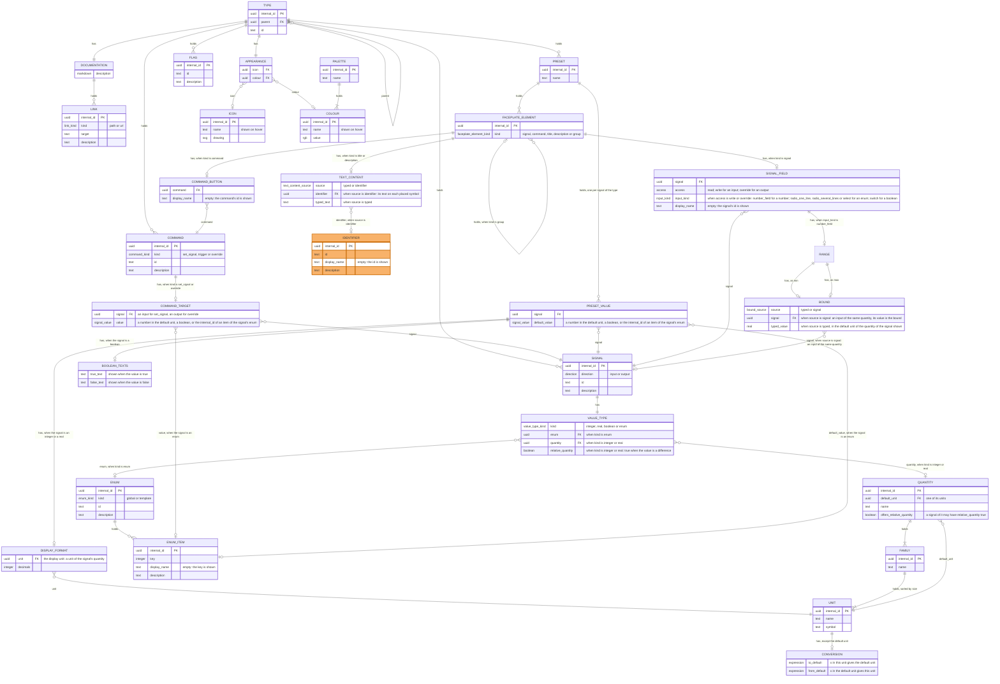

# Data model

> [Home](../README.md) › [Metadata](README.md) › Data model

Status: the schema and its JSON, being validated with the Product Owner. The rules, the reading notes and the open questions are in [Data model: notes](data-model-notes.md).

Colours of the boxes: orange, the object has its own page in [Objects](objects/README.md), not validated yet; green, its page is validated by the Product Owner; no colour, not written yet.

## The schema



## The schema as JSON

### A type

```json
{
  "format": 1,
  "internal_id": "6f1c2a90-0000-4000-8000-000000000001",
  "parent": "6f1c2a90-0000-4000-8000-000000000000",
  "id": "centrifugal_pump",
  "appearance": {
    "icon": "6f1c2a90-0000-4000-8000-000000000700",
    "colour": null
  },
  "documentation": {
    "description": "A **centrifugal** pump, driven by a variable speed motor.",
    "links": [
      {
        "internal_id": "6f1c2a90-0000-4000-8000-000000000010",
        "kind": "url",
        "target": "https://example.com/datasheets/centrifugal-pump",
        "description": "Datasheet"
      }
    ]
  },
  "signals": [
    {
      "internal_id": "6f1c2a90-0000-4000-8000-000000000020",
      "direction": "input",
      "id": "speed_setpoint",
      "description": "Speed asked of the motor.",
      "value_type": {
        "kind": "real",
        "quantity": "6f1c2a90-0000-4000-8000-000000000900",
        "relative_quantity": false
      }
    },
    {
      "internal_id": "6f1c2a90-0000-4000-8000-000000000021",
      "direction": "input",
      "id": "speed_max",
      "description": "Highest speed the operator may ask for.",
      "value_type": {
        "kind": "real",
        "quantity": "6f1c2a90-0000-4000-8000-000000000900",
        "relative_quantity": false
      }
    },
    {
      "internal_id": "6f1c2a90-0000-4000-8000-000000000022",
      "direction": "output",
      "id": "speed",
      "description": "Speed of the motor, computed by the model.",
      "value_type": {
        "kind": "real",
        "quantity": "6f1c2a90-0000-4000-8000-000000000900",
        "relative_quantity": false
      }
    },
    {
      "internal_id": "6f1c2a90-0000-4000-8000-000000000023",
      "direction": "output",
      "id": "running",
      "description": "True while the pump turns.",
      "value_type": {
        "kind": "boolean"
      }
    },
    {
      "internal_id": "6f1c2a90-0000-4000-8000-000000000024",
      "direction": "input",
      "id": "mode",
      "description": "How the pump is driven.",
      "value_type": {
        "kind": "enum",
        "enum": "6f1c2a90-0000-4000-8000-000000000500"
      }
    },
    {
      "internal_id": "6f1c2a90-0000-4000-8000-000000000025",
      "direction": "output",
      "id": "bearing_temperature_rise",
      "description": "How much the bearing is warmer than the room.",
      "value_type": {
        "kind": "real",
        "quantity": "6f1c2a90-0000-4000-8000-000000000910",
        "relative_quantity": true
      }
    }
  ],
  "commands": [
    {
      "internal_id": "6f1c2a90-0000-4000-8000-000000000030",
      "kind": "trigger",
      "id": "start",
      "description": "Asks the model to start the pump."
    },
    {
      "internal_id": "6f1c2a90-0000-4000-8000-000000000031",
      "kind": "set_signal",
      "id": "switch_to_auto",
      "description": "Puts the pump in automatic mode.",
      "command_target": {
        "signal": "6f1c2a90-0000-4000-8000-000000000024",
        "value": "6f1c2a90-0000-4000-8000-000000000502"
      }
    },
    {
      "internal_id": "6f1c2a90-0000-4000-8000-000000000032",
      "kind": "override",
      "id": "force_speed",
      "description": "Replaces the speed computed by the model, for a test.",
      "command_target": {
        "signal": "6f1c2a90-0000-4000-8000-000000000022",
        "value": 151.8436
      }
    }
  ],
  "flags": [
    {
      "internal_id": "6f1c2a90-0000-4000-8000-000000000040",
      "id": "under_maintenance",
      "description": "The pump is out of service for maintenance."
    }
  ],
  "presets": [
    {
      "internal_id": "6f1c2a90-0000-4000-8000-000000000050",
      "name": "Standard",
      "preset_values": [
        {
          "signal": "6f1c2a90-0000-4000-8000-000000000020",
          "default_value": 0,
          "display_format": {
            "unit": "6f1c2a90-0000-4000-8000-000000000902",
            "decimals": 0
          }
        },
        {
          "signal": "6f1c2a90-0000-4000-8000-000000000021",
          "default_value": 157.0796,
          "display_format": {
            "unit": "6f1c2a90-0000-4000-8000-000000000902",
            "decimals": 0
          }
        },
        {
          "signal": "6f1c2a90-0000-4000-8000-000000000022",
          "default_value": 0,
          "display_format": {
            "unit": "6f1c2a90-0000-4000-8000-000000000902",
            "decimals": 1
          }
        },
        {
          "signal": "6f1c2a90-0000-4000-8000-000000000023",
          "default_value": false,
          "boolean_texts": {
            "true_text": "Running",
            "false_text": "Stopped"
          }
        },
        {
          "signal": "6f1c2a90-0000-4000-8000-000000000024",
          "default_value": "6f1c2a90-0000-4000-8000-000000000501"
        },
        {
          "signal": "6f1c2a90-0000-4000-8000-000000000025",
          "default_value": 0,
          "display_format": {
            "unit": "6f1c2a90-0000-4000-8000-000000000912",
            "decimals": 1
          }
        }
      ],
      "faceplate_elements": [
        {
          "internal_id": "6f1c2a90-0000-4000-8000-000000000060",
          "kind": "title",
          "text_content": {
            "source": "identifier",
            "identifier": "6f1c2a90-0000-4000-8000-000000000800"
          }
        },
        {
          "internal_id": "6f1c2a90-0000-4000-8000-000000000061",
          "kind": "description",
          "text_content": {
            "source": "typed",
            "typed_text": "Feed pump of the main loop."
          }
        },
        {
          "internal_id": "6f1c2a90-0000-4000-8000-000000000062",
          "kind": "group",
          "faceplate_elements": [
            {
              "internal_id": "6f1c2a90-0000-4000-8000-000000000063",
              "kind": "signal",
              "signal_field": {
                "signal": "6f1c2a90-0000-4000-8000-000000000020",
                "access": "write",
                "input_kind": "number_field",
                "display_name": "Speed setpoint",
                "range": {
                  "min": {
                    "source": "typed",
                    "typed_value": 0
                  },
                  "max": {
                    "source": "signal",
                    "signal": "6f1c2a90-0000-4000-8000-000000000021"
                  }
                }
              }
            },
            {
              "internal_id": "6f1c2a90-0000-4000-8000-000000000064",
              "kind": "signal",
              "signal_field": {
                "signal": "6f1c2a90-0000-4000-8000-000000000022",
                "access": "read",
                "display_name": null
              }
            },
            {
              "internal_id": "6f1c2a90-0000-4000-8000-000000000065",
              "kind": "signal",
              "signal_field": {
                "signal": "6f1c2a90-0000-4000-8000-000000000023",
                "access": "read",
                "display_name": "State"
              }
            }
          ]
        },
        {
          "internal_id": "6f1c2a90-0000-4000-8000-000000000066",
          "kind": "signal",
          "signal_field": {
            "signal": "6f1c2a90-0000-4000-8000-000000000024",
            "access": "write",
            "input_kind": "radio_one_line",
            "display_name": "Mode"
          }
        },
        {
          "internal_id": "6f1c2a90-0000-4000-8000-000000000067",
          "kind": "command",
          "command_button": {
            "command": "6f1c2a90-0000-4000-8000-000000000030",
            "display_name": "Start"
          }
        }
      ]
    }
  ]
}
```

### A global enum

```json
{
  "format": 1,
  "internal_id": "6f1c2a90-0000-4000-8000-000000000500",
  "kind": "global",
  "id": "operating_mode",
  "description": "How a piece of equipment is driven.",
  "enum_items": [
    {
      "internal_id": "6f1c2a90-0000-4000-8000-000000000501",
      "key": 0,
      "display_name": "Manual",
      "description": "Driven by the operator."
    },
    {
      "internal_id": "6f1c2a90-0000-4000-8000-000000000502",
      "key": 1,
      "display_name": "Auto",
      "description": "Driven by the control loop."
    }
  ]
}
```

### A quantity of the catalogue

```json
{
  "internal_id": "6f1c2a90-0000-4000-8000-000000000910",
  "default_unit": "6f1c2a90-0000-4000-8000-000000000911",
  "name": "temperature",
  "offers_relative_quantity": true,
  "families": [
    {
      "internal_id": "6f1c2a90-0000-4000-8000-000000000915",
      "name": "metric",
      "units": [
        {
          "internal_id": "6f1c2a90-0000-4000-8000-000000000911",
          "name": "kelvin",
          "symbol": "K"
        },
        {
          "internal_id": "6f1c2a90-0000-4000-8000-000000000912",
          "name": "degree Celsius",
          "symbol": "°C",
          "conversion": {
            "to_default": "x + 273.15",
            "from_default": "x - 273.15"
          }
        }
      ]
    },
    {
      "internal_id": "6f1c2a90-0000-4000-8000-000000000916",
      "name": "imperial",
      "units": [
        {
          "internal_id": "6f1c2a90-0000-4000-8000-000000000913",
          "name": "degree Fahrenheit",
          "symbol": "°F",
          "conversion": {
            "to_default": "(x + 459.67) * 5 / 9",
            "from_default": "x * 9 / 5 - 459.67"
          }
        }
      ]
    }
  ]
}
```
