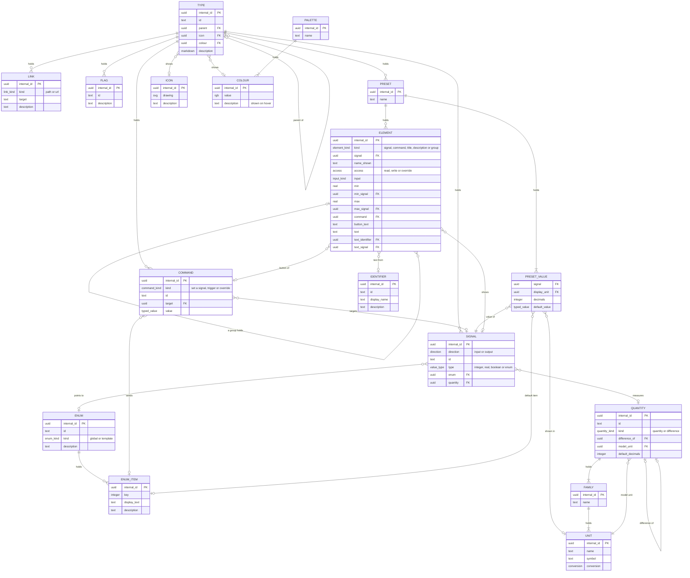

# Data model

> [Home](../README.md) › [Metadata](README.md) › Data model

Status: schema only, being written (2026-11-19). The descriptions come once the schema is validated by the Product Owner.

- `internal_id`: the UUID set by the software; every FK holds one.
- `id`: the public identifier, written by the user.
- `holds`: an ordered list inside its owner.

## The schema

## Not in the schema yet

- The texts filled on each placed symbol: with the synoptic.
- The versions of Metadata.
- How a unit converts (against a reference family or a base unit).

## Open

- The name of the short text that names a colour or an icon: `description` for now.
