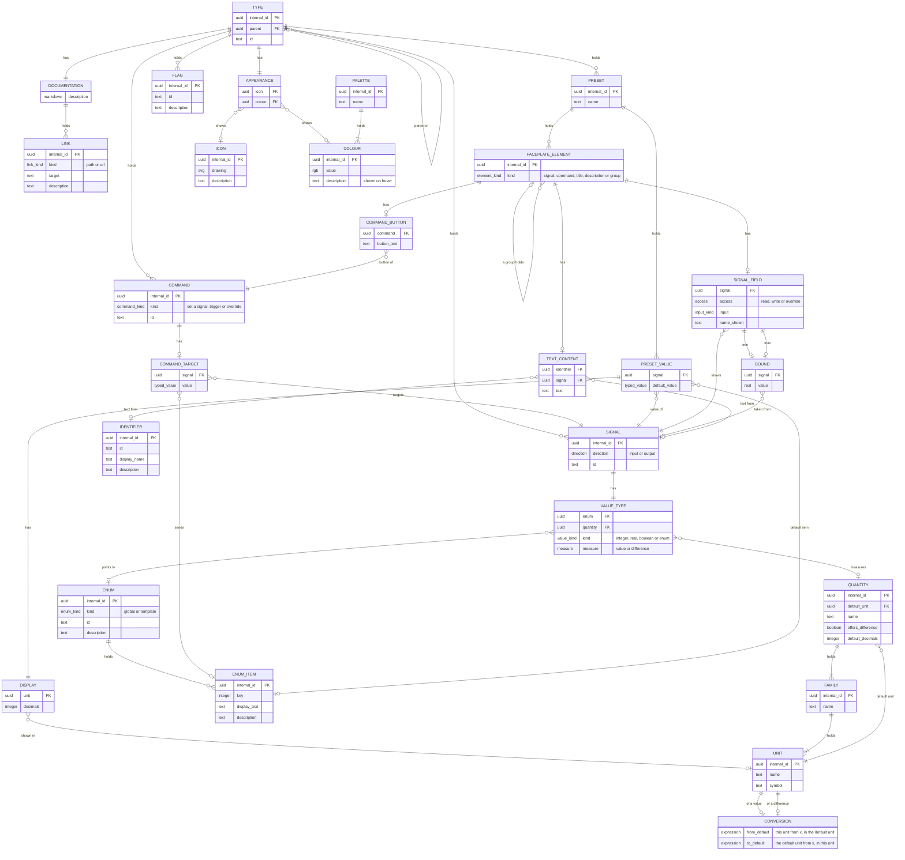

# Data model

> [Home](../README.md) › [Metadata](README.md) › Data model

Status: schema only, being written (2026-11-19). The descriptions come once the schema is validated by the Product Owner.

- `internal_id`: the UUID set by the software; every FK holds one.
- `id`: the public identifier, written by the user. What the software ships (quantities, families, units) has a `name` instead: the user never writes it.
- A choice of the software (`kind`, `direction`, `measure`...) is written in the JSON as an English word (`"input"`, `"difference"`), never as a number, so that a file reads by itself (Product Owner, 2026-11-19). The key of an enum item stays a whole number: it goes to the model (decisions 0012, 0016).
- A box without `internal_id` is a part of its owner (a nested object in the JSON), never pointed to.
- `has`: one nested object; `holds`: an ordered list inside its owner.
- Field order in each box: `internal_id`, then the links (FK), then the kind, then `id` or the name, then the values, then the texts.

## The schema

## Changed on 2026-11-19

Asked by the Product Owner on 2026-11-19, while reading the schema; the three points the assistant proposed were settled by the Product Owner the same day, in the questionnaire. Decision 0049 (accepted, 2026-11-19) records them: it changes decision 0003 (reference family, closed forms) and specifies decision 0020 (a difference).

- **The default unit** replaces `model_unit` (Product Owner: "c'est plutôt la unit par défaut"): the unit of the quantity that every conversion is written against, as the Units page already calls it. Its own conversion is empty: it is the unit itself.
- **No reference family any more**: every unit converts to the default unit and back, never to another family. It answers the question of 2026-11-17 the way the assistant proposed then; the families only group the units for reading.
- **A conversion is the real formula** (Product Owner: "que la conversion on puisse mettre le calcul réel"), not only a factor: two expressions in `x`, one from the default unit, one back to it, because a free formula cannot be turned round by the software. Confirmed by the Product Owner on 2026-11-19 ("Oui, formules libres"). It replaces the rule of 2026-11-11 (decision 0003) by which a conversion was one of four closed forms, a pair of free expressions being the last resort. The four forms of the research (proportional, affine, inverse, logarithmic) are now just formulas like any other. The catalogue is written by contributors, so its tests check that each pair goes there and back.
- **A quantity has a `name`, not an `id`** (Product Owner: "c'est pas vraiment ce que j'appellerai un ID, c'est plutôt un nom"): mass, volume, flow are shipped by the software, never typed by the user.
- **A difference is no longer a quantity of its own** (assistant's proposal, chosen by the Product Owner on 2026-11-19: "une lecture de la grandeur"; no table of its own): the signal says whether its value is the quantity or a difference of it (`measure`, as decision 0020 already says), and the units of a quantity whose conversion changes (`offers_difference`, temperature, gauge pressure...) carry a second conversion, for a difference. It removes the quantity that points to another quantity (`difference_of`, `kind`), which read badly. It is what FMI does with its flag `relativeQuantity` (research T2, section 3.8).
- **`integer` stays a value kind** beside `real`, `boolean` and `enum` (Product Owner, 2026-11-19: "Garder integer"), as decisions 0003 and 0043 already say: the model receives an exact whole number, and the input refuses decimals. FMI and SSP keep integers apart from reals (research T2, section 3.1).

## Not in the schema yet

- The texts filled on each placed symbol: with the synoptic.
- The versions of Metadata.

## Open

- The default unit is also the model unit while the model unit stays in the catalogue (decision 0024 leans that way). If it moves to a configuration of the project, the default unit stays the unit the formulas are written against, and the model unit becomes a field of its own.
- The symbol of a unit for a difference: the same (`°C`) or marked (`Δ°C`)?
- The syntax of the expressions (operators, π, powers, logarithms): chosen with the architecture, evaluated without `eval`.
- The name of the short text that names a colour or an icon: `description` for now.
- The names of the nested parts (`APPEARANCE`, `VALUE_TYPE`, `COMMAND_TARGET`, `DISPLAY`, `SIGNAL_FIELD`, `BOUND`, `COMMAND_BUTTON`, `TEXT_CONTENT`, `CONVERSION`) and of `FACEPLATE_ELEMENT`: working names.
