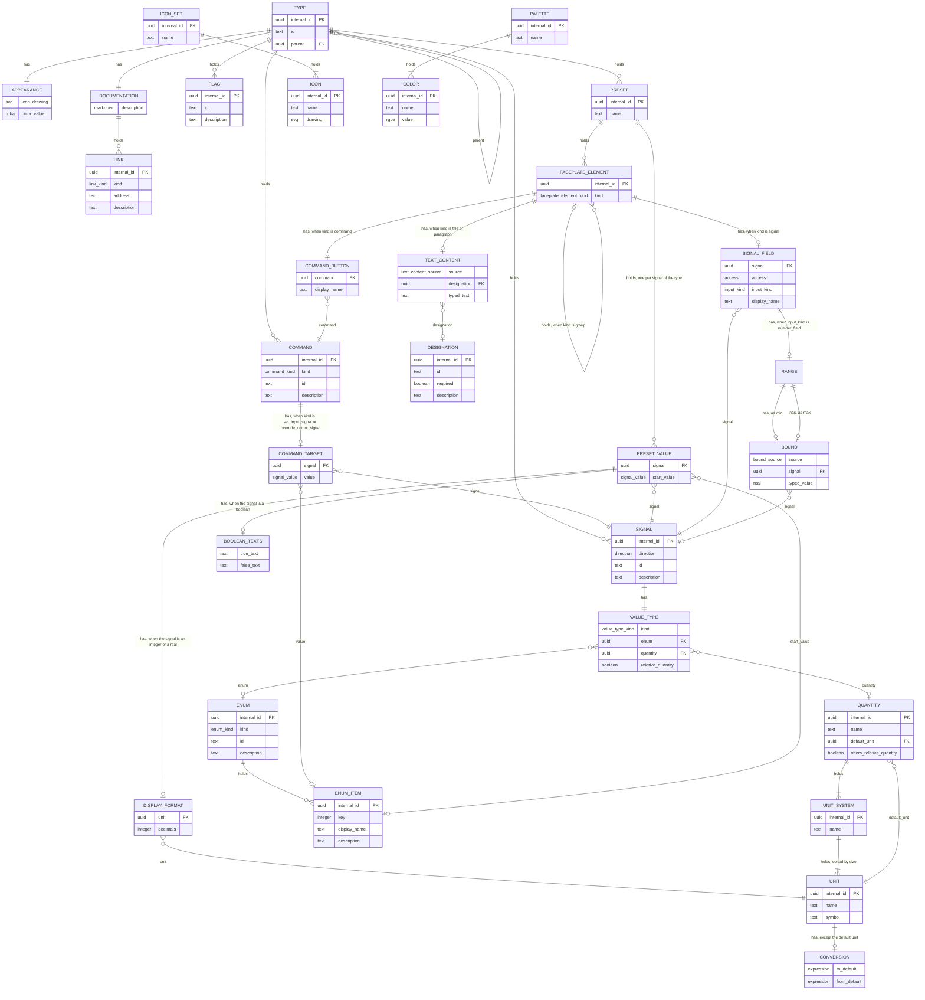

# Data model

> [Home](../README.md) › [Metadata](README.md) › Data model

Status: the schema and its JSON, being validated with the Product Owner. The rules, the reading notes and the open questions are in [Data model: notes](data-model-notes.md).

Colour of a box's title: orange, the entity has its own page in [Entities](entities/README.md), whose last version is not validated yet; green, the last version of its page is validated by the Product Owner; no colour, not written yet.

## The schema



## The schema as JSON

### A type

```json
{
  "format_version": 1,
  "type": {
    "internal_id": "01a1f800-0000-7000-8000-000000000001",
    "id": "centrifugal_pump",
    "parent": "01a1f800-0000-7000-8000-000000000000",
    "appearance": {
      "icon_drawing": "<svg xmlns=\"http://www.w3.org/2000/svg\" viewBox=\"0 0 24 24\"><circle cx=\"12\" cy=\"12\" r=\"9\"/></svg>",
      "color_value": null
    },
    "documentation": {
      "description": "A **centrifugal** pump, driven by a variable speed motor.",
      "links": [
        {
          "internal_id": "01a1f800-0000-7000-8000-000000000010",
          "kind": "url",
          "address": "https://example.com/datasheets/centrifugal-pump",
          "description": "Datasheet"
        }
      ]
    },
    "signals": [
      {
        "internal_id": "01a1f800-0000-7000-8000-000000000020",
        "direction": "input",
        "id": "speed_setpoint",
        "description": "Speed asked of the motor.",
        "value_type": {
          "kind": "real",
          "quantity": "01a1f800-0000-7000-8000-000000000900",
          "relative_quantity": false
        }
      },
      {
        "internal_id": "01a1f800-0000-7000-8000-000000000021",
        "direction": "input",
        "id": "speed_max",
        "description": "Highest speed the operator may ask for.",
        "value_type": {
          "kind": "real",
          "quantity": "01a1f800-0000-7000-8000-000000000900",
          "relative_quantity": false
        }
      },
      {
        "internal_id": "01a1f800-0000-7000-8000-000000000022",
        "direction": "output",
        "id": "speed",
        "description": "Speed of the motor, computed by the model.",
        "value_type": {
          "kind": "real",
          "quantity": "01a1f800-0000-7000-8000-000000000900",
          "relative_quantity": false
        }
      },
      {
        "internal_id": "01a1f800-0000-7000-8000-000000000023",
        "direction": "output",
        "id": "running",
        "description": "True while the pump turns.",
        "value_type": {
          "kind": "boolean"
        }
      },
      {
        "internal_id": "01a1f800-0000-7000-8000-000000000024",
        "direction": "input",
        "id": "mode",
        "description": "How the pump is driven.",
        "value_type": {
          "kind": "enum",
          "enum": "01a1f800-0000-7000-8000-000000000500"
        }
      },
      {
        "internal_id": "01a1f800-0000-7000-8000-000000000025",
        "direction": "output",
        "id": "bearing_temperature_rise",
        "description": "How much the bearing is warmer than the room.",
        "value_type": {
          "kind": "real",
          "quantity": "01a1f800-0000-7000-8000-000000000910",
          "relative_quantity": true
        }
      }
    ],
    "commands": [
      {
        "internal_id": "01a1f800-0000-7000-8000-000000000030",
        "kind": "trigger",
        "id": "start",
        "description": "Tells that the start of the pump was asked."
      },
      {
        "internal_id": "01a1f800-0000-7000-8000-000000000031",
        "kind": "set_input_signal",
        "id": "switch_to_auto",
        "description": "Puts the pump in automatic mode.",
        "command_target": {
          "signal": "01a1f800-0000-7000-8000-000000000024",
          "value": "01a1f800-0000-7000-8000-000000000502"
        }
      },
      {
        "internal_id": "01a1f800-0000-7000-8000-000000000032",
        "kind": "override_output_signal",
        "id": "force_speed",
        "description": "Replaces the speed computed by the model, for a test.",
        "command_target": {
          "signal": "01a1f800-0000-7000-8000-000000000022",
          "value": 151.8436
        }
      }
    ],
    "flags": [
      {
        "internal_id": "01a1f800-0000-7000-8000-000000000040",
        "id": "under_maintenance",
        "description": "The pump is out of service for maintenance."
      }
    ],
    "presets": [
      {
        "internal_id": "01a1f800-0000-7000-8000-000000000050",
        "name": "Standard",
        "preset_values": [
          {
            "signal": "01a1f800-0000-7000-8000-000000000020",
            "start_value": 0,
            "display_format": {
              "unit": "01a1f800-0000-7000-8000-000000000902",
              "decimals": 0
            }
          },
          {
            "signal": "01a1f800-0000-7000-8000-000000000021",
            "start_value": 157.0796,
            "display_format": {
              "unit": "01a1f800-0000-7000-8000-000000000902",
              "decimals": 0
            }
          },
          {
            "signal": "01a1f800-0000-7000-8000-000000000022",
            "start_value": 0,
            "display_format": {
              "unit": "01a1f800-0000-7000-8000-000000000902",
              "decimals": 1
            }
          },
          {
            "signal": "01a1f800-0000-7000-8000-000000000023",
            "start_value": false,
            "boolean_texts": {
              "true_text": "Running",
              "false_text": "Stopped"
            }
          },
          {
            "signal": "01a1f800-0000-7000-8000-000000000024",
            "start_value": "01a1f800-0000-7000-8000-000000000501"
          },
          {
            "signal": "01a1f800-0000-7000-8000-000000000025",
            "start_value": 0,
            "display_format": {
              "unit": "01a1f800-0000-7000-8000-000000000912",
              "decimals": 1
            }
          }
        ],
        "faceplate_elements": [
          {
            "internal_id": "01a1f800-0000-7000-8000-000000000060",
            "kind": "title",
            "text_content": {
              "source": "designation",
              "designation": "01a1f800-0000-7000-8000-000000000800"
            }
          },
          {
            "internal_id": "01a1f800-0000-7000-8000-000000000061",
            "kind": "paragraph",
            "text_content": {
              "source": "typed",
              "typed_text": "Feed pump of the main loop."
            }
          },
          {
            "internal_id": "01a1f800-0000-7000-8000-000000000062",
            "kind": "group",
            "faceplate_elements": [
              {
                "internal_id": "01a1f800-0000-7000-8000-000000000063",
                "kind": "signal",
                "signal_field": {
                  "signal": "01a1f800-0000-7000-8000-000000000020",
                  "access": "write",
                  "input_kind": "number_field",
                  "display_name": "Speed setpoint",
                  "range": {
                    "min": {
                      "source": "typed",
                      "typed_value": 0
                    },
                    "max": {
                      "source": "signal",
                      "signal": "01a1f800-0000-7000-8000-000000000021"
                    }
                  }
                }
              },
              {
                "internal_id": "01a1f800-0000-7000-8000-000000000064",
                "kind": "signal",
                "signal_field": {
                  "signal": "01a1f800-0000-7000-8000-000000000022",
                  "access": "read",
                  "display_name": null
                }
              },
              {
                "internal_id": "01a1f800-0000-7000-8000-000000000065",
                "kind": "signal",
                "signal_field": {
                  "signal": "01a1f800-0000-7000-8000-000000000023",
                  "access": "read",
                  "display_name": "State"
                }
              }
            ]
          },
          {
            "internal_id": "01a1f800-0000-7000-8000-000000000066",
            "kind": "signal",
            "signal_field": {
              "signal": "01a1f800-0000-7000-8000-000000000024",
              "access": "write",
              "input_kind": "radio_horizontal",
              "display_name": "Mode"
            }
          },
          {
            "internal_id": "01a1f800-0000-7000-8000-000000000067",
            "kind": "command",
            "command_button": {
              "command": "01a1f800-0000-7000-8000-000000000030",
              "display_name": "Start"
            }
          }
        ]
      }
    ]
  }
}
```

### The enums

```json
{
  "format_version": 1,
  "enums": [
    {
      "internal_id": "01a1f800-0000-7000-8000-000000000500",
      "kind": "global",
      "id": "operating_mode",
      "description": "How a piece of equipment is driven.",
      "enum_items": [
        {
          "internal_id": "01a1f800-0000-7000-8000-000000000501",
          "key": 0,
          "display_name": "Manual",
          "description": "Driven by the operator."
        },
        {
          "internal_id": "01a1f800-0000-7000-8000-000000000502",
          "key": 1,
          "display_name": "Auto",
          "description": "Driven by the control loop."
        }
      ]
    },
    {
      "internal_id": "01a1f800-0000-7000-8000-000000000510",
      "kind": "template",
      "id": "switch_positions",
      "description": "The positions of a switch.",
      "enum_items": []
    }
  ]
}
```

### A quantity

```json
{
  "format_version": 1,
  "quantity": {
    "internal_id": "01a1f800-0000-7000-8000-000000000910",
    "name": "temperature",
    "default_unit": "01a1f800-0000-7000-8000-000000000911",
    "offers_relative_quantity": true,
    "unit_systems": [
      {
        "internal_id": "01a1f800-0000-7000-8000-000000000915",
        "name": "metric",
        "units": [
          {
            "internal_id": "01a1f800-0000-7000-8000-000000000911",
            "name": "kelvin",
            "symbol": "K"
          },
          {
            "internal_id": "01a1f800-0000-7000-8000-000000000912",
            "name": "degree Celsius",
            "symbol": "°C",
            "conversion": {
              "to_default": "x + 273.15",
              "from_default": "x - 273.15"
            }
          }
        ]
      },
      {
        "internal_id": "01a1f800-0000-7000-8000-000000000916",
        "name": "imperial",
        "units": [
          {
            "internal_id": "01a1f800-0000-7000-8000-000000000913",
            "name": "degree Fahrenheit",
            "symbol": "°F",
            "conversion": {
              "to_default": "(x + 459.67) * 5 / 9",
              "from_default": "x * 9 / 5 - 459.67"
            }
          }
        ]
      }
    ]
  }
}
```
