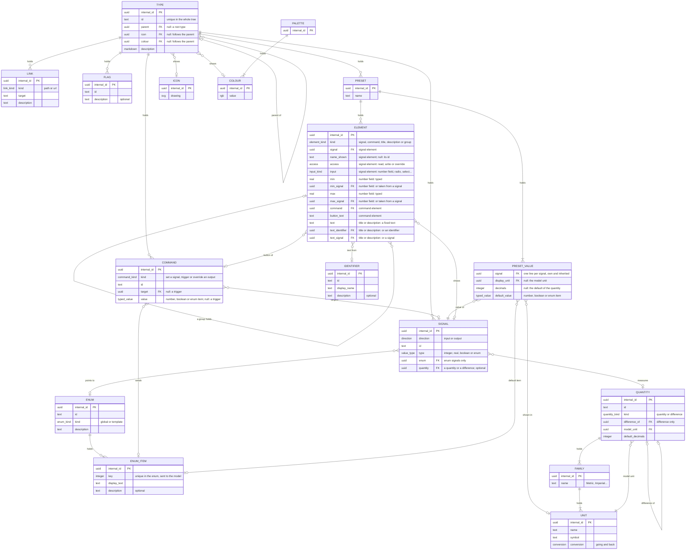

# Data model

> [Home](../README.md) › [Metadata](README.md) › Data model

Status: final page, being written (2026-11-19). The schema only, to be validated by the Product Owner before the rest of the page. Written from the [whole draft](draft.md); the presets part is drawn from the [Presets](draft.md#presets-and-their-faceplate) page, never described as data before.

## How to read the schema

- Every object has an `internal_id` (PK): a UUID set by the software, that never changes and never leaves the application.
- A field marked FK holds the `internal_id` of the object it points to, never its `id` nor a copy.
- `id` is the public identifier, written by the user and sent to the model and the configuration files.
- A "holds" line is a nested, ordered list: the order of the list is the order on the screen.
- `null` in a comment says what an empty field means.
- `quantity`, `family`, `unit`, `icon`, `palette` and `colour` ship with the software: the user only points to them.

## The schema

## Not in the schema yet

- The texts filled on each placed symbol (identifiers, items of a template enum, flags on or off): with the synoptic, part 3.
- The versions of Metadata: their questions are open (see [Versions](draft.md#versions-of-metadata)).
- The conversion of a unit: against a reference family or a base unit, still open (see [Units](draft.md#quantities-families-and-conversions)).
