# Data model

> [Home](../README.md) › [Metadata](README.md) › Data model

Status: the whole schema of Metadata and the list of its entities, being validated. Each entity is written whole, with its JSON Schema and the JSON Schema of its file, in [Entities](entities/README.md); the rules every file follows are in [Files](files.md); the reading notes and the open questions are in [Data model: notes](data-model-notes.md).

## The schema

The schema reads from the top: the type, then its parts in the order of the keys of its file, then the quantities, the enums and the designations its fields point to. Palettes and icon sets stand apart, on the left beside the appearance: an appearance copies the color and the drawing it picks, and keeps no link to them. A click on a box opens its entity file.

Colour of a box's title: orange, the last version of its entity file is not validated yet; green, it is validated.

```mermaid
---
config:
  themeCSS: "[id*='entity-PALETTE-'] .outer-path path, [id*='entity-COLOR-'] .outer-path path, [id*='entity-ICON_SET-'] .outer-path path, [id*='entity-ICON-'] .outer-path path, [id*='entity-TYPE-'] .outer-path path, [id*='entity-APPEARANCE-'] .outer-path path, [id*='entity-DOCUMENTATION-'] .outer-path path, [id*='entity-LINK-'] .outer-path path, [id*='entity-SIGNAL-'] .outer-path path, [id*='entity-VALUE_TYPE-'] .outer-path path, [id*='entity-QUANTITY-'] .outer-path path, [id*='entity-UNIT_SYSTEM-'] .outer-path path, [id*='entity-UNIT-'] .outer-path path, [id*='entity-CONVERSION-'] .outer-path path, [id*='entity-ENUM-'] .outer-path path, [id*='entity-ENUM_ITEM-'] .outer-path path, [id*='entity-COMMAND-'] .outer-path path, [id*='entity-COMMAND_TARGET-'] .outer-path path, [id*='entity-FLAG-'] .outer-path path, [id*='entity-SIGNAL_SETTING-'] .outer-path path, [id*='entity-DISPLAY_FORMAT-'] .outer-path path, [id*='entity-BOOLEAN_TEXTS-'] .outer-path path, [id*='entity-FACEPLATE_ELEMENT-'] .outer-path path, [id*='entity-SIGNAL_FIELD-'] .outer-path path, [id*='entity-RANGE-'] .outer-path path, [id*='entity-BOUND-'] .outer-path path, [id*='entity-COMMAND_BUTTON-'] .outer-path path, [id*='entity-TEXT_CONTENT-'] .outer-path path, [id*='entity-DESIGNATION-'] .outer-path path { fill: #f8b26a !important; }"
---
erDiagram
    %% link PALETTE entities/02-palette.md
    %% link COLOR entities/01-color.md
    %% link ICON_SET entities/04-icon-set.md
    %% link ICON entities/03-icon.md
    %% link TYPE entities/30-type.md
    %% link APPEARANCE entities/12-appearance.md
    %% link DOCUMENTATION entities/14-documentation.md
    %% link LINK entities/13-link.md
    %% link SIGNAL entities/16-signal.md
    %% link VALUE_TYPE entities/15-value-type.md
    %% link COMMAND entities/18-command.md
    %% link COMMAND_TARGET entities/17-command-target.md
    %% link FLAG entities/19-flag.md
    %% link SIGNAL_SETTING entities/22-signal-setting.md
    %% link DISPLAY_FORMAT entities/20-display-format.md
    %% link BOOLEAN_TEXTS entities/21-boolean-texts.md
    %% link FACEPLATE_ELEMENT entities/28-faceplate-element.md
    %% link SIGNAL_FIELD entities/25-signal-field.md
    %% link RANGE entities/24-range.md
    %% link BOUND entities/23-bound.md
    %% link COMMAND_BUTTON entities/26-command-button.md
    %% link TEXT_CONTENT entities/27-text-content.md
    %% link QUANTITY entities/10-quantity.md
    %% link UNIT_SYSTEM entities/09-unit-system.md
    %% link UNIT entities/08-unit.md
    %% link CONVERSION entities/07-conversion.md
    %% link ENUM entities/06-enum.md
    %% link ENUM_ITEM entities/05-enum-item.md
    %% link DESIGNATION entities/11-designation.md
    PALETTE {
        uuid internal_id PK
        text name
    }
    COLOR {
        uuid internal_id PK
        text name
        rgba value
    }
    ICON_SET {
        uuid internal_id PK
        text name
    }
    ICON {
        uuid internal_id PK
        text name
        svg drawing
    }
    TYPE {
        uuid internal_id PK
        text id
        uuid parent FK
        uuid_list faceplate_order
    }
    APPEARANCE {
        svg icon_drawing
        rgba color_value
    }
    DOCUMENTATION {
        markdown description
    }
    LINK {
        uuid internal_id PK
        link_kind kind
        text address
        text description
    }
    SIGNAL {
        uuid internal_id PK
        direction direction
        text id
        text description
    }
    VALUE_TYPE {
        value_type_kind kind
        uuid enum FK
        uuid quantity FK
        boolean relative_quantity
    }
    COMMAND {
        uuid internal_id PK
        command_kind kind
        text id
        text description
    }
    COMMAND_TARGET {
        uuid signal FK
        signal_value value
    }
    FLAG {
        uuid internal_id PK
        text id
        text description
    }
    SIGNAL_SETTING {
        uuid signal FK
        signal_value start_value
    }
    DISPLAY_FORMAT {
        uuid unit FK
        integer decimals
    }
    BOOLEAN_TEXTS {
        text true_text
        text false_text
    }
    FACEPLATE_ELEMENT {
        uuid internal_id PK
        faceplate_element_kind kind
    }
    SIGNAL_FIELD {
        uuid signal FK
        access access
        input_kind input_kind
        text display_name
    }
    BOUND {
        bound_source source
        uuid signal FK
        real typed_value
    }
    COMMAND_BUTTON {
        uuid command FK
        text display_name
    }
    TEXT_CONTENT {
        text_content_source source
        uuid designation FK
        text typed_text
    }
    QUANTITY {
        uuid internal_id PK
        text name
        uuid default_unit FK
        boolean offers_relative_quantity
    }
    UNIT_SYSTEM {
        uuid internal_id PK
        text name
    }
    UNIT {
        uuid internal_id PK
        text name
        text symbol
    }
    CONVERSION {
        expression to_default
        expression from_default
    }
    ENUM {
        uuid internal_id PK
        enum_kind kind
        text id
        text description
    }
    ENUM_ITEM {
        uuid internal_id PK
        integer key
        text display_name
        text description
    }
    DESIGNATION {
        uuid internal_id PK
        text id
        boolean required
        text description
    }
    PALETTE ||--|{ COLOR : "holds"
    ICON_SET ||--|{ ICON : "holds"
    TYPE |o--o{ TYPE : "parent"
    TYPE ||--|| APPEARANCE : "has"
    TYPE ||--|| DOCUMENTATION : "has"
    TYPE ||--o{ SIGNAL : "holds"
    TYPE ||--o{ COMMAND : "holds"
    TYPE ||--o{ FLAG : "holds"
    TYPE ||--o{ SIGNAL_SETTING : "holds, one per own signal, and one per inherited signal it changes"
    TYPE ||--o{ FACEPLATE_ELEMENT : "holds; faceplate_order places those of the parents too"
    DOCUMENTATION ||--o{ LINK : "holds"
    SIGNAL ||--|| VALUE_TYPE : "has"
    SIGNAL ||--o{ COMMAND_TARGET : "signal"
    SIGNAL ||--o{ SIGNAL_SETTING : "signal"
    SIGNAL ||--o{ SIGNAL_FIELD : "signal"
    SIGNAL |o--o{ BOUND : "signal"
    VALUE_TYPE }o--o| QUANTITY : "quantity"
    VALUE_TYPE }o--o| ENUM : "enum"
    COMMAND ||--o| COMMAND_TARGET : "has, when kind is set_input_signal or override_output_signal"
    COMMAND ||--o{ COMMAND_BUTTON : "command"
    COMMAND_TARGET }o--o| ENUM_ITEM : "value"
    SIGNAL_SETTING ||--o| DISPLAY_FORMAT : "has, when the signal is an integer or a real"
    SIGNAL_SETTING ||--o| BOOLEAN_TEXTS : "has, when the signal is a boolean"
    SIGNAL_SETTING }o--o| ENUM_ITEM : "start_value"
    DISPLAY_FORMAT }o--|| UNIT : "unit"
    FACEPLATE_ELEMENT |o--o{ FACEPLATE_ELEMENT : "holds, when kind is group"
    FACEPLATE_ELEMENT ||--o| SIGNAL_FIELD : "has, when kind is signal"
    FACEPLATE_ELEMENT ||--o| COMMAND_BUTTON : "has, when kind is command"
    FACEPLATE_ELEMENT ||--o| TEXT_CONTENT : "has, when kind is title or paragraph"
    SIGNAL_FIELD ||--o| RANGE : "has, when input_kind is number_field"
    RANGE ||--o| BOUND : "has, as min"
    RANGE ||--o| BOUND : "has, as max"
    TEXT_CONTENT }o--o| DESIGNATION : "designation"
    QUANTITY ||--|{ UNIT_SYSTEM : "holds"
    QUANTITY }o--|| UNIT : "default_unit"
    UNIT_SYSTEM ||--|{ UNIT : "holds, sorted by size"
    UNIT ||--o| CONVERSION : "has, except the default unit"
    ENUM ||--o{ ENUM_ITEM : "holds"
```

## The entities

Every entity of the schema, in the order of the pages of Metadata where it is edited (General, Documentation, Signals, Commands, Flags, Signal settings, Faceplate, then Units, Enums, Designations), with its number and the file it is kept in.

| Page | # | Entity | Kept in |
| --- | --- | --- | --- |
| General | 02 | [Palette](entities/02-palette.md) | `<name>.palette.json` |
| General | 01 | [Color](entities/01-color.md) | `<name>.palette.json` |
| General | 04 | [Icon set](entities/04-icon-set.md) | `<name>.icon-set.json` |
| General | 03 | [Icon](entities/03-icon.md) | `<name>.icon-set.json` |
| Types | 30 | [Type](entities/30-type.md) | `<id>.type.json` |
| General | 12 | [Appearance](entities/12-appearance.md) | `<id>.type.json` |
| Documentation | 14 | [Documentation](entities/14-documentation.md) | `<id>.type.json` |
| Documentation | 13 | [Link entity](entities/13-link.md) | `<id>.type.json` |
| Signals | 16 | [Signal](entities/16-signal.md) | `<id>.type.json` |
| Signals | 15 | [Value type](entities/15-value-type.md) | `<id>.type.json` |
| Commands | 18 | [Command](entities/18-command.md) | `<id>.type.json` |
| Commands | 17 | [Command target](entities/17-command-target.md) | `<id>.type.json` |
| Flags | 19 | [Flag](entities/19-flag.md) | `<id>.type.json` |
| Signal settings | 22 | [Signal setting](entities/22-signal-setting.md) | `<id>.type.json` |
| Signal settings | 20 | [Display format](entities/20-display-format.md) | `<id>.type.json` |
| Signal settings | 21 | [Boolean texts](entities/21-boolean-texts.md) | `<id>.type.json` |
| Faceplate | 28 | [Faceplate element](entities/28-faceplate-element.md) | `<id>.type.json` |
| Faceplate | 25 | [Signal field](entities/25-signal-field.md) | `<id>.type.json` |
| Faceplate | 24 | [Range](entities/24-range.md) | `<id>.type.json` |
| Faceplate | 23 | [Bound](entities/23-bound.md) | `<id>.type.json` |
| Faceplate | 26 | [Command button](entities/26-command-button.md) | `<id>.type.json` |
| Faceplate | 27 | [Text content](entities/27-text-content.md) | `<id>.type.json` |
| Units | 10 | [Quantity](entities/10-quantity.md) | `<name>.quantity.json` |
| Units | 09 | [Unit system](entities/09-unit-system.md) | `<name>.quantity.json` |
| Units | 08 | [Unit](entities/08-unit.md) | `<name>.quantity.json` |
| Units | 07 | [Conversion](entities/07-conversion.md) | `<name>.quantity.json` |
| Enums | 06 | [Enum](entities/06-enum.md) | `enums.json` |
| Enums | 05 | [Enum item](entities/05-enum-item.md) | `enums.json` |
| Designations | 11 | [Designation](entities/11-designation.md) | `designations.json` |

## The types of the fields

Every type a field of the schema has. A type is named after what the value is for Synoptic Studio, never after the JSON type that holds it: `text`, `markdown`, `svg` and `expression` are all JSON strings, but each is read and checked its own way. Empty is always `null`, never an empty string.

### The values

| Type | In JSON | Fields | Why this name |
| --- | --- | --- | --- |
| `uuid` | A string: a UUID version 7, in lower case, 36 characters. | Every `internal_id` (`PK`) and every link (`FK`). | The name of the format (RFC 9562); every key the software sets is one. |
| `text` | A string, plain text. | `id`, `name`, `description` (but that of a documentation), `display_name`, `address`, `symbol`, `true_text`, `false_text`, `typed_text`. | A text people write or read, without markup; `string` would only say how JSON holds it. |
| `markdown` | A string in Markdown. | `DOCUMENTATION.description`. | The only text shown with its formatting, so the only one named after its format. |
| `svg` | A string holding an SVG drawing. | `ICON.drawing`, `APPEARANCE.icon_drawing`. | The format of the drawing, which the software draws and recolours. |
| `rgba` | A string `#rrggbbaa`: red, green, blue in sRGB, then the opacity. | `COLOR.value`, `APPEARANCE.color_value`. | Its four channels, the opacity last, as CSS writes them. |
| `boolean` | `true` or `false`. | `DESIGNATION.required`, `VALUE_TYPE.relative_quantity`, `QUANTITY.offers_relative_quantity`. | The usual word, also a kind of value of a signal. |
| `integer` | A whole number. | `ENUM_ITEM.key`, `DISPLAY_FORMAT.decimals`. | The word of FMI and of `value_type_kind`, kept apart from `real`. |
| `real` | A number, with or without decimals. | `BOUND.typed_value`. | The word of FMI and of `value_type_kind` for a number that is not whole. |
| `expression` | A string: a formula in `x`, written as [Formulas](formulas.md) says. | `CONVERSION.to_default`, `CONVERSION.from_default`. | A formula the software reads and computes, never a text shown as it is. |
| `uuid_list` | An array of `uuid`, each once. | `TYPE.faceplate_order`. | Several links in an order the user chose. |
| `signal_value` | A number, `true` or `false`, or the `uuid` of an enum item, as the value type of the signal says. | `COMMAND_TARGET.value`, `SIGNAL_SETTING.start_value`. | A value whose kind is read from the signal it goes with. |

### The choice lists

A choice list is a field whose value is one word of a fixed list, written in English, several words joined by `_`. It is named after its field; a field named `kind` or `source`, which several boxes have, takes its box as prefix.

| List | Field | Values | Meaning |
| --- | --- | --- | --- |
| `link_kind` | `LINK.kind` | `path`, `url` | A path to a file or a folder, or a web address; held in `LINK.address`. |
| `direction` | `SIGNAL.direction` | `input`, `output` | The model receives it, or the model sends it. |
| `value_type_kind` | `VALUE_TYPE.kind` | `integer`, `real`, `boolean`, `enum` | A whole number, a number, true or false, an item of an enum. |
| `command_kind` | `COMMAND.kind` | `set_input_signal`, `trigger`, `override_output_signal` | Send a fixed value to an input signal; tell the layer above the model that an action happened, never the model; replace the value of an output signal by a fixed value. |
| `enum_kind` | `ENUM.kind` | `global`, `template` | Items written once, the same everywhere; or items completed on each placed symbol. |
| `faceplate_element_kind` | `FACEPLATE_ELEMENT.kind` | `signal`, `command`, `title`, `paragraph`, `group` | A signal field, a command button, a title, a paragraph, or a group of elements. |
| `access` | `SIGNAL_FIELD.access` | `read`, `write`, `override` | Shown only; typed in, for an input; typed in, for an output. |
| `input_kind` | `SIGNAL_FIELD.input_kind` | `number_field`, `radio_horizontal`, `radio_vertical`, `select`, `switch` | A number field, for an integer or a real; buttons on one line, one button per line, or a list, for an enum; a switch, for a boolean. |
| `bound_source` | `BOUND.source` | `typed`, `signal` | A number typed in the builder, or the value of an input signal. |
| `text_content_source` | `TEXT_CONTENT.source` | `typed`, `designation` | A text typed in the builder, or the text of a designation on each placed symbol. |
