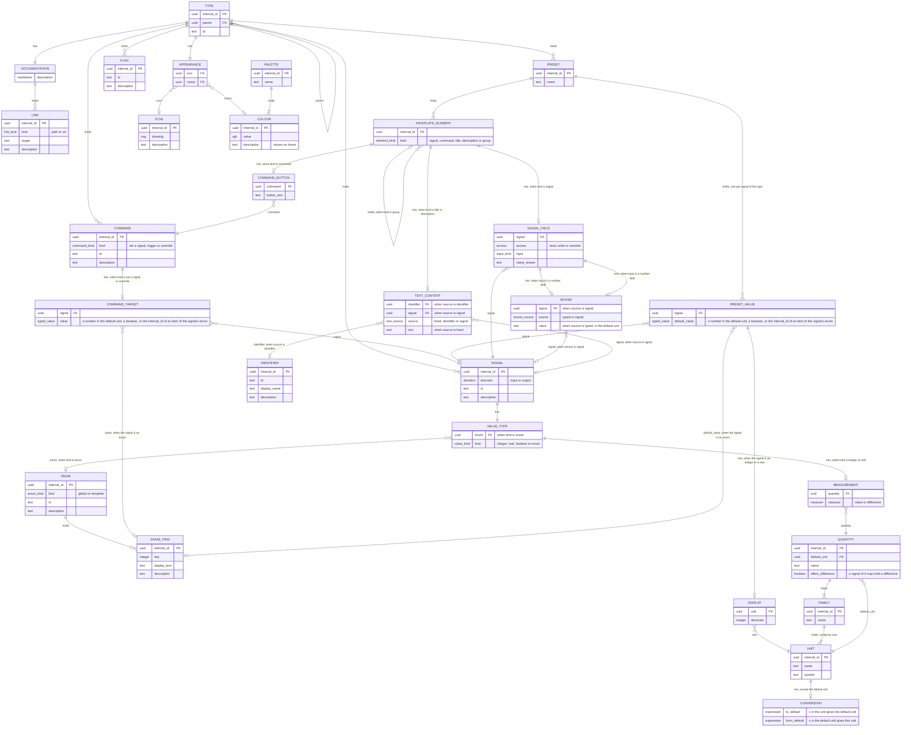

# Data model

> [Home](../README.md) › [Metadata](README.md) › Data model

Status: schema only, being written (2026-11-19). The descriptions come once the schema is validated by the Product Owner.

- `internal_id`: the UUID set by the software; every FK holds one.
- `id`: the public identifier, written by the user. What the software ships (quantities, families, units) has a `name` instead: the user never writes it.
- A choice of the software (`kind`, `direction`, `measure`...) is written in the JSON as an English word (`"input"`, `"difference"`), never as a number, so that a file reads by itself (Product Owner, 2026-11-19). The key of an enum item stays a whole number: it goes to the model (decisions 0012, 0016).
- A box without `internal_id` is a part of its owner (a nested object in the JSON), never pointed to.
- `has`: one nested object; `holds`: an ordered list inside its owner.
- Every other link is a FK, labelled by the field that holds it (`signal`, `default_unit`...), so that the reader knows which field points where.
- A link or a field that only exists in some cases says when, always in the same words: `when kind is enum`, `when the signal is an enum`.
- A number typed in Metadata (a default value, the value of a command, a typed bound) is kept in the default unit of its signal's quantity, whatever unit the screen shows it in (decision 0051).
- Field order in each box: `internal_id`, then the links (FK), then the kind, then `id` or the name, then the values, then the texts.

## The schema

## Changed on 2026-11-19

Asked by the Product Owner on 2026-11-19, while reading the schema; the three points the assistant proposed were settled by the Product Owner the same day, in the questionnaire. Decision 0049 (accepted, 2026-11-19) records them: it changes decision 0003 (reference family, closed forms) and specifies decision 0020 (a difference).

- **The default unit** replaces `model_unit` (Product Owner: "c'est plutôt la unit par défaut"): the unit of the quantity that every conversion is written against, as the Units page already calls it. Its own conversion is empty: it is the unit itself.
- **No reference family any more**: every unit converts to the default unit and back, never to another family. It answers the question of 2026-11-17 the way the assistant proposed then; the families only group the units for reading.
- **A conversion is the real formula** (Product Owner: "que la conversion on puisse mettre le calcul réel"), not only a factor: two expressions in `x`, one from the default unit, one back to it, because a free formula cannot be turned round by the software. Confirmed by the Product Owner on 2026-11-19 ("Oui, formules libres"). It replaces the rule of 2026-11-11 (decision 0003) by which a conversion was one of four closed forms, a pair of free expressions being the last resort. The four forms of the research (proportional, affine, inverse, logarithmic) are now just formulas like any other. The catalogue is written by contributors, so its tests check that each pair goes there and back.
- **A quantity has a `name`, not an `id`** (Product Owner: "c'est pas vraiment ce que j'appellerai un ID, c'est plutôt un nom"): mass, volume, flow are shipped by the software, never typed by the user.
- **A difference is no longer a quantity of its own** (assistant's proposal, chosen by the Product Owner on 2026-11-19: "une lecture de la grandeur"; no table of its own): the signal says whether its value is the quantity or a difference of it (`measure`, as decision 0020 already says), and the units of a quantity whose conversion changes (`offers_difference`, temperature, gauge pressure...) carry a second conversion, for a difference (computed by the software since the evening, see below). It removes the quantity that points to another quantity (`difference_of`, `kind`), which read badly. It is what FMI does with its flag `relativeQuantity` (research T2, section 3.8).
- **`integer` stays a value kind** beside `real`, `boolean` and `enum` (Product Owner, 2026-11-19: "Garder integer"), as decisions 0003 and 0043 already say: the model receives an exact whole number, and the input refuses decimals. FMI and SSP keep integers apart from reals (research T2, section 3.1).

## Read again on 2026-11-19 (afternoon)

The Product Owner read the quantity part again and found it right (`measure`: "ça, c'est vraiment bien"; families: metric or imperial "c'est juste ça"; units: name and symbol).

- **The units of a family are sorted by the software, never by hand** (Product Owner: "Oui, go faire ça. C'est plus simple comme ça"): smallest first, by the size of one step in the default unit, `to_default(1) − to_default(0)`; equal sizes by name. The catalogue writes them in any order. A quantity whose formulas give no finite step (an inverse such as l/100 km, a logarithm such as dB) keeps the order the catalogue writes.
- **The two expressions of a conversion are named by where `x` goes**: `to_default` takes `x` in this unit and gives the default unit; `from_default` takes `x` in the default unit and gives this unit. The labels of the schema said it the wrong way round.
- **What a difference is, said for the Product Owner** (the assistant's explanation, not a new rule): a value is a point on the scale ("it is 20 °C"), a difference is a gap between two points ("it rose by 20 °C"). Most conversions only multiply (litres to decalitres, kilograms to pounds): a value and a difference then convert the same way, so a quantity like volume needs nothing more. A conversion that also shifts the zero (°C to °F: `x × 9/5 + 32`; gauge to absolute pressure) converts them differently: 20 °C is 68 °F, but a rise of 20 °C is a rise of 36 °F, because the `+ 32` cancels out in a gap. `offers_difference` marks these quantities, as decision 0020 says.
- **`default_decimals` is for the screen, never for the model**: the model always gets the full value; the decimals only round what is shown. Removed the same day (see below).

## Settled on 2026-11-19 (evening)

The Product Owner answered the two questions of the afternoon in the questionnaire. Decision 0050 (accepted, 2026-11-19) records them: it changes decisions 0049 (a second conversion for a difference) and 0020 (default decimals in the catalogue).

- **A difference is converted by the software, never written in the catalogue** (Product Owner: "si tout peut être calculé, « logiquement », ben go"; with no exception, else everything by hand): the difference of `x` in the default unit is `to_default(x) − to_default(0)`, and back `from_default(x) − from_default(0)`. A unit has one conversion only; the conversion "of a difference" is gone.
  - Why there is no exception: this computation is exact for every conversion that multiplies then shifts (°C, °F, K, gauge or absolute pressure), and these are the only quantities that offer a difference. A conversion that only multiplies needs no difference at all. A conversion that is not a straight line (an inverse such as l/100 km, a logarithm such as dB) has no difference that converts on its own, and such a quantity never offers one.
  - Hence one rule of the catalogue, checked by its tests: a quantity with `offers_difference` has only conversions that multiply then shift (`to_default(x) − to_default(0)` proportional to `x`).
- **No `default_decimals` on the quantity** (Product Owner: "les décimales à montrer, c'est vraiment selon les presets [...] il faut l'enlever de l'objet quantité"): the decimals shown are set in the presets only, which start from one default number of decimals, the same everywhere. The assistant agrees: the right number of decimals depends on the unit shown, not on the quantity (2 decimals show 10 g in kilograms, but 0.01 g in grams), so a default per quantity would be wrong as soon as a preset shows another unit.

## Read again on 2026-11-19 (enums)

The Product Owner read the enums and found them right (enum: kind, `id`, description, "faut pas plus"; item: key, display text, description, and its place in the list). The Product Owner then asked why `VALUE_TYPE` holds `measure` beside `enum`, when a signal does not always have a quantity. The question was right: `measure` only means something when there is a quantity, and the box did not say it. The fix is a rule for the whole schema, not only for this box (assistant's proposal, asked by the Product Owner: "corriger tous les endroits où il y aura des problèmes comme ça").

- **Fields that only exist together go in a part of their own.** The quantity and `measure` move to `MEASUREMENT`, which a value type has for an integer or a real only. The enum stays a single field of `VALUE_TYPE`: it has nothing else that goes with it, so it needs no part.
- **A part that only exists for some signals says so on its link.** `DISPLAY` (unit and decimals) is there for an integer or a real only, never for a boolean or an enum; its unit only when the signal has a quantity.
- **A choice between alternatives says which one it is**, as `VALUE_TYPE.kind` does, instead of leaving the reader to guess from the field that is filled. `BOUND` gets `source` (typed or signal), `TEXT_CONTENT` gets `source` (fixed, identifier or signal); each other field says when it is filled.
- **A typed value says what it holds**: a number, a boolean, or the internal ID of an enum item (decision 0047), in `COMMAND_TARGET` and `PRESET_VALUE`.
- The screen of an enum showed "Name": it is the `id`, as the Product Owner said ("ça devrait être ID"), in `screens/metadata.md`, MD-09.3.

## Read again on 2026-11-19 (signals, commands, flags)

The Product Owner read the signals, the commands and the flags and found them right; nothing changes in the schema.

- **Signals**: right ("j'ai l'impression que c'est bon, en tout cas pour moi").
- **Commands** ("C'est propre, je trouve"): a type holds its commands; a command has its `id` and its kind (set a signal, trigger or override); a command that sets a signal has a `COMMAND_TARGET`, the signal and the value sent; it is used by a command button of a faceplate element.
- **The typed value is not checked by its own field** (Product Owner: "en fonction de l'UID, on est censé savoir ce que c'est [...] tout est censé parser en fonction de la foreign key"): the field accepts a number, a boolean or the internal ID of an enum item, and it is read by the value type of the signal it targets. An integer signal reads a whole number, a boolean signal a boolean, an enum signal the internal ID of one of its items.
- **Flags**: an `id` and a description, "faut pas plus".
- Next: the presets, after a break.

## Read again on 2026-11-19 (presets)

The Product Owner read the preset, its values and their display. The preset (a name) and its values (a signal, a default value) are right ("ça fait sens"). He found the links to the enums and the signals unclear, and left the fix to the assistant ("je te laisse faire"), with a pass over the whole schema to make it even.

- **The "default item" and "sends" links were not fields of their own**: they are the typed value itself (`default_value`, `value`) when the signal is an enum, as decision 0047 says. They are now labelled by that field: `default_value, when the signal is an enum`, `value, when the signal is an enum`. The item is always one of the signal's enum.
- **Every FK link is labelled by its field**, all over the schema (`signal`, `quantity`, `default_unit`, `icon`...), instead of a verb (`targets`, `value of`, `shown in`, `measures`). `has` and `holds` stay for nested parts.
- **Every condition is said the same way**, `when ...`, on the fields and on the links: it replaces `enum only`, `signal only`, `typed only`, `integer or real only`, `a group holds`.
- **The parts of a faceplate element say when they exist**: a signal field for a signal element, a command button for a command element, a text content for a title or a description, the children for a group.
- **A command target exists for "set a signal" and for "override"**: the section above said "a command that sets a signal" only; an override targets an output the same way (draft, Commands).
- **A preset holds one value per signal of the type**, own and inherited, so none for a type without signals: `o{` instead of `|{`.
- **A unit has a conversion except the default unit**: said on the link, as the section of the morning already said.

### Can a number have no quantity? Checked on 2026-11-19

Asked by the Product Owner, who thinks a real always has a quantity or a difference ("il faut que tu fasses une recherche"). A fact to find, checked in the standard and in a catalogue of units, not a documentary research of its own.

- **FMI allows a number without unit**: "Variables without unit must not have a `unit` attribute" ([FMI 3.0.1](https://fmi-standard.org/docs/3.0.1/), section 2.4.7.5, table 21, read on 2026-11-19). A display unit needs a unit: "If `displayUnit` is defined a `unit` must also be defined" (same document, section 2.4.4, table 15). AutomationML also makes the unit optional (research T2, `research/t2-recherche-documentaire-unique-modeles-de-donnees/rapport.md`, section 3.1, source S8).
- **Such numbers exist in models**: a ratio, an efficiency, a valve opening from 0 to 1, a count. Paraphrase, assistant's examples.
- **A catalogue of units gives them a quantity anyway**: QUDT puts the percent and the per mille under the quantity "DimensionlessRatio" (percent = 0.01), and a count under the quantity "Count", whose unit is "unitless" ([QUDT, percent](https://qudt.org/vocab/unit/PERCENT), [QUDT, count](https://qudt.org/vocab/quantitykind/Count), read on 2026-11-19 through a search summary, pages not opened one by one).
- **What it changes in `DISPLAY`**: the unit and the decimals do not always go together. A real with no quantity still needs decimals, but has no unit to show. An integer needs decimals only when it is shown in another unit than its default unit (1450 rpm is 24.17 rps).
- Asked in the questionnaire: either every integer and real has a quantity, or a number may have no quantity and the decimals leave `DISPLAY`. Settled the same day, see below.

## Settled on 2026-11-19 (night)

The Product Owner answered the two questions of the presets in the questionnaire, with the option the assistant advised each time. Decision 0051 (accepted, 2026-11-19) records them: it changes the rule of the draft by which the quantity of a signal is optional (`draft.md`, Signals; screen MD-04.9), and extends decision 0024 (the bounds of a signal written in the model unit of its quantity) to every number typed in Metadata.

- **Every integer and real signal has a quantity** (Product Owner: "Quantité obligatoire"). A number that measures nothing physical gets one from the catalogue, as QUDT does (see above): a **ratio** (units 1, %, ‰, ppm; default unit 1) for a rate, an efficiency or a valve opening from 0 to 1, and a **count** (unit 1) for a number of things. Working names, as the other quantities of the catalogue. In the schema:
  - `MEASUREMENT` is always there for an integer or a real, and its `quantity` is required (it already was on the link);
  - `DISPLAY` keeps its unit and its decimals together; its `unit` is required and no longer says "when the signal has a quantity";
  - the rule of the head of the file gives another example of a condition.
- **A number typed in Metadata is kept in the default unit of its quantity** (Product Owner: "Unité par défaut"): the default value of a preset, the value of a command, a typed bound of a signal field. Changing the display unit of a preset never changes a stored value: the screen converts it with `from_default` to show it, and what the user types in the display unit is turned back with `to_default` before it is kept. A difference is turned the way decision 0050 says.
  - The bound is the assistant's reading: the question named the default value and the value of a command; a typed bound is the same kind of number, so the same rule applies.
  - It answers the gap the research T2 found: the conversion back of the values typed (`research/t2-recherche-documentaire-unique-modeles-de-donnees/rapport.md`, short answer, point 4).

## Changed on 2026-11-20 (descriptions)

The Product Owner found that the signals and the commands had no description ("il manque un champ description [...] c'est essentiel parce qu'il faut pouvoir expliquer ce qu'on veut dire au modeleur"). Decision 0052 (accepted, 2026-11-20) records it: it replaces the rule of the draft "a signal has no description" (2026-11-16).

- **A signal and a command each get a `description`**: a text that says what the line means, for the person who writes the model.
- Checked against the rest of the schema, as he listed it: the type has its description in `DOCUMENTATION`; a flag, an enum, an enum item and an identifier already have one. Nothing else changes.
- Plain text, like the description of a flag or of an enum item, never Markdown: assistant's reading.

## Not in the schema yet

- The texts filled on each placed symbol: with the synoptic.
- The versions of Metadata.

## Open

- The default unit is also the model unit while the model unit stays in the catalogue (decision 0024 leans that way). If it moves to a configuration of the project, the default unit stays the unit the formulas are written against, and the model unit becomes a field of its own.
- The symbol of a unit for a difference: the same (`°C`) or marked (`Δ°C`)?
- An integer signal shown in another unit than its default unit: a number typed there may not give a whole number in the default unit (24.17 rps is 1450.2 rpm). Rounded to the nearest whole number, or refused?
- The names of the two quantities added for numbers that measure nothing physical: "ratio" and "count" for now.
- The default number of decimals of a preset: 2 or 3 (Product Owner, 2026-11-19: "qui serait de 2 ou de 3"), and whether it is fixed by the software or set for the project.
- The syntax of the expressions (operators, π, powers, logarithms): chosen with the architecture, evaluated without `eval`.
- The name of the short text that names a colour or an icon: `description` for now.
- The description of a signal and of a command: optional or required? Written in the configuration files sent with the model, or kept in Metadata only? It is there to explain the line to the person who writes the model.
- The names of the nested parts (`APPEARANCE`, `VALUE_TYPE`, `MEASUREMENT`, `COMMAND_TARGET`, `DISPLAY`, `SIGNAL_FIELD`, `BOUND`, `COMMAND_BUTTON`, `TEXT_CONTENT`, `CONVERSION`) and of `FACEPLATE_ELEMENT`: working names.
