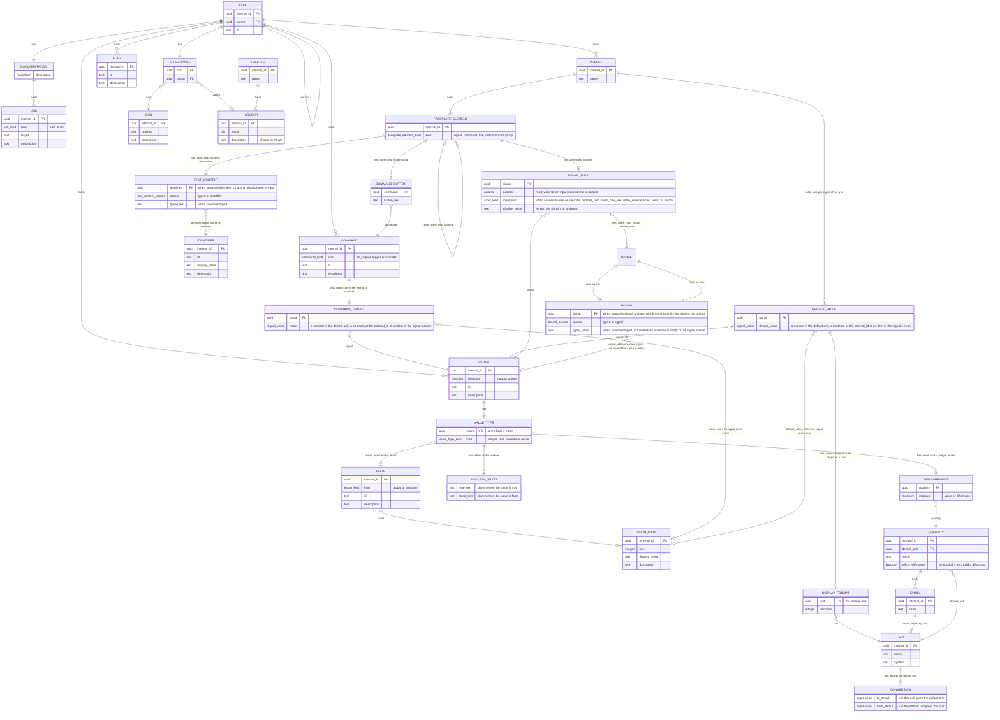
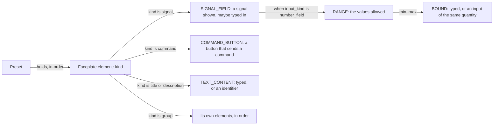

# Data model

> [Home](../README.md) › [Metadata](README.md) › Data model

Status: schema being read again with the Product Owner (2026-11-19 to 2026-11-21). The schema is shown as JSON in [The schema as JSON](#the-schema-as-json), the faceplate box by box in [The faceplate, box by box](#the-faceplate-box-by-box), and every choice list in [The choice lists](#the-choice-lists); the other descriptions come once the schema is validated.

- `internal_id`: the UUID set by the software; every FK holds one.
- `id`: the public identifier, written by the user, that leaves the application: sent to the model and written in the configuration files.
- `name`: a label people read, for a thing that has no `id`: nothing points to it and it never goes to the model. What the software ships (quantities, families, units), the name of a preset (see [Read again on 2026-11-21](#read-again-on-2026-11-21-presets-and-faceplate)), the name of a palette.
- `display_name`: a label people read, for a thing that has an `id` or a key: it is shown in place of that `id` or key, and never goes to the model (an enum item, an identifier, a signal field).
- `description`: a text that explains, for people; plain text everywhere, Markdown only in `DOCUMENTATION`.
- A choice of the software (`kind`, `direction`, `measure`...) is written in the JSON as an English word (`"input"`, `"difference"`), never as a number, so that a file reads by itself (Product Owner, 2026-11-19). A value of several words is joined by underscores (`set_signal`, `number_field`), the same in the schema and in the JSON. The key of an enum item stays a whole number: it goes to the model (decisions 0012, 0016).
- The field that says which alternative a box is: `kind` in general; `source` when it says where a value comes from (typed, or taken from a signal or an identifier); `direction`, `measure`, `access` and `input_kind` where their own word says more.
- A list of choices is named after its field; a field called `kind` or `source`, which several boxes have, takes its box as prefix (`command_kind`, `bound_source`). Every list is in [The choice lists](#the-choice-lists).
- A value typed in the builder is prefixed `typed_` where it stands beside a value taken elsewhere (`typed_value`, `typed_text`). A value read by the value type of its signal (a number, a boolean or an enum item) has the type `signal_value`.
- A box without `internal_id` is a part of its owner (a nested object in the JSON), never pointed to.
- `has`: one nested object; `holds`: an ordered list inside its owner. When an owner has two parts of the same box, the link says their role (`has, as min`).
- Every other link is a FK, labelled by the field that holds it, so that the reader knows which field points where. The field is named after the box it points to (`signal`, `quantity`, `unit`), or after its role when the box alone says too little (`parent`, `default_unit`).
- A link or a field that only exists in some cases says when, always in the same words: `when kind is enum`, `when the signal is an enum`.
- A number typed in Metadata (a default value, the value of a command, a typed bound) is kept in the default unit of its signal's quantity, whatever unit the screen shows it in (decision 0051).
- Field order in each box: `internal_id`, then the links (FK), then the kind, then `id` or the name, then the values, then the texts.
- The words `id` and `internal_id` wait for the documentary research T5; every other name follows these rules (see [Names made even on 2026-11-21](#names-made-even-on-2026-11-21)).

## The schema



## The schema as JSON

Asked by the Product Owner on 2026-11-21 ("que tu me construises juste en dessous du schéma l'objet JSON [...] qui représente un peu tout ce qu'il pourrait avoir"). One made-up type that uses every box of a type at least once, without trying every combination; then a global enum and a quantity of the catalogue, which live in files of their own. The identifiers, the icons and the palettes are left out. The internal IDs are made up, and only their last digits differ, to read them easily.

How the boxes become JSON, one rule for each, with no exception (assistant's reading, to validate with the example):

- A field keeps its name in the schema (`internal_id`, `display_name`, `typed_value`).
- A part (`has`) is a nested object named after its box, in lower case (`value_type`, `measurement`, `command_target`, `signal_field`); two parts of the same box are named by their role (`min`, `max`).
- A list (`holds`) is an array named after the box it holds, in lower case and in the plural (`signals`, `enum_items`, `preset_values`, `faceplate_elements`, `units`): the same list has the same name everywhere, in a preset and in a group.
- The field order is the rule of the head of this file; the parts and the lists come after the fields of their box.
- A field or a part that does not exist in this case (its `when` is false) is left out; one that exists but is empty is `null` (no parent, no colour, no display name).
- A choice of several words is joined by underscores: `"set_signal"`, `"number_field"`, `"radio_one_line"`.

### A type

```json
{
  "format": 1,
  "internal_id": "6f1c2a90-0000-4000-8000-000000000001",
  "parent": "6f1c2a90-0000-4000-8000-000000000000",
  "id": "centrifugal_pump",
  "appearance": {
    "icon": "6f1c2a90-0000-4000-8000-000000000700",
    "colour": null
  },
  "documentation": {
    "description": "A **centrifugal** pump, driven by a variable speed motor.",
    "links": [
      {
        "internal_id": "6f1c2a90-0000-4000-8000-000000000010",
        "kind": "url",
        "target": "https://example.com/datasheets/centrifugal-pump",
        "description": "Datasheet"
      }
    ]
  },
  "signals": [
    {
      "internal_id": "6f1c2a90-0000-4000-8000-000000000020",
      "direction": "input",
      "id": "speed_setpoint",
      "description": "Speed asked of the motor.",
      "value_type": {
        "kind": "real",
        "measurement": {
          "quantity": "6f1c2a90-0000-4000-8000-000000000900",
          "measure": "value"
        }
      }
    },
    {
      "internal_id": "6f1c2a90-0000-4000-8000-000000000021",
      "direction": "input",
      "id": "speed_max",
      "description": "Highest speed the operator may ask for.",
      "value_type": {
        "kind": "real",
        "measurement": {
          "quantity": "6f1c2a90-0000-4000-8000-000000000900",
          "measure": "value"
        }
      }
    },
    {
      "internal_id": "6f1c2a90-0000-4000-8000-000000000022",
      "direction": "output",
      "id": "speed",
      "description": "Speed of the motor, computed by the model.",
      "value_type": {
        "kind": "real",
        "measurement": {
          "quantity": "6f1c2a90-0000-4000-8000-000000000900",
          "measure": "value"
        }
      }
    },
    {
      "internal_id": "6f1c2a90-0000-4000-8000-000000000023",
      "direction": "output",
      "id": "running",
      "description": "True while the pump turns.",
      "value_type": {
        "kind": "boolean",
        "boolean_texts": {
          "true_text": "Running",
          "false_text": "Stopped"
        }
      }
    },
    {
      "internal_id": "6f1c2a90-0000-4000-8000-000000000024",
      "direction": "input",
      "id": "mode",
      "description": "How the pump is driven.",
      "value_type": {
        "enum": "6f1c2a90-0000-4000-8000-000000000500",
        "kind": "enum"
      }
    },
    {
      "internal_id": "6f1c2a90-0000-4000-8000-000000000025",
      "direction": "output",
      "id": "bearing_temperature_rise",
      "description": "How much the bearing is warmer than the room.",
      "value_type": {
        "kind": "real",
        "measurement": {
          "quantity": "6f1c2a90-0000-4000-8000-000000000910",
          "measure": "difference"
        }
      }
    }
  ],
  "commands": [
    {
      "internal_id": "6f1c2a90-0000-4000-8000-000000000030",
      "kind": "trigger",
      "id": "start",
      "description": "Asks the model to start the pump."
    },
    {
      "internal_id": "6f1c2a90-0000-4000-8000-000000000031",
      "kind": "set_signal",
      "id": "switch_to_auto",
      "description": "Puts the pump in automatic mode.",
      "command_target": {
        "signal": "6f1c2a90-0000-4000-8000-000000000024",
        "value": "6f1c2a90-0000-4000-8000-000000000502"
      }
    },
    {
      "internal_id": "6f1c2a90-0000-4000-8000-000000000032",
      "kind": "override",
      "id": "force_speed",
      "description": "Replaces the speed computed by the model, for a test.",
      "command_target": {
        "signal": "6f1c2a90-0000-4000-8000-000000000022",
        "value": 151.8436
      }
    }
  ],
  "flags": [
    {
      "internal_id": "6f1c2a90-0000-4000-8000-000000000040",
      "id": "under_maintenance",
      "description": "The pump is out of service for maintenance."
    }
  ],
  "presets": [
    {
      "internal_id": "6f1c2a90-0000-4000-8000-000000000050",
      "name": "Standard",
      "preset_values": [
        {
          "signal": "6f1c2a90-0000-4000-8000-000000000020",
          "default_value": 0,
          "display_format": {
            "unit": "6f1c2a90-0000-4000-8000-000000000902",
            "decimals": 0
          }
        },
        {
          "signal": "6f1c2a90-0000-4000-8000-000000000021",
          "default_value": 157.0796,
          "display_format": {
            "unit": "6f1c2a90-0000-4000-8000-000000000902",
            "decimals": 0
          }
        },
        {
          "signal": "6f1c2a90-0000-4000-8000-000000000022",
          "default_value": 0,
          "display_format": {
            "unit": "6f1c2a90-0000-4000-8000-000000000902",
            "decimals": 1
          }
        },
        {
          "signal": "6f1c2a90-0000-4000-8000-000000000023",
          "default_value": false
        },
        {
          "signal": "6f1c2a90-0000-4000-8000-000000000024",
          "default_value": "6f1c2a90-0000-4000-8000-000000000501"
        },
        {
          "signal": "6f1c2a90-0000-4000-8000-000000000025",
          "default_value": 0,
          "display_format": {
            "unit": "6f1c2a90-0000-4000-8000-000000000912",
            "decimals": 1
          }
        }
      ],
      "faceplate_elements": [
        {
          "internal_id": "6f1c2a90-0000-4000-8000-000000000060",
          "kind": "title",
          "text_content": {
            "identifier": "6f1c2a90-0000-4000-8000-000000000800",
            "source": "identifier"
          }
        },
        {
          "internal_id": "6f1c2a90-0000-4000-8000-000000000061",
          "kind": "description",
          "text_content": {
            "source": "typed",
            "typed_text": "Feed pump of the main loop."
          }
        },
        {
          "internal_id": "6f1c2a90-0000-4000-8000-000000000062",
          "kind": "group",
          "faceplate_elements": [
            {
              "internal_id": "6f1c2a90-0000-4000-8000-000000000063",
              "kind": "signal",
              "signal_field": {
                "signal": "6f1c2a90-0000-4000-8000-000000000020",
                "access": "write",
                "input_kind": "number_field",
                "display_name": "Speed setpoint",
                "range": {
                  "min": {
                    "source": "typed",
                    "typed_value": 0
                  },
                  "max": {
                    "signal": "6f1c2a90-0000-4000-8000-000000000021",
                    "source": "signal"
                  }
                }
              }
            },
            {
              "internal_id": "6f1c2a90-0000-4000-8000-000000000064",
              "kind": "signal",
              "signal_field": {
                "signal": "6f1c2a90-0000-4000-8000-000000000022",
                "access": "read",
                "display_name": null
              }
            },
            {
              "internal_id": "6f1c2a90-0000-4000-8000-000000000065",
              "kind": "signal",
              "signal_field": {
                "signal": "6f1c2a90-0000-4000-8000-000000000023",
                "access": "read",
                "display_name": "State"
              }
            }
          ]
        },
        {
          "internal_id": "6f1c2a90-0000-4000-8000-000000000066",
          "kind": "signal",
          "signal_field": {
            "signal": "6f1c2a90-0000-4000-8000-000000000024",
            "access": "write",
            "input_kind": "radio_one_line",
            "display_name": "Mode"
          }
        },
        {
          "internal_id": "6f1c2a90-0000-4000-8000-000000000067",
          "kind": "command",
          "command_button": {
            "command": "6f1c2a90-0000-4000-8000-000000000030",
            "button_text": "Start"
          }
        }
      ]
    }
  ]
}
```

What the example shows, beyond the fields themselves:

- **Numbers are kept in the default unit** (decision 0051): the speeds are in rad/s, the default unit of the made-up quantity `…900` (angular velocity), while the preset shows them in rpm (`…902`). `157.0796` is 1500 rpm, `151.8436` is 1450 rpm.
- **A typed value is read by the signal it targets**: `switch_to_auto` sends the internal ID of the item `auto` because `mode` is an enum; `force_speed` sends a number because `speed` is a real.
- **The maximum of the setpoint is a signal**: `speed_max`, an input of the same quantity (decision 0056); the minimum is typed.
- **No `input_kind` and no `range` in read**, no `display_format` for the boolean and the enum, no `command_target` for a trigger: their `when` is false.
- **`display_name: null`**: the field of `speed` shows the signal's `id`.
- **A difference**: `bearing_temperature_rise` holds a gap of temperature, shown in °C (`…912`), kept in kelvins.
- The title shows the identifier `…800` (`tag`, say `P-101`) of each placed symbol; the identifiers have their file of their own (draft, Identifiers).

### A global enum

```json
{
  "format": 1,
  "internal_id": "6f1c2a90-0000-4000-8000-000000000500",
  "kind": "global",
  "id": "operating_mode",
  "description": "How a piece of equipment is driven.",
  "enum_items": [
    {
      "internal_id": "6f1c2a90-0000-4000-8000-000000000501",
      "key": 0,
      "display_name": "Manual",
      "description": "Driven by the operator."
    },
    {
      "internal_id": "6f1c2a90-0000-4000-8000-000000000502",
      "key": 1,
      "display_name": "Auto",
      "description": "Driven by the control loop."
    }
  ]
}
```

### A quantity of the catalogue

Shipped with the software, never copied into the user's files: they hold the internal IDs only (draft, Data model).

```json
{
  "internal_id": "6f1c2a90-0000-4000-8000-000000000910",
  "default_unit": "6f1c2a90-0000-4000-8000-000000000911",
  "name": "temperature",
  "offers_difference": true,
  "families": [
    {
      "internal_id": "6f1c2a90-0000-4000-8000-000000000915",
      "name": "metric",
      "units": [
        {
          "internal_id": "6f1c2a90-0000-4000-8000-000000000911",
          "name": "kelvin",
          "symbol": "K"
        },
        {
          "internal_id": "6f1c2a90-0000-4000-8000-000000000912",
          "name": "degree Celsius",
          "symbol": "°C",
          "conversion": {
            "to_default": "x + 273.15",
            "from_default": "x - 273.15"
          }
        }
      ]
    },
    {
      "internal_id": "6f1c2a90-0000-4000-8000-000000000916",
      "name": "imperial",
      "units": [
        {
          "internal_id": "6f1c2a90-0000-4000-8000-000000000913",
          "name": "degree Fahrenheit",
          "symbol": "°F",
          "conversion": {
            "to_default": "(x + 459.67) * 5 / 9",
            "from_default": "x * 9 / 5 - 459.67"
          }
        }
      ]
    }
  ]
}
```

- The kelvin has no `conversion`: it is the default unit.
- A difference is converted by the software from these two formulas (decision 0050): a rise of 1 °C is 1 K, a rise of 1 °F is 5/9 K.
- The syntax of the formulas is still open (see [Open](#open)).

## The faceplate, box by box

Written on 2026-11-21, at the Product Owner's request ("pour la partie faceplate, j'aimerais bien que tu refasses un retravail là-dessus [...] c'est un peu flou"). It says, field by field, what the boxes of the mode Faceplate of a preset hold. The rules are those of [Presets and their faceplate](draft.md#presets-and-their-faceplate) and of the dated sections below (decision 0055 for the text, the display name and the range; decision 0056 for the quantity of a bound).

A preset holds an ordered list of elements. Each element has a kind, and its kind gives it exactly one part, or, for a group, its own list of elements.



### `FACEPLATE_ELEMENT`: one line of the builder

| Field | What it holds | When |
| --- | --- | --- |
| `internal_id` | The UUID set by the software. | Always. |
| `kind` | Signal, command, title, description or group (see [The choice lists](#the-choice-lists)). | Always. |
| `faceplate_elements` | The elements inside a group, in order, with the same five kinds; the same name as the list of the preset. | When `kind` is group. |

### `SIGNAL_FIELD`: a signal shown in the faceplate

A labelled field that shows the value of one signal, and lets a person type it when its access allows.

| Field | What it holds | When |
| --- | --- | --- |
| `signal` | The signal shown: one of the type, own or inherited. | Always. |
| `access` | `read`: the field only shows the value, as text alone: in the display unit and with the decimals of the preset, an enum by the display name of its item, a boolean by the text of its state (`BOOLEAN_TEXTS`). `write`, for an input: a person types the value the model receives. `override`, for an output: a person types a value that replaces the model's. | Always. Write is offered for an input only, override for an output only (decision 0040). |
| `input_kind` | How the value is typed: `number_field`, `radio_one_line`, `radio_several_lines`, `select` or `switch` (see [The choice lists](#the-choice-lists)). | When `access` is write or override. The choices depend on the value type of the signal. |
| `display_name` | The label beside the field, for people; never sent to the model. The same name as the field of an identifier (decision 0055). | Always; empty, the signal's `id` is shown (decision 0018). |
| `range` | A `RANGE`: the values a person may type. | When `input_kind` is `number_field`. |

### `RANGE`: the values allowed in a number field

The minimum and the maximum only exist together, for a number field: they go in a part of their own, by the rule of the schema (see [Read again on 2026-11-19 (enums)](#read-again-on-2026-11-19-enums)).

| Field | What it holds | When |
| --- | --- | --- |
| `min` | A `BOUND`: the smallest value allowed. | Optional: empty, no minimum. |
| `max` | A `BOUND`: the largest value allowed. | Optional: empty, no maximum. |

A typed value outside the range is refused (assistant's reading, screen MD-07.22).

### `BOUND`: the minimum or the maximum of a range

A bound is its own box because it is one of two things, a number or a signal: three fields that say which, rather than six fields in `RANGE`.

| Field | What it holds | When |
| --- | --- | --- |
| `source` | `typed`: a number typed in the builder. `signal`: the value of an input signal of the type, read at each moment. | Always. |
| `typed_value` | The number. Shown and typed in the display unit of the preset (`g`, if the preset shows a mass in grams); kept in the default unit of the quantity of the signal shown, the unit of the Units page that every conversion is written against (`kg` for the mass), so that changing the display unit never changes the bound (decision 0051). | When `source` is typed. |
| `signal` | The signal whose value is the bound, picked with the small icon inside the field (decision 0041). An input only, never an output: an input is what the model receives, so the bound stays what the user set (decision 0055). An integer or a real of the same quantity as the signal shown, so that both compare in the same default unit; the list offers only these inputs (decision 0056). | When `source` is signal. |

### `COMMAND_BUTTON`: a button that sends a command

Found right by the Product Owner on 2026-11-21 ("button text, ça, c'est parfait, et la commande associée").

| Field | What it holds | When |
| --- | --- | --- |
| `command` | The command sent by a click, one of the type, own or inherited. | Always. |
| `button_text` | The text on the button. | Always. |

### `TEXT_CONTENT`: the text of a title or a description

The text a title or a description element shows, and where it comes from. The small icon on the right of its field chooses the source (Product Owner, 2026-11-18, decision 0048).

| Field | What it holds | When |
| --- | --- | --- |
| `source` | `typed`: a text typed in the builder. `identifier`: the text filled for an identifier on each placed symbol. | Always. |
| `typed_text` | The text. A description keeps its line breaks; neither takes Markdown. | When `source` is typed. |
| `identifier` | The identifier whose text is shown: `tag` shows `P-101` on one pump and `P-102` on the next. | When `source` is identifier. |

**Never a signal** (Product Owner, 2026-11-21: "ça doit venir que d'un identifiant et jamais d'un signal [...] un signal, on peut l'afficher avec la partie signal"): the value of a signal is shown by a signal element in read. Decision 0055 changes decisions 0048 and 0054 on this point.

## The choice lists

Every field whose value is one word from a fixed list. Each is written in the JSON as that word in English (see the head of this file).

| List | Field | Values | Meaning |
| --- | --- | --- | --- |
| `link_kind` | `LINK.kind` | path, url | A path to a file or a folder, or a web address. |
| `direction` | `SIGNAL.direction` | input, output | The model receives it, or the model sends it. |
| `value_type_kind` | `VALUE_TYPE.kind` | integer, real, boolean, enum | A whole number, a number, true or false, an item of an enum. |
| `measure` | `MEASUREMENT.measure` | value, difference | A point on the scale ("it is 20 °C"), or a gap between two points ("it rose by 20 °C"). |
| `command_kind` | `COMMAND.kind` | set_signal, trigger, override | Send a fixed value to an input; tell the model something happened; replace the value of an output. |
| `enum_kind` | `ENUM.kind` | global, template | Items written on the Enums page, the same everywhere; or items completed on each placed symbol. |
| `faceplate_element_kind` | `FACEPLATE_ELEMENT.kind` | signal, command, title, description, group | See [The faceplate, box by box](#the-faceplate-box-by-box). |
| `access` | `SIGNAL_FIELD.access` | read, write, override | Shown only; typed in, for an input; typed in, for an output. |
| `input_kind` | `SIGNAL_FIELD.input_kind` | number_field, radio_one_line, radio_several_lines, select, switch | `number_field`: for an integer or a real. `radio_one_line`, `radio_several_lines`, `select`: for an enum, its items in the order of the handles of the Enums page. Switch: for a boolean, one click turns it on or off. |
| `bound_source` | `BOUND.source` | typed, signal | See `BOUND`. |
| `text_content_source` | `TEXT_CONTENT.source` | typed, identifier | See `TEXT_CONTENT`. |

## Changed on 2026-11-19

Asked by the Product Owner on 2026-11-19, while reading the schema; the three points the assistant proposed were settled by the Product Owner the same day, in the questionnaire. Decision 0049 (accepted, 2026-11-19) records them: it changes decision 0003 (reference family, closed forms) and specifies decision 0020 (a difference).

- **The default unit** replaces `model_unit` (Product Owner: "c'est plutôt la unit par défaut"): the unit of the quantity that every conversion is written against, as the Units page already calls it. Its own conversion is empty: it is the unit itself.
- **No reference family any more**: every unit converts to the default unit and back, never to another family. It answers the question of 2026-11-17 the way the assistant proposed then; the families only group the units for reading.
- **A conversion is the real formula** (Product Owner: "que la conversion on puisse mettre le calcul réel"), not only a factor: two expressions in `x`, one from the default unit, one back to it, because a free formula cannot be turned round by the software. Confirmed by the Product Owner on 2026-11-19 ("Oui, formules libres"). It replaces the rule of 2026-11-11 (decision 0003) by which a conversion was one of four closed forms, a pair of free expressions being the last resort. The four forms of the research (proportional, affine, inverse, logarithmic) are now just formulas like any other. The catalogue is written by contributors, so its tests check that each pair goes there and back.
- **A quantity has a `name`, not an `id`** (Product Owner: "c'est pas vraiment ce que j'appellerai un ID, c'est plutôt un nom"): mass, volume, flow are shipped by the software, never typed by the user.
- **A difference is no longer a quantity of its own** (assistant's proposal, chosen by the Product Owner on 2026-11-19: "une lecture de la grandeur"; no table of its own): the signal says whether its value is the quantity or a difference of it (`measure`, as decision 0020 already says), and the units of a quantity whose conversion changes (`offers_difference`, temperature, gauge pressure...) carry a second conversion, for a difference (computed by the software since the evening, see below). It removes the quantity that points to another quantity (`difference_of`, `kind`), which read badly. It is what FMI does with its flag `relativeQuantity` (research T2, section 3.8).
- **`integer` stays a value kind** beside `real`, `boolean` and `enum` (Product Owner, 2026-11-19: "Garder integer"), as decisions 0003 and 0043 already say: the model receives an exact whole number, and the input refuses decimals. FMI and SSP keep integers apart from reals (research T2, section 3.1).

## Read again on 2026-11-19 (afternoon)

The Product Owner read the quantity part again and found it right (`measure`: "ça, c'est vraiment bien"; families: metric or imperial "c'est juste ça"; units: name and symbol).

- **The units of a family are sorted by the software, never by hand** (Product Owner: "Oui, go faire ça. C'est plus simple comme ça"): smallest first, by the size of one step in the default unit, `to_default(1) − to_default(0)`; equal sizes by name. The catalogue writes them in any order. A quantity whose formulas give no finite step (an inverse such as l/100 km, a logarithm such as dB) keeps the order the catalogue writes.
- **The two expressions of a conversion are named by where `x` goes**: `to_default` takes `x` in this unit and gives the default unit; `from_default` takes `x` in the default unit and gives this unit. The labels of the schema said it the wrong way round.
- **What a difference is, said for the Product Owner** (the assistant's explanation, not a new rule): a value is a point on the scale ("it is 20 °C"), a difference is a gap between two points ("it rose by 20 °C"). Most conversions only multiply (litres to decalitres, kilograms to pounds): a value and a difference then convert the same way, so a quantity like volume needs nothing more. A conversion that also shifts the zero (°C to °F: `x × 9/5 + 32`; gauge to absolute pressure) converts them differently: 20 °C is 68 °F, but a rise of 20 °C is a rise of 36 °F, because the `+ 32` cancels out in a gap. `offers_difference` marks these quantities, as decision 0020 says.
- **`default_decimals` is for the screen, never for the model**: the model always gets the full value; the decimals only round what is shown. Removed the same day (see below).

## Settled on 2026-11-19 (evening)

The Product Owner answered the two questions of the afternoon in the questionnaire. Decision 0050 (accepted, 2026-11-19) records them: it changes decisions 0049 (a second conversion for a difference) and 0020 (default decimals in the catalogue).

- **A difference is converted by the software, never written in the catalogue** (Product Owner: "si tout peut être calculé, « logiquement », ben go"; with no exception, else everything by hand): the difference of `x` in the default unit is `to_default(x) − to_default(0)`, and back `from_default(x) − from_default(0)`. A unit has one conversion only; the conversion "of a difference" is gone.
  - Why there is no exception: this computation is exact for every conversion that multiplies then shifts (°C, °F, K, gauge or absolute pressure), and these are the only quantities that offer a difference. A conversion that only multiplies needs no difference at all. A conversion that is not a straight line (an inverse such as l/100 km, a logarithm such as dB) has no difference that converts on its own, and such a quantity never offers one.
  - Hence one rule of the catalogue, checked by its tests: a quantity with `offers_difference` has only conversions that multiply then shift (`to_default(x) − to_default(0)` proportional to `x`).
- **No `default_decimals` on the quantity** (Product Owner: "les décimales à montrer, c'est vraiment selon les presets [...] il faut l'enlever de l'objet quantité"): the decimals shown are set in the presets only, which start from one default number of decimals, the same everywhere. The assistant agrees: the right number of decimals depends on the unit shown, not on the quantity (2 decimals show 10 g in kilograms, but 0.01 g in grams), so a default per quantity would be wrong as soon as a preset shows another unit.

## Read again on 2026-11-19 (enums)

The Product Owner read the enums and found them right (enum: kind, `id`, description, "faut pas plus"; item: key, display name, description, and its place in the list). The Product Owner then asked why `VALUE_TYPE` holds `measure` beside `enum`, when a signal does not always have a quantity. The question was right: `measure` only means something when there is a quantity, and the box did not say it. The fix is a rule for the whole schema, not only for this box (assistant's proposal, asked by the Product Owner: "corriger tous les endroits où il y aura des problèmes comme ça").

- **Fields that only exist together go in a part of their own.** The quantity and `measure` move to `MEASUREMENT`, which a value type has for an integer or a real only. The enum stays a single field of `VALUE_TYPE`: it has nothing else that goes with it, so it needs no part.
- **A part that only exists for some signals says so on its link.** `DISPLAY` (unit and decimals) is there for an integer or a real only, never for a boolean or an enum; its unit only when the signal has a quantity.
- **A choice between alternatives says which one it is**, as `VALUE_TYPE.kind` does, instead of leaving the reader to guess from the field that is filled. `BOUND` gets `source` (typed or signal), `TEXT_CONTENT` gets `source` (fixed, identifier or signal); each other field says when it is filled.
- **A typed value says what it holds**: a number, a boolean, or the internal ID of an enum item (decision 0047), in `COMMAND_TARGET` and `PRESET_VALUE`.
- The screen of an enum showed "Name": it is the `id`, as the Product Owner said ("ça devrait être ID"), in `screens/metadata.md`, MD-09.3.

## Read again on 2026-11-19 (signals, commands, flags)

The Product Owner read the signals, the commands and the flags and found them right; nothing changes in the schema.

- **Signals**: right ("j'ai l'impression que c'est bon, en tout cas pour moi").
- **Commands** ("C'est propre, je trouve"): a type holds its commands; a command has its `id` and its kind (set a signal, trigger or override); a command that sets a signal has a `COMMAND_TARGET`, the signal and the value sent; it is used by a command button of a faceplate element.
- **The typed value is not checked by its own field** (Product Owner: "en fonction de l'UID, on est censé savoir ce que c'est [...] tout est censé parser en fonction de la foreign key"): the field accepts a number, a boolean or the internal ID of an enum item, and it is read by the value type of the signal it targets. An integer signal reads a whole number, a boolean signal a boolean, an enum signal the internal ID of one of its items.
- **Flags**: an `id` and a description, "faut pas plus".
- Next: the presets, after a break.

## Read again on 2026-11-19 (presets)

The Product Owner read the preset, its values and their display. The preset (a name) and its values (a signal, a default value) are right ("ça fait sens"). He found the links to the enums and the signals unclear, and left the fix to the assistant ("je te laisse faire"), with a pass over the whole schema to make it even.

- **The "default item" and "sends" links were not fields of their own**: they are the typed value itself (`default_value`, `value`) when the signal is an enum, as decision 0047 says. They are now labelled by that field: `default_value, when the signal is an enum`, `value, when the signal is an enum`. The item is always one of the signal's enum.
- **Every FK link is labelled by its field**, all over the schema (`signal`, `quantity`, `default_unit`, `icon`...), instead of a verb (`targets`, `value of`, `shown in`, `measures`). `has` and `holds` stay for nested parts.
- **Every condition is said the same way**, `when ...`, on the fields and on the links: it replaces `enum only`, `signal only`, `typed only`, `integer or real only`, `a group holds`.
- **The parts of a faceplate element say when they exist**: a signal field for a signal element, a command button for a command element, a text content for a title or a description, the children for a group.
- **A command target exists for "set a signal" and for "override"**: the section above said "a command that sets a signal" only; an override targets an output the same way (draft, Commands).
- **A preset holds one value per signal of the type**, own and inherited, so none for a type without signals: `o{` instead of `|{`.
- **A unit has a conversion except the default unit**: said on the link, as the section of the morning already said.

### Can a number have no quantity? Checked on 2026-11-19

Asked by the Product Owner, who thinks a real always has a quantity or a difference ("il faut que tu fasses une recherche"). A fact to find, checked in the standard and in a catalogue of units, not a documentary research of its own.

- **FMI allows a number without unit**: "Variables without unit must not have a `unit` attribute" ([FMI 3.0.1](https://fmi-standard.org/docs/3.0.1/), section 2.4.7.5, table 21, read on 2026-11-19). A display unit needs a unit: "If `displayUnit` is defined a `unit` must also be defined" (same document, section 2.4.4, table 15). AutomationML also makes the unit optional (research T2, `research/t2-recherche-documentaire-unique-modeles-de-donnees/rapport.md`, section 3.1, source S8).
- **Such numbers exist in models**: a ratio, an efficiency, a valve opening from 0 to 1, a count. Paraphrase, assistant's examples.
- **A catalogue of units gives them a quantity anyway**: QUDT puts the percent and the per mille under the quantity "DimensionlessRatio" (percent = 0.01), and a count under the quantity "Count", whose unit is "unitless" ([QUDT, percent](https://qudt.org/vocab/unit/PERCENT), [QUDT, count](https://qudt.org/vocab/quantitykind/Count), read on 2026-11-19 through a search summary, pages not opened one by one).
- **What it changes in `DISPLAY`**: the unit and the decimals do not always go together. A real with no quantity still needs decimals, but has no unit to show. An integer needs decimals only when it is shown in another unit than its default unit (1450 rpm is 24.17 rps).
- Asked in the questionnaire: either every integer and real has a quantity, or a number may have no quantity and the decimals leave `DISPLAY`. Settled the same day, see below.

## Settled on 2026-11-19 (night)

The Product Owner answered the two questions of the presets in the questionnaire, with the option the assistant advised each time. Decision 0051 (accepted, 2026-11-19) records them: it changes the rule of the draft by which the quantity of a signal is optional (`draft.md`, Signals; screen MD-04.9), and extends decision 0024 (the bounds of a signal written in the model unit of its quantity) to every number typed in Metadata.

- **Every integer and real signal has a quantity** (Product Owner: "Quantité obligatoire"). A number that measures nothing physical gets one from the catalogue, as QUDT does (see above): a **ratio** (units 1, %, ‰, ppm; default unit 1) for a rate, an efficiency or a valve opening from 0 to 1, and a **count** (unit 1) for a number of things. Working names, as the other quantities of the catalogue. In the schema:
  - `MEASUREMENT` is always there for an integer or a real, and its `quantity` is required (it already was on the link);
  - `DISPLAY` keeps its unit and its decimals together; its `unit` is required and no longer says "when the signal has a quantity";
  - the rule of the head of the file gives another example of a condition.
- **A number typed in Metadata is kept in the default unit of its quantity** (Product Owner: "Unité par défaut"): the default value of a preset, the value of a command, a typed bound of a signal field. Changing the display unit of a preset never changes a stored value: the screen converts it with `from_default` to show it, and what the user types in the display unit is turned back with `to_default` before it is kept. A difference is turned the way decision 0050 says.
  - The bound is the assistant's reading: the question named the default value and the value of a command; a typed bound is the same kind of number, so the same rule applies.
  - It answers the gap the research T2 found: the conversion back of the values typed (`research/t2-recherche-documentaire-unique-modeles-de-donnees/rapport.md`, short answer, point 4).

## Changed on 2026-11-20 (descriptions)

The Product Owner found that the signals and the commands had no description ("il manque un champ description [...] c'est essentiel parce qu'il faut pouvoir expliquer ce qu'on veut dire au modeleur"). Decision 0052 (accepted, 2026-11-20) records it: it replaces the rule of the draft "a signal has no description" (2026-11-16).

- **A signal and a command each get a `description`**: a text that says what the line means, for the person who writes the model.
- Checked against the rest of the schema, as he listed it: the type has its description in `DOCUMENTATION`; a flag, an enum, an enum item and an identifier already have one. Nothing else changes.
- Plain text, like the description of a flag or of an enum item, never Markdown: assistant's reading.

## Settled on 2026-11-20 (descriptions)

The Product Owner answered the two questions of the morning in the questionnaire, with the option the assistant advised each time. Decision 0052 records them.

- **The description is optional** (Product Owner: "Facultative"), as for the flags and the enum items: an empty description never blocks anything. `description` stays a plain `text` field, which may be empty.
- **It is written in the configuration files sent with the model** (Product Owner: "Dans les fichiers de configuration"), so that the model author reads it where they work. It is edited in Metadata only (Product Owner: "on ne peut la modifier que dans la metadata"). Changing it changes nothing the model reads.
- A way for model authors to read the synoptics without changing them, with a summary sheet when they click a symbol, is an idea of the Product Owner for later ("ça, on verra ça plus tard"): noted in the open questions of the synoptics, nothing written here.

## Settled on 2026-11-21 (no versions)

The Product Owner answered the question of the day before in the questionnaire, with the option the assistant advised ("Les retirer, Git suffit"). Decision 0053 (accepted, 2026-11-21) records it: it changes decision 0017.

- **The schema has no version of Metadata**: no version number, no change log, nothing "not yet versioned". The application keeps no versions; the types are clean JSON files, one per type, that the user versions with Git if they want.
- So the JSON files must stay readable and stable (one field per line, the same order of keys every time), for the differences of Git to be clear: assistant's reading, to settle with the format of the files.
- The `"format"` number at the top of each file stays: it is the version of the file format, not of Metadata.

## Read again on 2026-11-21 (presets and faceplate)

The Product Owner read the preset, its values and the faceplate again. The values are right ("default value", the link to the enum item, the decimals beside the unit: "ça fait sens, c'est cool"); the command button too. He found the rest of the faceplate unclear and asked for it to be reworked, and left two names to the assistant ("à toi de me le dire").

- **The preset keeps a `name`, not an `id`** (assistant's choice, left to it by the Product Owner, who leaned that way: "peut-être que non, c'est mieux là, parce que ça va pas être utilisé comme un ID"). Nothing points to it, every link goes through its `internal_id`, and it never goes to the model: it only tells two presets of a type apart for people. The head of the file now says what `id` and `name` each mean, so that the difference is a rule and not an exception. Screen MD-07.3 already says "Name of the preset".
- **`DISPLAY` becomes `DISPLAY_FORMAT`, not "display unit"** (assistant's choice, asked by the Product Owner: "Pourquoi pas display unit ?"). The part holds two things that go together, the display unit and the decimals, so "display unit" would name only half of it; "display" alone said too little. Its `unit` field is the display unit, said in the schema.
- **The faceplate is described box by box**, in [The faceplate, box by box](#the-faceplate-box-by-box): what each field holds and when, with a diagram of which part goes with which kind of element.
- **Every choice list is described**, in [The choice lists](#the-choice-lists), with its values and their meaning (Product Owner: "Input kind : c'est un enum pour moi, mais du coup, tu décris pas l'enum").
- **Fields renamed so that they say what they hold** (Product Owner: "Je veux bien que tu repasses sur les noms des propriétés"):
  - `SIGNAL_FIELD.input` becomes `input_kind`, the Product Owner's own reading, so that it is never mistaken for an input of the model; its values are written in the schema;
  - `access` says in the schema which value goes with which direction: write for an input, override for an output;
  - `BOUND.value` becomes `typed_value` and `TEXT_CONTENT.text` becomes `typed_text`: each says it is the typed one, beside the signal or the identifier;
  - the source of a text says `typed` instead of `fixed`, the same word as for a bound; screen MD-07.19 and the draft keep "fixed text" for the user, which means the same.
- **Why a title or a description could point to a signal** (Product Owner: "Je comprends pas pourquoi y a un truc signal"): he asked for it on 2026-11-18 (decision 0048). Removed the same day, see [Read again on 2026-11-21 (faceplate fields)](#read-again-on-2026-11-21-faceplate-fields).

## Settled on 2026-11-21 (faceplate fields)

The Product Owner answered the two questions of the faceplate in the questionnaire, with the option the assistant advised each time.

- **A boolean signal is typed with a switch** (Product Owner: "Interrupteur (switch)"): `switch` is added to `input_kind`, for a boolean only. One click turns it on or off, and its state reads at a glance.
- **A signal field in read shows the text of the value alone** (Product Owner: "Le texte de la valeur seul"): in the display unit and with the decimals of the preset, an enum by the display name of its item, a boolean by the text of its state. No field is drawn, not even greyed.
- **A boolean signal has two texts of its own** (Product Owner, in a third question: "Deux mots choisis par signal"): `true_text` and `false_text` ("Open" and "Closed", "Running" and "Stopped"), in a part `BOOLEAN_TEXTS` that a value type has for a boolean only, as `MEASUREMENT` for a number. They are typed in the table of signals. Assistant's reading, to confirm: they never go to the model, which gets `true` or `false`; empty, the faceplate shows "true" and "false"; the switch shows the text of its state beside it.
- Decision 0054 (accepted, 2026-11-21) records the three answers.
- **So `input_kind` only exists in write or override**: it says how a value is typed, and nothing is typed in read. The builder may keep the last choice while the access changes, so that going back to write finds it: assistant's reading, a matter of the screen, not of the file.
- The bounds follow: `min` and `max` exist only for a number field, so never in read.

## Read again on 2026-11-21 (faceplate fields)

The Product Owner read the signal field, its bounds and the text content again. Decision 0055 (accepted, 2026-11-21) records the first three points: it changes decisions 0048 and 0054 (a text bound to a signal) and specifies decisions 0018 (the name) and 0041 (a bound taken from a signal).

- **A title or a description comes from a typed text or an identifier, never from a signal** (Product Owner: "le titre ou une description, je pense que ça doit venir que d'un identifiant et jamais d'un signal [...] Puisqu'un signal, on peut l'afficher avec la partie signal"). `signal` leaves `TEXT_CONTENT` and `text_source`. The value of a signal is shown by a signal element in read, which does the same with a label.
- **`name_shown` becomes `display_name`** (Product Owner: "est-ce que c'est pas display name qu'on appellerait ça [...] faudrait homogénéiser ça partout"): the name people read, the same word as the field of an identifier. The screens and the draft say "Display name" too.
- **A bound taken from a signal takes an input only, never an output, for now** (Product Owner: "qu'en entrée, jamais en sortie pour l'instant [...] Au moins, le signal, il reste fixe"): an input is a value the user sets and the model receives, so the range does not move with what the model computes. A bounded linear animation of a symbol keeps any signal, input or output: it is another rule (decision 0027).
  - The signal of a bound is an integer or a real of the same quantity as the signal shown: settled the same day, see below.
- **`min` and `max` go in a part `RANGE`** (left to the assistant: "je te laisse réfléchir [...] pouvoir mettre un min/max [...] une range de valeurs"). They only exist together, for a number field: the rule of the schema puts them in a part of their own. `BOUND` stays a box, because a bound is a number or a signal and says which. In the JSON: `"range": { "min": { "source": "typed", "typed_value": 0 }, "max": { "source": "signal", "signal": "…" } }`.
- **The default unit of a typed bound, explained** (Product Owner: "Et où, le default unit ?"): it is the default unit of the quantity of the signal shown, set on the Units page (kilogram for a mass). The user types the bound in the display unit of the preset; the file keeps it in the default unit (decision 0051). The labels of the schema now say it.

## Settled on 2026-11-21 (enum item and bounds)

The Product Owner answered the two questions left by decision 0055 in the questionnaire, with the option the assistant advised each time. Decision 0056 (accepted, 2026-11-21) records them: it specifies decisions 0032 (the column of an enum) and 0041 with 0055 (the signal of a bound).

- **`ENUM_ITEM.display_text` becomes `display_name`** (Product Owner: "Oui, display_name"): the same word as for an identifier and a signal field, "Display name" on screen. Its rule does not change: what people read, never sent to the model.
- **The signal of a bound has the same quantity as the signal shown** (Product Owner: "Même grandeur obligatoire"): an input, integer or real, of that quantity, so that a speed is bounded by a speed and both compare in the same default unit. The list of the bound offers only these inputs.

## Names made even on 2026-11-21

Asked by the Product Owner on 2026-11-21 ("voir tout, tout, tout [...] comment c'est nommé, et donc homogénéiser le tout"). Every box, field, link, choice list and value was read again against one set of rules, now written at the head of this file. What changed:

- **Two things had the same name**: `typed_value` was both the type of a value read by its signal (`COMMAND_TARGET.value`, `PRESET_VALUE.default_value`) and the field of a bound typed in the builder. The type becomes `signal_value`; the field keeps `typed_value`, beside `typed_text`.
- **The choice lists are named by one rule**: their field, with the box as prefix for `kind` and `source`. `value_kind` becomes `value_type_kind`, `element_kind` becomes `faceplate_element_kind`, `text_source` becomes `text_content_source`. The others already followed it.
- **A value of several words is joined by underscores**, the same in the schema and in the JSON: `set_signal` (was "set a signal"), `number_field`, `radio_one_line`, `radio_several_lines`. The screens and the draft keep their words for people ("Set a signal", "radio on one line").
- **The two bounds of a range are parts**, so their link says `has, as min` and `has, as max`, not `min` alone, which read like a FK.
- **The JSON keys follow the boxes with no exception**: `command_target` (was `target`, which `LINK.target` already uses), `enum_items` (was `items`), `preset_values` (was `values`), `faceplate_elements` in the preset and in a group (were `faceplate` and `elements`).
- **`name`, `display_name` and `description` are told apart** at the head of the file: `name` for a thing without `id`, `display_name` shown in place of an `id` or a key, `description` to explain.
- Checked and unchanged: the FK fields (`parent`, `icon`, `colour`, `enum`, `quantity`, `signal`, `command`, `identifier`, `unit`, `default_unit`), the field order in every box, `has` and `holds`, the conditions in `when`.
- Left open, because they change words the Product Owner validated or that wait for a research: `id` and `internal_id` (research T5), `button_text`, and the `description` of an icon or a colour (see [Open](#open)).

## Not in the schema yet

- The texts filled on each placed symbol: with the synoptic.

## Open

- The default unit is also the model unit while the model unit stays in the catalogue (decision 0024 leans that way). If it moves to a configuration of the project, the default unit stays the unit the formulas are written against, and the model unit becomes a field of its own.
- The symbol of a unit for a difference: the same (`°C`) or marked (`Δ°C`)?
- An integer signal shown in another unit than its default unit: a number typed there may not give a whole number in the default unit (24.17 rps is 1450.2 rpm). Rounded to the nearest whole number, or refused?
- The names of the two quantities added for numbers that measure nothing physical: "ratio" and "count" for now.
- The default number of decimals of a preset: 2 or 3 (Product Owner, 2026-11-19: "qui serait de 2 ou de 3"), and whether it is fixed by the software or set for the project.
- The syntax of the expressions (operators, π, powers, logarithms): chosen with the architecture, evaluated without `eval`.
- The name of the short text that names a colour or an icon: `description` for now. By the rules of the head of this file it is a `name` (a label for a thing without `id`), not a text that explains.
- `COMMAND_BUTTON.button_text`: by the rules of the head of this file it is a `display_name` (shown in place of the command's `id`). Kept as it is: the Product Owner found it right on 2026-11-21. If it became `display_name`, an empty one would show the command's `id`, as for a signal field.
- The names of the nested parts (`APPEARANCE`, `VALUE_TYPE`, `MEASUREMENT`, `BOOLEAN_TEXTS`, `COMMAND_TARGET`, `DISPLAY_FORMAT`, `SIGNAL_FIELD`, `RANGE`, `BOUND`, `COMMAND_BUTTON`, `TEXT_CONTENT`, `CONVERSION`) and of `FACEPLATE_ELEMENT`: working names.
- The two texts of a boolean: required, or "true" and "false" when empty (assistant's reading)? And are they written in the configuration files sent with the model, as the description is?
