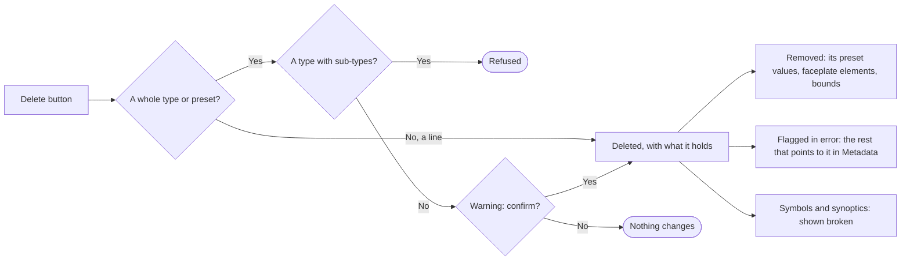

# Deleting and its consequences

> [Home](../README.md) › [Metadata](README.md) › Deleting and its consequences

| Version | Date | Status | Change |
| --- | --- | --- | --- |
| 1 | 2026-11-22 | Draft | Creation of the file |
| 2 | 2026-11-23 | Draft | A warning only for a type or a preset; lines deleted at once; the undo history (decision 0093) |

What a user can delete in Metadata, how, and what happens to everything that points to the deleted thing, in Metadata and outside it. The rules come from decisions 0017, 0053, 0079, 0080, 0082 and 0093, the [layout rules](../screens/README.md#delete-a-warning-only-for-a-whole-thing), the [whole draft](draft.md), the [entity files](entities/README.md) and [When Metadata changes](../symbols/01-libraries-and-symbols.md#when-metadata-changes) in the part Symbols.

## Where it is used

| Where | What it takes from here |
| --- | --- |
| [Type](entities/30-type.md), [Preset](entities/29-preset.md) | Deleted with a red button and a warning; what they hold goes with them. A type that has sub-types is never deleted. |
| [Signal](entities/16-signal.md), [Command](entities/18-command.md), [Flag](entities/19-flag.md), [Faceplate element](entities/28-faceplate-element.md), [Link entity](entities/13-link.md) | Deleted at once with the bin of their line; what they hold goes with them. |
| [Enum](entities/06-enum.md), [Enum item](entities/05-enum-item.md), [Designation](entities/11-designation.md) | Deleted on their page; what they hold goes with them. An item and a designation at once; an enum with a warning (proposed). A built-in enum and its items are never deleted (decision 0095). |
| [Preset value](entities/22-preset-value.md), [Signal field](entities/25-signal-field.md), [Command button](entities/26-command-button.md), [Bound](entities/23-bound.md) | Removed with the signal or the command they point to. |
| [Command target](entities/17-command-target.md), [Value type](entities/15-value-type.md), [Preset value](entities/22-preset-value.md), [Text content](entities/27-text-content.md) | Flagged in error, kept as written, when what they point to is deleted. |
| [Inheritance of types](inheritance.md) | A deleted line of a parent is gone from every sub-type. |
| [MD-02 · General](../screens/metadata.md#md-02--general), [MD-03](../screens/metadata.md#md-03--documentation), [MD-04](../screens/metadata.md#md-04--signals), [MD-05](../screens/metadata.md#md-05--commands), [MD-12](../screens/metadata.md#md-12--flags-a-part-of-the-type), [MD-07](../screens/metadata.md#md-07--presets), [MD-09](../screens/metadata.md#md-09--enums), [MD-13](../screens/metadata.md#md-13--designations) | The delete button, and the warning of a type or a preset. |
| [Undo history](../storage/files-and-conflicts.md#undo-history) | Takes back any delete. |
| [When Metadata changes](../symbols/01-libraries-and-symbols.md#when-metadata-changes) | What a delete breaks in a symbol, shown there, never repaired by Metadata. |

## How a delete is done

- **A line is deleted at once** with the delete button (a bin icon) at its far right, with no column header: no warning, no message (decision 0093). There is no right click in Metadata.
- **A whole type or a whole preset is deleted with a red button and a warning** that asks to confirm; nothing is deleted before the user confirms. The type's button is in its General part, never in the tree; the preset's, on the line of its name.
- **The warning never lists what the delete breaks**: the user knows what they delete. What is broken shows later, in Metadata, the symbol mode and the synoptic mode.
- **An inherited line has no delete button**: it is deleted in the type that declares it.
- **A type that has sub-types is never deleted** (decision 0082): its sub-types are deleted first, from the bottom of the branch up.
- **Every delete can be undone** with the undo history (decision 0093; see [Files and conflicts](../storage/files-and-conflicts.md#undo-history)). No versions in the application: older states come back through Git, on the JSON files (decision 0053).

## What can be deleted

| Thing | Where | Deleted with it |
| --- | --- | --- |
| Type | Its General part (MD-02), only when it has no sub-type | Its whole file: appearance, documentation and links, own signals, commands and flags, presets. |
| Link | Documentation of the type (MD-03) | Nothing else. |
| Signal | Signals of the type (MD-04), own lines only | Its value type. |
| Command | Commands of the type (MD-05), own lines only | Its command target. |
| Flag | Flags of the type (MD-12), own lines only | Nothing else. |
| Preset | Presets of the type (MD-07) | Its preset values and its faceplate elements. |
| Faceplate element | Faceplate builder of a preset (MD-07) | Its part; for a group, every element in it, at any depth. |
| Enum | Enums page (MD-09) | Its items. |
| Enum item | Enums page (MD-09) | Nothing else. |
| Designation | Designations page (MD-13) | Nothing else. |

Never deleted in the software:

- **Quantities, unit systems and units**: a catalogue, read only (MD-08); contributors change their files.
- **Palettes and icon sets**: added or removed with their file. An appearance copies the color and the drawing it picks, so removing them changes no type.

## The rules

1. **What a thing holds goes with it.** A type deletes its lines, a group its elements, an enum its items: nothing is left behind.
2. **A type that has sub-types is never deleted** (decision 0082). A sub-type never changes parent (decision 0013), so it could never be repaired.
3. **In the presets, what shows a deleted signal or sends a deleted command goes too**, in every preset of the type and of its sub-types: the preset value of the signal, the faceplate elements whose signal field shows it, those whose button sends the command (decisions 0079, 0080), and the bound of a range read from the signal: the range then has no minimum, or no maximum (decision 0082).
4. **Everything else in Metadata that points to a deleted thing is flagged in error and kept as written** (decision 0082): nothing is emptied or removed in its place. The user picks another target, enum, item or designation; until then, the error stays.
5. **Symbols and synoptics are never changed by a delete.** What points to the deleted thing is shown broken, with a small red mark, and listed in the symbol mode and the synoptic mode; there is no automatic repair.
6. **A delete is breaking for the model when the thing goes to it**: a type, a signal, a command, a flag, an enum item. Nothing warns; the change is seen in the differences of Git.
7. **A file missing or unreadable is not a delete**, and is handled as rule 4: what points to it is flagged in error and kept as written, so that it links again when the file comes back (decision 0079, for a parent).

## What points to each thing

| Deleted | Pointed to by | Effect |
| --- | --- | --- |
| Type | Its sub-types (`TYPE.parent`) | The delete is refused (decision 0082). |
| Type | Symbols | The symbol keeps existing without a type: its animations and interactions are broken until the user chooses a type. |
| Signal | Preset values (`PRESET_VALUE.signal`) | Removed (decision 0079). |
| Signal | Signal fields (`SIGNAL_FIELD.signal`) | Their faceplate elements removed (decision 0079). |
| Signal | Bounds (`BOUND.signal`) | Removed: the range has no minimum, or no maximum (decision 0082). |
| Signal | Command targets (`COMMAND_TARGET.signal`) | Their command flagged in error, kept as written (decision 0082). |
| Signal | Symbols | Its animations, the texts that show its value or its unit, its test value are broken. |
| Command | Command buttons (`COMMAND_BUTTON.command`) | Their faceplate elements removed (decision 0080). |
| Command | Symbols | The interactions that send it are broken. |
| Flag | Placed symbols | Nothing is said at the delete; the synoptic mode lists it as broken. |
| Preset | Symbols, placed symbols | Not in the schema yet. |
| Enum | Value types (`VALUE_TYPE.enum`) | Their signal flagged in error, kept as written (decision 0082). |
| Enum item | Start values (`PRESET_VALUE.start_value`) | The preset value flagged in error, kept as written (decision 0082). |
| Enum item | Command values (`COMMAND_TARGET.value`) | Their command flagged in error, kept as written (decision 0082). |
| Enum, enum item | Symbols | The animations and the texts that use it are broken. |
| Designation | Text contents (`TEXT_CONTENT.designation`) | Their faceplate element flagged in error, kept as written (decision 0082). |
| Designation | Texts filled on placed symbols | Not in the schema yet. |
| Link, faceplate element | Nothing | — |

## Open questions

- **The last preset of a type**: a type needs one to be chosen in a symbol or a synoptic.
- **A preset deleted that symbols use**: with the synoptic (gap of MD-07).
- **A whole enum**: deleted with a warning, as a type (assistant's reading, decision 0093)?
- **The undo history**: how far back, and whether it survives closing the application (see [Files and conflicts](../storage/files-and-conflicts.md#open-questions)).
- How a refused delete and a thing in error show, and a quantity whose file is missing: moved to [Checks and errors](checks-and-errors.md#open-questions).
