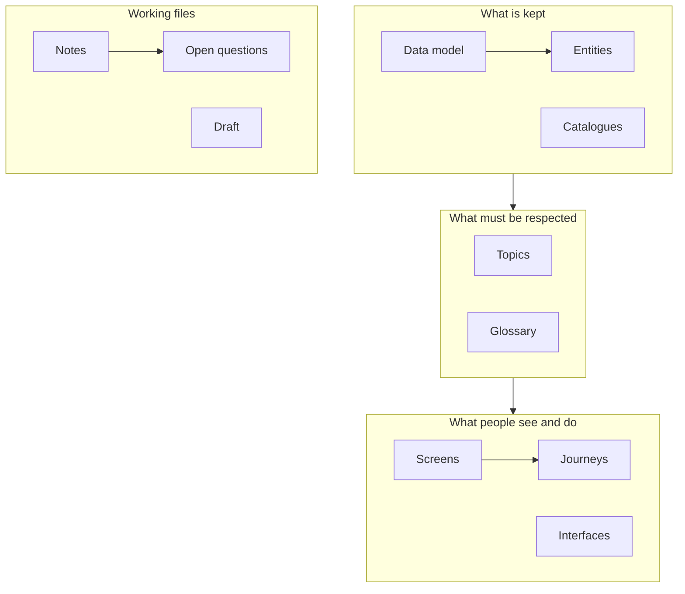

# Documentation plan

> [Home](../README.md) › [Metadata](README.md) › Documentation plan

The kinds of documents Metadata needs, what each one holds, those already written and those still missing. Each kind has a name, so that a new document is written as the others of its kind. Written by the assistant on 2026-11-22, at the Product Owner's request; nothing here is validated.

## The kinds of documents

The specification reads in three layers: the data (what is kept), the rules (what must be respected), and the use (what people see and do). The working files sit beside them and are emptied as the final pages are written.

| Kind | What one document holds | Written | Missing |
| --- | --- | --- | --- |
| **Data model** | The whole schema, the table of the entities, the types of the fields. | [Data model](data-model.md) | — |
| **Entity** | One kind of thing kept: what it is, its schema, its JSON Schema, the JSON Schema of its file. | 30, in [Entities](entities/README.md) | — |
| **Topic** | One theme, the question it raises and how it is settled, across several entities. | [Files](files.md), [Formulas](formulas.md), [Inheritance of types](inheritance.md), [Deleting and its consequences](deleting.md), [Checks and errors](checks-and-errors.md), [Identity and renaming](identity-and-renaming.md), [Units on screen](units-on-screen.md) | See [The topics missing](#the-topics-missing). |
| **Catalogue** | The data Synoptic Studio ships: each item, its values, its source. | — | Quantities and units; palettes; icon sets. |
| **Glossary** | Each word of the product, its one meaning, and the words not to use for it; one for the whole specification. | [Glossary](../overview/glossary.md), Metadata's words | The words of the other parts, as each is written again. |
| **Screen** | One screen: its identifier, its map, every button, field and list, its states and messages. | [Screens of Metadata](../screens/metadata.md), written before the entities | Each screen read again against the entities: names, fields, lists. |
| **Journey** | One path of a user through the screens, step by step, with the screen of each step. | — | Every journey of Metadata (each screen and menu must have one). |
| **Interface** | What Metadata gives outside the software: to the model, to the configuration files, to an export. | Part of [Files](files.md) (match with the standards) | What the model receives (ids, keys, units); the configuration files and what they hold (flags, texts of a boolean); exports. |
| **Open questions** | Every question still open in the part, each with the page it belongs to. | Scattered: [notes](data-model-notes.md#open), [Files](files.md#open-questions), entity files | One file gathering them all. |
| **Notes** | What was said and settled, by date: the trace, never the rule. | [Data model: notes](data-model-notes.md) | — |
| **Draft** | The pages written before 2026-11-19, until each theme replaces its part. | [Whole draft](draft.md) | Emptied theme by theme. |

## The topics missing

Each one gathers rules spread today across the entity files and the [whole draft](draft.md).

| Topic | The question it settles | Where it is today |
| --- | --- | --- |
| Editing without versions | Everything stays editable; what a change does to the synoptics already built. | [draft](draft.md#always-editable-no-versions) |
| Who changes what | Which person changes which part of Metadata, and where. | [draft](draft.md#who-changes-what-and-where) |

## For the development

Not part of the specification of the product, but to carry to the software architecture (repository `synoptic-studio-spec`, programme architecture):

- The branded types of JavaScript, one per type of the fields: see [For the development](data-model-notes.md#for-the-development).
- The writing rules of the entity files: to become the skill `write-a-metadata-entity-file` of the assistant, in `.claude/skills/` of the programme (Product Owner, 2026-11-22); until then in [Writing rules](data-model-notes.md#writing-rules-of-the-entity-files-to-become-a-skill).

## Open questions

- The order of the missing documents after the glossary, the inheritance of types, deleting, checks and errors, identity and renaming, and units on screen, written in that order (Product Owner, 2026-11-22).
