# Metadata: the whole draft

> [Home](../README.md) › [Metadata](README.md) › Whole draft

Status: every page of Metadata written up to 2026-11-18, gathered in this one file on 2026-11-19 at the Product Owner's request. The content is unchanged: only the headings and the links were adapted. It is the source of the final pages of Metadata, written theme by theme; the first one is [Data model](data-model.md).

## Contents

- [Overview](#overview)
- [Types](#types)
- [Type icons](#type-icons)
- [Type documentation](#type-documentation)
- [Signals](#signals)
- [Units](#units)
- [Enums](#enums)
- [Commands](#commands)
- [Presets and their faceplate](#presets-and-their-faceplate)
- [Always editable, no versions](#always-editable-no-versions)
- [Flags](#flags)
- [Identifiers](#identifiers)
- [Data model, first draft](#data-model-first-draft)
- [Who changes what, and where](#who-changes-what-and-where)
- [Metadata: open questions](#metadata-open-questions)

## Overview

The first part of Synoptic Studio: the data and documentation a symbol can be attached to. It is the model side (what an object is, what goes in and out of it), not the front side (how it looks).

Status: validated by the Product Owner on 2026-11-11, then changed by him the same day while reviewing the [screens](../screens/metadata.md): type tree on the left, order of the parts, three modes for the description, links that only open folders, a signal edited as a whole, enum items as a key and a display name, typed values of any type, differences shown with their quantity. On 2026-11-16, while reviewing the wireframes, he removed the libraries of types and set the layout rules of the [screens](../screens/README.md#layout-rules) (a navigation bar on the left, a list on the left and its panel on the right), made enum keys numbers only, and said how a type is created (a + on hover) and deleted (right click). Later that day he made the parent of a type fixed at creation, the description always editable (no view mode), the add buttons always above the lists, the signals and commands into tables, and the value of a command always fixed (a typed value goes through a write entry of the faceplate). Then he merged the faceplate into the presets (a preset is one table that builds the faceplate, seen with a button) and gave each signal an ID and a display name. Last, he chose a strip of icons for the parts of a type, confirmed delete by right click in all of Metadata, made enum keys whole numbers, kept the type tree in the full page of the description, and limited commands to the inputs of the model (a text that becomes an input writes an input signal directly). Last of all that day, he removed every Edit and Save step (everything is editable all the time) and added the Versions of Metadata (differences, change log, undo, semantic version; removed on 2026-11-21, see [Always editable, no versions](#always-editable-no-versions)), kept the read-only mode of the description, put the direction first in the table of signals with a colour per direction, moved the name people see of a signal from the signal to the preset, and gave commands three kinds (set a signal, trigger, override an output) and an ID. Then he replaced the strip of icons by the names of the parts in whole words, fixed under the type tree in its column, put the choice of quantity or difference in the one column Quantity (a difference only where the conversion changes), and confirmed the default decimals fixed by the catalogue of units. Last, he moved that list above the tree, then back under it, and made the Faceplate a part again, after Presets, which only shows the faceplate of a chosen preset (it replaces the button that showed it). Reviewing the wireframes at the end of the day, he validated the type tree, put its search behind an icon, removed every right click of Metadata (a delete button with a warning instead, in General for a type, at the far right of a line elsewhere), put the inherited signals and commands first, marked a quantity and a difference by icons, put the formatting tool bar in both modes of the description, and split a preset into two modes: its values, and a faceplate builder with groups, titles and descriptions. Last, he removed the Faceplate part (the faceplate is the second mode of a preset), removed the model unit from the signal (one model unit per quantity, set outside Metadata), gave each enum item a description, let the links and the commands be reordered by a handle, and set three layout rules: a small + on the right of the title of each list, no header on the columns of buttons, and handles wherever the user chooses the order. The questions still open are listed in [Open questions](#metadata-open-questions).

### The big picture

Metadata answers one question: what is this object, and how do we talk to it? It is read in three steps.

#### Step 1: what a type is made of

The user builds a tree of types. Each type is made of three things.

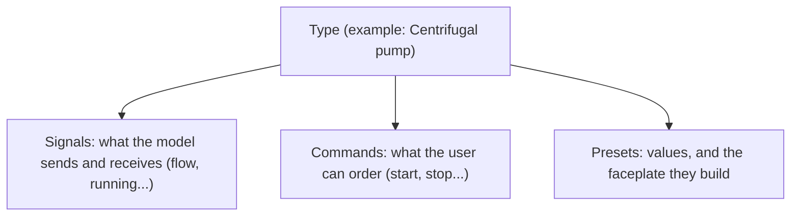

#### Step 2: the model side and the front side

Signals and commands are the contract with the model (the back). The presets, and the faceplate they build, are only about what the user sees (the front). Units are used by both to show values the way the user wants.

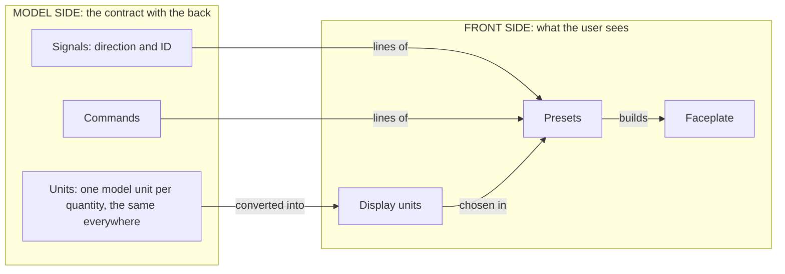

#### Step 3: how it is used

A symbol picks a type, among all the types of the tree, and a preset. A synoptic uses symbols and can only change their faceplate: the defaults, the texts of its title and description elements (what else it can change in the built faceplate is open). There are no libraries of types (Product Owner, 2026-11-16).

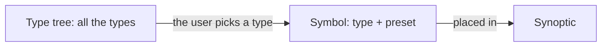

## Types

Status: validated by the Product Owner on 2026-11-11; changed by him on 2026-11-16 (no libraries of types, type tree actions, fixed parent, icon buttons in General, parts listed by name under the tree, a Faceplate part that only shows the faceplate, no Edit or Save step). Reviewing the wireframes later that day, he validated the tree (coloured icon and name, nesting, + on hover and + on the title), put the search behind an icon on the line of the title, removed every right click, moved Delete to General with a warning, and asked for lists of types indented with dashes. At the end of the day he removed the Faceplate part: five parts are left. Open points are listed in [Open questions](#metadata-open-questions).

A type is the representation of a symbol at one level of detail. Types form a tree, hence parents and sub-types.

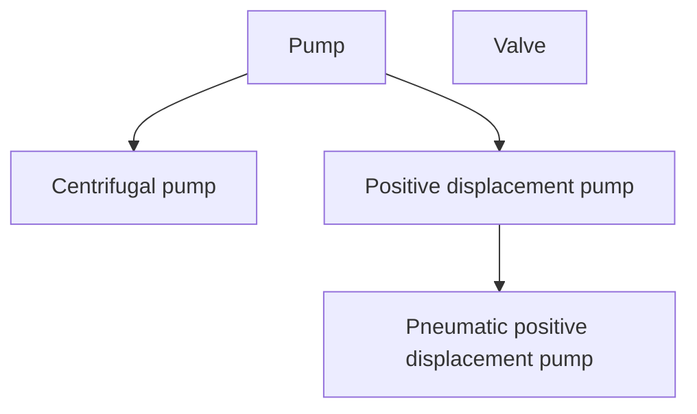

### Rules

- The General part holds the name (labelled "ID"), and an icon with its colour (see [Icons](#type-icons)); it does not show the parent, which the tree already shows (Product Owner, 2026-11-22). The description and the links are in a separate documentation page (see [Documentation](#type-documentation)).
- The name is the type's identifier for the model, like a signal's name. No second label. It must be readable and exact, because model authors use it to know what the type is (example: `centrifugal_pump`). Where a standard already names things, the type takes that name.
- A type also has an internal identifier, set by the software, that never changes. It exists on the application side only and never goes to the model. It is needed to define the parent and for symbols to point to the type, so renaming a type breaks nothing in the application.
- So there are two identifiers: the name (seen by the model, meaningful) and the internal one (seen by the application only, meaningless).
- **The name (the public ID) of a type is unique in the whole tree** (Product Owner, 2026-11-18, decision 0047, answering the questionnaire: "Oui, unique dans tout l'arbre"): the model knows a type by it, so two types with the same name would be mixed up (see [Data model](#the-type)).

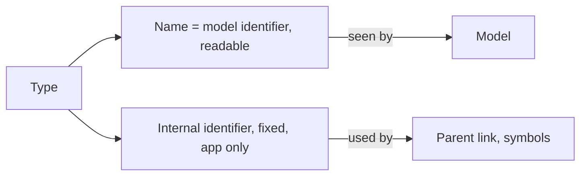

- No abstract types: "Pump", "Positive displacement pump" and "Pneumatic positive displacement pump" can all be chosen.
- A type inherits the signals of its parents.
- The type tree is on the **left** of the screen, as in a code editor (IDE), where every tree sits on the left (Product Owner, 2026-11-11). It sits just right of the navigation bar of Metadata (see [Screens](../screens/README.md#layout-rules)).
- There are no libraries of types: every type of the tree can be chosen everywhere (Product Owner, 2026-11-16).
- The name is changed in the General part only. Double-clicking an item in the tree does not rename it: hidden options are avoided.
- **The parent never changes** (Product Owner, 2026-11-16; decision 0013; confirmed on 2026-11-22: "on n'est pas censé le bouger"). It is set when the type is created, by the + of the type under which it is created (or the + of the title, for a root type). Only the tree shows it: General does not (Product Owner, 2026-11-22: "afficher le parent dans le truc général, ça sert pas à grand-chose").
  - Why: moving a type to another parent changes the signals it inherits and breaks what uses it. No signal goes from one parent to another "aussi bêtement que ça". Metadata must stay strict ("ça doit être carré").
  - A type created under the wrong parent is deleted and created again under the right one; it is never moved.

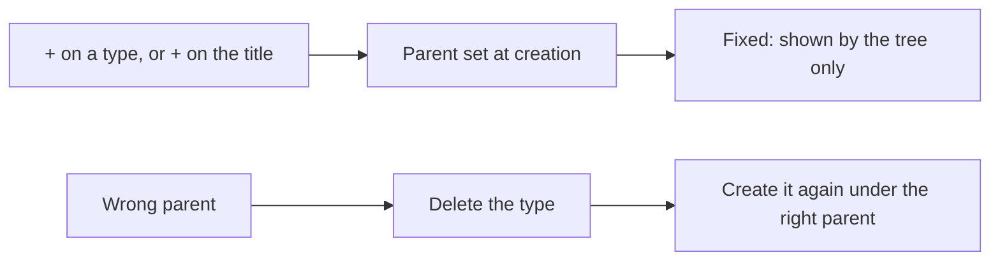

- The parts of a type are shown in this order (Product Owner, 2026-11-11, then 2026-11-16): General, Documentation, Signals, Commands, Presets. There is **no Faceplate part** (removed by the Product Owner at the end of 2026-11-16): the faceplate is built and seen in the mode Faceplate of a preset (see [Presets](#no-faceplate-part)). They are shown as **a list of their names, in the column of the type tree, fixed under the tree** (proposal B, changed by the Product Owner on 2026-11-16; see [The parts of a type](#the-parts-of-a-type-a-list-fixed-under-the-tree)).

#### The type tree: search, create, delete (Product Owner, 2026-11-16)

Validated by the Product Owner on 2026-11-16, while reviewing the wireframes ("cette partie-là, on peut la valider").

- Each type of the tree shows **its icon, in its colour, and its name**. Types nest: a type can hold types, at any depth.
- **Create a child:** each type of the tree has a **+** on its right, **shown when the mouse is over the type** ("sinon on va les voir tout le temps et ça va être imbuvable"). It creates a new type **inside** it (a child): "le truc le plus logique". The new type starts with a default name, changed afterwards in General.
  - The Product Owner thought for a moment of showing these + all the time, in a light colour, so that nothing is hidden; then dropped it: one more mark on every line "va faire beaucoup trop surchargé". They stay on hover.
- **Create a root type:** a **+** on the line of the title "Type tree", always on the far right. It is always shown, so that creating a type is never hidden.
- **Search:** a **search icon** sits on the line of the title, just left of the +.
  - A click on it turns the title into a **search field**: the words "Type tree" disappear and the field takes their place.
  - Typing filters the tree.
  - While searching, the **+ becomes a cross (×)**, which closes the search: the field goes, the title "Type tree" and the + come back.
  - It replaces the search field always shown under the title, drawn earlier the same day.
- **No double click:** double-clicking a type does not rename it; hidden options are avoided.
- **No right click** in the tree, nor anywhere in Metadata (Product Owner, 2026-11-16: "on ne peut juste pas avoir de clic droit du tout"). Its menu held only Delete, and a delete must not be that easy to reach.
- **Delete:** a **Delete button in the General part** of the type. A click opens a **warning message** that asks to confirm: a whole type is one of the few deletes that warn (see the [layout rules](../screens/README.md#delete-a-warning-only-for-a-whole-thing), decision 0093). It replaces the right click and the "no warning" decided earlier the same day. A delete is taken back with the undo history (see [Files and conflicts](../storage/files-and-conflicts.md#undo-history)).

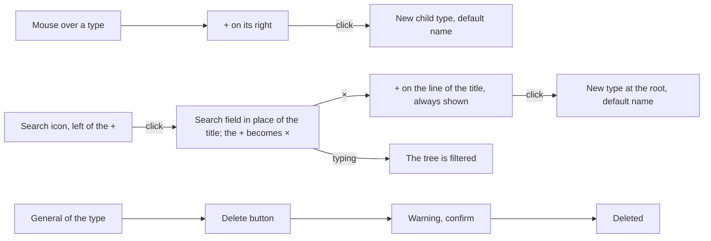

The line of the title, out of search and in search:

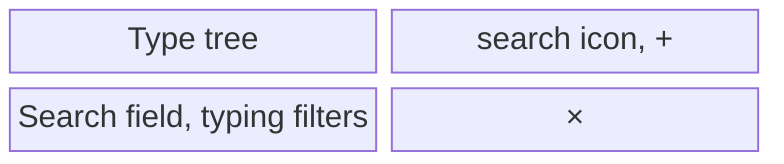

- The General part holds the name, the icon and the colour, and the **Delete button** of the type (Product Owner, 2026-11-11, confirmed on 2026-11-16; the Delete button added the same day; the parent removed from it on 2026-11-22).
- The field of the name is labelled **"ID"**, as for the signals, the commands, the flags, the enums and the designations (Product Owner, 2026-11-22, questionnaire: "ID"; decision 0084). It was open since 2026-11-16 ("Je ne sais pas s'il faut mettre vraiment un nom ou plutôt un ID").

#### A list of types shows the tree, indented

Said by the Product Owner on 2026-11-16, for a list of the parent in General that is no longer drawn: General does not show the parent (2026-11-22). The display holds for any list of types.

- When a list of types opens (a select), it shows **the whole type tree**, each type with its icon and its name.
- The level of a type is shown by **small dashes before the icon**, one per level, each taking a wide square of space, so that the indentation reads as in the tree ("des petits tirets, mais qui prennent un gros carré d'espacement"). Example: `Pump`, then `— Centrifugal pump`, then `— — …`.
- Assistant's proposal, to confirm: the same display wherever a type is picked in a list, for example when a symbol picks its type.

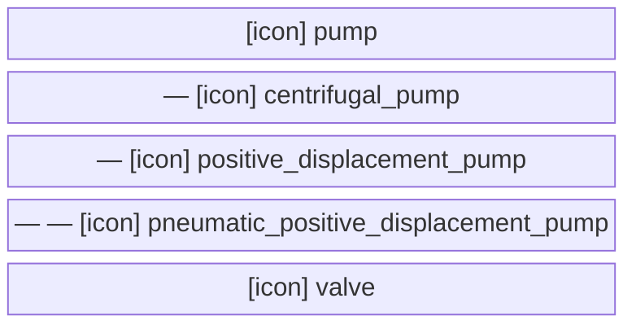

- **Icon and colour:** a list of icons and a list of colours, each with its reset button, validated (Product Owner, 2026-11-16). The colours, and the icons, may take more than one line: where the reset button goes then is to find with the design ("il faudra trouver une autre disposition, mais dans le général, là, ça suffit").
- In General, the name is **always editable**: no Edit or Save button (Product Owner, 2026-11-16: "il faut que tout soit éditable tout le temps"). The resets to the parent (icon, colour) are **icon buttons**, without a text label.
- No virtual links between types of the tree. Duplicates are accepted: a change in one type must not change another silently, so nothing has to be retested everywhere. It also lets each type be versioned alone later. The documentary research (2026-11-10) finds this rule defensible: neither FMI, OPC UA nor AutomationML requires or forbids it.

#### Limits of "no virtual link" (decided on 2026-11-11, from the research)

The rule is true between types that have no parent link. Three mechanisms do propagate a change, on purpose, and are written as such:

- Changing the content of a parent (its signals, its commands) changes all its descendants. The parent link itself never changes (see above).
- A sub-type cannot declare again a signal name it already inherits. No redefinition: it is the simplest rule, and a name stays one thing along the tree.
- The values of an enum are part of the contract with the model: changing them is breaking, like a rename (see [Enums](#enums)). Links to an enum or a quantity go through an internal identifier, like symbols do for types.

Versions, the answer of OPC UA's best-practices guide and of Siemens, came on 2026-11-16 (Metadata as a whole versioned), then left the application on 2026-11-21: the JSON files of the types are versioned with Git by the user (see [Always editable, no versions](#always-editable-no-versions)).

### What a type holds

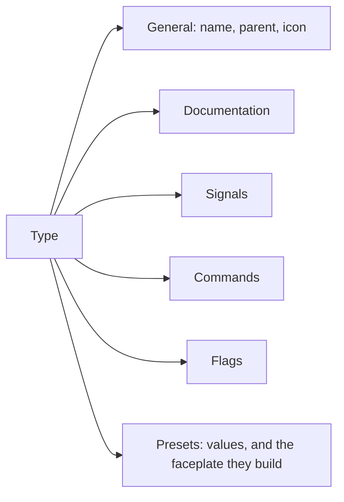

| Part | File |
| --- | --- |
| General: icon and colour | [Icons](#type-icons) |
| Documentation: description (Markdown), links | [Documentation](#type-documentation) |
| Signals | [Signals](#signals) |
| Commands | [Commands](#commands) |
| Flags: keys written in the configuration files, for customisation outside the application (2026-11-17) | [Flags](#flags) |
| Presets: values, and the faceplate they build | [Presets](#presets-and-their-faceplate) |

### The parts of a type: a list fixed under the tree

Chosen by the Product Owner on 2026-11-16: **proposal B, the parts written in whole words**, placed in the column of the type tree. It replaces proposal C (a strip of icons), chosen earlier the same day.

- The six parts are listed **with their names in whole words**, one under the other, in the order General, Documentation, Signals, Commands, Flags, Presets (the Faceplate part, there for a while on 2026-11-16, was removed the same day; Flags added after Commands on 2026-11-17, Product Owner: "général, documentation, signal, commande, flag"; decision 0028).
- They sit **in the same column as the type tree, under it**, not in a column of their own. The list was moved above the tree for a while the same day, then put back under it: above the title "Type tree", it made no sense (Product Owner, 2026-11-16: "ça n'a aucun sens logique").
- The list is **fixed** at the bottom of that column: it never moves, whatever the length of the tree (Product Owner: "on fixe, et comme ça, ça ne bouge pas … ça bougera jamais"). The tree scrolls above it.
- Why: whole words are understood at once, icons are not ("il faut faire des mots entiers, sinon ils vont rien comprendre"); and since the column on the left already holds long lines (the names of the types), the names of the parts fit there without taking a column of their own.
- The same design applies to every screen of a type, General to Presets (Product Owner: "il va falloir que t'appliques ce design-là partout").

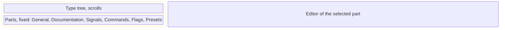

The four proposals drawn before the choice, kept for the record. The Product Owner liked the tabs in a row, easy to use, but they break the rule "columns rather than rows" (see [Layout rules](../screens/README.md#layout-rules)). Their drawings were removed from the Figma file once B was in place (Product Owner, 2026-11-16). D was refused ("c'est mort"). C was chosen first, then B, its parts moved into the column of the tree, under it (moved above it for a while, then back under it).

| Proposal | What it is | For | Against |
| --- | --- | --- | --- |
| A. Tabs in a row | The five parts as tabs above the editor (the current wireframes). | Known by everyone; all the width stays for the part. | A row, against the rule of columns. |
| B. A column of parts (**chosen**, placed under the tree) | A narrow column between the tree and the editor lists the five parts, one under the other, with their names. Chosen with the list moved into the column of the tree, under it, fixed. | Follows the rule of columns; the names stay readable. | Drawn as one more column; moved into the column of the tree, it takes no width. |
| C. A strip of icons (chosen first, then replaced by B) | The same column, reduced to five icons, the name in a tooltip. | Narrow: almost all the width stays for the part. | Icons to learn; the name is hidden until the mouse is over it. |
| D. Under the type, in the tree | When a type is selected, its five parts unfold under it in the tree, as the layers of a frame in Figma. | No extra column; the type and its part are read together. | The tree grows and moves; a part is mixed with the types. |

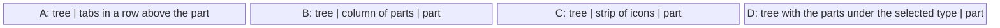

### Type and symbol

- A symbol is attached to one type.
- The type of a symbol can only be changed in symbol editing.
- In a synoptic, the type can never be changed. Only the preset can be.

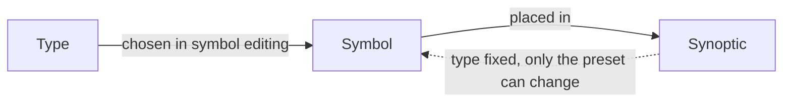

### Renaming is breaking, on purpose

The names of types (and of signals) build the interface definition of the model. They are meant to be defined at the start and never to change.

- A name is a contract with the model. No mapping layer between an old name and a new one: it would make no sense here.
- Renaming a type is possible but breaking: the model must change its name too, because its interface definition changed.
- The more names change, the more the model has to change. So names must be thought through before they are set.
- The application does not break on a rename, because it uses the internal identifier.

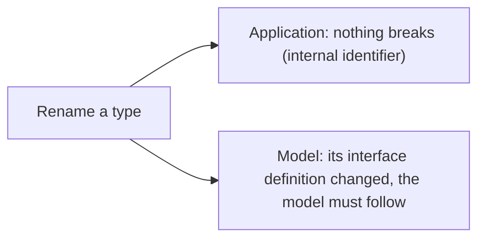

### How a rename is done: typed in place

Changed by the Product Owner on 2026-11-16. It replaces the Edit and Save buttons of 2026-11-11. The Versions page that checked a rename was removed on 2026-11-21 (decision 0053).

- The name is typed in place in General, like every field of Metadata. No Edit or Save button, no warning, no confirmation dialog.
- Nothing in the application stops a mistake: the rename is written to the JSON file of the type, and the user sees it in the differences of Git, where it can be taken back (see [Always editable, no versions](#always-editable-no-versions)). A rename breaks the model.
- The consequences for models (see above) are to be explained in a user manual. That manual is not part of the open source version.

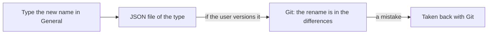

### Where it is used

| Thing | Created and changed in | Used in | In a symbol | In a synoptic |
| --- | --- | --- | --- | --- |
| Type (name, parent) | Metadata: the name in General, the parent at creation only; deleted in General, with a warning | Signal and command inheritance | Chosen among all the types, only here | No |

### Open questions

- The search: does the filtered tree keep the parents of a type that matches, so that its place is seen?
- Where the reset buttons of the icon and the colour go when their lists take several lines.

## Type icons

Status: validated by the Product Owner on 2026-11-11. Open points are listed in [Open questions](#metadata-open-questions).

An icon helps to recognise a type at a glance, in addition to its name. It is only for the application and says nothing to the model.

### Rules

- The icons come from a predefined list of SVG files that ships with the program. The user cannot import their own icon. To add one by hand, the file of the list is edited, and that is all. Replaced on 2026-11-22 (decision 0073): the icons come in icon sets, one file each, and the user adds their own sets in their configuration folder (see [Icon set](entities/04-icon-set.md)).
- The list can already hold icons for common objects (for example, several pumps).
- The colour comes from a fixed palette of predefined colours. The user cannot pick any other colour.
- For a type, the user picks one icon in the list, then one colour in the palette.
- Icon and colour are chosen in the General part of the type (see [Types](#types)).
- The icon is shown in the type tree and wherever types are listed.
- A default icon and a default colour exist, so that a type with no choice and no parent choice still shows something. They are defined with the design system.

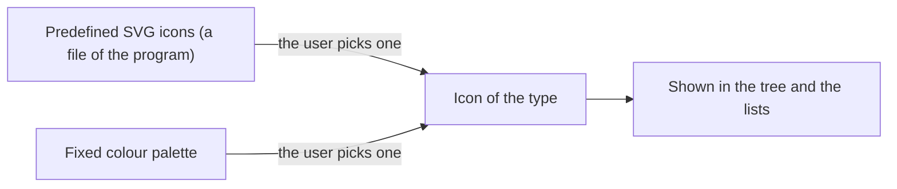

### Icon and colour are inherited

- If a parent type chooses an icon and/or a colour, all its children take the same.
- A child can override the icon and/or the colour with its own choice. Its own children then follow the child.
- A child that overrides can reset: a reset action, available when choosing the icon or the colour, makes it follow its parent again. It is an icon button, without a text label (Product Owner, 2026-11-16).
- In General, the icons and the colours are shown as two lists, each with its reset button (validated by the Product Owner on 2026-11-16). Each list may take more than one line; where the reset button goes then is to find with the design.
- A type with no choice anywhere up its branch uses the default icon and the default colour.

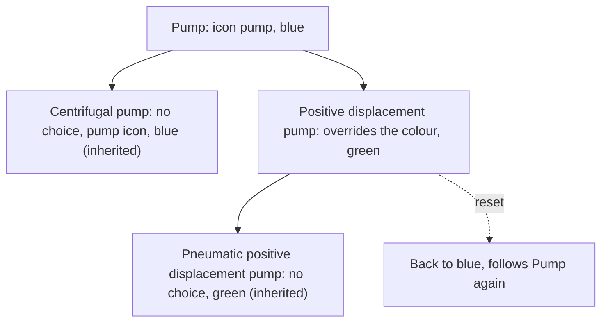

### Where it is used

| Thing | Created and changed in | Used in | In a symbol | In a synoptic |
| --- | --- | --- | --- | --- |
| Icon and colour of a type | Metadata, General | Tree, lists | No | No |

### Open questions

- To define with the design system: the contents of the palette, the list of icons at the start, and the default icon and colour are not decided here. They are defined when the design system is defined.
- Where the reset buttons go when the list of icons or of colours takes several lines.

## Type documentation

Status: validated by the Product Owner on 2026-11-11; changed by him on 2026-11-16 (no Edit step, read-only mode kept, then removed on 2026-11-22, full page button with the type tree kept, add buttons above the links, the description shown on this page only); reviewing the wireframes later that day, he set the formatting tool bar in both modes, with the full page button in it, and a delete button with a warning on each link; at the end of the day, a handle to reorder the links, two small icons with a + on the right of their title (path, URL), and no column Open: a click on the path or the URL opens it, an icon at its start. Open points are listed in [Open questions](#metadata-open-questions).

A type has a documentation page, where people put what explains the type: a description and links to documents and sources.

### Rules

- Documentation is created and changed in Metadata only.
- The description and the links do not go to the model.

### What the page holds

| Part | Meaning |
| --- | --- |
| Description | A text in Markdown that says what the type is. Shown on this page only (Product Owner, 2026-11-16). |
| Links | Links to files, folders and URLs (standards, datasheets, project folders...), each with a short description. |

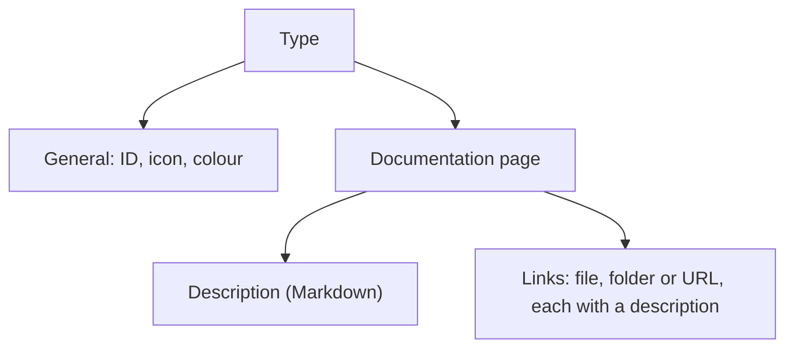

### The description

- It is stored in Markdown.
- **No Edit or Save step** (Product Owner, 2026-11-16): what is typed is kept, as everywhere in Metadata (see [Always editable, no versions](#always-editable-no-versions)).
- **Two modes, Visual and Markdown**; the user switches between them at any time. There is **no read-only mode** (Product Owner, 2026-11-22: "le readonly, tu peux juste le dégager [...] Y a que visuel et Markdown que je veux voir ici"; it replaces the read-only mode kept on 2026-11-16).

| Mode | What the user sees | When |
| --- | --- | --- |
| Visual | A visual editor (what you see is what you get), with the formatting tool bar. | The mode that opens first (Product Owner, 2026-11-22, questionnaire: "Visual"). |
| Markdown | The raw text, for those who write Markdown faster, with the same formatting tool bar. | When the user switches to it. |

- Switching mode is not an Edit button: there is nothing to save or to confirm.
- The description has a **title, "Description"**, above its editor, as the links have theirs, so that the user knows what the text is (Product Owner, 2026-11-22: "on sait pas que c'est une description [...] je sais pas s'il faudrait un petit titre au-dessus"; then, questionnaire: "Oui, le garder").
- The application holds its own **Markdown editor** (Product Owner, 2026-11-16: "il faudra faire un éditeur Markdown"), with its two ways to type:
  - **Markdown**: the raw text shows its marks, for example the `#` of a heading;
  - **Visual**: the text is laid out, "comme un éditeur de texte Word".

#### The formatting tool bar

Said by the Product Owner on 2026-11-16, while reviewing the wireframes.

- The **formatting tool bar** is there **in both modes**, Visual and Markdown, with the same buttons ("disponible dans les deux, dans tous les cas"; confirmed on 2026-11-22: "T'es censé le laisser, même quand on sélectionne le Markdown"). In Markdown, a button writes the marks into the text; in Visual, it lays the text out.
- It works "un peu comme Word": the user picks what to apply, among **what Markdown can write**: the level of a heading, lists, tables, and the rest of Markdown ("tous les trucs Markdown").
- Proposed content, to confirm (the marks of CommonMark and of GitHub's Markdown): heading levels, bold, italic, strikethrough, bulleted list, numbered list, checklist, quote, inline code, code block, table, link, horizontal line.
- **The buttons show the state of the text under the cursor or of the selection** (Product Owner, 2026-11-22: "quand on sélectionne un élément, ça nous dit s'il est déjà en header, s'il est déjà en italique, en bold"): bold, italic and strikethrough are toggles, drawn selected when the text already has them; a click puts the mark or takes it away.
- **The heading is a list, not a button** (Product Owner, 2026-11-22: "le header, normalement, on est censé avoir une liste"): a small select shows the level of the current line, Paragraph or Heading 1 to Heading 6, the six levels of Markdown; picking one changes the line.
- **The table button opens a grid** to choose the size of the new table (Product Owner, 2026-11-22: "Tu cliques sur tableau et ça te propose un cadrillage [...] choisir directement le nombre de colonnes et de lignes"): the cells under the mouse light up from the top left, a caption says "4 × 3" (columns × rows), a click inserts the table. Grid of 8 columns × 6 rows: assistant's reading.
- The lists, quote, inline code, code block and link buttons stay as drawn (Product Owner, 2026-11-22: "ça, c'est bien").
- **No text colour**: Markdown has no mark for a colour (only raw HTML could), so the tool bar offers none. The Product Owner asked whether it could ("je sais pas si, en Markdown, on peut choisir la couleur de texte"); assistant's answer, to confirm.
- The **full page** button is part of the tool bar (Product Owner, 2026-11-16).
- The two buttons that switch between the modes, Visual and Markdown, sit **on the right of the formatting tool bar**, on the same line (Product Owner, 2026-11-16).
- The tool bar also has a **full page** button (Product Owner, 2026-11-16):
  - the description takes the whole page of the documentation, and the links are no longer shown, so the user only types text, calmly;
  - it is not the full screen of the system: the window stays as it is, and the menus of the application stay;
  - **the type tree stays visible** (Product Owner, 2026-11-16): only the editing part takes the whole page, the rest of the screen does not move;
  - the editing area goes down to the bottom of the page, whatever the length of the text (Product Owner, 2026-11-22: "la couleur plus claire, elle serait pas censée descendre jusqu'en bas ?");
  - the same button brings the page back.
- The description is written in the documentation page, not in General. It does not go to the model.
- The description is **optional** (Product Owner, 2026-11-22: "Facultative"): a new type has none until someone writes it.

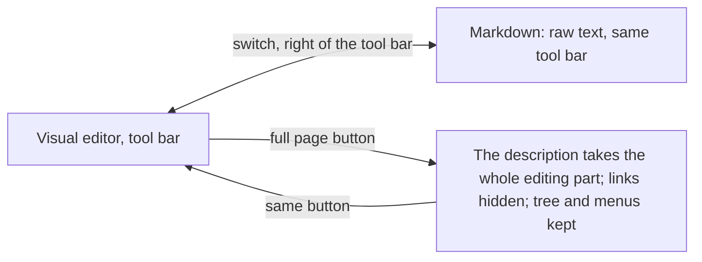

### The links

- A link is one of two kinds: a path to a file or a folder, or a URL.
- A path is chosen with a selection window: the user browses to the file or the folder, and the application keeps only its path (for example `W:/...`). The file is never loaded, copied or embedded.
- A URL is typed or pasted.
- The list has the title "Links", with **two small icons on its right, each with a small +**: a path icon, which opens the selection window, and a URL icon, which opens a field to type or paste (Product Owner, 2026-11-16: "un petit +, une petite icône à côté du titre", then, against a menu: "là, tu peux faire clac-clac. C'est beaucoup plus rapide"; see the [layout rules](../screens/README.md#a-title-and-a-small--on-its-right)). They replace the two buttons "Add a path" and "Add a URL".
- **How a link is added** (Product Owner, 2026-11-22: "on voit pas une sorte de pop-up pour pouvoir les ajouter [...] Quand je rajoute un lien, il faut bien que je puisse entrer le lien quelque part"; assistant's proposal, to confirm):
  - the path icon opens the **selection window of the computer**, shown by the server; the path chosen becomes a new link at the end of the list. In the mockups, this window is a stand-in frame, since it belongs to the system, not to the application;
  - the URL icon opens a **small window, "Add a URL"**, with a field for the URL and one for its description (optional), then Cancel and Add; Add puts the new link at the end of the list.

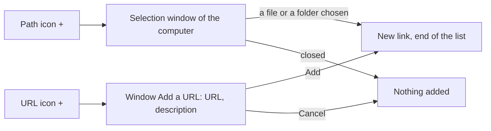

- **No column "Open"** (Product Owner, 2026-11-16: "la colonne open, elle sert à rien"): a click on the path or on the URL itself opens it, as below. A **small icon at the start** of the path or of the URL says which kind it is (a folder or a link) and shows that it can be clicked ("une icône avant dans le path ou l'URL").
- **The user chooses the order of the links** (Product Owner, 2026-11-16, reviewing the wireframes: "dans les liens de la documentation [...] il faudrait pouvoir changer de place"): each line has a **handle** at its very left, held and dragged to move it, as in the table of signals; the order is kept (see [Signals](#the-order-of-the-lines)).
- The columns of the handle and of the delete button have no header (see the [layout rules](../screens/README.md#columns-of-buttons-have-no-header)).
- Each link has a description: a short text in plain text (not Markdown) that says what is attached. It is a description, not a name. **Optional** (Product Owner, 2026-11-22: "Facultative"): without it, only the path or the URL is shown.
- Once a link is added, **only its description changes**, in place; its path or its URL does not: a wrong link is deleted and added again, and a click on the path or the URL always opens it (Product Owner, 2026-11-22, questionnaire: "Seule sa description change").
- **Deleting a link:** a delete button (an icon) in the **last column of its line, on the far right** (Product Owner, 2026-11-16: "Tu me rajoutes un bouton de suppression"); a click deletes the link at once, with no warning (decision 0093, which replaces the warning of 2026-11-16). No right click (see the [layout rules](../screens/README.md#delete-a-warning-only-for-a-whole-thing)).
- A link to a file or a folder can be opened directly, with a click on its path, so the user does not lose time. Opening **always opens a folder, never a file** (Product Owner, 2026-11-11):
  - a link to a file opens the folder that contains the file;
  - a link to a folder opens that folder.
- The application never launches a file or a program: launching things blindly is not safe.
- A URL opens in the default browser, with a click on it.
- Documents cannot be attached inside the application: that could be dangerous. Only links exist.
- The path is kept as it is chosen, with no translation. In a company, everyone is expected to have the same drive letters. Otherwise, the absolute path is used (for example the path of the server).
- The selection window and the opening of a folder are done by the server, since all access to files goes through the server (see [Storage](../storage/README.md)). In the free version, the application is a built program and the server runs on the user's computer, so it can open a folder window. In development, the front is opened in a browser, and the server still does it.
- The web hosting of the paid offer, where a folder cannot be opened on the user's computer, is out of these specs.

```mermaid
flowchart TD
    L[Link] --> K1["Path"]
    L --> K2["URL"]
    L --> DS["Description: what it is"]
    K1 -->|"selection window, path only"| P["W:/... (nothing embedded)"]
    K1 -->|"open"| F["A folder opens: the one that contains the file, or the folder itself; never the file"]
    K2 -->|"open"| B["The browser opens"]
```

### Where it is used

| Thing | Created and changed in | Used in | In a symbol | In a synoptic |
| --- | --- | --- | --- | --- |
| Description, links | Metadata | Documentation page of the type | No | No |

### Open questions

- The content of the formatting tool bar (proposed above) and no text colour: to confirm.

## Signals

Status: validated by the Product Owner on 2026-11-11; changed by him on 2026-11-16 (signals shown in a table, always editable, direction first, line coloured by direction; no display name on the signal, it moved to the preset; a handle on each line to choose the order; the quantity says "quantity" or "difference"). Reviewing the wireframes later that day, he confirmed the ID and the removal of the display name, put the inherited signals first, read only, from the top of the tree down, marked a quantity and a difference by two icons, and replaced the delete by right click by a delete button with a warning. At the end of the day he removed the model unit from the signal (it is one per quantity, set outside Metadata), kept only the icons in the column Quantity, and left the columns of the handle and of the delete button without a header. On 2026-11-17 he removed the minimum and the maximum from the signal: a bound is a signal of its own. Later that day he made a bound a plain signal with no tie to the one it bounds (usually an input), named the column "Quantity / Difference", kept decimal places out of Metadata, and refused the bubble on an enum name. On 2026-11-18 he removed the type text: a word shown goes through an enum. On 2026-11-20 he gave the signal a description (decision 0052). On 2026-11-22 he removed the colour of the lines: the direction is told by its icon only. Open points are listed in [Open questions](#metadata-open-questions).

A signal is what goes between the front and the model: an input or an output of the model. Only these are defined here. Values that stay inside the model are not defined in Metadata: the people who write the model name them as they wish, and they are invisible to the application.

### Rules

- Metadata is the contract with the model: what is negotiated with the model author is written here. Transforming data (for example mapping a value to a 0 to 1 range for an animation, proportionally or not) is not done here: it belongs to symbol editing.
- Only inputs and outputs exist: no separate constant parameters (the research notes that FMI has them; the project keeps none).
- No default value on a signal: default values live in presets only (see [Presets](#presets-and-their-faceplate)).
- Signals are inherited along the tree: "Pneumatic positive displacement pump" has the signals of Pump, of Positive displacement pump and of its own. A sub-type cannot declare again a signal name it already inherits (see [Types](#types)).
- Signals are created and changed in Metadata only, never in a symbol or a synoptic.
- A signal's name is part of the model's interface definition: it is set once and is not meant to change. Renaming one is breaking for models, as for types (see [Types](#types)).
- **The table of signals is always editable** (Product Owner, 2026-11-16): no Edit button, no Save button, no warning. It replaces the Edit and Save of 2026-11-11. The application keeps no versions: a mistake is seen and taken back with Git, on the JSON files (see [Always editable, no versions](#always-editable-no-versions)).
- A signal also has an internal identifier, set by the software, that never changes, like a type's (see [Types](#types)). It exists on the application side only and never goes to the model. Symbols link to a signal through it, so renaming a signal does not break them (see [Libraries and symbols](../symbols/01-libraries-and-symbols.md)).
- A signal has an **ID**: its name for the model, the identifier above, set once (Product Owner, 2026-11-16).
- **A signal has no display name** (Product Owner, 2026-11-16, later the same day): since the faceplate is built by the preset, the name people see is written in the preset, one per signal, in its faceplate builder (see [Presets](#mode-faceplate-the-faceplate-builder)). It replaces the display name on the signal decided earlier that day. Confirmed while reviewing the wireframes: "Dans Signal, le display name ne sert à rien. Je te le dis très clairement."
- **A signal has a description** (Product Owner, 2026-11-20: "il faut pouvoir expliquer ce qu'on veut dire au modeleur"; decision 0052): it says what the signal means, for the person who writes the model. It replaces "a signal has no description" (2026-11-16). Plain text: assistant's reading. **Optional**, as for the flags and the enum items (Product Owner, 2026-11-20). **Written in the configuration files sent with the model**, but edited in Metadata only (Product Owner, 2026-11-20: "on ne peut la modifier que dans la metadata").
- **The direction of a signal is told by its icon only** (Product Owner, 2026-11-22: "pas de fond, juste l'icône de direction [...] je veux vraiment que ce soit plus calme"): the line has no background colour of its own; the column Direction shows an icon for an input and another for an output, both in the same colour. It replaces the line coloured by its direction (2026-11-16).
- **A signal has no model unit** (Product Owner, 2026-11-16, end of the day: "« model unit », ça, on enlève. C'est pas ici qu'il faut mettre ça"). For one quantity, and for one difference, the model always uses **the same unit, everywhere**, so that there are no odd conversions. That unit is set once, outside Metadata (see [Units](#model-unit-and-display-unit)). It replaces the model unit chosen per signal (decision 0024, accepted on 2026-11-16).
- **A signal has no minimum and no maximum** (Product Owner, 2026-11-17: "le min et le max, ça doit être un signal à part entière et pas une propriété de ce signal-là [...] comme ça, ça simplifie"). A bound is **a signal of its own**, declared in the table like any other, with its direction, ID, type and quantity. It replaces the bounds kept on the signal on 2026-11-16 (decision 0026, accepted on 2026-11-17).
- **A bound is a plain signal** (Product Owner, 2026-11-17: "c'est un signal ordinaire"; decision 0027, accepted on 2026-11-17): it has **no tie** to the signal it bounds. `speed_setpoint_max` is a signal like any other; its name is only a convention of the people who write it, and the application reads nothing in it.
- **Its direction is chosen like any signal's**, input or output. In practice a bound is **an input**: it is given to the model, to tell it the range its data will be bounded with (Product Owner, 2026-11-17: "on dit littéralement au modèle ce qu'il va avoir [...] dans la logique, c'est donné au modèle").
- Where a bound is used:
  - in a symbol, the bounded linear animation can take its minimum or its maximum from any signal of the type, input or output (see [Animation mode](../symbols/08-animation-mode/README.md#shapes-of-mapping));
  - in the faceplate, the minimum and the maximum of a number field are each typed by hand or taken from an input signal of the type with the same quantity, never an output (Product Owner, end of 2026-11-17, and 2026-11-21 for the input of the same quantity only; see [Presets](#bounds-of-a-number-field)).
- **No decimal places on the signal** (Product Owner, 2026-11-17: "le modèle, il doit pouvoir tout bouffer"): the model gives and receives the whole value. If a number of decimals must be set, it is set once for the whole project, in a place for project settings, outside Metadata, so that every value of the project has the same decimals (Product Owner: "c'est pas dans les métadatas [...] avoir le même nombre de décimales partout"). That place is not described yet. What this means for the decimals of the presets and of the catalogue of units is asked (see [Open questions](#metadata-open-questions)).

### Fields

| Field | Meaning | Rule |
| --- | --- | --- |
| Direction | Input or output of the model. | Belongs to the signal. Seen from the model: an input is what the model receives, an output is what it sends. First column of the table. |
| ID | The signal's name for the model. | Its variable identifier, set once. Shown as "ID" in the table. |
| Type | What kind of value. | Integer, real, boolean or enum. A real is a 64-bit double. No text (Product Owner, 2026-11-18, see [No text signal](#no-text-signal)). |
| Enum | For an enum: the list of values. | An enum picked from the Enums page (see [Enums](#enums)): a global enum or a template (2026-11-17, see [Global enums and templates](#global-enums-and-templates)). A link to it, never a copy, and never defined in the signal. |
| Quantity | What the value measures (volume, flow, pressure...), and whether the value is the quantity itself or a difference of it. | Required for an integer or a real, never for a boolean or an enum (decision 0051, 2026-11-19): a number that measures nothing physical takes the ratio or the count of the catalogue. Picked from the ready-made catalogue of the Units page, which the user never changes; the user picks the quantity or its difference, told apart by an icon (Product Owner, 2026-11-16), see [Units](#value-or-difference-chosen-in-the-signal). |
| Description | What the signal means, for the person who writes the model. | Plain text (assistant's reading). Optional. Written in the configuration files sent with the model, edited in Metadata only. Last column of the table (2026-11-20, decision 0052). |

There is no field Minimum or Maximum (Product Owner, 2026-11-17): a bound is a plain signal of its own. There is no field Decimals either (Product Owner, 2026-11-17). There are no texts of a boolean on the signal: set on the signal by decision 0054, they moved to the preset the same day (Product Owner, 2026-11-21: "ça serait plutôt dans les presets"; decision 0058; see [Mode Values](#mode-values-one-table-of-the-signals)).

```mermaid
classDiagram
    class Signal {
        direction in or out
        ID
        type
        enum
        quantity
        description
    }
    class Quantity
    class Enum
    Signal ..> Quantity : quantity
    Signal ..> Enum : link
```

### Example

The signals of `centrifugal_pump`, a child of `pump`, itself a child of `equipment`. The example shows every kind of line: both directions, every type (no text since 2026-11-18), a quantity offered once, a quantity and a difference, inherited lines first (Product Owner, 2026-11-16: "complète le tableau [...] pour qu'on comprenne mieux avec un peu toutes les options").

In the column Quantity, ● stands for the icon of a quantity and Δ for the icon of a difference: both are placeholders, the icons are chosen with the design system.

| From | Direction | ID | Type | Enum | Quantity | Description |
| --- | --- | --- | --- | --- | --- | --- |
| `equipment`, read only | output | `fault` | enum | `fault_state` (0 None, 1 Overheating, 2 Dry running) |  | The fault the equipment is in, if any. |
| `pump`, read only | input | `running` | boolean |  |  | True to run the pump, false to stop it. |
| `pump`, read only | output | `flow` | real |  | ● flow | Flow through the pump. |
| own | input | `mode` | enum | `operating_mode` (0 Off, 1 Manual, 2 Automatic) |  | How the pump is driven. |
| own | input | `speed_setpoint` | integer |  | ● rotational speed | Speed asked of the motor. |
| own | input | `speed_setpoint_max` | integer |  | ● rotational speed | Highest speed that may be asked. |
| own | output | `inlet_pressure` | real |  | ● pressure | Pressure at the inlet. |
| own | output | `pressure_rise` | real |  | ● pressure | Pressure gained between inlet and outlet. |
| own | output | `bearing_temperature` | real |  | ● temperature | Temperature of the motor bearing. |

`speed_setpoint_max` is a bound: a plain input signal, given to the model, with no tie to `speed_setpoint` (Product Owner, 2026-11-17). A minimum would be one more line, the same way.

Flow, rotational speed and pressure have no difference in the list: their value and their difference convert the same way. So `pressure_rise`, a gap between two pressures, is a plain pressure (decision 0075).

### The table of signals

The signals of a type are shown in **one table**, one line per signal, one column per field (Product Owner, 2026-11-16). It replaces the list on the left with the panel of the selected signal on the right. The table takes as much room as it can, so that every column fits.

| Column | Values |
| --- | --- |
| Handle | A small grip at the very left of the line, with no value and **no header**: it is held and dragged to move the line (see [The order of the lines](#the-order-of-the-lines)). |
| Direction | Input or output. **First column** of values, before the ID, so that the line reads in order (Product Owner, 2026-11-16). |
| ID | The model identifier (Product Owner, 2026-11-16: "l'ID, qui est le modèle identifiant"). |
| Type | Integer, real, boolean, enum. |
| Enum | For an enum signal only: the enum it points to. |
| Quantity / Difference | Header **"Quantity / Difference"** (Product Owner, 2026-11-17: "quantity, c'est le rond, et différence, c'est le petit triangle. Du coup, c'est quantity/différence"). Optional, integers and reals only. One column holds the choice of the quantity or of its difference: its list offers the temperature and the temperature difference (Product Owner, 2026-11-16). Only the quantities whose conversion changes (temperature) have the two items; the others are offered once (see [Units](#value-or-difference-chosen-in-the-signal)). **An icon before the name** says which it is: one icon for a quantity, another for a difference, so that the two are told apart at a glance (Product Owner, 2026-11-16: "on met un symbole, une icône. Comme ça, c'est beaucoup plus simple à reconnaître"). **The icon alone**: no "(quantity)" or "(difference)" after the name (Product Owner, 2026-11-16: "pas besoin de mettre (quantité) ou (différence) [...] quand on connaît les icônes"). The icons are chosen with the design system. |
| Description | What the signal means, for the person who writes the model (Product Owner, 2026-11-20, decision 0052). Last column of values: the short fields first and the long one last, as for the enum items and the flags (assistant's reading). It takes the room left. |
| Delete | A delete button (an icon), in the last column, on the far right, with **no header**; a click opens a warning before anything is deleted (Product Owner, 2026-11-16). Not on the inherited lines. |

- **No column Model unit** (Product Owner, 2026-11-16, end of the day): the model unit is one per quantity, set outside Metadata (see [Units](#model-unit-and-display-unit)).
- **No column Min or Max** (Product Owner, 2026-11-17): a bound is a plain signal of its own, on a line of its own.
- **No column Decimals** (Product Owner, 2026-11-17): decimals are not set in Metadata.
- **No column True / False** (Product Owner, 2026-11-21, decision 0058): the texts of a boolean are set in the preset.
- The columns of the handle and of the delete button have no header and take the least room possible (see the [layout rules](../screens/README.md#columns-of-buttons-have-no-header)).

- Every line is always editable: a field is changed in place, with no Edit or Save step (Product Owner, 2026-11-16: "il faut que tout soit éditable tout le temps, rapidement"). See [Always editable, no versions](#always-editable-no-versions).
- An input line and an output line have the same background; the icon of the column Direction tells them apart (2026-11-22).
- The fields that do not apply to a line stay empty (no enum for a real, no quantity for a boolean).
- The line of an enum signal shows the name of the enum it points to (Product Owner, 2026-11-11). **No bubble** lists its items when the mouse rests on that name (Product Owner, 2026-11-17: "je vois pas où tu pourrais mettre l'info-bulle pour l'instant. Fais pas ça"). The enums themselves are made on their own page (see [Enums](#enums)), never in the table of signals.
- The table shows the signals of the type and the signals it inherits from its parents. Inherited lines cannot be edited here: they are edited in the type that declares them.
- **The inherited lines come first, read only** (Product Owner, 2026-11-16), in this order:
  1. the signals of the first parent, at the top of the tree;
  2. then those of the next parent, down the branch;
  3. last, the signals of the type itself.
  Example for `pneumatic_positive_displacement_pump`: the signals of `pump`, then of `positive_displacement_pump`, then its own. The column "From" of the example above is only there to explain the order; whether the table shows which parent a line comes from is left to the design.
- The button that adds a signal is a small **+ icon on the right of the title "Signals"**, above the table (see the [layout rules](../screens/README.md#a-title-and-a-small--on-its-right)).
- **Deleting a signal** is done with the delete button in the last column of its line (Product Owner, 2026-11-16: "une icône de suppression et pas le clic droit"), at once, with no warning (decision 0093). There is no right click in Metadata (see the [layout rules](../screens/README.md#delete-a-warning-only-for-a-whole-thing)). The handle at the left of a line is not a button: it only moves the line.

The block below shows the order of the columns, with an input line and an output line.

```mermaid
block-beta
    columns 8
    h0[" "] h8["Direction"] h1["ID"] h2["Type"] h3["Enum"] h4["Quantity / Difference"] h5["Description"] h9[" "]
    r0["handle"] r8["→ input"] r1["running"] r2["boolean"] r3["-"] r4["-"] r5["True to run the pump"] r9["bin icon"]
    s0["handle"] s8["← output"] s1["flow"] s2["real"] s3["-"] s4["● flow"] s5["Flow through the pump"] s9["bin icon"]
```

→ and ← stand for the icons of an input and of an output (`signal-input`, `signal-output` of the design system).

### The order of the lines

The user chooses the order of the signals, so that the table looks tidy (Product Owner, 2026-11-16: "un truc tout à gauche, genre une poignée, qui permet de déplacer l'ordre des signaux pour que ça fasse plus propre").

- Each line has a **handle** at its very left. The user holds it and drags the line up or down; the line drops where the mouse is released.
- The order is kept: the table opens again in the order the user left.
- Only the type's own lines have a handle: the inherited lines stay at the top, in the order chosen in the type that declares them (Product Owner, 2026-11-16, see [The table of signals](#the-table-of-signals)).
- A new signal goes at the end of the table. Assistant's choice, to confirm.
- The order is for the people who read the table: it does not go to the model and changes nothing in the contract with it. Assistant's reading, to confirm.
- The look of the handle (for example six dots in two columns) is chosen with the design system.
- The table of values of every preset of the type shows the signals in this order, with no sort of its own (see [Presets](#mode-values-one-table-of-the-signals)). The faceplate follows the order of its builder.

```mermaid
flowchart LR
    H["Hold the handle of a line"] --> D["Drag up or down"] --> R["Release: the line takes its new place"] --> K["The order is kept"]
```

### Where it is used

| Thing | Created and changed in | Used in | In a symbol | In a synoptic |
| --- | --- | --- | --- | --- |
| Signal (direction, ID, type, enum, quantity, description) | Metadata | Lines of a preset and its faceplate (read, write for an input, override for an output), bounds of a number field of the faceplate, commands that set it | No | No |

### No text signal

Decided by the Product Owner on 2026-11-18 (decision 0043, accepted on 2026-11-18).

- **A signal is never a text.** Its type is integer, real, boolean or enum.
- Why: a simulation model exchanges numbers and states. A word shown on screen is the state of something, so it goes through an enum, whose display names are the words shown (Product Owner: "si on fait afficher une string, c'est sa représentation d'un état, mais du coup ça passe via un enum").
- What follows from it:
  - a fault message becomes an enum output: `fault_message` (text) of the example became `fault` (enum `fault_state`);
  - a command never carries a text value (see [Commands](#the-value-is-always-fixed));
  - a default value of a preset is never a text (see [Presets](#presets-and-their-faceplate));
  - a text of a symbol that becomes an input is a number input or an enum menu, never a text input (see [Animation mode](../symbols/08-animation-mode/README.md#a-text-that-becomes-an-input)).

## Units

Status: validated by the Product Owner on 2026-11-11; changed by him on 2026-11-16 (the units are a ready-made catalogue, read only in the application, kept in files of the software that contributors complete; a signal says whether its value is a quantity or a difference; decision 0020, accepted on 2026-11-16; the same day: the choice shown in the one column "Quantity", a difference only where the conversion changes, default decimals fixed by the catalogue; at the end of the day, one model unit per quantity, the same everywhere, no longer chosen per signal); the page reviewed by him on 2026-11-17 (default unit and default decimals, a converter, the formula of each unit in the table, families named after their system). Decisions 0049, 0050 and 0051 (2026-11-19) changed it again: no reference family, conversions as free formulas to and from the default unit, a difference computed by the software, no decimals per quantity, a quantity for every number; the schema says it in [Data model](data-model.md), and the rest of this section is still to be rewritten from them. Open points are listed in [Open questions](#metadata-open-questions).

A Units page lists quantities (mass, volume, flow, pressure...), with their families and units. A quantity is what a value measures; a unit is one way to count it: the kilogram is a unit of the quantity mass.

### Rules

#### A ready-made catalogue, read only

Decided by the Product Owner on 2026-11-16: "il n'y a pas d'édition possible. Tout est préfait, avec tous les noms [...] Il n'y aurait jamais d'écriture ou de modification ici, et puis basta."

- The units are known and documented worldwide: there is nothing for the user to decide. So the application ships every quantity, family, unit and conversion ready made, with their names.
- The aim is the whole catalogue at once: every unit that can be imagined is in it from the first launch (Product Owner: "toutes les unités possibles, imaginables, on peut viser juste pour toutes les mettre à l'intérieur instantanément").
- **The Units page is read only.** The user browses the quantities, families and units and reads their conversions; there is no + button, no field to change, nothing to delete. It replaces the rule of 2026-11-11 by which the user could add and change quantities, families and units.
- The catalogue is kept in **files of the software itself**, delivered with the application. Synoptic Studio is open source: when a unit or a quantity is missing, a contributor adds it to these files, and it comes to everyone with the next version of the software (Product Owner: "s'il manque des unités, des quantités, il faudrait pouvoir venir les rajouter").
- Each quantity is one file of the catalogue, `<name>.quantity.json`, described in [Quantity](entities/10-quantity.md) (Product Owner, 2026-11-22). The repository that holds them is chosen with the architecture.

```mermaid
flowchart LR
    C["Contributor of the open source project"] -->|"adds a missing unit or quantity"| F["Catalogue files, in the software"]
    F -->|"delivered with each version of the application"| P["Units page: read only"]
    P -->|"quantities and units to choose from"| S["Signals and presets"]
```

#### Quantities, families and conversions

```mermaid
flowchart TD
    Cat[Quantity] --> Fam[Family: a table of units]
    Cat --> Ref[One reference family]
    Cat --> Model[Default model unit]
    Cat --> Dec[Default decimal places]
    Fam --> Unit[Unit with its ratio inside the family]
    Fam -- "conversion to the reference family, and back" --> Ref
```

- A quantity holds one or more unit families.
- A family is a table of units of one system, like the school ladder: kilogram, hectogram, decagram, gram, decigram, centigram, milligram. A family is named after its system: **Metric**, **Imperial**, US customary... (as in the wireframes the Product Owner reviewed on 2026-11-17; it replaces the names "gram" and "pound" used for the families until then).
- A quantity can hold several families. Example: quantity "mass" has the family "Metric" (kilogram, gram, milligram...) and the family "Imperial" (stone, pound, ounce...).
- Each quantity has a reference family. Every other family is converted to it and from it, never pairwise. Formulas are not limited to a factor, so cases like temperature are covered.
- À trancher (asked on 2026-11-17): the reference family is a way to store the conversions, made for a user who typed them; since the catalogue is ready made, it means nothing on screen (Product Owner: "Référence family metric, ça, je pas forcément compris"). Proposed: every unit is defined against the base unit of its quantity (as UCUM and Pint do), the families only group the units for reading, and the reference family disappears from the catalogue and from the screen.

```mermaid
flowchart LR
    subgraph Mass[Quantity: mass]
        subgraph G[Family: Metric, the reference]
            kg[kilogram] --- g[gram] --- mg[milligram]
        end
        subgraph P[Family: Imperial]
            st[stone] --- lb[pound] --- oz[ounce]
        end
        P -- "to the reference" --> G
        G -- "and back" --> P
    end
```

### Model unit and display unit

Changed by the Product Owner on 2026-11-16, at the end of the day: "il faut, pour un même type de quantité, qu'il faille tout le temps la même unité, pour les différences pareil, partout. Comme ça, au moins, t'as pas de trucs chelous de conversion."

- **One model unit per quantity, the same everywhere** (decision 0024, accepted on 2026-11-16): every signal of a quantity is handled by the model in that unit. A difference has its own model unit, the same everywhere too.
- A signal takes a quantity, not a unit: a signal is "volume", not "m³/h". **The signal never chooses its model unit**: the override per signal of 2026-11-11 is removed, and the column Model unit with it (see [Signals](#signals)).
- **The model unit is not set in Metadata** ("ça va pas dans la définition de la metadata. Ça va plutôt après"). Two places are possible, not chosen yet:
  - once and for good, in the catalogue files of the software: then it is the model unit the catalogue already gives each quantity, shown read only on the Units page;
  - once per project, in a configuration file of the project.
- À trancher : where the model unit is set. The Product Owner leans towards the catalogue of the software (2026-11-16), but has not settled it: "On verra ça plus tard car potentiellement dans une page annexe mais il faut que j'y réfléchisse". A third place is now possible: an annex page, not described yet. Until then, the Units page keeps showing the catalogue's model unit of each quantity.
- A display unit is any unit of the same quantity, in any family. It is chosen in a preset, and can be edited in a symbol or a synoptic.
- The value is converted for display only. The model value stays the same.

```mermaid
flowchart TD
    C["Model unit of the quantity volume: cL, the same everywhere"] --> P1["Signal flow_in: handled in cL"]
    C --> P2["Signal tank_level: handled in cL"]
    W{"Set where?"} -.->|"for good"| CAT["Catalogue files of the software"]
    W -.->|"per project"| PRJ["Configuration file of the project"]
    CAT -.-> C
    PRJ -.-> C
    P1 --> D["Display unit: chosen in the preset, editable in a symbol or a synoptic"]
    P2 --> D
```

```mermaid
sequenceDiagram
    participant M as Model (centilitres)
    participant F as Front
    participant U as User
    M->>F: volume = 250 (cL)
    F->>F: convert cL to L for display
    F-->>U: 2.5 L
```

### Conversions only inside a quantity

A conversion only exists between two units of the same quantity: kilograms to pounds, never kilograms to volts.

The documentary research (2026-11-10) answers which function is needed: no single one. Four closed forms cover the useful cases, and a pair of free expressions covers the rest.

| Form | Going | Back | Example |
| --- | --- | --- | --- |
| Proportional | y = a·x | x = y / a | kilogram and pound |
| Affine | y = a·x + b | x = (y − b) / a | Celsius, Fahrenheit |
| Inverse | y = a / x | x = a / y | L/100 km and miles per gallon |
| Logarithmic | y = k·log(x / x₀) | x = x₀·base^(y / k) | decibel, pH |
| Other, one value | y = f(x) | x = f⁻¹(y) | slope in % = 100·tan(angle) |

All of it stays in pure JavaScript.

#### Decided on 2026-11-11

- Each quantity has a reference family. Families convert to it and from it, not pairwise: 4 families need 6 formulas instead of 12, and two formulas cannot contradict each other.
- A conversion is one of the closed forms. A pair of free expressions, going and back, is the last resort. The application checks that the pair is a round trip.
- The user types a value in the display unit, so the back conversion (display unit to model unit) is also needed. The model value is still the only one stored.
- A temperature and a temperature difference are not converted the same way: 25 °C is 77 °F, but a difference of 25 °C is a difference of 45 °F (a heating rate in °C/min is a difference). A difference is its own quantity ("temperature difference"), with its own units and a proportional conversion. This needs no new mechanism, and it keeps the rule that a conversion only exists inside a quantity.
- On the Units page, a difference is shown **in the same place as its quantity**, attached to it (Product Owner, 2026-11-11): the user finds "temperature difference" right under "temperature", not elsewhere in the list. It stays a quantity of its own for the conversions.

#### Value or difference, chosen in the signal

Decided by the Product Owner on 2026-11-16: "quand on choisit une quantité, il faudrait pouvoir choisir si c'est une quantité ou si c'est un écart."

- When the user gives a signal a quantity, they also say whether its value is **the quantity itself** or **a difference** of it. Example: the temperature, or the temperature difference.
- The conversion follows this choice: a difference of 25 °C is a difference of 45 °F, a value of 25 °C is 77 °F (see above).
- **One column "Quantity"** in the table of signals holds the choice (Product Owner, 2026-11-16): its list offers the temperature and the temperature difference side by side, each with its **icon** (one for a quantity, one for a difference), and no "(quantity)" or "(difference)" written after the name. No column of its own: one column less in a table that is already wide.
- **Only the quantities whose conversion changes offer a difference** (Product Owner, 2026-11-16): those where a value and a difference are not converted the same way, because of an offset (temperature). The other quantities are offered once: their value and their difference convert the same way.
- **Gauge pressure is a quantity of its own**, with no conversion to pressure (Product Owner, 2026-11-22, decision 0075): the atmosphere varies, so no fixed offset turns bar g into bar a. Both only multiply between their own units, so neither offers a difference.
- Which quantities have a difference is written in the catalogue files, with the difference itself (Product Owner: "ce sera configuré"); the user never decides it.

### The Units page

Reviewed by the Product Owner on 2026-11-17, on the wireframe of the mass. What he asked: the name of the quantity said once, the words "by default", the conversions shown in the table instead of ratios, and a field to try a value.

- The page is read only (see [A ready-made catalogue, read only](#a-ready-made-catalogue-read-only)): nothing typed there changes the catalogue.
- The page lists the quantities, **one line each, its difference included**: the line shows the name of the quantity ("Temperature"), then the small icon `quantity`, and the icon `difference` when the catalogue gives the quantity a difference; one icon or two (Product Owner, 2026-11-22: "au lieu de mettre « température » et « température différence » [...] juste « température » avec des petites icônes"). It replaces the difference shown as a line of its own under its quantity.
- **On the page of a quantity that has a difference, a switch Quantity | Difference** sits at the top: the same page in both modes, the default unit, the unit systems, the converter and the table, for the quantity or for its difference (Product Owner, 2026-11-22: "on peut passer en mode quantité ou en mode différence, et ça garde tout pareil"). The quantity opens first (assistant's reading). The catalogue does not change: the difference stays a quantity of its own, with its own internal ID.
- The conversions go through the default unit of the quantity, whatever the unit system: confirmed by the Product Owner on 2026-11-22, on the screens ("ça fait sens, même si ça change d'unité système [...] le modèle de données, il reste simple").
- A click on a quantity opens it. **Its name is its title, and is not written again under it** (Product Owner, 2026-11-17: "Tu mets déjà quantité, masse. Ça sert à rien de remettre le nom juste en dessous [...] vu que c'est redondant"). Under the title:
  - **Default unit**: the model unit of the quantity, which is also the display unit until a preset chooses another (Product Owner, 2026-11-17: "Le modèle unit : faudrait mettre unité par défaut"; see [Model unit and display unit](#model-unit-and-display-unit)).
  - **Unit systems** (called "families" until 2026-11-22): the list of its unit systems; a click opens one (kept by the Product Owner on 2026-11-17: "ça fait sens"). The default decimal places were removed on 2026-11-19 (decision 0050).
- A click on a unit system opens, on the right, **a converter and the table of its units** (Product Owner, 2026-11-17):
  - **A number field at the top, in the default unit** of the quantity, 1 to start with (assistant's reading). Typing a value there converts it into every unit of the table: "je mets 1 kg et, avec 1 kg, je vois combien de pounds ça fait et combien d'ounces ça fait". It only tries a value: nothing is kept.
  - **The table of the units**, one line per unit, taking the whole width: **Unit** (its name, with its variant), **Symbol**, **Value** (the value of the field, converted into this unit), **Formula** (how this unit is computed from the default unit, e.g. `lb = kg ÷ 0.45359237`, `°F = °C × 9/5 + 32`).
  - **The formula is in the table, on the line of its unit**, never in a line under the table (Product Owner: "il faudra que ce soit dans le tableau, le calcul. Il faudrait dire que le kilogramme se calcule de telle manière").
  - **No ratio column**: the ratio of each unit inside its family (pound 1, ounce 1/16) is no longer shown (Product Owner: "C'est présenté de la pire des manières").
- How the converted value is rounded: assistant's reading, rounded to 12 significant digits, as a typed value (see the last rule below), so that the table reads as a reference; not the default decimals, which would show 1 kg as 0.001 long ton instead of 0.000984207.
- The line of the default unit is marked in its family; its formula is the unit itself (assistant's reading).

```mermaid
flowchart LR
    L["List of quantities, one line each, icons quantity and difference"] -->|"click a quantity"| Q["Quantity, its name as title: switch Quantity or Difference, default unit, unit systems"]
    Q -->|"click a unit system"| F["Unit system: a field in the default unit, then the table Unit, Symbol, Value, Formula"]
```

Example, the mass, family Imperial, with 1 typed in the field (default unit: kilogram):

| Unit | Symbol | Value | Formula |
| --- | --- | --- | --- |
| Stone | st | 0.157473044418 | st = kg ÷ 6.35029318 |
| Pound | lb | 2.20462262185 | lb = kg ÷ 0.45359237 |
| Ounce | oz | 35.2739619496 | oz = kg ÷ 0.028349523125 |

- **The units of a family are listed from the largest to the smallest**, like the metric ladder (kilogram, then gram, then milligram): stone (14 lb), then pound, then ounce (Product Owner, 2026-11-17, on the wireframe that listed pound, ounce, stone: "les pierres [...] faut le mettre avant les pounds [...] faut de la cohérence dans ce que t'affiches").

- Unit names carry their variant (US gallon, thermochemical calorie), because one name hides several values.
- Units are flat: "m³/h" is one unit with its own factor, nothing is deduced from its parts.
- When a conversion is not defined (logarithm of zero), the display says so instead of showing a wrong number.
- Floating point does not round-trip exactly (12 997 of 100 000 values do not come back unchanged from °C to °F to °C): display rounding hides it. A value typed in the display unit is converted back to the model unit, then rounded to 12 significant digits before it goes to the model, which removes the floating-point noise (100.03999999999999 becomes 100.04) and keeps the real precision of a 64-bit double (about 15 digits).

### Source of the catalogue

- Open: the source of the catalogue data and its licence. The licences of UCUM, QUDT, CLDR and NIST were not checked, and must be before the application is released (see [Open questions](#open-questions-3)). It matters more now that the whole catalogue ships with the software.

### Decimal places

- Decimal places are the number of decimals shown for a value. They are a display matter only.
- **The decimals are set in the presets only**, for each signal, next to its display unit (see [Presets](#presets-and-their-faceplate)). They start from one default number of decimals, the same everywhere; the catalogue gives no decimals per quantity (Product Owner, 2026-11-19: "les décimales à montrer, c'est vraiment selon les presets"; decision 0050, which replaces the default per quantity confirmed on 2026-11-16). The right number depends on the unit shown, not on the quantity.
- **The default number is 2, fixed by the software** (Product Owner, 2026-11-22: "c'est fixé par le logiciel"), never set for a project; the value 2 was left to the assistant after a short search (see [Data model: notes](data-model-notes.md#settled-on-2026-11-22-preset-values)).
- The symbol and the synoptic can edit it from the preset, like the display unit.

```mermaid
flowchart LR
    U["One default number of decimals"] -->|"starts"| P["Preset: decimals per signal"]
    P -->|"editable"| S["Symbol and synoptic"]
```

### Where it is used

| Thing | Created and changed in | Used in | In a symbol | In a synoptic |
| --- | --- | --- | --- | --- |
| Quantity, families, conversions, default unit | Catalogue files of the software, completed by contributors; read only on the Units page | Signal (quantity, value or difference), preset (display unit, decimals) | No | No |
| Model unit of a quantity, the same everywhere | Outside Metadata: the catalogue for good (leaning), a configuration file of the project, or an annex page (open) | Every signal of the quantity, the conversions for display | No | No |
| Display unit, decimal places | Preset, in Metadata | Faceplate, texts of a symbol that show a value | Edit | Edit |

### Open questions

- Source and licence of the catalogue data (UCUM, QUDT, CLDR, NIST not checked).
- Where the model unit of each quantity is set: once and for good in the catalogue, once per project in a configuration file, or on an annex page (Product Owner, 2026-11-16: "Je sais pas où on va le mettre encore"; later the same day, leaning towards the catalogue, "il faut que j'y réfléchisse").

## Enums

Status: validated by the Product Owner on 2026-11-11; changed by him on 2026-11-16 (keys always whole numbers; the + that creates an enum is an icon on the line of the title; delete with a button and a warning; at the end of the day, an optional description for each item, shown on the Enums page only); reviewed by him on 2026-11-17 (the display name before the description, no change of order of the items); changed by him later on 2026-11-17 (two kinds of enum: global and template, see [Global enums and templates](#global-enums-and-templates)); completed by him at the end of 2026-11-17 (the items of a template are completed on each placed symbol in the synoptic, with a warning until they are; a template has a description); changed by him again at the end of 2026-11-17 (the user picks the number of each key, gaps allowed; the items are sorted by key; the name "template" kept); answered by him on the questionnaire at the end of 2026-11-17 (handles after the sort by key; a key can change, then shown by the Versions page, removed on 2026-11-21); answered by him again (an item added goes right after the item with the next smaller key; an item whose key changes stays where it is); answered by him last (a description for a global enum too; the kind can change at any time, losing nothing). Points left for later are listed in [Left for later](#left-for-later).

An Enums page lists the enums of the application, like the Units page lists the quantities. A signal of the type enum does not hold its own list of values: it points to an enum of this page.

### Global enums and templates

Decided by the Product Owner on 2026-11-17 (decision 0035, accepted on 2026-11-17). The Enums page holds **two kinds of enum**:

| Kind | What it is | Its items | Example |
| --- | --- | --- | --- |
| **Global** | An enum that is true everywhere: the same items for every symbol and every synoptic that uses it. | Written on the Enums page, as below. | `alarm_level`: "normalement, tu as la même alarm level partout". |
| **Template** | An enum that is not defined in advance: only its name and its description are made on the Enums page. Its items belong to **one placed symbol** and can change from one symbol to the next. | Not written on the Enums page: no keys, no display names, no descriptions yet ("des displays qui ne sont pas encore faits, des descriptions qui ne sont pas encore faites"). | The positions of a switch: switch `ID 123` has its own list, another switch another one ("un commutateur, il a plusieurs sélections, mais ça change à chaque fois"). |

- Why (Product Owner): some enums are shared, others depend on the very object ("le pump mode, ça dépend des pompes potentiellement"). A template lets people work with an enum signal before its items exist ("comme ça, au moins, on se permet de travailler quand même avec les choses").
- **The user chooses the kind** when making an enum on the Enums page ("dans la page enum, il faut pouvoir créer des enums globaux et des templates").
- **The kind can be changed at any time, even once signals point to the enum**, with no warning and no safeguard (Product Owner, end of 2026-11-17: "bien sûr que oui, il peut changer l'enum de genre [...] Il n'y a aucune sécurité comme ça"). A warning would only waste time. Decision 0042, accepted on 2026-11-17.
- **Changing the kind loses nothing**: going from global to template, then back to global, brings back every item the global enum had ("il faut que toutes les infos que j'avais dans le global avant de passer en template restent"). The user can always go back simply.
- The user knows that changing things in Metadata can break what uses them; Metadata never warns about it (see [What breaks a link](../symbols/01-libraries-and-symbols.md#when-metadata-changes)).
- **A signal of the type enum points to a global enum or to a template**, picked in the same list ("pouvoir choisir dans la liste « enum unique » ou un truc du genre"). The Product Owner first said "enum unique", then "template". **The names "Global" and "Template" are kept** (Product Owner, end of 2026-11-17, on the wireframe: "ton truc template, là, je l'aime bien [...] Comment t'as géré ça : global ou template ? Ouais, c'est bien comme ça"), although the research found "template" taken in OPC UA and AutomationML in another sense.
- **A template has a name and a description** (Product Owner, end of 2026-11-17: "un peu comme les enums normaux, il faudrait, en plus du nom, pouvoir mettre une description qui explique un peu plus ce que c'est, en généralité, de l'enum"). The description says what the enum is about as a whole (for example "the positions of a switch"), since a template has no items to explain it. Plain text, never sent to the model, like the description of an item.
- **A global enum has the same description of the enum as a whole**, besides the descriptions of its items (Product Owner, end of 2026-11-17: "Oui"; decision 0042).
- **The items of a template are completed on each placed symbol, in the synoptic** (Product Owner, end of 2026-11-17: "quand on crée le synoptique, les symboles qu'on place contiennent des templates d'enum"). Switch `ID 123` gets its own keys, display names and descriptions there. The synoptic, part 3, is not written yet: the screen where they are typed is described with it.
- **A placed symbol whose template is not completed shows a small warning**, an information that its enum must be completed (Product Owner: "c'est une sorte de petit warning ou d'information qui dit : « Oui, vous devez compléter son enum à lui »"). It does not stop the user from placing the symbol or working on: it only reminds that the enum is still empty (assistant's reading of "petit warning ou d'information" and of "on se permet de travailler quand même"). Where it is shown, and whether it is a warning or an information, is for part 3.
- **The screen must make the difference explicit**: a global enum is the same everywhere, a template changes with each symbol. How it is shown is for the design system: the Product Owner asked the assistant to note it, not to explain it on the page itself ("il ne faut pas l'expliquer, mais toi, il faut que tu te le notes : il faudra trouver un moyen d'expliquer ça explicitement").
- A Symbol Lib can add its own columns to a template as to a global enum (see [Enums of a Symbol Lib](../symbols/11-enums-of-a-symbol-lib.md)).

### Built-in enums

Decision 0095. Some enums come **with the software**, because a part of the software needs them: the first one is **pipe direction**, which animates the direction of the moving dashes of a pipe (see [Pipe styles](../symbols/pipes/pipe-styles.md#a-pipe-style-linked-to-a-type)).

- **The Enum entity does not change**: a built-in enum is an ordinary enum, with its `internal_id`. Only the interface differs.
- The built-in enums are kept in an **internal `enums.json` of the software**, which the software needs to work (Product Owner, 2026-11-23: "un fichier d'enums internes qui sont obligatoires pour le logiciel"). The Product Owner said "enum.json"; the name of the list's file, `enums.json`, is kept.
- A built-in enum **cannot be deleted**.
- In the interface, it is **read-only**: its items (keys, display names, descriptions) and its description cannot be changed.
- It is **always global**, never a template: its screen shows no kind.
- Its **ID can be changed**: it comes with a default ID, and the user may rename it, as any enum. It is the only thing the interface changes.
- A signal points to it as to any enum.
- The Enums page shows **two lists**: the built-in enums first, then the user's enums (Product Owner, 2026-11-23). The list of built-in enums has no + and its lines no delete button.

#### Overriding a built-in enum

Product Owner, 2026-11-23 ("ça viendra surcharger dans son enum.json à lui, avec le même UUID [...] Comme ça, il a vraiment la main").

- **Changing the ID of a built-in enum writes a copy of the whole enum in the user's `enums.json`**, with the **same `internal_id`** and the ID the user chose.
- **The user's copy overrides the software's**: the software finds the same `internal_id` in both files and uses the user's.
- **The user may then change their copy by hand**, for example to add items to the enum. The interface never offers it: no + on its items.
- The match is made by `internal_id`, not by file name: both files are called `enums.json`, and the rule of decision 0071 (the user's file of the same name replaces the software's) does not apply to them, since the user's `enums.json` also holds their own enums.
- **The overridden enum stays a built-in enum** for the software, because its `internal_id` is in the software's list: it stays in the list of built-in enums, read-only but for its ID (assistant's reading of "par défaut, ça le met en [...]", a word not clear in the dictation; to confirm).

```mermaid
flowchart LR
    S["Internal enums.json of the software: pipe_direction"] --> M{"Same internal_id in the user's enums.json?"}
    U["User's enums.json: their enums, and their copies"] --> M
    M -- "No" --> A["The software's enum is used"]
    M -- "Yes" --> B["The user's copy is used: their ID, their items added by hand"]
    A --> L["List of built-in enums"]
    B --> L
```

| Built-in enum | Default ID | Items (key: display name) | Status |
| --- | --- | --- | --- |
| Pipe direction | `pipe_direction` | 0: Start to end, 1: End to start | Proposed (ID, keys and names) |

- Open: which other built-in enums the software needs.
- Open: when a new version of the software changes a built-in enum (a new item), does the user's copy still win whole, or are the new items added to it?
- Open: what happens when a copy changed by hand lacks an item the software needs (`pipe_direction` without `1`).
- Open: can the user go back to the default ID, that is remove their copy, from the interface?
- Open: where the internal `enums.json` is: inside the program, or in the software's configuration folder that the user may change by hand ([Files](files.md#the-two-configuration-folders)).

```mermaid
flowchart LR
    P["Enums page"] --> G["Global enum: items written here, the same everywhere"]
    P --> T["Template: a name and a description, no items here"]
    S1["Signal of type enum"] -->|"link"| G
    S2["Signal of type enum"] -->|"link"| T
    T -->|"placed in a synoptic"| W["Placed symbol: small warning, enum to complete"]
    W -->|"items completed"| X["Switch ID 123: its own items"]
```

### Rules

- An enum is a named list of items. **Each item is a pair: a key and a display name** (Product Owner, 2026-11-11, replacing the "value alone" rule written earlier the same day):
  - the **key** is what the model receives: **always a whole number** (Product Owner, 2026-11-16, replacing "a number or a string, chosen for the whole enum": "les enums, c'est tout le temps des entiers"); keys are unique in the enum;
  - **the user picks the number of each key**, with gaps if they want: an enum can have the keys 0, 2, 4 (Product Owner, end of 2026-11-17: "il faut pouvoir mettre le chiffre qu'on veut. Il faut laisser le choix de rajouter une ligne et de choisir son numéro [...] un enum où c'est 0, 2, 4"). The same for a global enum and for the items of a template ("que ce soit un template ou un enum"). Decision 0037, accepted on 2026-11-17;
  - the **description** explains what the item means, for the people who make the types and the symbols (Product Owner, 2026-11-16, end of the day: "il faut pouvoir décrire quand même ce que vaut l'enum [...] une description, c'est peut-être pas mal pour avoir des explications sur les enums"); plain text; it never goes to the model; **optional, and shown only on the Enums page**: the faceplate never shows it (Product Owner, 2026-11-16);
  - the **display name** is what people read: the faceplate, a text of a symbol and the test values show it, never the key. Called "display text" until 2026-11-21, renamed for the same word as an identifier and a signal field (Product Owner: "Oui, display_name"; decision 0056);
  - each item also has an **internal ID**, set by the software, that never changes and never goes to the model: a command's fixed value points to the item through it, so a key changed later is followed (Product Owner, 2026-11-18, decision 0047, answering the questionnaire: "Oui, un internal ID par item"; see [Data model](#the-commands)).
- The items are shown in a table whose columns come in this order: **Key, Display name, Description**, then the delete button, with no header; no handle (removed on 2026-11-22, see below) (Product Owner, 2026-11-17, reviewing the wireframes: "Faudrait peut-être inverser la description et le display name [...] le display name, il est assez court. La description, elle est plutôt grande, donc la description, elle irait après"). The short field first, the long one last. It replaces the order Key, Description, Display name of 2026-11-16 (decision 0032, accepted on 2026-11-17, which changes decision 0025 on this point).
- **The items are sorted by key automatically**, from the smallest key to the largest: a line added with the key 3 goes between 2 and 4 (Product Owner, end of 2026-11-17: "en fonction des chiffres qu'on met, il y ait un tri automatique pour que ça aille dans l'ordre quand même. Il ne faut pas déconner"). It replaces "a new item goes at the end" (assistant's reading of the same day; decision 0037, which changes decision 0032 on this point).
- **The order of the items is the order of their keys, and nothing else**: no handle, no move (Product Owner, 2026-11-22: "les trier par numéro et puis point barre [...] Ça fera beaucoup moins compliqué"). An item whose key changes takes its new place by key. It replaces the handles after the sort by key (decision 0038, end of 2026-11-17) and the place of a new item after a move and of an item whose key changes (decision 0039).
- **A key can still be changed once given**, which is breaking for the model. The screen does not forbid it and does not warn (decision 0038, accepted on 2026-11-17). The Versions page that showed the change (Product Owner, end of 2026-11-17: "Oui, la page Versions le signale") was removed on 2026-11-21 (decision 0053): the change is seen in the differences of Git, on the JSON files.
- No string keys (Product Owner, 2026-11-16). Why: every enum can be checked in one place, the Enums page, and the configuration files are generated from it; so the model never needs a readable key, and the display name is enough for people.
- When the user picks an item, the signal receives exactly its key.
- It is the pair (name, value) the research found in FMI, SSP and OPC UA.
- Enums are created and changed on the Enums page only, never inside a signal, a symbol or a synoptic. Exception since 2026-11-17: the items of a **template** are completed on each placed symbol, in the synoptic (see [Global enums and templates](#global-enums-and-templates)); the template itself, its name and its description, is made on the Enums page.
- Unlike the units, which are a read-only catalogue (see [Units](#a-ready-made-catalogue-read-only)), enums are made by the user: each has its name, and the user builds its items (Product Owner, 2026-11-16: "Les enums, par contre, il faut pouvoir en créer").
- The button that creates an enum is a small **+ icon on the line of the title "Enums"**, on its right, above the list (Product Owner, 2026-11-16: "il faut qu'il soit au niveau des enums pour que ça fasse joli avec une icône", then, reviewing the wireframes: "ça doit être un petit +, une petite icône à côté du titre"). The same for the items: a small + on the right of the title "Items" (see the [layout rules](../screens/README.md#a-title-and-a-small--on-its-right)).
- A new enum goes into the list of the Enums page. The list can be filled in advance, before any signal uses it.
- An enum, or an item of an enum, is deleted with the delete button at the far right of its line; there is no right click in Metadata (Product Owner, 2026-11-16). An item goes at once, with no warning (decision 0093); a whole enum asks to confirm, as a whole type (assistant's reading, to confirm). See the [layout rules](../screens/README.md#delete-a-warning-only-for-a-whole-thing).
- A signal of the type enum picks one enum of the list. It is a link to the existing enum, never a copy.
- Several signals can point to the same enum.
- Changing an enum changes it for every signal that points to it: that is the point of a link.
- The keys of an enum are part of the contract with the model (decided on 2026-11-11, from the research). Adding, removing or changing a key is breaking, like a rename: OPC UA's best-practices guide forbids it for a published enum. The model must follow. Changing a display name is not breaking: it never goes to the model.

The items of `operating_mode`:

| Key | Display name | Description |
| --- | --- | --- |
| 0 | Off | The pump is stopped and ignores the setpoint. |
| 1 | Manual | An operator drives the pump from its faceplate. |
| 2 | Automatic | The control loop drives the pump. |

| Enum | Items (key: display name) |
| --- | --- |
| `operating_mode` | 0: Off, 1: Manual, 2: Automatic |
| `speed` | 0: Low speed, 1: High speed |
| `fault_state` | 0: None, 1: Overheating, 2: Dry running |

A word the model gives to show, a fault message for example, is an enum like `fault_state`: a signal is never a text (Product Owner, 2026-11-18, see [Signals](#no-text-signal)).

```mermaid
flowchart LR
    P["Enums page: list of named enums"] --> E1["operating_mode: 0 Off, 1 Manual, 2 Automatic"]
    P --> E2["speed: 0 Low speed, 1 High speed"]
    A["Signal mode of a pump"] -->|"link"| E1
    B["Signal mode of a valve"] -->|"link"| E1
    C["Signal speed of a motor"] -->|"link"| E2
```

### Steps

```mermaid
flowchart LR
    A["Create an enum on the Enums page"] --> B["Add its items: a whole number key picked by the user, display name, description; sorted by key"]
    B --> C["On a signal of type enum, pick the enum"]
    C --> D["The signal follows the enum: no copy"]
```

### Where it is used

| Thing | Created and changed in | Used in | In a symbol | In a synoptic |
| --- | --- | --- | --- | --- |
| Global enum, its description, its items (key, display name, description) | Enums page | Signal: picks one as a link | Its columns added by the Symbol Lib, used by animations | No |
| Template (a name and a description, no items) | Enums page | Signal: picks one as a link | Its columns added by the Symbol Lib, used by animations | Its items, completed on each placed symbol; a small warning until they are |

The faceplate builder of a preset chooses how an enum is shown in the faceplate (radio on one line, radio on several lines, select), see [Presets](#mode-faceplate-the-faceplate-builder). **The radio buttons and the select show the items in the order of their keys**, the only order of the Enums page since 2026-11-22 (it replaces "l'ordre des poignées", end of 2026-11-17).

### Left for later

Noted, not to be asked again (Product Owner, end of 2026-11-17): each is settled when its part comes.

- The warning of a placed symbol whose template is not completed: where it shows, whether it is a warning or an information, and whether a synoptic can be saved or used with it. For part 3, the synoptic.
- How the screen makes the difference between a global enum and a template explicit. For the design system.
- How the keys of a template are written in the configuration files. For later, when the form of the files is decided.

## Commands

Status: validated by the Product Owner on 2026-11-11; changed by him on 2026-11-16 (a command always sends a fixed value; commands shown in a table, always editable; three kinds: set a signal, trigger, override an output; an ID instead of a name; decision 0019, accepted on 2026-11-16, which completes decision 0014; a handle on each line to choose the order). Reviewing the wireframes later that day, he confirmed the three kinds and the ID, asked for an example with every option, and replaced the delete by right click by a delete button with a warning; the inherited commands come first, like the inherited signals. At the end of the day he confirmed the handle on each own command ("En gros, faut le rajouter pour les commandes"), and set the small + on the right of the title and the columns of buttons without a header. On 2026-11-20 he gave the command a description (decision 0052). Open points are listed in [Open questions](#metadata-open-questions).

A command is how the front acts with one click. Three kinds, kept apart because they do not say the same thing (Product Owner, 2026-11-16: "envoyer à une entrée, à un output, ou faire un trigger").

| Kind | Meaning | What the user edits |
| --- | --- | --- |
| Set a signal | "This input must take this value". | Its ID, the signal targeted (an input of the model, picked by its ID in the list of signals), the value sent, fixed in Metadata, and its description. |
| Trigger | "An action happened". | Its ID and its description, defined by the user. It targets nothing and never goes to the model, which only has inputs and outputs: it goes to the layer above the model, which decides what to send to the model for it (Product Owner, 2026-11-22). |
| Override an output | "I want this output to show this value instead of the model's". | Its ID, the signal targeted (an output of the model, picked by its ID in the list of signals), the value, fixed in Metadata, and its description. |

A command has an **ID** and a kind (Product Owner, 2026-11-16: the column is called ID, as for the signals, never "name"), and a **description** (Product Owner, 2026-11-20: "commande, pareil"; decision 0052): what the command means, for the person who writes the model. It matters most for a trigger, whose ID is all the layer above the model gets. Plain text: assistant's reading. Optional, written in the configuration files sent with the model and edited in Metadata only, as for the signals (Product Owner, 2026-11-20).

```mermaid
flowchart TD
    C["Command: an ID, a kind and a description"] --> S[Set a signal]
    C --> E[Trigger]
    C --> O[Override an output]
    S --> TS["Target: an input, picked by its ID"]
    S --> F["Fixed value, of the target's type"]
    E --> N["Its ID only, to the layer above the model; no target"]
    O --> TO["Target: an output, picked by its ID"]
    O --> FO["Fixed value, of the target's type"]
```

### Rules

- Commands are created and changed in Metadata only.
- The table of commands is always editable, with no Edit or Save step, as the signals (Product Owner, 2026-11-16). See [Always editable, no versions](#always-editable-no-versions).
- A command also has an internal identifier, set by the software, that never changes, like a type's (see [Types](#types)). It exists on the application side only and never goes to the model. Symbols link to a command through it, so changing a command's ID does not break them (see [Libraries and symbols](../symbols/01-libraries-and-symbols.md)).
- In a symbol, direct commands: the user links a command from Metadata to a click on a part of the symbol.
- On the front, a command is a button: the user clicks it, and that is all.
- **"Set a signal" targets an input of the model only** (Product Owner, 2026-11-16): sending a value to an output "n'a pas trop de sens", since the model computes it. Its target list shows the inputs only.
- **"Override an output" targets an output only**, picked in the list of signals by its ID, the same way (Product Owner, 2026-11-16). It is "une mécanique complètement différente" from sending a value to an input: it does not ask the model to compute anything, it says the value of an output is to be overridden.
- A preset does not choose commands: all the commands of a type stay available. The symbol says which it uses. The faceplate builder of a preset only places the commands that have a button in the faceplate, and gives that button its text (see [Presets](#mode-faceplate-the-faceplate-builder)). Commands are not in the table of values of a preset: they have no value to set there.

### The value is always fixed

Decided by the Product Owner on 2026-11-16. It replaces the "typed value" of 2026-11-11 (a command whose value the person types).

- A command is a click, nothing more. Its value is set once in Metadata and stays fixed: the person who clicks never types it.
- So there is no choice between "fixed" and "typed" any more.
- The value follows the type of the target signal, for "Set a signal" and for "Override an output":

| Type of the target signal | Fixed value written in Metadata |
| --- | --- |
| Integer, real | A number, typed. |
| Boolean | True or false. |
| Enum | An item of the enum, picked by its display name; the model receives its key. |

- To let a person **type a value**, a command is not used: a signal of the preset is set to **write**, which puts an input in the faceplate (see [Presets](#typing-a-value)). The person types the value there; it is checked, converted and sent to the model.

```mermaid
flowchart LR
    W["The person wants to..."] --> A["send a value known in advance to an input"] --> CM["Command Set a signal: a button, fixed value"]
    W --> O["force an output to a value known in advance"] --> CO["Command Override an output: a button, fixed value"]
    W --> B["type a value"] --> FP["Faceplate: signal entry in write"]
```

Example: the command `start`, when the user clicks a zone of the symbol, sets the signal `running` to `true`.

```mermaid
sequenceDiagram
    actor U as User
    participant S as Symbol (front)
    participant M as Model (back)
    U->>S: clicks the zone linked to "start"
    S->>M: for this symbol, running = true
    M-->>S: running = true (an output of the model)
    S-->>U: the symbol is redrawn
```

### The table of commands

The commands of a type are shown in **one table**, like the signals (Product Owner, 2026-11-16): one line per command, the kind in the first column.

| Column | Values |
| --- | --- |
| Handle | A small grip at the very left of the line, with no value and no header: it is held and dragged to move the line. |
| Kind | Set a signal, Trigger, or Override an output. First column of values. |
| ID | The command's identifier (Product Owner, 2026-11-16: "comme dans les signaux, il vaut mieux mettre l'ID"). |
| Target signal | For "Set a signal": an input, picked by its ID. For "Override an output": an output, picked by its ID. Empty for a trigger. |
| Value | For "Set a signal" and "Override an output": the fixed value, of the target signal's type. Empty for a trigger. |
| Description | What the command means, for the person who writes the model (Product Owner, 2026-11-20, decision 0052). Last column of values, as for the signals (assistant's reading). It takes the room left. |
| Delete | A delete button (an icon), in the last column, on the far right, with no header; a click opens a warning before anything is deleted (Product Owner, 2026-11-16). Not on the inherited lines. |

- A trigger leaves the target and the value empty; its description says what the layer above the model is expected to do with it.
- The button that adds a command is a small **+ icon on the right of the title "Commands"**, above the table (see the [layout rules](../screens/README.md#a-title-and-a-small--on-its-right)).
- The columns of the handle and of the delete button have no header and take the least room possible (see the [layout rules](../screens/README.md#columns-of-buttons-have-no-header)).
- A command is deleted with the delete button of its line, at once, with no warning (decision 0093); there is no right click in Metadata (Product Owner, 2026-11-16; see the [layout rules](../screens/README.md#delete-a-warning-only-for-a-whole-thing)).
- **The inherited commands come first, read only**, from the first parent at the top of the tree down to the type's own commands, as for the signals (Product Owner, 2026-11-16, said for the signals; the commands are inherited the same way; see [The table of signals](#the-table-of-signals)).
- **The user chooses the order of the type's own commands** with the handle at the left of each line, the same way as for the signals (Product Owner, 2026-11-16: "pouvoir trier l'ordre dans les tableaux"). The order is kept, a new command goes at the end, and a change of order changes nothing for the model. See [The order of the lines](#the-order-of-the-lines). The faceplate places its command buttons in the order of its builder (see [Presets](#mode-faceplate-the-faceplate-builder)).

#### Example

The commands of `centrifugal_pump`, with every kind and every type of value (Product Owner, 2026-11-16: "complète le tableau des commandes avec le + d'options"). The signals are those of the [example of Signals](#example).

| From | Kind | ID | Target signal | Value | Description |
| --- | --- | --- | --- | --- | --- |
| `equipment`, read only | Override an output | `clear_fault` | `fault` (enum output) | None (key 0) | Shows no fault, whatever the model says. |
| `pump`, read only | Set a signal | `start` | `running` (boolean input) | true | Starts the pump. |
| `pump`, read only | Set a signal | `stop` | `running` (boolean input) | false | Stops the pump. |
| `pump`, read only | Override an output | `force_flow_zero` | `flow` (real output) | 0 | Shows a flow of zero, whatever the model says. |
| own | Set a signal | `auto_mode` | `mode` (enum input) | Automatic (key 2) | Hands the pump to the automatic control. |
| own | Set a signal | `nominal_speed` | `speed_setpoint` (integer input) | 1450 | Asks the nominal speed of the motor. |
| own | Trigger | `reset_fault` |  |  | Tells that a reset of the fault was asked; the layer above the model clears it if its cause is gone. |
| own | Trigger | `request_maintenance` |  |  | Tells that a maintenance was asked. |

### Where it is used

| Thing | Created and changed in | Used in | In a symbol | In a synoptic |
| --- | --- | --- | --- | --- |
| Command (set a signal, trigger, override an output; ID, description) | Metadata | Button of the faceplate (ticked in the preset), click on a part of a symbol | Link a command to a click | No |

### A text that becomes an input does not use a command

A text of a symbol that becomes an input when clicked writes an **input signal** of the type directly, with the same checks as a write entry of the faceplate (conversion from the display unit, enum item, and the bounds of the number field, typed by hand or taken from a signal: see [Presets](#bounds-of-a-number-field), decision 0041). No command is used (Product Owner, 2026-11-16, accepting the assistant's proposal). See [Animation mode](../symbols/08-animation-mode/README.md#a-text-that-becomes-an-input).

### Open questions

- Override an output: who applies the override (the model, the server, the front), what the model and the other screens see while it holds, and how it ends (a second click, a command that lifts it, a time limit)? If the answer is the server, it must be checked against decision 0001 (proposed): the server only communicates with files.
- Since 2026-11-17 an output can also be overridden by a value a person types in the faceplate, when its signal element is set to "override" (an input is set to "write"; see [Presets](#typing-a-value)). The same answer will serve both ways.
- The layer above the model, which receives the triggers (Product Owner, 2026-11-22): its name in the specs, and what it is (part of the simulation, the software that runs the model...). It is not the server of Synoptic Studio, which only communicates with files (decision 0001, proposed).

## Presets and their faceplate

Status: validated by the Product Owner on 2026-11-11; changed by him on 2026-11-16: the faceplate and the presets are **merged** into this one part, always editable; the name people see for each signal is written here (decision 0018, accepted on 2026-11-16, which changes decision 0015). Later that day, a Faceplate part of its own only showed the faceplate of a chosen preset (decision 0021). Last, while reviewing the wireframes, he split the preset into **two modes**, chosen by a switch above its name: the **values** (display unit, decimals, default value of each signal) and the **faceplate builder** (a list of elements, with groups, titles and descriptions, that builds the faceplate), with no "shown" box (decision 0022, accepted on 2026-11-16, which changes a point of decisions 0015 and 0018). At the end of the day he **removed the Faceplate part** (decision 0023, accepted on 2026-11-16, which replaces decision 0021): the faceplate is only the second mode of the preset; he confirmed the labels "Values" and "Faceplate", and made "Presets" the title of the list, with a small + on its right, so that the switch moves up. Later still, he made the builder fully generic: no title nor description by default, neither for the faceplate nor for a group; a title or a description is an element the user adds; a group shows the same small + icons at its top, a group included. On 2026-11-17, reviewing the wireframes again, he kept the display unit, the decimals and the default value; asked for an icon telling an input from an output in the table of values; said what the default value is for; replaced "read or write" by "read or override"; and confirmed that neither the faceplate nor a group has a title or a description of its own. At the end of 2026-11-17 he corrected it: **read or write for an input, read or override for an output**; and he settled the handles of the builder, the input chosen in the builder, and the bounds of a number field, typed or taken from a signal. On 2026-11-18 he gave the text field of a title and of a description element a small icon on its right: a fixed text, or a variable, an identifier of the new page [Identifiers](#identifiers) or a signal. Open points are listed in [Open questions](#metadata-open-questions).

A preset is made under a type (example: pneumatic positive displacement pump). It holds the defaults of a symbol and **builds its faceplate**, so that a symbol or a synoptic starts well configured. A faceplate is the panel that shows the signals and the commands of a placed symbol: what the user sees and can act on. "Faceplate" is the standard word of supervision software for this panel.

### Rules

#### One part: the preset builds the faceplate

Decided by the Product Owner on 2026-11-16: "Faceplate et preset, il faut fusionner ça, parce que les presets ne servent qu'à la faceplate."

- Everything the faceplate shows is set in the preset: which signals and commands are shown, how, in which groups, and under which titles.
- The display unit and the decimal places of the preset also serve the texts of a symbol that show a value (see [Animation mode](../symbols/08-animation-mode/README.md)): a preset is not only the faceplate, but the faceplate is wholly in the preset.
- A preset is an override: what it does not change comes from the signal and from the units (the default unit of the quantity, the one default number of decimals; see [Decimal places](#decimal-places)).
- The preset is always editable, with no Edit or Save step (Product Owner, 2026-11-16). See [Always editable, no versions](#always-editable-no-versions).

#### A type needs a preset

- A type needs at least one preset of its own to be chosen in a symbol or a synoptic. No preset is created automatically (decision 0087 replaces, for the presets, the copy at creation of decision 0080; see [Inheritance of types](inheritance.md)). If no preset fits, the user creates one, or duplicates one of a parent.
- **The presets are split in two lists**, one above the other, on the left (Product Owner, 2026-11-23: "une liste où il y a les presets qui viennent des parents, et une liste où il y a les presets qui correspondent au type"):
  - **"Parent presets"**, first: the presets of every parent up the branch, from the root down, each line its name and the `id` of the parent it comes from; read only, no +, no delete. A root type has no parent: this list is not shown.
  - **"Presets"**, under it: the type's own presets, the only ones a symbol or a synoptic can choose.
- **On hover, a line of "Parent presets" shows a duplicate button on its right** (Product Owner, 2026-11-23: "des boutons à droite [...] en hover. C'est pour dupliquer, c'est pour créer un preset à partir d'un autre qui est déjà fait"). A click adds to "Presets" a copy of that preset, with its preset values and its faceplate elements, and selects it; the copy then lives alone. It gets a preset value for each signal the parent's preset does not have (those of the sub-type and of the parents below), with the start value and the display format a new preset value starts with. It always gets the name of the preset followed by "-" and the first number free in the type: "Default-1", then "Default-2", "Default-3"... so it never bears the name of the preset it comes from (Product Owner, 2026-11-23, decision 0088: "Un preset, c'est censé quand même avoir un nom unique [...] Quand tu dupliques, tu mets Default-1, Default-2, Default-3"). The separator is the hyphen (Product Owner, 2026-11-23). The name stays unique only among the presets of the type: a preset may bear the same name as a preset of a parent, it is neither refused nor renamed; the number only keeps the two apart at duplication (Product Owner, 2026-11-23: "si on évite, c'est mieux [...] Interdire, ça n'a aucun intérêt non plus").
- **A click on a line of "Parent presets" selects it** (decision 0088: "si tu cliques sur Default qui vient d'un parent, faut le sélectionner. Il faut tout mettre en mode read-only. Comme ça, ça permet de voir avant de dupliquer"). One line is selected across the two lists. The right side shows the parent's preset, all read only: the switch Values | Faceplate still works, to see both modes; the name, the table of values and the elements of the faceplate cannot be changed; no "Delete the preset", no + of elements, no handle nor delete on an element.
- The list of own presets has the title **"Presets"**, with a small **+ on its right** that creates a preset (Product Owner, 2026-11-16: "Preset, ça ne doit pas être le titre de toute la page. Tu dois juste mettre Preset comme titre de la liste et avoir un petit + à droite"; see the [layout rules](../screens/README.md#a-title-and-a-small--on-its-right)). The page has no big title above.
- The selected preset is on the right: the switch of the two modes **at the top**, where the page title was ("ça te permettra de remonter le truc Values / Faceplate"), then its name, then the mode chosen.
- A preset has a name, which tells two presets of a type apart (Product Owner, 2026-11-16). Its field sits under the switch of the two modes, and stays the same in both.
- **A preset is deleted with a red button "Delete the preset"**, on the line of its name, on the right of the field, as the type is deleted from General; a click opens the warning. The list of presets has no delete button on its lines (Product Owner, 2026-11-22: "on le fait nulle part, donc je préfère que tu mettes un bouton delete [...] un bouton rouge, un peu comme delete type"; the place left to the assistant).

#### Two modes, chosen by a switch

Decided by the Product Owner on 2026-11-16, while reviewing the wireframes: "un menu qui soit juste un switch au-dessus de name of the preset. Ce switch serait entre ma définition des display units, des décimales et des default values, et un truc en mode création de pop-up."

- A **switch** sits above the name of the preset. It changes what the right side shows:
  - **Values**: the display unit, the decimals, the texts of a boolean (decision 0058) and the default value of each signal;
  - **Faceplate**: the faceplate builder, where the faceplate is put together element by element.
- The labels are **"Values"** and **"Faceplate"** (proposed by the assistant, confirmed by the Product Owner on 2026-11-16: "que ce soit juste un truc Values et Faceplate").
- **The faceplate has no part of its own**: it is made and seen only in this second mode of the preset (Product Owner, 2026-11-16, end of the day). Decision 0023 replaces decision 0021, which had made it a part.
- The title and the description of the faceplate are no longer two fields next to the name (Product Owner: "Faceplate title et faceplate description, ça, on le dégagerait"). They are not fields of the builder either: a title or a description is an element the user adds, like any other (see [Only elements in elements](#only-elements-in-elements)).

```mermaid
flowchart TD
    R["Preset, under a type"] --> SW["Switch, above the name"]
    SW --> V["Values: one table, one line per signal"]
    SW --> B["Faceplate: the builder"]
    V --> F["Faceplate and texts of a symbol: display unit, decimals, default value"]
    B --> F2["Faceplate: signals, commands, titles, descriptions, groups, in the order of the builder"]
```

#### Mode Values: one table of the signals

A table with **every signal of the type**, own and inherited, one per line (Product Owner, 2026-11-16: "un premier tableau des signaux où on voit l'ID du signal, le display unit, son nombre de décimales, les default values").

| Column | Values | Rule |
| --- | --- | --- |
| Signal | An icon of its direction, then the signal's ID, read only | Which signal the line is about (see [Signals](#signals)). The icon says whether it is an input or an output of the model (Product Owner, 2026-11-17: "il faudrait qu'on puisse savoir si c'est un input ou un output [...] ça donne juste une icône"), so that the default value is read right. |
| Display unit | Select | Only with a quantity. Among the units of the signal's quantity; starts as the model unit of the quantity. Kept (Product Owner, 2026-11-17: "Display unit pareil"). |
| Decimals | Number field | Integers and reals only. Starts at 2, the one default number of decimals (see [Decimal places](#decimal-places)). Display only. Kept (Product Owner, 2026-11-17: "les décimales ici servent"). |
| False / True | Two short text fields | Booleans only: the text of the false state, then of the true state ("Closed" and "Open", "Stopped" and "Running"): false on the left, true on the right, as 0 then 1 read from left to right (Product Owner, 2026-11-22, with a doubt, the choice left to the assistant: "c'est de 0 à 1"). The texts are shown in the faceplate for a signal in read (Product Owner, 2026-11-21: "le boolean text, ça serait plutôt dans les presets"; decision 0058, which moves them from the signal, decision 0054). Never sent to the model, which gets true or false. Optional: "true" and "false" are shown when empty (Product Owner, 2026-11-22). Header and place after Decimals: assistant's reading, to confirm. |
| Default value | Field of the signal's type | See [The default value](#the-default-value) below. A boolean: true or false. An integer or a real: a number, typed. An enum: an item, picked by its display name (Product Owner, 2026-11-16: "si c'est un nombre, on peut écrire une valeur par défaut, et puis basta"). |

##### The default value

Said by the Product Owner on 2026-11-17, who asked that it be written as it is: "c'est vraiment le premier truc qu'on envoie au modèle, et c'est le truc qu'on voit avant que le modèle nous envoie quelque chose."

- **For an input**, the default value is **the first value sent to the model**.
- **For an input and for an output**, it is **the value shown before the model sends anything**: once the model sends a value, that value is shown instead.
- This is why the table shows the direction of each signal: the same field means more for an input than for an output.
- Written in decision 0030 (accepted on 2026-11-17).
- The default value is shown and typed in the display unit of the line, and kept in the default unit of the quantity: changing the display unit never changes it (Product Owner, 2026-11-19: "Unité par défaut"; decision 0051).
- **An enum that is a template has no default value in the preset**: its items exist only on each placed symbol, so the default value is picked there (Product Owner, 2026-11-22).

```mermaid
sequenceDiagram
    participant P as Preset (default values)
    participant F as Faceplate and symbol
    participant M as Model
    P->>F: shows the default value of every signal, input and output
    P->>M: sends the default value of every input, first
    M-->>F: sends a value
    F->>F: shows the model's value instead of the default
```

- **No command in this table** (Product Owner: "Dans les commandes, tu ne les verrais même pas dans preset"): a command has no value to set here. Commands are only placed in the builder.
- No "Shown", no "Display name", no "Input", no "Read or write", no "Read or override" here: they belong to the builder, since they only say how the faceplate shows a signal.
- There is no "add an entry": the whole list is always there.
- The lines come in the order of the table of [Signals](#the-order-of-the-lines): inherited signals first, then the type's own; no handle and no sort here.
- Since no line is moved or deleted here, the table has **no room for a handle nor for a delete button**: its columns take the whole width (Product Owner, 2026-11-22: "il y a la place pour la poubelle et Déplacer, qui est pas là").

```mermaid
block-beta
    columns 5
    h1["Signal"] h2["Display unit"] h3["Decimals"] h5["False / True"] h4["Default value"]
    a1["input · running"] a2["-"] a3["-"] a5["Stopped / Running"] a4["false"]
    b1["input · mode"] b2["-"] b3["-"] b5["-"] b4["Automatic"]
    c1["output · inlet_pressure"] c2["bar"] c3["2"] c5["-"] c4["1.5"]
```

#### Mode Faceplate: the faceplate builder

Decided by the Product Owner on 2026-11-16: "il ne faut pas juste bêtement avoir la liste des signaux. Il faudrait pouvoir vraiment mettre des sous-groupes."

- The builder is a **list of elements**, read from top to bottom like the faceplate it builds.
- The list of elements has the title **"Elements"**, with, on its right, **one small icon with a + per kind** of element below; a click adds one element at a time. It applies the rule the Product Owner set for the links (2026-11-16: no menu, "clac-clac"), confirmed by him for the builder the same day (see the [layout rules](../screens/README.md#a-title-and-a-small--on-its-right)). An element is one of:

| Element | What it holds | Rule |
| --- | --- | --- |
| Signal | The signal, picked by its ID; the **display name**; **read or write** for an input, **read or override** for an output; the **input**. | Display name: plain text, the name people see in the faceplate, never sent to the model; empty, the ID is shown (decision 0018); it exists only in the builder (decision 0022). Called "name shown" until 2026-11-21, renamed for the same word as an identifier's (Product Owner: "faudrait homogénéiser ça partout"; decision 0055). Read or write, read or override: see [Typing a value](#typing-a-value). Input: chosen in the builder (Product Owner, end of 2026-11-17: "on le choisit : on met input number, par exemple"); for an enum, radio on one line, radio on several lines or select, its items in the order of their keys (2026-11-22; the order of the handles of 2026-11-17 is gone); for a number, a number field, with its [bounds](#bounds-of-a-number-field); for a boolean, a switch (Product Owner, 2026-11-21: "Interrupteur (switch)"). Chosen for write or override only: in read, the value is shown as text (see [Typing a value](#typing-a-value)). |
| Command | The command, picked by its ID; the **display name** on the button. | Plain text, never sent to the model; empty, the command's ID is shown. Called the text of the button until 2026-11-21, renamed for the same word as a signal element's (decision 0057). The faceplate shows a button that sends the command. |
| Title | A text: fixed, or a variable (an identifier, never a signal). | A heading inside the faceplate or inside a group. A small icon on the right of its field chooses a fixed text or a variable (Product Owner, 2026-11-18; see [Fixed text or a variable](#fixed-text-or-a-variable)). |
| Description | A text, plain: no Markdown, no links; line breaks kept. Fixed, or a variable (an identifier, never a signal). | A paragraph inside the faceplate or inside a group. The same small icon as the title (Product Owner, 2026-11-18). |
| Group | Only its own elements: signals, commands, titles, descriptions, groups. No title, no description of its own (confirmed by the Product Owner on 2026-11-17: "ça, faut les enlever, le title et la description"). | Gathers the elements put in it. At its top, the same five small icons with a + as the title "Elements": Signal, Command, Title, Description, Group (decided 2026-11-16; confirmed 2026-11-17, see [Only elements in elements](#only-elements-in-elements)). |

##### Only elements in elements

Decided by the Product Owner on 2026-11-16: "il ne faut pas donner un titre et une description par défaut à la pop-up. Il faut vraiment glisser en premier un titre et une description si on veut un titre et une description. [...] Comme ça, ce ne sont vraiment que des éléments dans des éléments."

- **No title and no description by default**, neither for the faceplate nor for a group. A faceplate or a group that needs a heading or a text gets a title element or a description element, usually put first. This replaces the earlier rule of a title and a description always at the top of the faceplate and of each group.
- **A group holds the same elements as the faceplate**, a group included: a group can hold a group ("+, signal, commande, titre, description, groupe en haut"). No limit of depth was given.
- **The add icons of a group are at its top**, not at its bottom ("C'est mieux de plutôt les mettre en haut du groupe"): the same five small icons with a +, in the same order as on the right of "Elements". A click adds the element inside the group.
- **Confirmed on 2026-11-17**, after a doubt the same day (a group with no add icons, its elements dragged in): the five + icons stay at the top of each group (Product Owner: "les boutons « + » là, directement dans le groupe [...] c'est OK, donc tu peux garder ça. Comme ça, ça fera gagner du temps et sera moins chiant").
- The builder is thus one generic rule at every level: a list of elements, and a row of small + icons above it.
- Written in decision 0034 (accepted on 2026-11-17), which changes decision 0022 on these points.

- **What is in the builder is what the faceplate shows.** There is no "Shown" checkbox any more ("on montrerait ce qu'on veut"): a signal or a command that is not added is not in the faceplate.
- The display name and the name on the button exist **only in the builder**: they serve the faceplate alone (Product Owner: "le display name, qui ne sert que pour la pop-up").
- The **order of the faceplate is the order of the builder**: it no longer follows the order of the table of Signals. An element is moved with a **handle** at its left, as in the tables of Metadata and as on the wireframes (Product Owner, end of 2026-11-17: "il y a déjà les poignées là").
- Deleting an element: a delete button at its right; the element goes at once, with no warning (Product Owner, 2026-11-23: "côté preset faceplate, les poubelles [...] même pas"; decision 0093; see the [layout rules](../screens/README.md#delete-a-warning-only-for-a-whole-thing)).
- All the commands of the type stay available to the symbol, which links them to clicks on its parts, whether or not the builder holds them (see [Commands](#commands)).
- An enum is always shown by the display names of its items, never by their keys (see [Enums](#enums)).

```mermaid
flowchart TD
    FP["Faceplate builder"] --> T["Title: Feed pump"]
    FP --> D["Description: Pump P-101"]
    FP --> E1["Signal: running, display name, read"]
    FP --> G["Group"]
    G --> GT["Title: Control"]
    G --> E2["Signal: mode, display name, radio, write"]
    G --> E3["Command: start, button Start"]
    G --> E4["Command: stop, button Stop"]
    FP --> E5["Title: Measures"]
    FP --> E6["Signal: inlet_pressure, read"]
```

##### Fixed text or a variable

Said by the Product Owner on 2026-11-18, with the page [Identifiers](#identifiers): the same principle as Figma's "Apply variable", already used for the [bounds of a number field](#bounds-of-a-number-field).

- The text field of a **title** element and of a **description** element has **a small icon on its right**, as in Figma ("quand on a un titre ou une description, pour les inputs texte, il faut qu'à leur droite, il y ait une petite icône, un peu comme sur Figma").
- The icon chooses what fills the field: **a fixed text** typed by the user, or **a variable**: an **identifier** of the page [Identifiers](#identifiers).
- **Never a signal** (Product Owner, 2026-11-21: "ça doit venir que d'un identifiant et jamais d'un signal [...] Puisqu'un signal, on peut l'afficher avec la partie signal"): a signal element in read shows its value. It removes the signal offered on 2026-11-18 ("ou alors un signal"); decision 0055.
- An identifier is filled with its own text on each placed symbol, in the synoptic: one preset shows "P-101" on one pump and "P-102" on the next ("La pop-up va pouvoir être remplie grâce à ces identifiants-là").
- The field holds a fixed text or one variable, whole: assistant's reading, from the Figma principle. The rest is open, listed in [Identifiers](#open-questions-8).
- Written in decision 0048 (accepted on 2026-11-18), with the page Identifiers.

#### No Faceplate part

- Earlier on 2026-11-16, a Faceplate part, last of the parts of a type, only showed the faceplate of a chosen preset (decision 0021).
- At the end of the day, the Product Owner **removed it** from the parts of the type ("Tu ne m'as pas enlevé la page Faceplate [...] de la liste de part of the type"): the faceplate is the mode Faceplate of the preset, nothing else (decision 0023). Since 2026-11-17, the parts of a type are General, Documentation, Signals, Commands, Flags, Presets (decision 0028; see [Types](#types)).

#### Typing a value

- A signal element offers **read or write for an input**, and **read or override for an output** (Product Owner, end of 2026-11-17: "c'est read write pour un input et read override pour un output"). It corrects the single "read or override" written earlier on 2026-11-17 for both directions (decision 0040, accepted on 2026-11-17, which changes decision 0030).
- A signal set to **read** shows **the text of its value alone**, no field drawn, not even greyed (Product Owner, 2026-11-21: "Le texte de la valeur seul"): in the display unit and with the decimals of the preset, an enum by the display name of its item, a boolean by the text of its state set in the preset (Product Owner, 2026-11-21: "Deux mots choisis par signal", then "ça serait plutôt dans les presets", decision 0058; see [Mode Values](#mode-values-one-table-of-the-signals)). It has no input to choose and no bounds (decision 0054).
- A signal set to **write** or to **override** in the builder is the only way for a person to type a value: a command always sends a fixed value (see [Commands](#the-value-is-always-fixed)).
- **An input and an output can both be typed in, in the same way** (Product Owner, 2026-11-17: "c'est des outputs, faut pouvoir les mettre en write aussi, exactement de la même façon"); only the word changes: write for an input, override for an output. It replaces the rule of 2026-11-16, which greyed write for an output (decision 0030, accepted on 2026-11-17, which changes decisions 0014 and 0022 on this point).
- What happens to the typed value is **left to what is behind** the faceplate (Product Owner: "c'est à ce qui passe derrière de se débrouiller, parce que ça peut devenir une valeur, ça peut devenir un override"): for an input it becomes the value the model receives; for an output, an override of that output. How an override of an output is applied, and how it ends, is the open question already asked for the command "Override an output" (see [Commands](#open-questions-4)).

##### Bounds of a number field

Said by the Product Owner at the end of 2026-11-17. A signal has no bounds of its own: a bound is a plain signal (decision 0026; see [Signals](#rules-3)). Written in decision 0041, accepted on 2026-11-17, which lifts the suspension of the bounds check left by decisions 0026 and 0027.

- A **number field** of the builder can have a **minimum** and a **maximum**.
- Each is **typed by hand, or taken from a signal of the type**, picked in the field itself: a small icon inside the field chooses the signal, as Figma's "Apply variable" in its fields ("dans l'input même de sélection du min/max, on puisse mettre un truc à la main ou alors choisir une variable").
- **The signal is an input, never an output, for now** (Product Owner, 2026-11-21: "qu'en entrée, jamais en sortie pour l'instant [...] Au moins, le signal, il reste fixe"): an input is set by the user and given to the model, so the range does not move with what the model computes. Decision 0055.
- **The signal has the same quantity as the signal shown**, an integer or a real (Product Owner, 2026-11-21: "Même grandeur obligatoire"): a speed is bounded by a speed, and both compare in the same default unit. The icon of the field offers only these inputs. Decision 0056.
- A typed bound is shown and typed in the display unit of the preset, and kept in the default unit of the quantity (decision 0051).
- The minimum and the maximum together are the **range** of the field (`RANGE` in the [data model notes](data-model-notes.md#range-the-values-allowed-in-a-number-field)).
- A typed value outside them is refused, as the faceplate did before bounds became signals (assistant's reading).
- An integer signal accepts whole numbers only. An enum signal accepts only the items of its enum: the user picks a display name, the model receives its key.
- A value that passes is converted back to the model unit and rounded to 12 significant digits before it goes to the model (see [Units](#units)).

```mermaid
flowchart LR
    T["User types a value"] --> C{"Integer, or enum item, as the type asks?"}
    C -- "No" --> R["Refused"]
    C -- "Yes" --> B["Converted to the model unit, rounded"] --> M["Sent to the model"]
```

#### In a symbol and in a synoptic

- The user chooses a preset, then can edit there its default values, display units, decimal places, and the title and description of the faceplate. Since the faceplate has no title nor description of its own any more, this now means the texts of its title and description elements (assistant's reading, to confirm with the open question below). Example: to see a green pump, the user sets the default colour in the symbol.
- In a synoptic, for one placed symbol, the user can edit the default values, display units, decimal places and the texts of the title and description elements of the faceplate, kept as changes from the preset with a way back to it (Product Owner, 2026-11-20; see [Panel of a placed symbol](../synoptics/04-placed-symbol-panel.md#preset)). A command that is not wanted means a new symbol, because the symbol shows something extra.
- Decimal places, display units, titles and descriptions never go to the model: they are display only.
- Open: before the builder, a symbol or a synoptic could tick a line left unticked in the preset. Now that the faceplate is a built list, what can a symbol or a synoptic change in it (add or remove an element, change a group)?

```mermaid
sequenceDiagram
    actor U as User
    participant MD as Metadata
    participant SY as Symbol
    participant SN as Synoptic
    U->>MD: creates a preset, sets its values (units, decimals, defaults)
    U->>MD: switches to Faceplate, builds it, sets each input to read or write and each output to read or override (signals, commands, titles, descriptions, groups)
    U->>SY: chooses the preset
    U->>SY: edits a default value or a display unit
    U->>SN: chooses the preset
    U->>SN: edits a default value, the text of a title element
```

### Example

Preset `default` of `centrifugal_pump`, with the signals and commands of the examples of [Signals](#example) and [Commands](#example-1).

Mode Values (inherited signals first, as in Signals):

| Signal (icon, ID) | Display unit | Decimals | Default value |
| --- | --- | --- | --- |
| output · `fault` |  |  | None |
| input · `running` |  |  | false |
| output · `flow` | m³/h | 1 | 0 |
| input · `mode` |  |  | Automatic |
| input · `speed_setpoint` | rpm | 0 | 1450 |
| input · `speed_setpoint_max` | rpm | 0 | 3000 |
| output · `inlet_pressure` | bar | 2 | 1.5 |
| output · `pressure_rise` | bar | 2 | 0 |
| output · `bearing_temperature` | °C | 1 | 20 |

Read: when the synoptic starts, the model first receives `running` false, `mode` Automatic, `speed_setpoint` 1450 and `speed_setpoint_max` 3000; until it sends anything, the faceplate shows every value of this table, `flow` 0 m³/h and `bearing_temperature` 20 °C included.

Mode Faceplate:

| Element | Content |
| --- | --- |
| Title | Feed pump |
| Description | Pump P-101, feeds tank T-3. |
| Signal | `running`, display name "Running", read |
| Signal | `flow`, display name "Flow", read |
| Group | (no title nor description of its own) |
| › Title | Control |
| › Description | Local commands |
| › Signal | `mode`, display name "Mode", radio on one line, write |
| › Signal | `speed_setpoint`, display name "Speed setpoint", number field, write, minimum 0 typed, maximum the signal `speed_setpoint_max` |
| › Command | `start`, button "Start" |
| › Command | `stop`, button "Stop" |
| Title | Measures |
| Signal | `inlet_pressure`, display name "Inlet pressure", read |
| Signal | `pressure_rise`, display name "Pressure rise", read |
| Signal | `bearing_temperature`, display name "Bearing temperature", read |
| Description | Alarm above 90 °C. |
| Command | `reset_fault`, button "Reset fault" |

### Where it is used

| Thing | Created and changed in | Used in | In a symbol | In a synoptic |
| --- | --- | --- | --- | --- |
| Preset and its name | Metadata, under a type | Symbol and synoptic start from it | Choose one | Choose one |
| Display unit, decimals, texts of a boolean, default value | Preset, mode Values, in Metadata | Faceplate of the symbol or synoptic; texts of a symbol that show a value | Edit | Edit |
| Elements of the faceplate: signals (display name, input and its bounds, read or write, read or override), commands (name on the button), titles, descriptions, groups | Preset, mode Faceplate, in Metadata | Faceplate of the symbol or synoptic | Open | Open |
| Texts of the title and description elements | Preset, mode Faceplate, in Metadata | Faceplate of the symbol or synoptic | Edit (assistant's reading) | Edit, on each placed symbol (assistant's reading) |
| Variable of a title or description element (an identifier) | Preset, mode Faceplate, in Metadata, through the small icon of the field | Faceplate of the symbol or synoptic | No (assistant's reading) | The text of each identifier filled on each placed symbol (see [Identifiers](#identifiers)) |

### Open questions

Noted, not to be asked again in the chat (Product Owner, end of 2026-11-17).

- Can a signal or a command be added twice to the builder?
- What a symbol or a synoptic can change in the faceplate built by the preset.
- The two texts of a boolean, set in the preset: required, or "true" and "false" when empty? Does the switch show the text of its state beside it (assistant's reading)?

## Always editable, no versions

Status: the principle "always editable" is decision 0017, accepted on 2026-11-16, which changes decision 0009. The Versions page that 0017 added was removed by decision 0053, accepted on 2026-11-21. Open points are listed in [Open questions](#metadata-open-questions).

Metadata is always editable, and the application keeps no versions of it: the types are clean JSON files, one per type, that the user versions with Git if they want (Product Owner, 2026-11-20: "je suis même pas sûr de mettre le versioning"; 2026-11-21, questionnaire: "Les retirer, Git suffit").

### Rules

#### Everything is editable all the time

- No Edit button, no Save button, no edit mode to enter and validate, anywhere in Metadata: General, documentation, signals, commands, presets, enums, flags, identifiers (Product Owner, 2026-11-16: "il faut que tout soit éditable tout le temps, rapidement, et puis basta … tout reste ultra simple").
- The units are not in this list: they are a read-only catalogue that the user never changes (Product Owner, 2026-11-16; see [Units](#a-ready-made-catalogue-read-only)).
- It replaces every Edit and Save step decided before (the name of a type, the whole signal, the tables).
- Each change is written to the files as it is made, since there is no Save button (Product Owner, 2026-11-23; see [Files and conflicts](../storage/files-and-conflicts.md#saving)).
- **Every change can be undone**: the undo history keeps each action (Product Owner, 2026-11-23, decision 0093; see [Undo history](../storage/files-and-conflicts.md#undo-history)). It is not a version: it takes back the last actions, while Git keeps the states of the files.

#### No versions in the application: Git is enough

- **No Versions page** (decision 0053, 2026-11-21): no list of differences, no change log, no undo before a version, no major, minor or patch number. The navigation bar of Metadata holds Types, Units, Enums and Identifiers.
- **The types are saved as clean JSON files, one per type** (see [As JSON](#as-json)). They are saved in the Git repository of the project, with the Symbol Libs and the synoptics, through a simple Git page of the application (Product Owner, 2026-11-22, which replaces "the application does not run Git"; see [Git](../storage/git.md)).
- The reason: a free version kept simple; a history kept by the application in files is easy to corrupt ("avec les fichiers, ça fait vite fait chier"), while Git already shows the differences of a clean JSON file and can go back (Product Owner, 2026-11-20).
- What follows: nothing in the application warns that a change breaks the model (a rename, an enum key changed, a signal removed). The user sees it in the differences of Git. So the JSON files must stay readable and stable, for their differences to be clear.
- The `"format"` number at the top of each file stays: it is the version of the file format, not a version of Metadata.

```mermaid
flowchart LR
    E["Edit freely: types, signals, commands, presets, enums"] --> F["Clean JSON files, one per type"]
    F -->|"if the user wants"| G["Git: differences, history, going back"]
```

### Where it is used

| Thing | Created and changed in | Used in | In a symbol | In a synoptic |
| --- | --- | --- | --- | --- |
| JSON file of a type, in the Git repository of the project | Every page of Metadata, written as it is changed | The [Git page](../storage/git.md); model authors | No | No |

### Open questions

- How far back the undo history goes, and whether it survives closing the application: see [Files and conflicts](../storage/files-and-conflicts.md#open-questions).

## Flags

Status: draft, from the Product Owner's description of 2026-11-17, then his answers of the same day (the name, the place, an ID and a description per flag; then the description optional, an internal identifier, no warning on delete, no rule on an ID, the order by handle, the inheritance). Not validated. Open points are listed in [Open questions](#open-questions-7).

A flag is a key that a symbol placed in a synoptic has or does not have. Synoptic Studio does nothing with it: it only writes it in the configuration files it produces, so that something outside the application can customise that symbol. Flags let the user say explicitly that a given symbol has a given option.

### Rules

- **The name is "Flag"** (Product Owner, 2026-11-17: "flag, ça me va très bien"). Like every name of these specs, it may be challenged again later by a documentary research (Product Owner: "tous les noms, ils seront rechallengés après, je pense, avec une recherche").
- **Flags are a part of the type**, not a page of their own (Product Owner, 2026-11-17: "la page, elle fait partie des types [...] c'est des flags qui sont donnés en fonction du type"; decision 0028, accepted on 2026-11-17, which completes decision 0023). The parts of a type become General, Documentation, Signals, Commands, Flags, then Presets (see [Types](#the-parts-of-a-type-a-list-fixed-under-the-tree)). The Product Owner listed the first five in this order; Presets, which he did not name, stays last, unchanged.
- **Each type lists its own flags.** A symbol placed in a synoptic is offered the flags of its type only.
- **A flag is an ID and a description** (Product Owner: "c'est juste une liste de [...] clés ou tokens [...] qui sont juste des IDs"; then, on 2026-11-17: "ce qu'il faut, c'est un [ID de] flag et une description. Comme ça, on se permet au moins de capter ce que c'est, en gros, et c'est tout"; decision 0031, accepted on 2026-11-17, which completes decision 0028). No value, no type, no unit, nothing else.
  - **The ID** is the key written in the configuration files. **No rule on how it is written**: the users name their IDs as they want, and keep them consistent themselves (Product Owner, 2026-11-17: "il faut laisser le choix de les nommer comme ils veulent [...] à eux de faire attention à ce que tout soit nommé de la même façon"). Words joined by an underscore, as in the example below, suit him.
  - **The description** says in a few words what the flag is for, so that the user understands it when editing a synoptic (Product Owner, 2026-11-17: "c'est juste pour quand on est en édition du synoptique, qu'on puisse avoir la description de ce qu'est le flag"). Plain text, as the description of an enum item (see [Enums](#enums)). **Optional** (Product Owner: "complètement facultative"). Never written in the configuration files: assistant's reading, since it only serves the editing.
- **Each flag has an internal identifier**, like every other thing of Metadata (Product Owner, 2026-11-17: "il y a bien un identifiant interne pour le flag, comme pour tous les autres"): a renamed ID is followed by the synoptics that have the flag on.
- **Deleting a flag gives no particular warning** about the synoptics that have it on (Product Owner, 2026-11-17: "si on le supprime, il n'y a pas de warning pour autant. Comme partout, c'est à la personne de savoir qu'elle supprime quelque chose"). The delete button deletes the flag at once, as every line (decision 0093); the synoptic mode lists what is broken (see [Libraries and symbols](../symbols/01-libraries-and-symbols.md#when-metadata-changes)).
- **The user chooses the order of the flags** with a handle at the left of each line (Product Owner, 2026-11-17: "je veux bien qu'on puisse changer l'ordre juste pour qu'ils puissent trier comme ils veulent").
- The internal identifier, the optional description, the order by handle and the inheritance of the flags are written in decision 0033 (accepted on 2026-11-17).
- **A flag means nothing to Synoptic Studio** (Product Owner: "une option qui n'a rien à voir avec le soft, avec mon soft à moi"). The application never reads it to draw, animate or check anything.
- **In the synoptic view, each placed symbol has each flag of its type on or off** (Product Owner: "quand on est sur la vue synoptique, on peut sélectionner ou non les tokens"). Off by default: assistant's reading.
- **The flags that are on go out in the configuration files** produced by the synoptic (Product Owner: "c'est juste pour pouvoir faire de la personnalisation externe via des clés, vu qu'en toute fin, ça sort des fichiers de config"). Their format there is settled with [Storage](../storage/README.md).
- **A sub-type inherits the flags of its parent**, as it inherits its signals and commands (see [Types](#types); confirmed by the Product Owner on 2026-11-17: "Oui, les sous-types héritent des flags, exactement"). The inherited flags come first, read only, as the inherited signals.
- Flags are part of Metadata, so they are always editable and saved in the JSON file of their type (see [Always editable, no versions](#always-editable-no-versions)).
- The panel of the synoptic where the flags are ticked is described with part 3 (the synoptic), not written yet (Product Owner, 2026-11-17: "Il va falloir le faire").

```mermaid
flowchart LR
    P["Type, part Flags: the list of IDs, each with its description"] -->|"offered to its symbols in"| S["Synoptic: a placed symbol, each flag of its type on or off"]
    S -->|"flags on, written in"| C["Configuration files of the synoptic"]
    C -->|"read by"| X["A program outside Synoptic Studio"]
```

### The name

"Flag" says exactly what the thing is, a mark that is on or off, and the other words are already taken in these specs or in the trade. Chosen by the Product Owner on 2026-11-17.

| Word | Taken by | Opinion |
| --- | --- | --- |
| Flag | Nothing in these specs; in software, a "feature flag" is a key switched on or off | Chosen |
| Tag | In supervision, a tag is a variable, a point of data: the meaning of a signal | Refused: confusing for the people of the trade |
| Token | The design tokens of the design system (colours, sizes) | Refused: confusing for the people who build the interface |
| Key | The key of an enum item, sent to the model (see [Enums](#enums)) | Refused: already used in Metadata |
| Option | The options and settings of the application itself | Refused: the flag is not an option of the software |

### Example

Flags of the type `centrifugal_pump`, used by a company that reads the configuration files of its synoptics with its own program. The IDs are made up for the example.

| Flag (ID) | Description (written by the user, in the type) |
| --- | --- |
| `show_in_overview` | Shows the pump on the overview screen. |
| `maintenance_watch` | Puts the pump on the maintenance list. |
| `export_to_mes` | Sends the pump's values to the production system. |

What each flag really does is decided by the company's program, outside Synoptic Studio; the description only tells the user.

In the synoptic "Line 1", the pump P-101 has `show_in_overview` and `export_to_mes` on; the pump P-102 has none. A valve placed in the same synoptic is offered the flags of its own type, not these.

### Where it is used

| Thing | Created and changed in | Used in | In a symbol | In a synoptic |
| --- | --- | --- | --- | --- |
| Flag (ID) | Part Flags of a type | Configuration files of the synoptic | No | On or off, per placed symbol of that type |
| Description of a flag | Part Flags of a type | Shown to the user only, when editing a synoptic | No | Shown with the flag, to tick it knowingly; the panel is described with part 3 |

### Open questions

Answered by the Product Owner on 2026-11-17: the description is optional; a flag has an internal identifier; no warning about what a delete breaks; no rule on an ID; the order chosen with a handle; the flags inherited. Left:

- Must an ID be unique in the type and its tree? Answered by the Product Owner on 2026-11-22: unique among the flags of the type and of its parents (see [Flag](entities/19-flag.md)).
- The description kept out of the configuration files: assistant's reading, to confirm.

## Identifiers

Status: draft, from the Product Owner's description of 2026-11-18. Not validated. He asked not to be asked questions on it for now ("Ça ne sert à rien de me poser des questions"): what he did not say is written as the assistant's reading, and listed in [Open questions](#open-questions-8). What he said is written in decision 0048 (accepted on 2026-11-18); "Identifiers" stays a working name there too, and the assistant's readings stay open.

An identifier is a named key that each placed symbol fills with its own text in the synoptic: the tag of a pump, for example `P-101`. A faceplate can then show that text in a title or a description, so that one preset builds the faceplate of every pump, each with its own tag.

### Rules

#### A page of its own, like Units and Enums

- **Identifiers are a page of Metadata, in the navigation bar, like Units and Enums** (Product Owner, 2026-11-18: "C'est une page de type unit enum version"; the Versions page was removed on 2026-11-21). They are not part of a type ("Ça n'a rien à faire dans les types"): every type can use them.
- The name "Identifiers" is the Product Owner's word ("Il faut qu'on puisse rajouter des identifiants"), kept as a working name: he does not know what to call it yet ("Je ne sais pas forcément comment l'appeler"). See [The name](#the-name-1).
- In the navigation bar, the page comes last, after Enums: assistant's reading, to confirm.

#### What an identifier is

- **An identifier is only a key with a name** (Product Owner: "Il faut que ce soit juste des clés, qu'on leur donne un nom"). It has exactly three fields, nothing else ("C'est tout"; the third, Required, added on 2026-11-21):

| Field | What it is | Rule |
| --- | --- | --- |
| ID | The key | Written by the user. The public identifier, as for every object of Metadata (see [Data model](#rules-11)). Also what people read, where the identifier is picked and where its text is filled. |
| Required | Whether its text must be filled | Yes: every placed symbol must have its text (a control ID), whether or not its faceplate shows it; left empty, a warning, never a block. No: it may stay empty (a location, for context). Product Owner, 2026-11-21: "j'ai complètement besoin de dire si c'est required ou non"; "Sur tous les symboles placés", "Avertir sans bloquer". |
| Description | What the identifier is | Plain text, to explain it (Product Owner: "expliquer ce que c'est"). Optional, like the description of a flag: assistant's reading. |

- **Usually three identifiers, four at most** (Product Owner, 2026-11-21: "trois, quatre grands max"): an order of size, not a limit.
- **No display name** (Product Owner, 2026-11-21: "on va dégager display name [...] on voit que l'ID [...] Par contre, faut laisser la description"): it was a third field from 2026-11-18; the ID is shown instead.
- **No default value** (Product Owner: "Il n'y a pas de valeur par défaut, ça, on s'en fout").
- **In front of the key, the value is a text** (Product Owner: "qu'en face, ce soit une string"), filled on each placed symbol, in the synoptic. Metadata only makes the key: it never holds a value.
- **That text is meant to be unique in the synoptics** (Product Owner: "une string qui est censée être unique après dans les synoptiques"): two pumps do not share the tag `P-101`. Whether the application checks it, warns about it or leaves it to the user is open.
- **There can be several identifiers** (Product Owner: "Il faut pouvoir mettre plusieurs identifiants comme ça"): a tag, a location, a cabinet number...
- Like every object of Metadata, each identifier has an **internal ID**, a UUID set by the software (see [Data model](#rules-11)): a faceplate points to the identifier through it, so a renamed ID breaks nothing. Assistant's reading of the general rule of 2026-11-18.

#### The page: a table, ordered, with delete

- **The identifiers are shown in a table** (Product Owner: "faire un tableau").
- **The user chooses their order** (Product Owner: "Il faut pouvoir leur donner un ordre"), with a handle at the very left of each line, as everywhere in Metadata (see the [layout rules](../screens/README.md#handles-to-choose-the-order)).
- **An identifier can be deleted** (Product Owner: "et les supprimer"): the delete button at the far right of its line, at once, with no warning, as every line (decision 0093; see the [layout rules](../screens/README.md#delete-a-warning-only-for-a-whole-thing)).
- A new identifier is added with the small + on the right of the title "Identifiers" (the [layout rule](../screens/README.md#a-title-and-a-small--on-its-right) of every list of Metadata): assistant's reading.
- Columns, in this order: the handle with no header, ID, Required, Description, then the delete button with no header. The short fields first and the long one last, as for the enum items (see [Enums](#rules-5)): assistant's reading.
- Identifiers are part of Metadata, so they are always editable, with no Edit or Save step (see [Always editable, no versions](#always-editable-no-versions)).

```mermaid
flowchart LR
    P["Identifiers page: ID, required, description; ordered, deleted"] -->|"picked in a text field of the faceplate"| F["Preset, mode Faceplate: title or description bound to an identifier"]
    P -->|"to fill, on each placed symbol"| S["Synoptic: pump P-101 gets the text 'P-101'"]
    S -->|"the text shown in"| F2["Faceplate of that pump"]
    F --> F2
```

#### In the faceplate: fixed text or a variable

Said by the Product Owner on 2026-11-18: it is the same principle as Figma's "Apply variable", already used for the bounds of a number field (see [Presets](#bounds-of-a-number-field)).

- **The text field of a title element and of a description element** of the faceplate builder has **a small icon on its right**, as in Figma (Product Owner: "quand on a un titre ou une description, pour les inputs texte, il faut qu'à leur droite, il y ait une petite icône, un peu comme sur Figma").
- **The icon chooses what fills the field** (Product Owner: "pour pouvoir sélectionner par quoi ça va être rempli"):
  - **a fixed text**, typed by the user (Product Owner: "soit nous qui tapons quelque chose de fixe"), as today;
  - **a variable** (Product Owner: "soit on dit que c'est un truc de variable"): **an identifier** of this page.
- **Never a signal** (Product Owner, 2026-11-21: "ça doit venir que d'un identifiant et jamais d'un signal"): the signal offered on 2026-11-18 ("ou alors un signal") is removed, since a signal element in read already shows a value (decision 0055).
- The icon tells the user that a variable can be chosen there (Product Owner: "Tu peux, à ta droite, sélectionner une variable").
- **The field holds one or the other, whole**: a fixed text, or one variable. Mixing both in one field (`Pump {tag}`) was not said: open. Assistant's reading, from the Figma principle the Product Owner names, where a variable replaces the whole value.
- **The faceplate is filled through the identifiers** (Product Owner: "La pop-up va pouvoir être remplie grâce à ces identifiants-là"): a title bound to the identifier `tag` shows `P-101` on the faceplate of the pump P-101, and `P-102` on the next one.
- **The identifiers used give the synoptic its list to fill** (Product Owner: "ça va permettre d'avoir une liste côté synoptique [...] d'identifiants à remplir"). How that list is shown is for part 3, the synoptic, not written yet.

```mermaid
flowchart TD
    T["Text field of a title or a description element"] --> I["Small icon, on its right"]
    I --> X["Fixed text: typed by the user"]
    I --> V["Variable: an identifier"]
    V --> ID["Its text, filled on each placed symbol"]
```

### Example

The page Identifiers of a plant. The IDs and texts are made up for the example.

| ID | Required | Description |
| --- | --- | --- |
| `tag` | Yes | The tag of the equipment, as on the plant drawings. |
| `location` | No | The room or the zone where the equipment stands. |

The preset `default` of `centrifugal_pump` has a title element bound to the identifier `tag`, and a description element bound to `location`. In the synoptic "Line 1", the first pump is filled with `tag` = `P-101` and `location` = `Hall 2`; the second with `P-102` and `Hall 3`. Their faceplates show the title "P-101" and "P-102", each with its own location, from one preset.

### The name

The Product Owner does not know what to call this page yet. "Identifiers" is kept as a working name, from his words. Candidates, none checked against a source:

| Word | Against it |
| --- | --- |
| Identifiers | Each identifier has an "ID" and an "internal ID" (see [Data model](#the-names-of-the-two-identifiers)): "the ID of an identifier" reads badly. |
| Variables | Figma's word for what fills a field; but in supervision, a variable is a point of data, the meaning of a signal. |
| Tags | Refused for the flags: in supervision software, a tag is a point of data (see [Flags](#the-name)). |
| Attributes, fields | Generic; nothing taken in these specs. |

Assistant's opinion: the word could be added to the documentary research on the names of the two identifiers (task of the feature Specification), since the words clash.

### Where it is used

| Thing | Created and changed in | Used in | In a symbol | In a synoptic |
| --- | --- | --- | --- | --- |
| Identifier (ID, required, description), its order | Identifiers page of Metadata | Text fields of the title and description elements of the faceplate builder | No (assistant's reading) | Its text filled on each placed symbol; the panel is described with part 3 |
| Fixed text or variable of a title or description element | Preset, mode Faceplate, in Metadata | Faceplate of the symbol or synoptic | No (assistant's reading) | The faceplate shows the text of the identifier |

### Open questions

Not asked in the chat: the Product Owner asked not to be asked on this page for now (2026-11-18).

- The name of the page and of the concept (see [The name](#the-name-1)).
- Is the uniqueness of the text checked by the application, a warning, or left to the user? Unique in one synoptic or in all of them?
- Does each placed symbol get every identifier of the page to fill, or only those its faceplate uses? Settled for a required identifier (2026-11-21): every placed symbol. Open for the others.
- Does the text of an identifier go out in the configuration files of the synoptic, as the flags do?
- Must an ID be unique on the page?
- One variable alone in a field, or a fixed text and variables mixed (`Pump {tag}`)?
- Other text fields of the builder with the same icon: the display name of a signal, the name on a command's button?
- The description: where it is shown; optional.
- Where the page sits in the navigation bar (last, after Enums: assistant's reading).

## Data model, first draft

Status: draft, from the Product Owner's description of 2026-11-18 (the type, its links, signals, commands and flags, as tables linked by internal identifiers). Not validated. The presets are left out: the Product Owner is not ready to describe them yet ("je ne suis pas prêt à le faire"). Open points are listed in [Open questions](#open-questions-9).

This page is the logical representation of Metadata: the objects, their fields, and how they point to each other. The Product Owner leans towards saving it as JSON files, with no database: [As JSON](#as-json) shows what that means for the schema. The folder and the conflicts are settled with [Storage](../storage/README.md).

### Rules

- **Every object has two identifiers** (Product Owner, 2026-11-18):
  - an **internal ID**, a UUID set by the software, that never changes and never goes to the model. Every link between two objects goes through it;
  - an **ID**, the public identifier: a text, written by the user, sent everywhere (the model, the configuration files). It is what the pages already call the ID of a signal, of a command and of a flag, and the name of a type.
- **The words "internal ID" and "ID" are the Product Owner's leaning, not a decision** (Product Owner, 2026-11-18: "je pense que c'est mieux de juste l'appeler ID [...] peut-être, j'ai peut-être tort"). The other pair he named is "internal identifier" and "public identifier". A documentary research checks the words first (see [The names of the two identifiers](#the-names-of-the-two-identifiers)).
- **An object points to another by its internal ID, never by its ID or by a copy** (Product Owner, 2026-11-18): the parent of a type, its icon, its colour, the enum and the quantity of a signal, the target of a command. So renaming an ID breaks nothing in the application (see [Types](#types)).
- **The order of a list is the order on the screen** (Product Owner, 2026-11-18: "en fonction de l'ordre de la liste, ça donne l'ordre"). It is how the handles of the tables keep their order: the objects themselves hold no position.
- **The links, signals, commands and flags of a type are nested in it, not kept in tables of their own** (Product Owner, 2026-11-18, answering the questionnaire: "Tout imbriqué dans le type"), if Metadata is saved as JSON (see [As JSON](#as-json)). Each line keeps its internal ID; the type holds them in ordered lists of lines, not lists of internal IDs. So a line belongs to one type and is never shared.
- A type holds **its own lines only**; the inherited ones are read from its parents, up the branch (see [Signals](#the-table-of-signals)).

```mermaid
flowchart LR
    O["Any object"] --> I["Internal ID: UUID, set by the software, never changes, app only"]
    O --> P["ID: text, written by the user, sent to the model and the configuration files"]
    I -->|"used by"| L["Every link between objects"]
```

### The schema

The diagram below shows every object and how they point to each other. A line marked "holds" is a nested list: the links, signals, commands and flags are written inside their type, the items inside their enum. Every other line reads from the object that holds the internal ID to the object it points to. `uuid_list` is an ordered list of internal IDs.

```mermaid
erDiagram
    TYPE {
        uuid internal_id PK
        text id "public, sent to the model"
        uuid parent_internal_id FK "empty for a root type"
        uuid icon_internal_id FK "empty: follows the parent"
        uuid colour_internal_id FK "empty: follows the parent"
        markdown description "plain text holding Markdown"
        line_list links "ordered, nested, own links only"
        line_list signals "ordered, nested, own signals only"
        line_list commands "ordered, nested, own commands only"
        line_list flags "ordered, nested, own flags only"
    }
    LINK {
        uuid internal_id PK
        link_kind kind "path or url"
        text target "the path or the URL"
        text description "plain text"
    }
    SIGNAL {
        uuid internal_id PK
        direction direction "input or output"
        text id "public, sent to the model"
        value_type type "integer, real, boolean or enum"
        uuid enum_internal_id FK "enum signals only"
        uuid quantity_internal_id FK "a quantity or a difference, optional"
        text description "plain text, since 2026-11-20"
    }
    COMMAND {
        uuid internal_id PK
        command_kind kind "set a signal, trigger, override an output"
        text id "public, sent to the model"
        uuid target_signal_internal_id FK "empty for a trigger"
        fixed_value value "number, boolean or enum item"
        text description "plain text, since 2026-11-20"
    }
    FLAG {
        uuid internal_id PK
        text id "key written in the configuration files"
        text description "plain text, optional"
    }
    ICON {
        uuid internal_id PK
        svg drawing "ships with the program"
    }
    PALETTE {
        uuid internal_id PK
        uuid_list colour_ids "ordered"
    }
    COLOUR {
        uuid internal_id PK
        rgb value "may change without breaking a type"
    }
    ENUM {
        uuid internal_id PK
        text id
        enum_kind kind "global or template"
        text description
        line_list items "ordered, nested, global enums only"
    }
    ENUM_ITEM {
        uuid internal_id PK
        integer key "sent to the model"
        text display_name
        text description "optional"
    }
    QUANTITY {
        uuid internal_id PK
        quantity_kind kind "quantity or difference"
        text id
    }
    IDENTIFIER {
        uuid internal_id PK
        text id "the key"
        boolean required
        text description "plain text"
    }
    TYPE |o--o{ TYPE : "parent of"
    TYPE }o--o| ICON : "shows"
    TYPE }o--o| COLOUR : "shows"
    PALETTE ||--|{ COLOUR : "holds"
    TYPE ||--o{ LINK : "holds"
    TYPE ||--o{ SIGNAL : "holds"
    TYPE ||--o{ COMMAND : "holds"
    TYPE ||--o{ FLAG : "holds"
    SIGNAL }o--o| ENUM : "points to"
    SIGNAL }o--o| QUANTITY : "measures"
    ENUM ||--o{ ENUM_ITEM : "holds"
    COMMAND }o--o| SIGNAL : "targets"
    COMMAND }o--o| ENUM_ITEM : "sends, for an enum target"
```

### The type

Said by the Product Owner on 2026-11-18.

| Field | Kind of value | Rule |
| --- | --- | --- |
| Internal ID | UUID | Set by the software, never changes. |
| ID | Text | The public identifier, sent to the model. Today called the name of the type (see [Types](#types)). **Unique in the whole tree of types** (Product Owner, 2026-11-18, decision 0047, answering the questionnaire: "Oui, unique dans tout l'arbre"): the model knows a type by its ID, so two types with the same ID would be mixed up. |
| Parent | Internal ID of a type | Empty for a root type. The screen shows the parent's ID and icon, read from it ("côté UI, montrer juste le parent"). Fixed at creation (decision 0013). |
| Icon | Internal ID of an icon | Empty: the type follows its parent's icon (see [Icons](#icon-and-colour-are-inherited)). |
| Colour | Internal ID of a colour | Empty: the type follows its parent's colour. A colour of a palette is pointed to by its internal ID, never by its colour code, so a palette that changes changes every type that uses it ("si jamais la palette change, c'est plus simple"). |
| Description | Text, holding Markdown | Plain text, not a binary object: the Markdown is read when it is shown (Product Owner: "ce n'est peut-être pas un blob, mais du texte [...] qui sera du Markdown, mais du texte brut"). |
| Links | Ordered list of links, nested | See [The links](#the-links-1). |
| Signals | Ordered list of signals, nested | Its own signals only. |
| Commands | Ordered list of commands, nested | Its own commands only. |
| Flags | Ordered list of flags, nested | Its own flags only. |
| Presets | Not described yet | Left out by the Product Owner on 2026-11-18. |

- Empty for "follows the parent" is how the reset of the icon and of the colour is kept: the reset empties the field. Assistant's reading, to confirm.

### The links

Said by the Product Owner on 2026-11-18.

- **The links are nested in their type** (Product Owner, 2026-11-18, answering the questionnaire: "Tout imbriqué dans le type"). It replaces "one table of links, common to every type", said earlier the same day ("une table commune pour tout le monde").
- A link has an **internal ID**, a **kind**, path or URL; a **target**, the path or the URL itself; and a **description** (see [Documentation](#the-links)).
- **The order of the type's list of links is the order on the screen.**
- **A link belongs to one type: links are never shared** (Product Owner, 2026-11-18, decision 0047: "on rajoute une ligne à chaque fois, et puis basta"). Two types that point to the same path have two links; the same path is written twice. Few links are expected, so the duplicates cost little ("ça se peut pas beaucoup non plus, parce qu'il y a pas énormément de données").
- **Adding a link adds it to the type's list.**
- **Changing a link changes it in its type only**: no other type changes.
- **Deleting a link removes it from the type's list**, and nothing is left elsewhere ("c'est supprimé [...] et puis basta").

```mermaid
flowchart LR
    T1["Type pump: links L1, L2"] --> L1["L1: path W:/datasheets/pumps, 'Datasheets'"]
    T1 --> L2["L2: URL of the standard"]
    T2["Type valve: links L3"] --> L3["L3: path W:/datasheets/pumps, 'Datasheets'"]
    D["Delete L3 from valve"] --> R["valve: no links; L3 gone; L1 untouched"]
```

### The signals

Said by the Product Owner on 2026-11-18: nested in their type, as the links, each with its internal ID.

| Field | Kind of value | Rule |
| --- | --- | --- |
| Internal ID | UUID | Set by the software, never changes. |
| Direction | Enum: input or output | Seen from the model (see [Signals](#fields)). |
| ID | Text | The public identifier, sent to the model. |
| Type | Enum: integer, real, boolean or enum | No text (decision 0043). |
| Enum | Internal ID of an enum | For an enum signal only. |
| Quantity / Difference | Internal ID of a quantity or of a difference | Required for integers and reals, none for the others (decision 0051). Each quantity and each difference of the catalogue has its own internal ID (see [Units](#value-or-difference-chosen-in-the-signal)). |
| Description | Text | Plain text, for the person who writes the model; optional; written in the configuration files sent with the model (2026-11-20, decision 0052). |

- **A signal belongs to one type, like a link**: two types never share a signal. Sharing one would change two types at once, a virtual link the rule of [Types](#types) refuses. Confirmed by the Product Owner choosing lines nested in their type (2026-11-18). The same holds for commands and flags.

### The commands

Said by the Product Owner on 2026-11-18.

| Field | Kind of value | Rule |
| --- | --- | --- |
| Internal ID | UUID | Set by the software, never changes. |
| Kind | Enum: set a signal, trigger, override an output | See [Commands](#commands). |
| ID | Text | The public identifier. |
| Target signal | Internal ID of a signal | An input for "set a signal", an output for "override an output", empty for a trigger. |
| Value | A number, a boolean, or an item of an enum | Fixed, of the type of the target signal; empty for a trigger. Never a text (decision 0043; Product Owner: "ça fait number, booléen ou enum"). |
| Description | Text | Plain text, for the person who writes the model; optional; written in the configuration files sent with the model (2026-11-20, decision 0052). |

- For an enum target, the value points to the item by its internal ID, so that a key changed later is followed: **each enum item has its own internal ID** (Product Owner, 2026-11-18, decision 0047, answering the questionnaire: "Oui, un internal ID par item").

### The flags

Said by the Product Owner on 2026-11-18, as [Flags](#flags) already says.

| Field | Kind of value | Rule |
| --- | --- | --- |
| Internal ID | UUID | Set by the software, never changes. |
| ID | Text | The key written in the configuration files. No rule on how it is written. |
| Description | Text | Plain text, optional. |

### The tables pointed to

These tables are pointed to by the type and its parts. The Product Owner did not go through them on 2026-11-18; they are written from the pages already validated.

| Table | Made by | Fields | Page |
| --- | --- | --- | --- |
| Icon | The program: a list of SVG files shipped with it | Internal ID, the SVG drawing | [Icons](#type-icons) |
| Palette, colour | The design system | A palette holds an ordered list of colours; a colour has an internal ID and its value | [Icons](#type-icons) |
| Enum, enum item | The user, on the Enums page | An enum: internal ID, ID, kind (global or template), description, ordered list of its items. An item: internal ID, key (a whole number), display name, description | [Enums](#enums) |
| Quantity, difference | The catalogue of the software, read only | Internal ID, ID, kind (quantity or difference) | [Units](#units) |
| Identifier (working name, 2026-11-18) | The user, on the Identifiers page | Internal ID, ID, required, description; no value, no default value. One ordered list, the order on the screen | [Identifiers](#identifiers) |

- The identifiers are pointed to by the title and description elements of the faceplate builder (a field holds a fixed text, or the internal ID of an identifier or of a signal): their table comes with the presets, not described yet. Their text, filled on each placed symbol, comes with part 3.
- If JSON: one file for the whole ordered list of identifiers (proposal, `identifiers.json`), since the order of the list is the order on the screen.

- "Palettes" in the plural is the Product Owner's word on 2026-11-18 ("comme ça, on peut faire des palettes et tout"); [Icons](#type-icons) still says one fixed palette. How many palettes there are is left to the design system.
- The items of a template enum are completed on each placed symbol, in the synoptic (see [Enums](#global-enums-and-templates)): their table comes with part 3.

### As JSON

Status: a leaning of the Product Owner, not a decision (2026-11-18: "On va peut-être tout faire en JSON pour pas faire compliqué"). Everything below marked "proposal" is the assistant's, to confirm.

#### Each kind of value in JSON

Every field of the schema has a JSON equivalent; the links between objects stay by internal ID.

| In the schema | In JSON | Rule |
| --- | --- | --- |
| UUID (internal ID) | String | Lower case, 36 characters with the dashes. |
| Text, Markdown | String | The Markdown stays plain text in the string. |
| Integer (an enum key) | Number, without a fraction | Exact in JavaScript up to 9 007 199 254 740 991: a key beyond it is refused. |
| Real | Number | JSON has no "not a number" nor infinity: a bound left open is `null`, never infinity. |
| Boolean | `true` or `false` |  |
| A choice of the software (direction, kind) | A fixed string | `"input"`, `"output"`, `"path"`, `"url"`... in English, never translated. |
| Ordered list of internal IDs | Array of strings | The place in the array is the place on the screen. |
| Colour value | String `"#rrggbb"` |  |
| Empty field ("follows the parent", no parent) | `null` | Proposal: written `null`, never left out, so that a file read by hand shows every field. |

- **The value of a command** is a number, a boolean, or the internal ID of an enum item (a string). What it is comes from the type of the target signal, never from the JSON value itself.
- **What the software ships is never copied into the user's files**: an icon's drawing and the catalogue of quantities stay with the program; the files hold their internal IDs only.
- **Each file starts with the version of its format** (`"format": 1`): see [Files](#files).

#### A type nested in one object

**A type is one JSON object; its links, signals, commands and flags are arrays of objects inside it** (Product Owner, 2026-11-18, answering the questionnaire: "Tout imbriqué dans le type"). Separate tables, with lists of internal IDs in the type, were the other way; not chosen.

- The order of an array is the order on the screen, nothing more.
- Deleting a type deletes its lines with it: nothing is left behind.
- Each line keeps its internal ID: a command still points to its target signal, a symbol to a signal, by internal ID.
- Finding a line by its internal ID uses an index the software builds when it reads the files. Assistant's reading: there is little data, so it costs little.
- Enum items follow the same rule: nested in their enum. Assistant's reading, to confirm.

An earlier example, with made-up identifiers. Replaced on 2026-11-21 by the JSON examples of the [Data model](data-model.md), which used the names of the schema (`internal_id`, `parent`, nested parts), themselves replaced on 2026-11-22 by the JSON Schemas of the [entity files](entities/README.md); this one is kept as a trace only:

```json
{
  "format": 1,
  "internalId": "6f1c2a90-0000-4000-8000-000000000001",
  "id": "centrifugal_pump",
  "parentInternalId": "6f1c2a90-0000-4000-8000-000000000000",
  "iconInternalId": null,
  "colourInternalId": null,
  "description": "A **centrifugal** pump.",
  "links": [
    {
      "internalId": "6f1c2a90-0000-4000-8000-000000000010",
      "kind": "path",
      "target": "W:/datasheets/pumps",
      "description": "Datasheets"
    }
  ],
  "signals": [
    {
      "internalId": "6f1c2a90-0000-4000-8000-000000000020",
      "direction": "input",
      "id": "speed_setpoint",
      "type": "real",
      "enumInternalId": null,
      "quantityInternalId": "6f1c2a90-0000-4000-8000-000000000900",
      "description": "Speed asked of the motor."
    }
  ],
  "commands": [
    {
      "internalId": "6f1c2a90-0000-4000-8000-000000000030",
      "kind": "trigger",
      "id": "start",
      "targetSignalInternalId": null,
      "value": null,
      "description": "Tells that the start of the pump was asked."
    }
  ],
  "flags": []
}
```

#### Files

- **One file per type** (Product Owner, 2026-11-18, answering the questionnaire: "Un fichier par type"). One file for all of Metadata was the other way; not chosen.
  - The check before saving works file by file (see [Files and conflicts](../storage/files-and-conflicts.md)): two people who change two different types never collide.
  - A change in Git shows one small file.
  - Checking that an ID is unique in the whole tree (decision 0047) needs every type read: they all are, when Metadata opens.
- **Proposal: the file is named by internal ID** (`types/<internal ID>.json`), never by ID: renaming an ID must break nothing. _Replaced on 2026-11-22: a file's name means something to a person, never an internal ID; a type's file is `<id>.type.json` ([Files](files.md#the-name-of-a-file), [Type](entities/30-type.md))._
- **Proposal: one file per global enum too**, for the same reasons (`enums/<internal ID>.json`). _Replaced on 2026-11-22: every enum is in one file, `enums.json` (decision 0072)._
- **Each file starts with the version of its format**, `"format": 1`, its first key, so that a later Synoptic Studio can still read an older file. It is the version of the file format, not of Metadata (decision 0053).
  - It belongs to the file, not to an object: it is described here, in the rules of the files, and never in the schema of the [Data model](data-model.md) (Product Owner, 2026-11-21, answering the questionnaire: "Règles des fichiers seulement"). A box `FILE` in the schema was the other way; not chosen.

### The names of the two identifiers

- The Product Owner leans towards **"ID"** for the public identifier, and **"internal ID"** for the UUID (2026-11-18). He asked for a documentary research before settling it.
- What the first research already found (`research/t2-recherche-documentaire-unique-modeles-de-donnees/rapport.md`, section 3.1): the three standards separate a readable name from a technical identifier, but call them otherwise. FMI says `name` and `valueReference`; OPC UA says `BrowseName` and `NodeId`; AutomationML says `Name` and `ID`, where `ID` is the technical one. So "ID" for the public identifier is the opposite of AutomationML's use.
- The new research (task of the feature Specification) settles the words for Synoptic Studio.

### Where it is used

| Thing | Created and changed in | Used in | In a symbol | In a synoptic |
| --- | --- | --- | --- | --- |
| Internal ID of any object | The software, at creation | Every link between objects, every ordered list | Links to the type, its signals and commands | Links to the flags of a placed symbol |
| ID of any object | Metadata | The model, the configuration files | No | No |

### Open questions

- The words "ID" and "internal ID": to settle with the documentary research.
- The presets: their tables, when the Product Owner describes them.
- JSON files instead of a database: a leaning of the Product Owner (2026-11-18, "peut-être"), not settled.
- If JSON: the file named by internal ID; one file per global enum; enum items nested in their enum; `null` for an empty field. Settled: lines nested in their type, one file per type (2026-11-18); the format version first in each file, described in the rules of the files only (2026-11-21).

## Who changes what, and where

Status: validated by the Product Owner on 2026-11-11; the faceplate merged into the presets on 2026-11-16, the display name of a signal moved to the preset and versions added the same day (removed on 2026-11-21); the preset split into two modes, Values and Faceplate (the builder), later that day; at the end of the day the model unit left the signal and the Faceplate part was removed. Open points are listed in [Open questions](#metadata-open-questions).

Rule of the Product Owner: no duplicate ways to change the same thing. Each thing has one place where it is created and changed.

| Thing | Created and changed in | In a symbol | In a synoptic |
| --- | --- | --- | --- |
| Type (name, parent, icon) | Metadata, General (the parent: set at creation in the tree, never changed, not shown in General) | Choose its type among all the types (only here) | No |
| Type documentation | Metadata | No | No |
| Signal, its direction, ID and description | Metadata | No | No |
| Quantity, families, conversions, default unit | Nowhere in the application: catalogue files of the software, completed by contributors; read only on the Units page | No | No |
| Quantity of a signal, and whether its value is the quantity or a difference | Signal, in Metadata | No | No |
| Model unit of a quantity, the same for every signal (no longer chosen per signal, 2026-11-16) | Outside Metadata: the catalogue for good, or a configuration file of the project (open) | No | No |
| Enum and its items (key, description, display name) | Enums page | No | No |
| Command, its ID and description | Metadata | Link a command to a click | No |
| Preset and its name | Metadata | Choose one | Choose one |
| Display unit, decimals, texts of a boolean, default value of each signal | Preset, mode Values, in Metadata | Edit | Edit |
| Elements of the faceplate: signals (display name, input and its bounds, read or write, read or override), commands (display name of their button), titles, descriptions, groups | Preset, mode Faceplate (the builder), in Metadata | Open | Open |
| Texts of the title and description elements of the faceplate (no title nor description by default, 2026-11-16) | Preset, mode Faceplate, in Metadata | Edit (assistant's reading) | Edit, on each placed symbol (assistant's reading) |
| Fixed text or variable (an identifier; a signal until 2026-11-21) of a title or description element (2026-11-18) | Preset, mode Faceplate, in Metadata, through the small icon of the field | No (assistant's reading) | No |
| Identifier: ID, required, description, order (2026-11-18, working name; no display name and required since 2026-11-21) | Identifiers page of Metadata | No (assistant's reading) | Its text, filled on each placed symbol (part 3) |

```mermaid
flowchart LR
    M[Metadata] -->|"types, signals, commands, presets"| S[Symbol]
    S -->|"choose a preset, edit its values, link a command to a click"| Y[Synoptic]
    Y -->|"choose a preset, edit its values, the text of a title element"| Y
```

### Details

- Types: [Types](#types), [Icons](#type-icons), [Documentation](#type-documentation).
- Model side: [Signals](#signals), [Units](#units), [Enums](#enums).
- Front side: [Commands](#commands), [Presets](#presets-and-their-faceplate).
- Editing and Git: [Always editable, no versions](#always-editable-no-versions).

Each page also has its own "Where it is used" table, the detail of the table above. When one changes, the other must change too.

## Metadata: open questions

Status: validated by the Product Owner on 2026-11-11, with the questions below still open.

This file is the index of the open questions.

Rule: a question sits in the file it concerns, under "Open questions", and is listed here. A file with no open question has no such section. When a question is answered, it is removed from both places and the answer is written in the rules of the file.

| Question | Page | Written as |
| --- | --- | --- |
| Parents kept in a filtered tree; place of the reset buttons | [Types](#types) | Raised while reviewing the wireframes (2026-11-16); the tree, its + and its search icon validated the same day. |
| Palette, icon list and default icon and colour; place of the reset buttons when a list takes several lines | [Icons](#type-icons) | To define with the design system. |
| Folder, generated files and conflicts between people | [Files and conflicts](../storage/files-and-conflicts.md) | Open, not about metadata. |
| Source and licence of the ready-made catalogue of units; where the model unit of each quantity is set (catalogue for good, a configuration file of the project, or an annex page) | [Units](#units) | Licences of UCUM, QUDT, CLDR and NIST not checked, to settle before release. The model unit left the signal at the end of 2026-11-16: one per quantity, the same everywhere, set outside Metadata; the Product Owner leans towards the catalogue but will think it over. Once settled, it will be decision 0029. |
| An element twice; what a symbol or a synoptic changes in the built faceplate | [Presets](#presets-and-their-faceplate) | Raised when the preset was split into Values and the faceplate builder (2026-11-16). The order by handle, the input chosen in the builder, the bounds of a number field and read or write (input) against read or override (output) were settled at the end of 2026-11-17. Not to be asked again in the chat. |
| Content of the formatting tool bar and no text colour | [Documentation](#type-documentation) | Raised while reviewing the wireframes (2026-11-16); on 2026-11-22 the read-only mode was removed, Visual opens first and only the description of a link changes once added. The order of the links (a handle), the two add icons and the click that opens were decided at the end of the day. |
| Override an output: who applies it, what is seen while it holds, how it ends | [Commands](#commands), [Presets](#typing-a-value) | The kind is decided (2026-11-16); its mechanism is open. Since 2026-11-17, a signal element of the faceplate set to "override" also overrides an output; the Product Owner leaves it to what is behind the faceplate. |
| How far back the undo history goes, and whether it survives closing | [Always editable, no versions](#always-editable-no-versions) | Raised when the Versions page was removed (decision 0053, 2026-11-21); the undo itself settled on 2026-11-23: a history keeps every action (decision 0093). |
| The description kept out of the configuration files | [Flags](#flags) | Settled by the Product Owner on 2026-11-17: the description optional, an internal identifier, no warning on delete, no rule on how an ID is written, the order by handle, the inheritance; on 2026-11-22: an ID unique in the type and its parents. |
| Left for later: the warning of an uncompleted template (part 3); how the screen shows global against template (design system); the keys of a template in the configuration files | [Enums](#left-for-later) | Noted, not to be asked again (Product Owner, end of 2026-11-17). The description of a global enum, the change of kind and the place of the smallest key were settled the same evening. |
| The words "ID" and "internal ID" (documentary research); the tables of the presets; JSON files instead of a database, the names of the files and the enums | [Data model](#open-questions-9) | Raised when the Product Owner described the tables on 2026-11-18; the presets left out by him the same day. Settled the same day: one line of links per type, deleted with it; an internal ID on each enum item; a type's ID unique in the whole tree; if JSON, lines nested in their type and one file per type. |
| The name of the page; uniqueness of the text (checked or not, in one synoptic or all); every identifier to fill or only those used; the text in the configuration files; an ID unique on the page; one variable or text and variables mixed; the same icon on other text fields; the place in the navigation bar | [Identifiers](#open-questions-8) | Raised when the Product Owner described the page on 2026-11-18; not to be asked in the chat for now, at his request. |
| Every control the specs need but never describe (create, delete, order...) | [Screens of Metadata](../screens/metadata.md) | Listed as gaps, screen by screen. |

```mermaid
flowchart LR
    Q["An open question"] -->|"sits in"| F["The page it concerns"]
    Q -->|"is listed in"| I["This index"]
    A["Answered"] -->|"removed from both, answer written in the page's rules"| F
```

### Documentary research: done

The documentary research of 2026-11-10 covered data models, unit conversions and vocabulary. Its report is `research/t2-recherche-documentaire-unique-modeles-de-donnees/rapport.md` (a source, never committed). What it settles is written in [Types](#types), [Signals](#signals), [Units](#units), [Enums](#enums) and the faceplate rules now in [Presets](#presets-and-their-faceplate), and was validated by the Product Owner on 2026-11-11. The names of the concepts (signal, trigger, faceplate, quantity) come from it and are applied everywhere in these specs. The Figma design system, a separate project, applies the same names when it is redone from these specs.

Not read by the research, to read if the subject matters: the exact linear conversion of OPC UA Part 8, the mirror-object rules of AutomationML (IEC 62714), ISA-101 for "faceplate", and the licences of UCUM, QUDT and CLDR if the application ships a ready-made unit catalogue.
